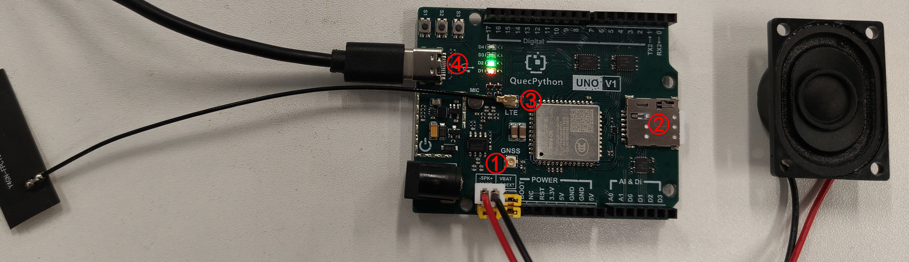

# Doubao RTC AI chatbot

This AI chatbot solution is developed based on the Doubao Volcano RTC engine and has the following characteristics:

- Support intelligent agent switching
- Support tone switching
- Support ASR subtitles
- Support TTS subtitles
- Support voice interruption/interruption
- Support server address switching
- Support voice wake-up
- Using Python language for easy secondary development

 

---

- [Development_resources](./dev_resources.md)
- [Quick start](./quick_start.md)
- [Software design](./software_design.md)

