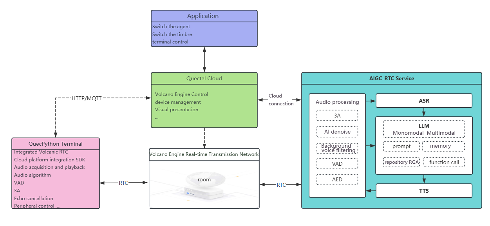
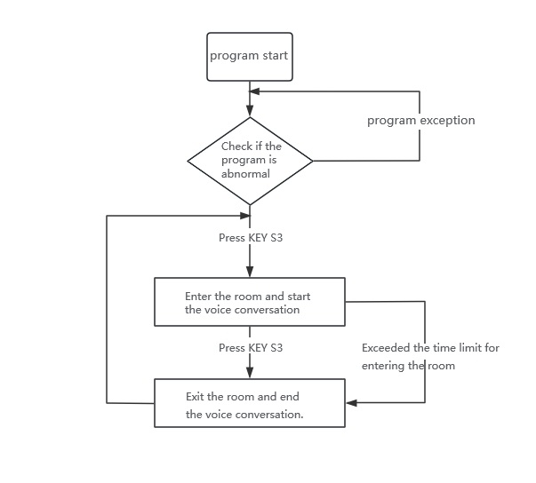

# Software design

## Software framework

### Framework design diagram

 

### Business system startup process

 

## Code Explanation

### AI event management

Handling AI events

```python
def ai_callback(args):
    global GPIO39 # audio PA GPIO
    event = args[0]
    msg = args[1]
    if event == 1:
        print('TIKTOK_RTC_EVENT_START') # enter room
        GPIO39.write(1)
    elif event == 2:
        print('TIKTOK_RTC_EVENT_STOP') # exit room
        GPIO39.write(0)
    elif event == 3:
        print('TIKTOK_RTC_EVENT_TTS_TEXT {}'.format(msg)) # TTS
    elif event == 4:
        print('TIKTOK_RTC_EVENT_ASR_TEXT {}'.format(msg)) # ASR
    elif event == 5:
        print('TIKTOK_RTC_EVENT_ERROR {}'.format(msg)) # Error
    else:
        print('TIKTOK_RTC_EVENT UNKNOWN {}'.format(event)) # Unknow

```

### AI Init

Initialize AI objects, register callback interfaces, and configure AI conversation times.

```python
tiktok = TiktokRTC(300000, ai_callback)
```

**Reference operation log**

```python

import example
>>> example.exec('/usr/ai_main.py')
volume: 11
>>> lte network normal
ai task running

```

### AI enter room

push down KEY S3 to enter room, start communicate, call `tiktok.active(True)` to active.

```python
tiktok.active(True)
```

**Reference operation log**

```python
# push KEY S3 to enter
rtc_queue key event 1
start rtc
TIKTOK_RTC_EVENT_START
TIKTOK_RTC_EVENT_TTS_TEXT 你
TIKTOK_RTC_EVENT_TTS_TEXT 你好
TIKTOK_RTC_EVENT_TTS_TEXT 你好有
TIKTOK_RTC_EVENT_TTS_TEXT 你好有什
TIKTOK_RTC_EVENT_TTS_TEXT 你好有什么
TIKTOK_RTC_EVENT_TTS_TEXT 你好有什么可
TIKTOK_RTC_EVENT_TTS_TEXT 你好有什么可以
TIKTOK_RTC_EVENT_TTS_TEXT 你好有什么可以帮
TIKTOK_RTC_EVENT_TTS_TEXT 你好有什么可以帮到
TIKTOK_RTC_EVENT_TTS_TEXT 你好有什么可以帮到你
TIKTOK_RTC_EVENT_TTS_TEXT 你好有什么可以帮到你的
TIKTOK_RTC_EVENT_TTS_TEXT 你好有什么可以帮到你的吗

```

### AI exit room

push down KEY S2 to exit room, stop communicate, call `tiktok.active(False) to deactive。

```python
tiktok.active(False)
```

**Reference operation log**

```python
# push KEY S2 to exit
rtc_queue key event 2
stop rtc
TIKTOK_RTC_EVENT_STOP
```

