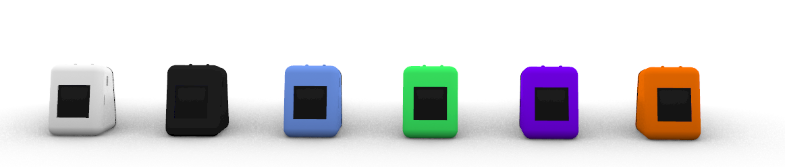

# AIbox chatbot

The AIbox chatbot solution has the following features:

- Supports tone color switching.
- Supports voice interruption/interruption.

- Support emotional visualization
- Supports voice wake-up.
- Using the Python language is convenient for secondary development.

 

---

- [Development resources](./dev_resources.md)
- [Quick start](./quick_start.md)
- [Software design](./software_design.md)
