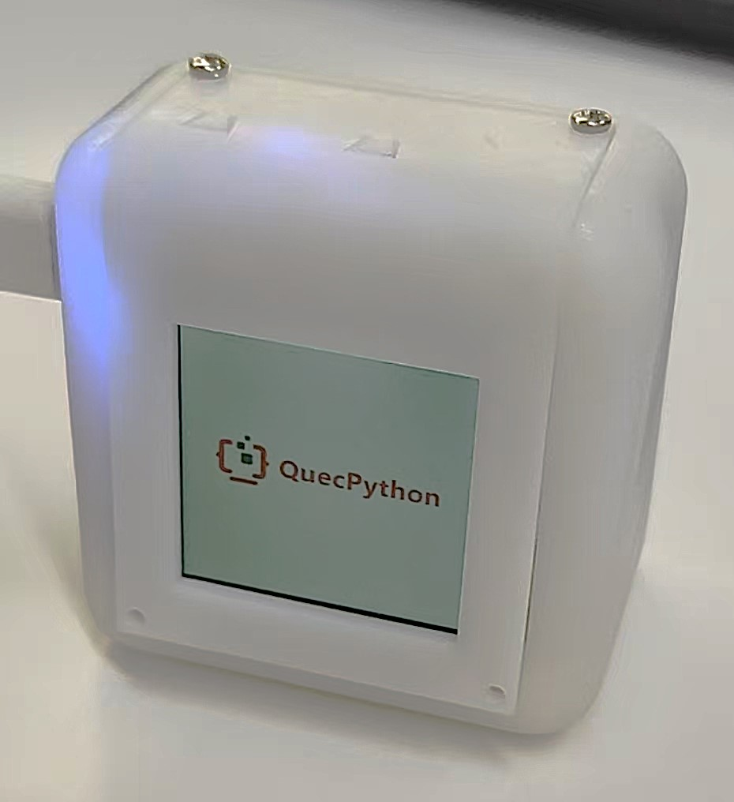
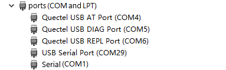
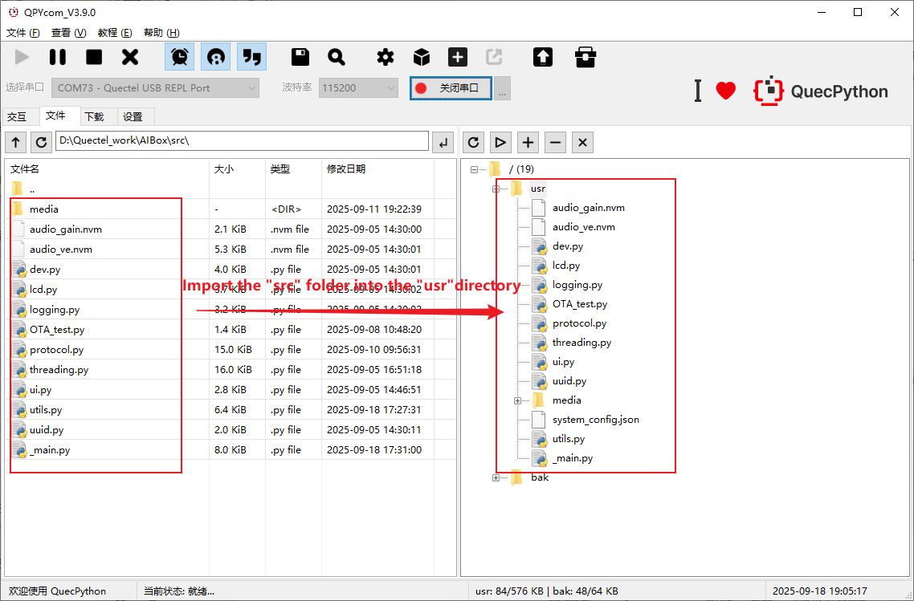
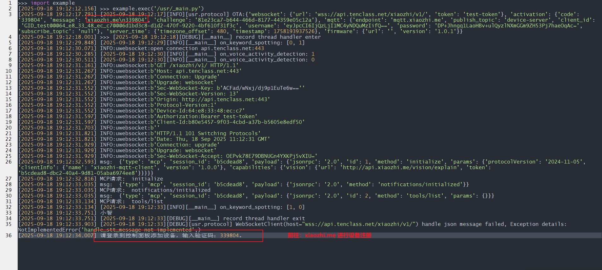
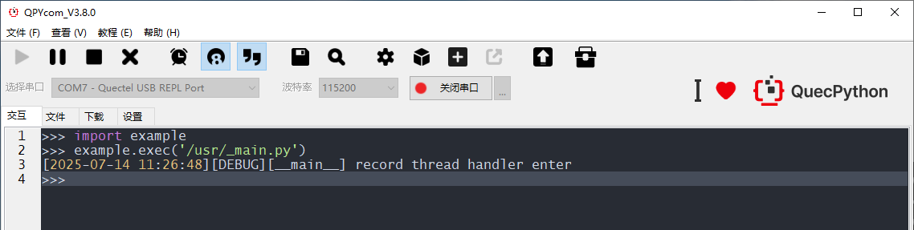
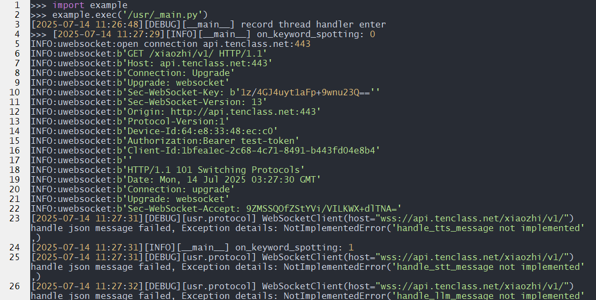
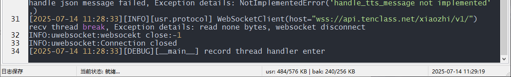

# Quick start

## Hardware preparation

- A Windows computer, recommended for the Win10 system.
- a set EC800MCNLE EVB(Including antenna, Type-C data cable, etc).

- A Nano SIM card.
- A speaker with a power of 2-5W.
  - [Click to purchase the AIbox finished product](https://www.quecmall.com/goods-detail/2c90800b987f06090199512609ae0299)

## Environment construction

- Download and install EC800M series module driver: [QuecPython_USB_Driver_Win10_ASR](https://developer.quectel.com/en/wp-content/uploads/sites/2/2024/11/Quectel_Windows_USB_DriverA_Customer_V1.1.13.zip).
- Download and install [VSCode](https://gitee.com/link?target=https%3A%2F%2Fcode.visualstudio.com%2F).
- Download and unzip [QPYCom](https://developer.quectel.com/en/wp-content/uploads/sites/2/2024/11/QPYcom_V4.1.0.zip)。
- [Download Firmware](../../media/solutions/AIbox/EC800MCNLE8.10.zip)
- Download [Source code](https://codeload.github.com/QuecPython/AIBox/zip/refs/heads/main)。

##  Hardware connection

Connect the hardware according to the following diagram:

 

1. Connect the development board to the computer using a Type-C data cable.

## Equipment development

### Power on

After completing the hardware connection work, if a COM port containing the words "Quectel USB" appears in the port list of the computer device manager, it indicates that the computer has successfully booted up.

 

###  Burn firmware package

Refer to [this chapter](https://developer.quectel.com/doc/quecpython/Getting_started/en/4G/flash_firmware.html#Flash-Firmware) Burn the corresponding firmware package to the development board.

### Script import and execution

1. Refer to [this chapter](https://developer.quectel.com/doc/quecpython/Getting_started/en/4G/first_python.html#Transferring-the-Script-File-to-the-Module) Import all files from the 'src' folder in the source code directory into the module file system, as shown in the following figure:

1. Refer to [this chapter](https://developer.quectel.com/doc/quecpython/Getting_started/en/4G/first_python.html#Executing-the-Script-File) Execute the main program file `ai_main.py`.
2. Refer to [this chapter](https://developer.quectel.com/doc/quecpython/Getting_started/en/4G/first_python.html#Stop-a-Running-Program) Stop the program from running.

## Debugging

### Program startup

After executing the `_main. py` script, the program starts running.

### Equipment Registration Scheme

If Xiaozhi is not registered, normal interaction cannot be carried out. When the program starts, OTA will return the verification code used for the registered device, and then go to [Xiaozhi AI Chatbot console](https://xiaozhi.me/) to register the device. After the registration is completed, run the script again to interact smoothly

### Activate Xiaozhi AI

As shown in the following picture, it is in a state ready to be awakened. A red light will flash on the development board, and you need to use the voice `Xiaozhi, Xiaozhi` to wake up Xiaozhi AI for a voice conversation.

After waking up, data related to connecting to the server or a prompt indicating connection failure will appear. When a connection failure occurs, please check if the network is normal.

When the system has not engaged in a conversation for a long time or has not received any commands, it will automatically enter a sleep state and wait for the next wake-up.

