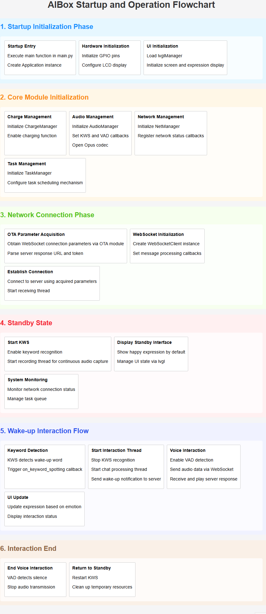
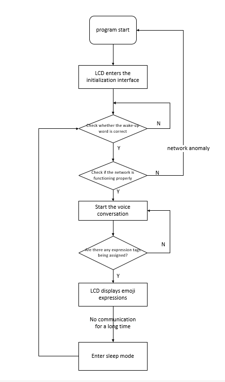

# Software design

## Software framework

### Framework design diagram

 

### Business system startup process



## Code explanation

### AI wake-up & Human voice detection

```python
class Application(object):
    def on_keyword_spotting(self, state):
        logger.info("on_keyword_spotting: {}".format(state))
        if state == 0:
            # Trigger the wake-up word
            if self.__working_thread is not None and self.__working_thread.is_running():
                return
            self.__working_thread = Thread(target=self.__working_thread_handler)
            self.__working_thread.start()
            self.__keyword_spotting_event.clear()
        else:
            self.__keyword_spotting_event.set()

    def on_voice_activity_detection(self, state):
        gc.collect()
        logger.info("on_voice_activity_detection: {}".format(state))
        if state == 1:
            self.__voice_activity_event.set()  # It is claimed that
        else:
            self.__voice_activity_event.clear()  # No One Can Hear You
```

### AI initialization

Initialize AI objects and other hardware drivers.

```python
class Application(object):

    def __init__(self):

        Pin(Pin.GPIO33, Pin.OUT, Pin.PULL_PD, 1)
        # Initialize the screen
        self.lvgl=lvglManager()
        # 初始化充电管理
        self.charge_manager = ChargeManager()

        # Initialize audio management
        self.audio_manager = AudioManager()
        self.audio_manager.set_kws_cb(self.on_keyword_spotting)
        self.audio_manager.set_vad_cb(self.on_voice_activity_detection)

        # Initialize network management
        self.net_manager = NetManager()

        # Initialize the task scheduler
        self.task_manager = TaskManager()

        # Initialize Protocol
        self.__protocol = WebSocketClient()
        self.__protocol.set_callback(
            audio_message_handler=self.on_audio_message,
            json_message_handler=self.on_json_message
        )

        self.__working_thread = None
        self.__record_thread = None
        self.__record_thread_stop_event = Event()
        self.__voice_activity_event = Event()
        self.__keyword_spotting_event = Event()
```

### AI dialogue interruption logic

```python
class Application(object):
    def __chat_process(self):
        self.start_vad()
        try:
            with self.__protocol:
                self.__protocol.hello()
                self.__protocol.wakeword_detected("小智")
                is_listen_flag = False
                while True:
                    data = self.audio_manager.opus_read()
                    if self.__voice_activity_event.is_set():
                        # It is claimed that
                        if not is_listen_flag:
                            self.__protocol.listen("start")
                            is_listen_flag = True
                        self.__protocol.send(data)
                        # logger.debug("send opus data to server")
                    else:
                        if is_listen_flag:
                            self.__protocol.listen("stop")
                            is_listen_flag = False
                    if not self.__protocol.is_state_ok():
                        break
                    # logger.debug("read opus data length: {}".format(len(data)))
        except Exception as e:
            logger.debug("working thread handler got Exception: {}".format(repr(e)))
        finally:
            self.stop_vad()

```

### music organizer

Uniformly manage the audio input and output, encoding and decoding, and voice recognition related functions of the equipment (keyword recognition KWS and voice activity detection VAD), and provide callback interfaces for upper-layer applications to use.

```python
class AudioManager(object):

    def __init__(self, channel=0, volume=11, pa_number=29):
        self.aud = audio.Audio(channel)  # 初始化音频播放通道
        self.aud.set_pa(pa_number)
        self.aud.setVolume(volume)  # 设置音量
        self.aud.setCallback(self.audio_cb)
        self.rec = audio.Record(channel)
        self.__skip = 0

    # ========== 音频文件 ====================

    def audio_cb(self, event):
        if event == 0:
            # logger.info('audio play start.')
            pass
        elif event == 7:
            # logger.info('audio play finish.')
            pass
        else:
            pass

    def play(self, file):
        self.aud.play(0, 1, file)

    # ========= opus ====================

    def open_opus(self):
        self.pcm = audio.Audio.PCM(0, 1, 16000, 2, 1, 15)  # 5 -> 25
        self.opus = Opus(self.pcm, 0, 6000)  # 6000 ~ 128000
    
    def close_opus(self):
        self.opus.close()
        self.pcm.close()
        del self.opus
        del self.pcm
    
    def opus_read(self):
        return self.opus.read(60)

    def opus_write(self, data):
        return self.opus.write(data)

    # ========= vad & kws ====================

    def set_kws_cb(self, cb):
        self.rec.ovkws_set_callback(cb)
            
    def set_vad_cb(self, cb):
        def wrapper(state):
            if self.__skip != 2:
                self.__skip += 1
                return
            return cb(state)
        self.rec.vad_set_callback(wrapper)

    def end_cb(self, para):
        if(para[0] == "stream"):
            if(para[2] == 1):
                pass
            elif (para[2] == 3):
                pass
            else:
                pass
        else:
            pass
    
    def start_kws(self):
        self.rec.ovkws_start("_xiao_zhi_xiao_zhi", 0.7)

    def stop_kws(self):
        self.rec.ovkws_stop()
    
    def start_vad(self):
        self.__skip = 0
        self.rec.vad_start()
    
    def stop_vad(self):
        self.rec.vad_stop()
```


## LCD screen display

The display of the LCD's expressions is controlled through the session bus sys_bus.

```python
def update_emoji(topic,msg):
    screen_gif.set_style_opa(lv.OPA.TRANSP, 0)
    if msg == "happy":
        screen_gif.set_src("U:/media/happy_min.gif")
        #print("update_emoji: happy screen")
    elif msg == "cool":
        screen_gif.set_src("U:/media/cool_min.gif")
        #print("update_emoji: cool screen")
    elif msg == "thinking":
        screen_gif.set_src("U:/media/think_min.gif")
        #print("update_emoji: think screen")
    elif msg == "angry":
        screen_gif.set_src("U:/media/angry_min.gif")
        #print("update_emoji: angry screen")
    elif msg == "sleep":
        screen_gif.set_src("U:/media/sleep_min.gif")
        #print("update_emoji: happy screen")
    utime.sleep_ms(20)
    screen_gif.set_style_opa(lv.OPA.COVER, 0)
  
def update_status(topic, msg):
    screen_word.set_text(msg+"...")
    
def update_screen(topic, msg):
    try:
        lcd.lcd_clear(0x0000)
        if msg == "init_screen":
            lv.scr_load(init_screen)
            logger.info("change init_screen")
        elif msg == "main_screen":
            lv.scr_load(screen)
            logger.info("change main_screen")
    except Exception as e:
        logger.error("update_screen error: {}".format(e))
   
def update_time(arg):
    year, month, day, hour, minute, second = utime.localtime()[0:6]
    toptime.set_text("{}:{}".format(hour,minute))
    #logger.info("time update")

# subscribe topic to update emoji and status
sys_bus.subscribe("update_emoji",update_emoji)
sys_bus.subscribe("update_status",update_status)
sys_bus.subscribe("update_screen",update_screen)

class lvglManager:
    #@staticmethod
    def __init__(self):
        #lv.scr_load(init_screen)
        update_time(None)
        timer1 = Timer(Timer.Timer1)
        timer1.start(period=10000, mode=timer1.PERIODIC, callback= update_time)
        utime.sleep(3)
        #lv.scr_load(screen)
```

