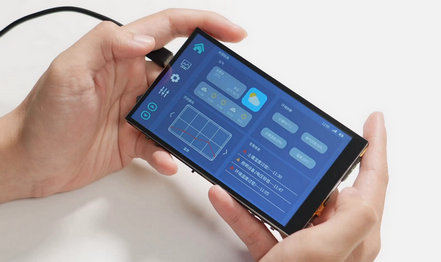

# Smart agriculture central control Panel

The smart agriculture control panel solution is based on the U-235 standard development board and has the following characteristics:

- Provide real-time display of weather forecasts, agricultural environmental data monitoring, real-time data display, historical data curves, agricultural equipment control, and other functions.
- Highly customizable, users can finely adjust various aspects of agricultural operations according to specific situations and needs
- Having rich peripheral interfaces, supporting the connection of most commonly used sensors, such as temperature and humidity sensors, gas sensors, etc
- Using Python language for easy secondary development.

    

------

- [Development resources](./dev_resources.md)
- [Quick start](./quick_start.md)
- [Software design](./software_design.md)

