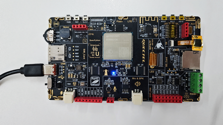
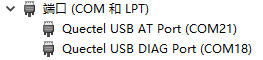
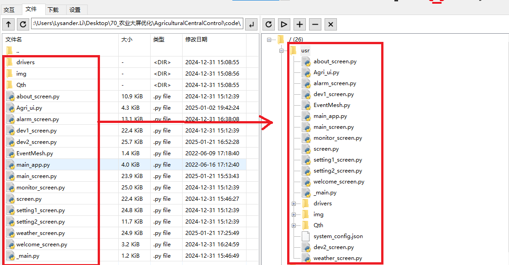
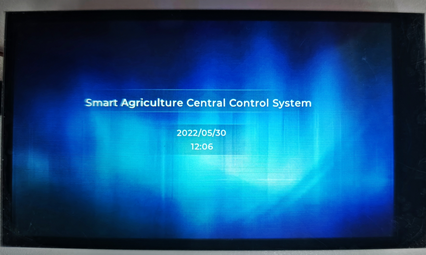
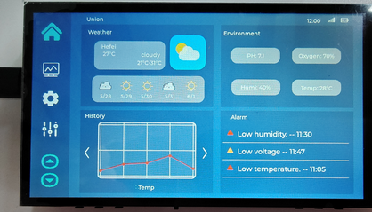
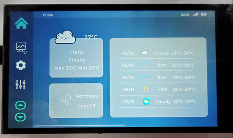
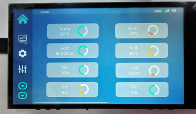
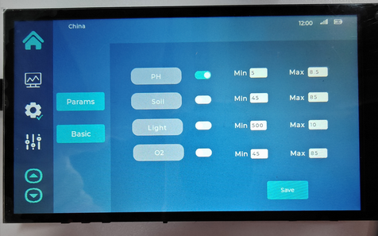
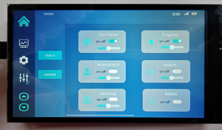
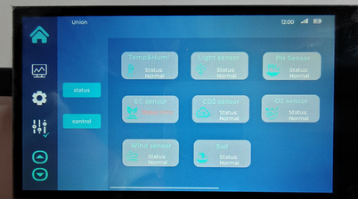

# Quick start

## Hardware preparation

- A Windows computer, recommended for the `Win10` system
- A [QuecPython U-235 development board](https://developer.quectel.com/doc/quecpython/Dev_board_guide/en/ec600u-235.html)
- A TypeC data cable

## Environment construction

- Download and install EC600U series module driver: [QuecPython_USB_DriverU_V1.0.19](https://developer.quectel.com/wp-content/uploads/2024/09/Quectel_Windows_USB_DriverU_V1.0.19.zip)
- Download and install [VSCode](https://code.visualstudio.com/)
- Download and install [QPYCom](https://developer.quectel.com/wp-content/uploads/2024/09/QPYcom_V4.1.0.zip) 
- Download [Firmware](https://github.com/QuecPython/solution-Agriculture-Control-Panel/tree/master/8915DM_cat1_open_EC600UEUAB_R03A01M8_OCPU_QPY_BETA1107)，Obtain the firmware from the experimental source code directory EC600UEUAB_R03A01M8_OCPU_QPY_BETA1107
- Download [Source Code](https://codeload.github.com/QuecPython/solution-Agriculture-Control-Panel/zip/refs/tags/v1.0.1)

## Hardware connection

Connect the hardware according to the following diagram:

	

Connect the development board and computer using a Type-C data cable.

## Equipment development

### Power on

After completing the hardware connection, long press the button labeled 'PWR' on the development board until the network light 'net' flashes or a COM port containing the words' Quectel USB 'appears in the port list of the computer device manager, indicating successful boot.

	

### Download firmware

Refer to [this chapter](https://developer.quectel.com/doc/quecpython/Application_guide/en/dev-tools/QPYcom/qpycom-dw.html), burn firmware package EC600UEUAB_R03A01M8_SCPU_QPYBETA10107 to the development board.

### Script import and execution

1. Refer to [this chapter](https://developer.quectel.com/doc/quecpython/Getting_started/en/4G/first_python.html#Transfer-Files-Between-PC-and-Module) To transfer files between modules, import all files from the `code` folder in the source code directory into the module file system, as shown in the following figure:

   ·

2. Refer to [this chapter](https://developer.quectel.com/doc/quecpython/Getting_started/en/4G/first_python.html#Run-Script) Execute the script file and execute the main program file `main.py`. (During normal startup, the module will automatically execute the `main.py` file)

3. Refer to [this chapter](https://developer.quectel.com/doc/quecpython/Getting_started/en/4G/first_python.html#Stop-a-Running-Program), stop program running.

## Screens

### Program startup

After executing `main.py`, if the program starts successfully, it will enter the `welcomescreen` interface. After waiting for 2 seconds, it will enter the `main_screen` screen.

	

### Main Screen

The main screenis the information center for agricultural management. Its design philosophy is intuitive and user-friendly, integrating multiple functions to support effective agricultural management.                                                                                                 

components:
1. **Weather information **:

  - Current weather conditions: including temperature, weather conditions (sunny, rainy, cloudy, etc.), wind speed and direction.

  - Future weather forecast: provides weather forecasts for the next few days or a week, including temperature changes, precipitation probabilities, etc.

    After clicking, you can enter the complete weather interface

2. **Historical curves of temperature and humidity **:

  * Real time updated temperature and humidity data, presented in the form of a curve graph, for easy observation of short-term and long-term trends.
  * This may include comparisons of data on a daily, weekly, monthly, or even yearly basis.

3. **Common environmental parameters **:

  - Soil moisture: Real time display of soil moisture level
  - Soil pH value: Monitor soil pH value.
  - O2 concentration: Display the current ambient oxygen concentration.
  - Temperature: Real time display of current room temperature, particularly crucial for greenhouse crop growth.

4. **Alarm Information **:

  - The system monitors and alerts in real-time for any abnormal situations, such as sudden deviation of temperature or humidity from normal range, unauthorized intrusion, equipment failure, etc.

  - Alarm history record, convenient for tracing and analyzing past events.

    

### Weather Screen

Click on `weather` on the main interface to enter the detailed weather Screen

	

Intuitively display the current temperature, highest temperature, lowest temperature, wind speed and direction of the city, as well as detailed information on the weather for the next five days

### Environmental data display screen

The device status display interface is used to monitor and display the operating status of various devices and sensors, in order to quickly identify any potential problems and take corresponding measures to ensure smooth and efficient agricultural operations. Through such a central control panel, agricultural managers can effectively monitor and maintain key equipment and sensors on the farm, improving overall productivity and reliability.

	

This interface includes the status of common environmental sensors in agriculture. Including temperature and humidity, care, soil pH value, soil EC, carbon dioxide concentration, oxygen concentration, wind speed and direction, and soil temperature and humidity.

### Threshold setting screen

The threshold setting screen allows users to customize and adjust various environmental and device operating parameters. These settings help ensure that the agricultural production environment matches the needs of crops, thereby optimizing growth conditions and improving production efficiency.

	

Users can set thresholds for various environmental parameters, such as temperature, humidity, light intensity, soil moisture, carbon dioxide concentration, etc. When these parameters reach or exceed the set thresholds, the system can automatically adjust device operation or send alerts.

Through this screen, users can finely adjust various aspects of agricultural operations according to specific situations and needs, ensuring efficient system operation and optimal crop growth conditions. This high degree of customizability is a major advantage of smart agriculture systems, allowing agricultural producers to flexibly adjust their operational strategies based on changing environments and market demands.

### Equipment control screen

The device control interface is a critical component used for managing and operating various equipment on the farm. It provides intuitive control options and real-time feedback, ensuring that users can easily and effectively manage key equipment on the farm. Through this intelligent device control, farm managers can optimize production conditions, improve efficiency, and reduce resource waste.

	

This screen includes common equipment controls in agriculture. Including ventilation equipment, irrigation equipment, humidification equipment, deworming equipment, heating equipment, and alarm equipment.

### System settings screen

The system settings screen is a key component for users to configure and personalize their agricultural management system, allowing them to adjust various system parameters to meet specific needs and preferences. Through these settings, users can ensure the efficient operation of the system while meeting their personal preferences and operating habits.

	

This screen includes the following functions:
1. About this machine

  - Provide basic information about the system, such as manufacturer, model, and operating system version.
  - Display the hardware configuration of the system, such as processor type, memory size, storage space, etc.

2. Volume setting

  - Allow users to adjust the volume of the system, including alarm sounds, notification sounds, etc.
  - Silent mode can be set, especially in environments that require reduced interference.

3. Check for updates

  - Used to check system software updates and ensure that all features are at the latest version.
  - This may include an option for automatic updates, allowing the system to automatically download and install new versions when they become available.

4. Low power mode

  - This option can reduce the energy consumption of the system, especially useful in environments with limited power sources.
  - Low power mode may limit certain functions or reduce system performance.

5. Screen rest time setting

  - Allowing users to set the time for the screen to automatically turn off when there is no operation helps save energy.
  - Users can set different time intervals as needed.

6. Mode selection

  - Users can choose different operating modes, such as daily mode, energy-saving mode, night mode, etc.
  - Each mode may adjust settings such as screen brightness, volume, energy usage, etc.

  

### Equipment status screen

The device status display screen is used to monitor and display the operating status of various devices and sensors, in order to quickly identify any potential problems and take corresponding measures to ensure smooth and efficient agricultural operations. Through such a central control panel, agricultural managers can effectively monitor and maintain key equipment and sensors on the farm, improving overall productivity and reliability.

	

This screen includes the status of common environmental sensors in agriculture. Including temperature and humidity, care, soil pH value, soil EC, carbon dioxide concentration, oxygen concentration, wind speed and direction, and soil temperature and humidity.