# Quick start

## Hardware preparation

- A Windows computer, recommended for the Win10 system.
- a set EC800MCNLE EVB(Including antenna, Type-C data cable, etc).

- A Nano SIM card.
- A speaker with a power of 2-5W.

## Environment construction

- Download and install EC800M series module driver: [QuecPython_USB_Driver_Win10_ASR](https://developer.quectel.com/wp-content/uploads/2024/09/Quectel_Windows_USB_DriverA_Customer_V1.1.13.zip).
- Download and install [VSCode](https://gitee.com/link?target=https%3A%2F%2Fcode.visualstudio.com%2F).
- Download and unzip [QPYCom](https://developer.quectel.com/wp-content/uploads/2024/09/QPYcom_V4.1.0.zip)。
- [Download Firmware](../../media/solutions/xiaozhi_AI/EC800MCNLER06A01M08_AI_WS_OCPU_QPY_BETA0927.zip)
- Download [Source code](https://github.com/QuecPython/solution-xiaozhiAI/archive/refs/heads/master.zip)。

##  Hardware connection

Connect the hardware according to the following diagram:

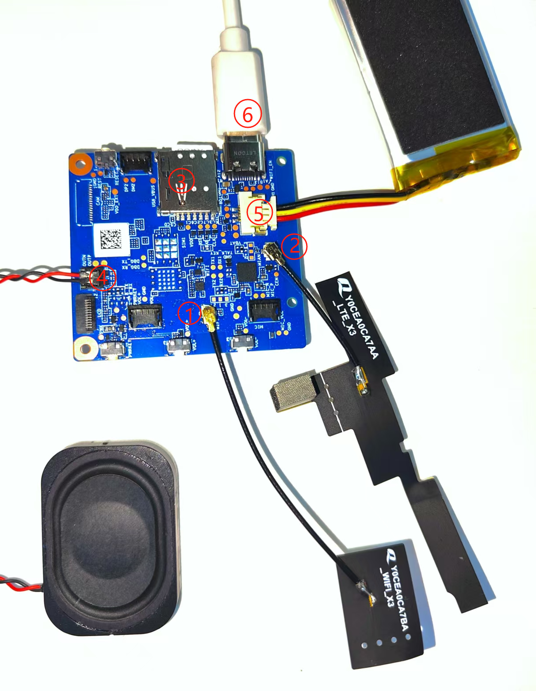 

1. Connect the `WiF` antenna to the antenna socket marked with the word `WiFi` in the picture.
2. Connect the antenna to the antenna socket marked with `LTE`.
3. Insert the available `Nano SIM` card at the position shown in the diagram.
4. Connect the speaker to the pin headers marked with `SPK+` and `SPK-` in the figure.
5. Connect the battery at the position shown in the diagram.
6. Connect the development board to the computer using a Type-C data cable.

## Equipment development

### Power on

After completing the hardware connection work, if a COM port containing the words "Quectel USB" appears in the port list of the computer device manager, it indicates that the computer has successfully booted up.

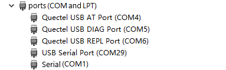 

###  Burn firmware package

Refer to [this chapter](https://developer.quectel.com/doc/quecpython/Application_guide/en/dev-tools/QPYcom/qpycom-dw.html#Download-Firmware) Burn the corresponding firmware package to the development board.

### Script import and execution

1. Refer to [this chapter](https://developer.quectel.com/doc/quecpython/Getting_started/en/4G/first_python.html) Import all files from the 'src' folder in the source code directory into the module file system, as shown in the following figure:

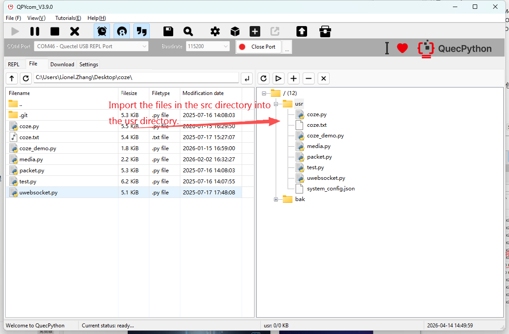

1. Refer to [this chapter](https://developer.quectel.com/doc/quecpython/Getting_started/en/4G/first_python.html#Executing-the-Script-File) Execute the main program file `_main.py`.
2. Refer to [this chapter](https://developer.quectel.com/doc/quecpython/Getting_started/en/4G/first_python.html#Stop-a-Running-Program) Stop the program from running.

## Debugging

###  Program startup

After executing the `_main. py` script, the program starts running.

### Register for Coze

If Coze is not registered, normal interaction cannot be carried out. You need to go to the [Home - Coze](https://www.coze.cn/home/) to register the device. After registration is completed, we need to copy the AI agent

### Duplicate AI Agent

a. Enter the template: 

Enter the template -> Chat Companion -> Select an agent. You can choose an agent according to your own needs.

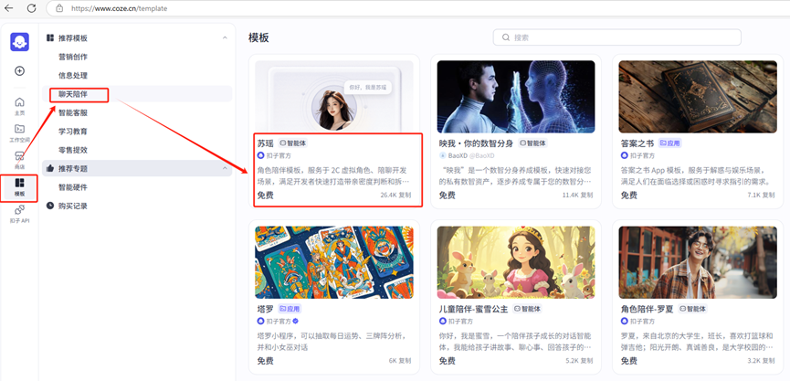

b. Copy Template

Select Copy Template

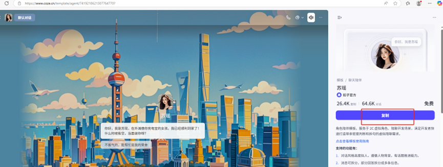

c. Release Template: 

Select voice call and release the template. 

After selecting the API, click Release.

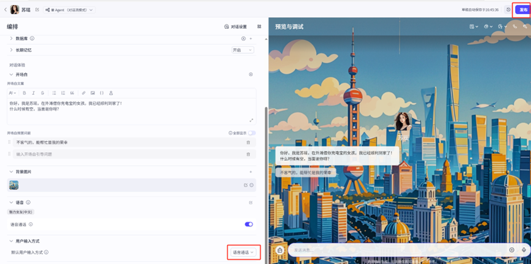

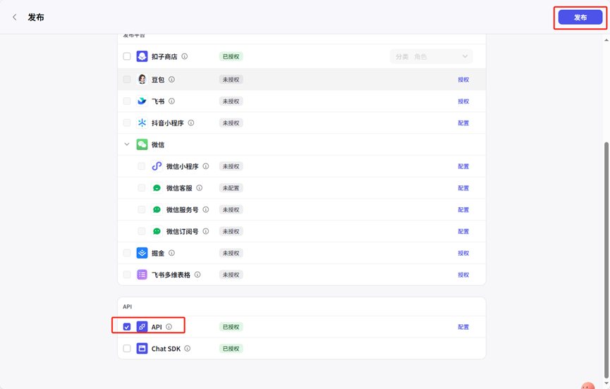

### Configure server information into the module

a. Configure a personal token. 

Create a personal token and configure it into the module demo. Refer to the following figure for the specific process.

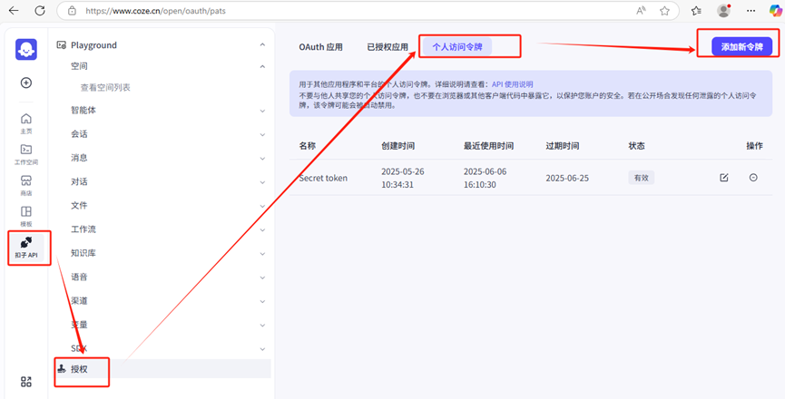

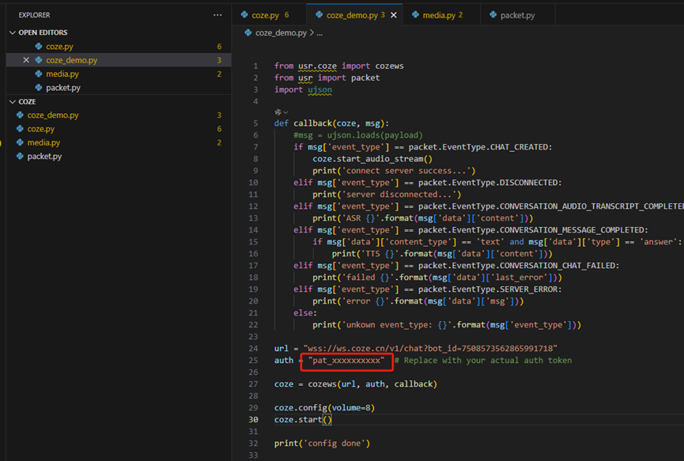

b. Configure the agent botid to enter the project development interface

click to enter the agent just copied. The accessed URL carries the botid information, configure the string after "bot" into the module demo, and refer to the following figure for specific information.

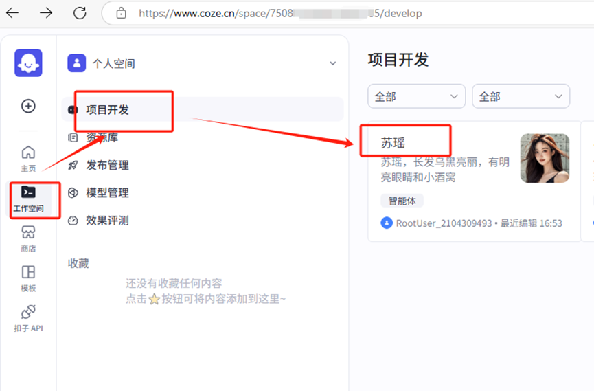

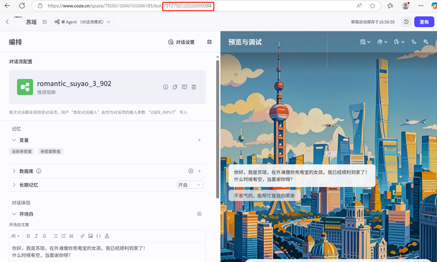

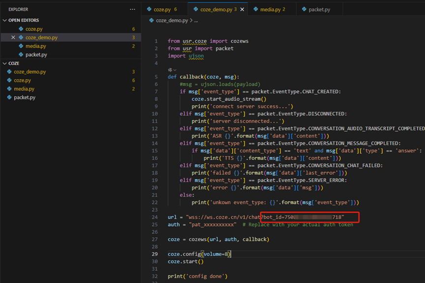

### Run the code

The operation log is as follows. After the opening remarks conclude, real-time conversation can commence.

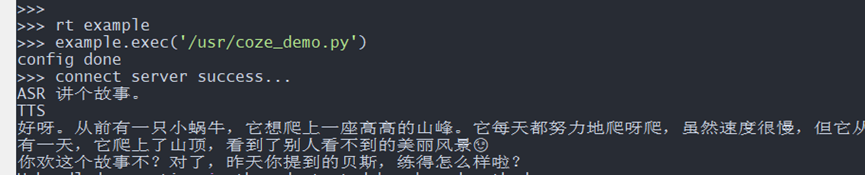
