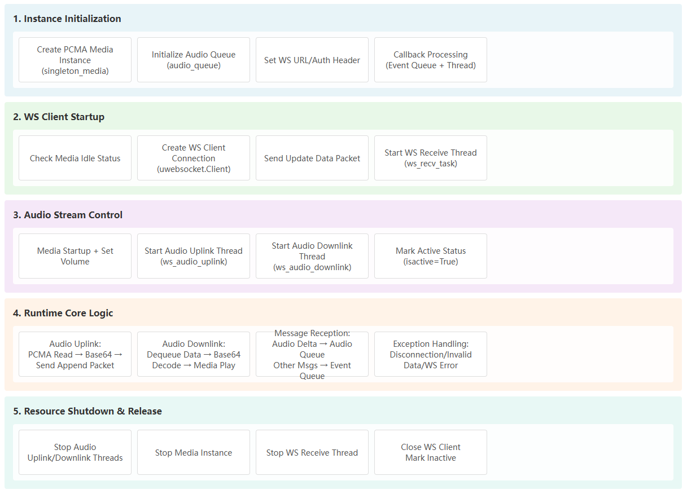

# Software design

## Software framework

### Framework design diagram

 


## Code explanation

### Class Initialization (init)

```python
def __init__(self, url, auth, callback=None):
    # Initialize PCMA media instance (singleton) and check occupancy status
    self.media = singleton_media('pcma', 4)
    if self.media is None:
        print('media is busy, please stop it first')
        return
    # Initialize audio downlink queue (stores audio data pushed by the server)
    self.audio_queue = Queue()
    
    # Configure WebSocket connection info (URL + authentication header)
    self.url = url
    self.headers = {"Authorization": "Bearer " + auth}

    # Initialize thread IDs (for subsequent thread termination), active status, and volume settings
    self.ws_recv_task_id = None
    self.ws_audio_uplink_handler_id = None
    self.ws_audio_downlink_handler_id = None
    self.isactive = False
    self.volume = 8
    self.callback = callback

    # If a callback function is passed, initialize the event queue and start the callback processing thread
    if self.callback:
        self.event_queue = Queue()
        self.ws_callback_event_id = _thread.start_new_thread(self.ws_server_event_handler, ())
```

### WS connection started (start)

Establish a WebSocket connection, send an initialization message, and start the message receiving thread.

```python
def start(self):
    # Check the idle status of the media instance to avoid resource conflicts
    if self.media.is_idle() is False:
        print('media is busy, please stop it first')
        return
    # Create a WebSocket client connection (based on uwebsocket.Client)
    self.client = uwebsocket.Client.connect(self.url, self.headers)
    # Send the update initialization data packet
    msg = ujson.dumps(packet.update)
    self.client.send(msg)

    # Start the WebSocket message receiving thread to independently process server-pushed data
    self.ws_recv_task_id = _thread.start_new_thread(self.ws_recv_task, ())
```

### Resource stop release (stop + stop_audio_stream)

Stop the audio stream thread, release media resources, close the WS connection, and complete the full lifecycle cleanup.

1. Audio Stream Termination (`stop_audio_stream`)

```python
def stop_audio_stream(self):
    # Stop the audio uplink thread and release the thread ID
    if self.ws_audio_uplink_handler_id:
        _thread.stop_thread(self.ws_audio_uplink_handler_id)
        self.ws_audio_uplink_handler_id = None
    # Stop the audio downlink thread and release the thread ID
    if self.ws_audio_downlink_handler_id:
        _thread.stop_thread(self.ws_audio_downlink_handler_id)
        self.ws_audio_downlink_handler_id = None
    # Stop the media instance and release audio hardware
    self.media.stop()
```

 2.Overall Termination (`stop`)

```python
def stop(self):
    # Stop the audio stream first
    self.stop_audio_stream()

    # Stop the WebSocket message receiving thread
    if self.ws_recv_task_id:
        _thread.stop_thread(self.ws_recv_task_id)
        self.ws_recv_task_id = None

    # Close the WebSocket connection and mark as inactive
    self.client.close()
    self.isactive = False
```

### WS Message Receiving (ws_recv_task)

Continuously monitor WS server messages, split audio data and event messages, and handle disconnection exceptions.

```python
def ws_recv_task(self):
    while True:
        try:
            # Receive WebSocket messages (max 4096 bytes)
            recv_data = self.client.recv(4096)
            if recv_data is None or len(recv_data) <= 1:
                print('illegal data {}'.format(recv_data))
                continue
            # Distribution: Audio Delta messages → audio queue; other messages → event queue (callback processing)
            if  packet.EventType.CONVERSATION_AUDIO_DELTA in recv_data:
                self.audio_queue.put(recv_data)
            else:
                if self.callback:
                    self.event_queue.put(recv_data)
        except Exception as e:
            # Disconnection exception (EIO): stop audio stream, close connection, and trigger callback notification
            if "EIO" in str(e):
                if self.isactive:
                    self.stop_audio_stream()
                    self.client.close()
                    self.isactive = False
                msg = '{"event_type": "client.disconnected"}'
                if self.callback:
                    self.event_queue.put(msg)
                break
            else:
                # Other exceptions: print error logs
                if recv_data is not None:
                    print('recv error[{}] |{}|'.format(len(recv_data), recv_data))
                print('ws error |{}|'.format(e))
        utime.sleep_ms(1)
```

### Callback Event Processing (`ws_server_event_handler`)

Consumes non-audio messages from the event queue and invokes the externally passed callback function for processing.

```python
def ws_server_event_handler(self):
    while True:
        # Block and fetch messages from the event queue
        recv_data = self.event_queue.get()
        # Invoke the external callback function, passing the current instance and message data
        self.callback(self, recv_data)
        utime.sleep_ms(1)
```

### Audio Stream Startup (`start_audio_stream`)

Starts the audio hardware, configures volume, launches audio uplink/downlink threads, and marks the active status.

```python
def start_audio_stream(self):
    # Start the media instance and set volume
    self.media.start()
    self.media.set_volume(self.volume)

    # Start audio uplink/downlink threads
    self.ws_audio_uplink_handler_id = _thread.start_new_thread(self.ws_audio_uplink_handler, ())
    self.ws_audio_downlink_handler_id = _thread.start_new_thread(self.ws_audio_downlink_handler, ())
    # Mark the module as active
    self.isactive = True
```

