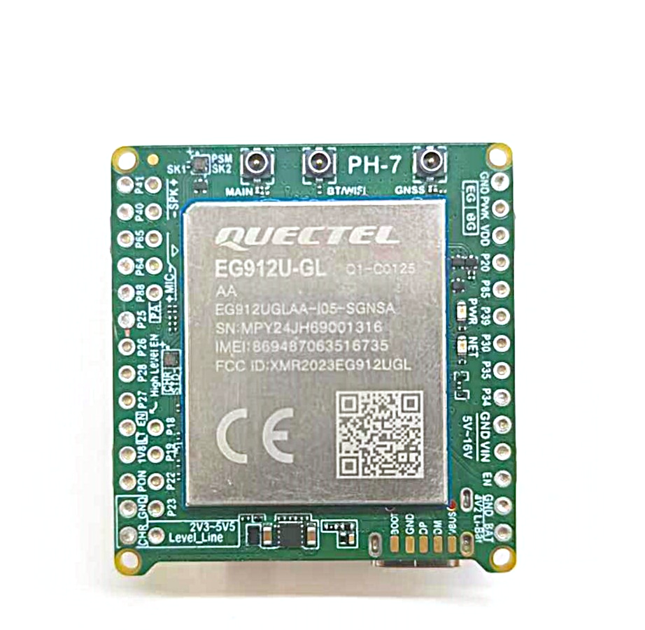

#  DTU based on EG912U

Based on EG912U core version DTU, it supports 4G and can achieve data exchange between serial port and 4G (CAT1). Compared with traditional 2G/3G networks, it has wider coverage, faster speed, and lower latency. Easy and fast development, supports transparent transmission, and supports Python secondary development. Small in size and easy to install, this product can be applied to various industries and complex scenarios to meet the needs of communication and data transmission, such as power grid, transportation, fire protection, industrial production, meteorological environment, agriculture, mining, and so on.

**Feature List**：

- Mqtt transparent transmission is supported
- Supports TCP/UDP transparent transmission
- Support 4G full Netcom
- Support Python language secondary development

**Product icon**：

------

- [Development resources](./dev_resources.md)
- [Quick start](./quick_start.md)
- [Software design](./software_design.md)

