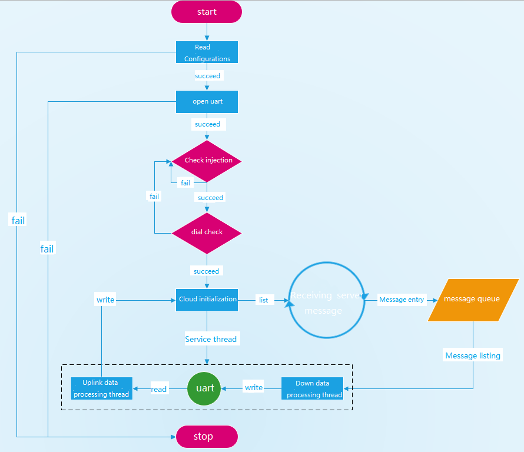
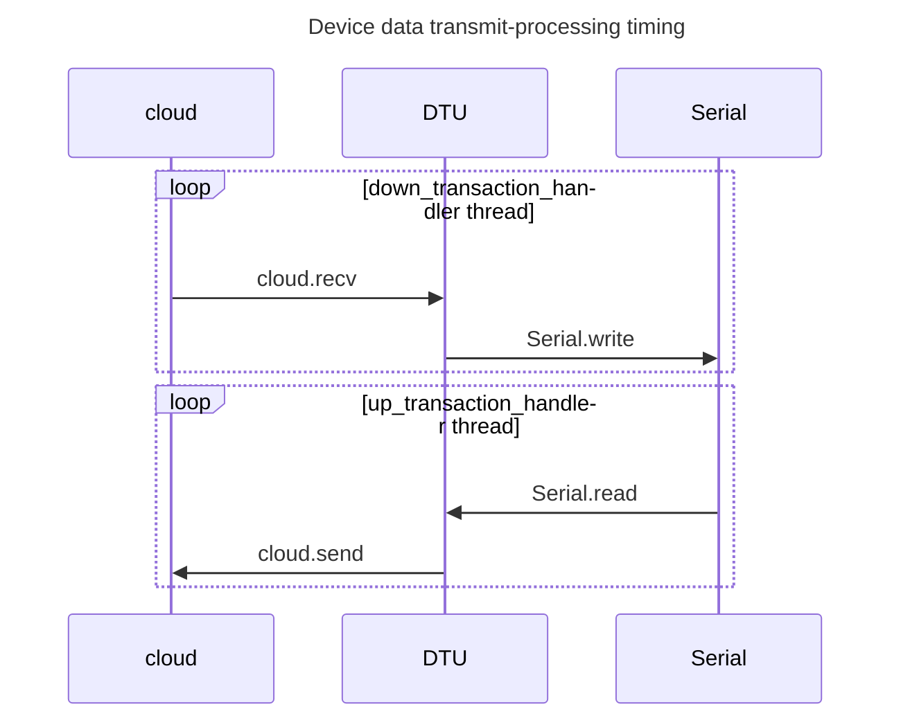

# Software design

## Application flow chart

Generally, when one wants to understand a program code, one usually starts from the initial part. Here, we also adopt this approach and first look for the starting point of the program. In this routine, the general program startup sequence is as shown in the following figure:



The overall business can be summarized as the following process：

1. After the DTU object is initialized, the system configuration is read
2. Example Initialize serial port peripherals
3. Checking network status
4. Initialize the cloud configuration and message queue
5. Start the data uplink, downlink and downlink service threads

> 💡 Basic principle: This DTU uses **multithreading + message queue** to realize upstream and downstream forwarding of serial port and cloud data. The Uplink data thread reads data from the serial port and sends it to the cloud. The Downlink data thread reads cloud data in the message queue and forwards it through the serial port. Message queues are used to cache downlink data from the cloud.

## Directory structure

```markdown
- usr
    _main.py:              Main script 
    dtu_config.json:       Configuration file 
    dtu.py :               DTU model object 
    logging.py:            Log module 
    cloud_abc.py:          Cloud Object Model Abstract base class 
    mqttIot.py:            Mqtt Cloud Object Model implementation 
    network.py:            Network  
    serial.py:             Serial port model object implementation 
    socketIot.py:          socket Cloud object model implementation 
    nThreading.py:         Threads and queues and mutex locks
    utils.py:              Utility class
```

## API description

### object model

In this scheme, multiple object models are defined, among which the main ones are `DTU` object model, cloud object model and serial port object model (`Serial`). The basic definitions are as follows:

#### DTU object model

The DTU class is defined in the `dtu.py`module, which is mainly used to initialize serial port, cloud, and upstream and downstream data services.

Implement the cloud communication function of MQTT protocol, providing connection, subscription, publication and monitoring functions. Mqtt cloud object init as below：

```python
self.cloud = MqttIot(
    mqtt_config['client_id'],
    mqtt_config['server'],
    port=mqtt_config['port'],
    user=mqtt_config['user'],
    password=mqtt_config['password'],
    keepalive=mqtt_config['keepalive'],
    clean_session=mqtt_config['clean_session'],
    qos=mqtt_config['qos'],
    subscribe_topic=mqtt_config['subscribe'],
    publish_topic=mqtt_config['publish'],
    queue=self.queue,
    error_trans=True
)
```

Implements the cloud communication function of TCP/UDP protocol, providing connection, sending, receiving and listening functions. Socket object  init  as below：

```python
self.cloud = SocketIot(
    ip_type=socket_config['ip_type'],
    keep_alive=socket_config['keep_alive'],
    domain=socket_config['domain'],
    port=socket_config['port'],
    queue=self.queue,
    error_trans=True
)
```

`up_transaction_handler` method: This is the entry function for the uplink data transmission business thread.

`down_transaction_handler` method: It is the entry function for the downlink data transmission business thread.

```python
def down_transaction_handler(self):
    while True:
        topic, data = self.cloud.recv()
        logger.info('down transfer msg: {}'.format(data))
        self.serial.write(data)
            
def up_transaction_handler(self):
    while True:
        data = self.serial.read(1024, timeout=100)
        if data:
            logger.info('up transfer msg: {}'.format(data))
            self.cloud.send(data)
```

`run` method: Initiates business operations, including creating serial ports and cloud objects based on configuration files, as well as creating business data processing threads for the upper and lower industries.

#### Serial object model

- In the `serial.py` module, the serial port model class `Serial` is defined. This class is mainly used to implement the read and write operations of the serial port. The main interfaces include:`Serial`
  - `__init__`: Serial port initialization.
  - `open`：Open the serial port.
  - `close`：Shut down the serial port.
  - `write`：Serial port write.
  - `read`：Serial port read.

Example of serial port:：

```python
from usr.serial import Serial

# init Serial object
s = Serial(port=2, baudrate=115200, bytesize=8, parity=0, stopbits=1, flowctl=0, rs485_config=None)
# open serial
s.open()

# serial write method
s.write(b"hello world!")

# serial read method
recv_data = s.read()
print(recv_data)
```


## Business code explanation

The data transmission service is mainly implemented in the DTU class (`dtu.py`), which is mainly used for managing serial ports, cloud services, and the uplink and downlink business of data. 

In the main script, the DTU object initiates the entire DTU business by calling the `run` method. This method is mainly used to create and run two threads, namely the uplink data processing thread (whose thread work function is `up_transaction_handler`) and the downlink data processing thread (whose thread work function is `down_transaction_handler`). In the thread functions, the corresponding serial port object and cloud object are obtained through two property attributes respectively. The serial port object attribute is `serial`, and when the thread calls this attribute, it immediately creates and opens the configured serial port object to provide read and write interfaces. The cloud object attribute is `cloud`, and when the thread calls this attribute, it immediately creates and connects to the cloud object to provide receiving and sending interfaces.

Function call timing diagram



The upstream data processing thread function 'DTU.up_transaction_handler' is implemented as follows:

```python
class DTU(object):
    
    # ...
    
    def up_transaction_handler(self):
        while True:
            data = self.serial.read(1024, timeout=100)
            if data:
                logger.info('up transfer msg: {}'.format(data))
                self.cloud.send(data)

    # ...
```

The `up_transaction_handler` function reads serial port data in 1KB buffer chunks (the buffer size can be adjusted by the user), formats the messages and sends the data to the cloud through the `cloud.send` interface.

The downlink data processing thread function 'down_transaction_handler' implements the following:

```python
class DTU(object):
    
    # ...
    
    def down_transaction_handler(self):
        while True:
            topic, data = self.cloud.recv()
            logger.info('down transfer msg: {}'.format(data))
            self.serial.write(data)
                
    # ...
```

The down_transaction_handler function gets the downlink message by calling `cloud.recv`and forwards the message through `Serial.write`.