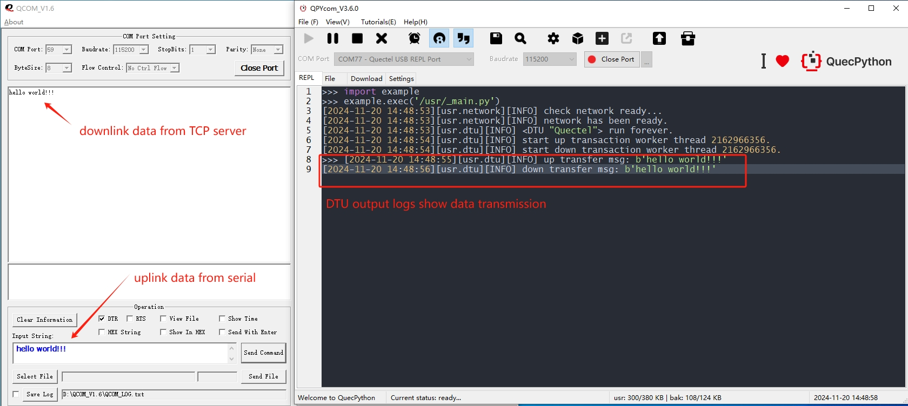

# Device development based on TCP protocol

## Modifying a configuration file

Path of the project configuration file：`code/dtu_config.json`。 

Perform the following configuration based on transparent transmission of TCP private server data：

open TCP Server website ：http://tt.ai-thinker.com:8000/ttcloud

- By default, the configuration item `system_config.cloud` is defined as `"tcp"` which means TCP transparent mode. The system will automatically read the configuration item `socket_private_cloud_config`.

  ```python
  {
      "system_config": {
          "cloud": "tcp"  # The tcp transparent mode is configured by default
      }
  }
  ```

- This experiment adopts the TCP transparent transmission mode. Users are required to set the TCP server domain name (*domain*) and port number (*port*) in the `socket_private_cloud_config` configuration item according to the actual situation.

  ```python
  {
      "socket_private_cloud_config": {
          "domain": "36.137.226.30",  # ip
          "port": 42298,  # port number
          "timeout": 5,  # time-out period (unit: s)
          "keep_alive": 1  # heartbeat cycle (unit: s)
      }
  }
  ```

- `uart_config` parameter is a configuration item for the UART interface. By default, it is set according to the current experimental development board and cannot be changed. If the user adopts another development board, it is necessary to configure it based on the actual hardware.

```python
{
    "uart_config": {
        "port": 2,  # Serial port number. Set this parameter based on the actual hardware configuration
        "baudrate": 115200,  # Baud rate
        "bytesize": 8,  # data bits
        "parity": 0,  # parity check
        "stopbits": 1,  # stop bit
        "flowctl": 0,  # fluid control
    }
}
```

The complete profile template is as follows：

```json
{
    "system_config": {
        "cloud": "tcp"
    },
    "mqtt_private_cloud_config": {
        "server": "mq.tongxinmao.com",
        "port": 18830,
        "client_id": "txm_1682300809",
        "user": "",
        "password": "",
        "clean_session": true,
        "qos": 0,
        "keepalive": 60,
        "subscribe": {"down": "/public/TEST/down"},
        "publish": {"up":  "/public/TEST/up"}
    },
   "socket_private_cloud_config": { 
        "ip_type":"IPv4",
        "domain": "36.137.226.30",
        "port": "42298",
        "keep_alive": 1
    },
    "uart_config": {
        "port": 2,
        "baudrate": 115200,
        "bytesize": 8,
        "parity": 0,
        "stopbits": 1,
        "flowctl": 0,
    }
}
```

Parameter description:

- `system_config.config`: Specifies the type of private cloud currently in use. tcp and mqtt are currently supported.
- `mqtt_private_cloud_config`: MQTT private cloud configuration.
- `socket_private_cloud_config`: tcp private cloud configuration.
- `uart_config`：Set serial port parameters.

## script is imported and run

After downloading and installing the **QPYCom** tool, use it to download the script to the QuecPython module.

> 💡 **Tips**
>
> QPYCom Installation and use tutorials：https://developer.quectel.com/doc/quecpython/Application_guide/en/dev-tools/QPYcom/index.html

## Service debugging

After the program is run, you can see the log output in the REPL interaction page as shown in the following figure.

In the illustration on the left, we use the QCOM simulation MCU to open the module serial port (i.e., the COM port corresponding to the USB-to-TTL module) for transparent transmission.

The illustration on the right shows the module log output by the REPL interactive interface.

Use the QCOM serial port tool to simulate the uplink serial port data of the MCU, and then transmit it through the DTU to the TCP echo server. Subsequently, the echo server will echo the same data and downlink it through the DTU to the QCOM.



In this case, TCP echo server is adopted. Therefore, the QCOM uplink data will be transmitted through DTU and then sent to the TCP server. After the TCP server receives it, it will immediately be sent down along the original path.

