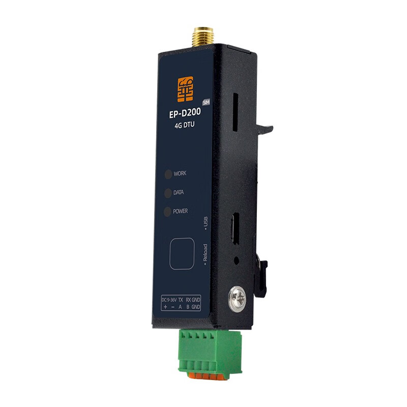

# EP-D200 Hua series DTU

The Hua series DTU products are equipped with the Mobile EC800G-CN module, which supports 4G Cat1 full network communication and can achieve data exchange between serial ports and 4G (CAT1). Compared with traditional 2G/3G networks, it has wider coverage, faster speed, and lower latency. Using wide voltage (9-36V) power supply. Rich interfaces are available, with RS232, RS485, and TTL interfaces to choose from. Easy and fast development, supports transparent transmission, and supports Python secondary development. Safe and reliable, supporting software and hardware watchdog protection. Compact and easy to install (22.6 * 74.6 mm). This product solution supports 4G full network connection, uses wide voltage (9-36V) power supply, and provides three interfaces: RS232, RS485, and TTL. It can be applied to various industries and complex scenarios to meet the needs of communication and data transmission, such as power grid, transportation, fire protection, industrial production, meteorological environment, agriculture, mining, etc.

**Function List **:

- Support Mqtt transparent transmission
- Support TCP/UDP transparent transmission
- Supports RS485 to 4G conversion
- Support 4G full network connectivity
- Support secondary development of Python language
- Support 9-36V wide power supply
- POWER/DATA/WORK indicator lights

**Product Diagram**

------

- [Development resources](./dev_resources.md)

- [Quick start](./quick_start.md)

- [Software design](./software_design.md)

