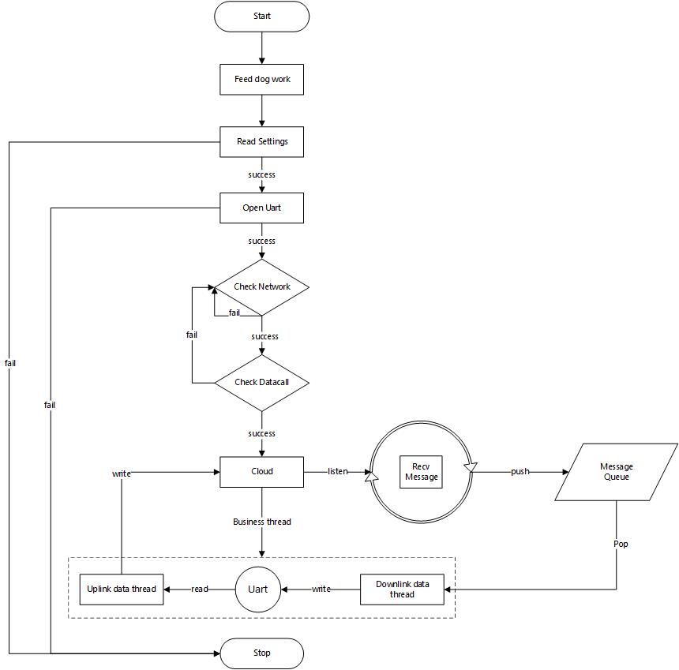
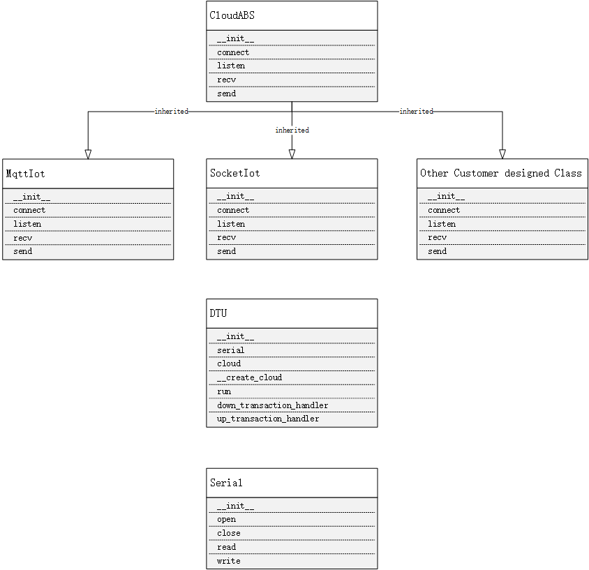
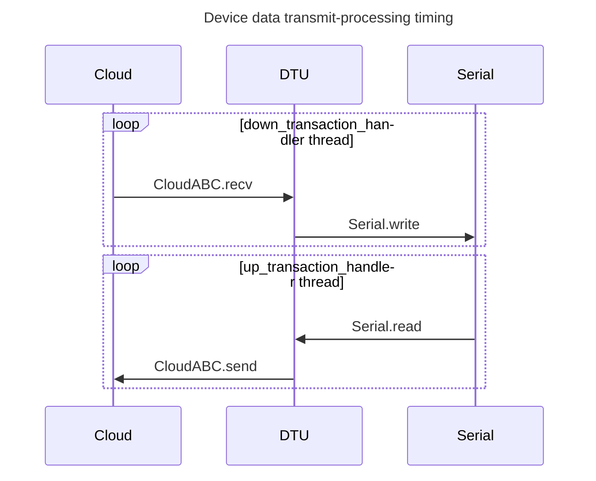

# Software design explanation

## Application flowchart

Generally speaking, understanding a program code mostly starts from the startup part, and this approach is also adopted here by first searching for the source of the program's startup. The general program startup sequence for this routine is shown in the following figure:



Overall, the business can be summarized as follows:
1. Start the dog feeding thread (the Huawei series 4G DTU is equipped with a hardware dog)
2. After initializing the DTU object, read the system configuration
3. Initialize serial peripherals
4. Check the network status
5. Initialize cloud configuration and message queue
6. Start data up and down business threads

> 💡 Basic principle: This DTU adopts **multi-threading + message queue** to achieve upstream and downstream forwarding of serial port and cloud data. Among them, the Uplink data thread is used to read serial data and send it to the cloud; The downlink data thread reads cloud data from the message queue and forwards it through the serial port; The message queue is used to cache downstream data in the cloud.

## directory structure

- `usr`: 
  - `_main.py`：main script
  - `dtu_config.json`：configure file
  - `dtu.py`：DTU module
  - `logging.py`：logging module
  - `cloud_abc.py`：cloud asb module
  - `mqttIot.py`：Mqtt cloud module
  - `network.py`：net
  - `serial.py`：serial module
  - `socketIot.py`：Socket module
  - `threading.py`：thread, mutex, queue, etc.
  - `utils.py`：tools

## API Reference

### Manager Class

In the main script `_main. py ` of the example program, we define a ` Manager ` class to manage various associated objects initialized.

Main methods:

- `__init__`: Management class initialization method
  - Watchdog: Due to the hardware watchdog (GPO12) configuration of the Hua series 4G DTU, the main script program needs to initialize a `self. dog_pin` object and feed the watchdog periodically using `osTimer`.
  - DTU model object:  `self.dtu`  is a DTU object that reads relevant configurations from a file using the object method `self.dtu.config.read_from.json("/var/dtuconfig.json")` The start method is the main entry of the program. Start the dog feeding timer every 3s, check the sim card and network status, and finally call `self.dtu.run()` to start the DTU routine.
- `start`: Start method
  - Activate the dog feeding timer
  - Check the status of the SIM card
  - Check the network status
  - Start the dtu routine
- `__feed`: The callback function for the dog feeding timer

The implementation is as follows:

```python
import sim
import osTimer
from machine import Pin
from usr import network
from usr.dtu import DTU


class Manager(object):

    def __init__(self, dog_gpio=Pin.GPIO12):
        self.dog_pin = Pin(dog_gpio, Pin.OUT, Pin.PULL_DISABLE, 1)
        self.dog_feed_timer = osTimer()

        self.dtu = DTU('Quectel')
        self.dtu.config.read_from_json('/usr/dtu_config.json')

    def start(self):
        # start timer to feed dog
        self.dog_feed_timer.start(3000, 1, self.__feed)
        # check sim card
        if sim.getStatus() != 1:
            raise ValueError("sim card not ready")
        # check network
        network.wait_network_ready()
        # start dtu business
        self.dtu.run()

    def __feed(self, args):
        if self.dog_pin.read():
            self.dog_pin.write(0)
        else:
            self.dog_pin.write(1)


if __name__ == "__main__":
    manager = Manager()
    manager.start()
```

### Object model

Multiple object models are defined in this scheme, including the DTU object model, CloudABS object model, and Serial object model. The basic definition is as follows:



#### DTU Object model

Define the DTU class in the `dtu.py` module, which is mainly used to manage the upstream and downstream business of serial ports, cloud, and data.

`config`  property：

There is a property `config` in the DTU object, which is a class `Configure` object used to manage application configuration. As follows:

```python
from usr.dtu import DTU

dtu = DTU('Quectel')
dtu.config.read_from_json('/usr/dtu_config.json')
```

Among them, it supports storing relevant configurations from JSON files, and the operation method is similar to the built-in dictionary type. The following methods can be used to read and write configurations (taking the example of reading the `system_comfig` configuration item).

- Import configuration from specified JSON file: ` dtu.config.read_from_json('/usr/dtu_config.json')`
- Use the `get` method to read configuration items: ` dtu.config.get("system_config")`
- Use the operator ` [] ` to read configuration items: ` dtu.config["system_config"]`
- Save and update configuration: ` dtu.config.save()`

`serial` property:

This property is used to construct serial port objects, and users generally do not need to modify it. They only need to define configuration parameters according to the actual situation.

```python
@property
def serial(self):
    """create&get serial object according configure"""
    __serial__ = getattr(self, '__serial__', None)
    if __serial__ is None:
        __serial__ = Serial(**self.config.get('uart_config'))  # init serial
        __serial__.open()  # open serial
    setattr(self, '__serial__', __serial__)
    return __serial__
```

`cloud` property:

This attribute is a property attribute used to retrieve cloud objects, and the method uses  `__create_cloud` to actually build the cloud object.

```python
@property
def cloud(self):
    """get cloud object"""
    cloud = getattr(self, '__cloud__', None)
    if cloud is None:
        cloud = self.__create_cloud()  # create cloud object
    setattr(self, '__cloud__', cloud)
    return cloud
```

`__create_cloud` method：

This method is used to actually create cloud objects. If the user customizes cloud objects, they need to add custom object initialization in this function.

```python
def __create_cloud(self):
    """create cloud object according configure"""
    # read cloud type
    cloud_type = self.config.get('system_config.cloud')
    if cloud_type == "mqtt":
        mqtt_config = self.config.get('mqtt_private_cloud_config')  # init mqtt cloud
        cloud = MqttIot(**mqtt_config)
    elif cloud_type == "tcp":
        socket_config = self.config.get('socket_private_cloud_config')  # init tcp cloud
        cloud = SocketIot(**socket_config)
    else:
        raise ValueError('\"{}\" not supported now!'.format(cloud_type))
    cloud.connect()  # connect to cloud
    cloud.listen()  # start listen message from cloud
    return cloud
```

`up_transaction handle` method is used as an entry function for upstream data transmission business threads.
`down_transaction handler ` method: used as an entry function for business threads in downlink data transmission.
`run` method: Start the business, including creating serial ports and cloud objects based on the configuration file, as well as creating upstream and downstream business data processing threads.

#### Serial object model

Define the serial model class `Serial` in the `serial. py`module, mainly for users to implement read and write operations on the serial port. The main interfaces are:
- `Serial`:
  - `__init__`: Serial port initialization.
  - `open`: Open the serial port.
  - `close`: Close the serial port.
  - `write`: Serial port writing.
  - `read`: Serial port read.

Example of serial port usage:

```python
from usr.serial import Serial

# init Serial object
s = Serial(port=2, baudrate=115200, bytesize=8, parity=0, stopbits=1, flowctl=0, rs485_config=None)
# open serial
s.open()

# serial write method
s.write(b"hello world!")

# serial read method
recv_data = s.read()
print(recv_data)
```

#### Cloud object model

**Cloud model**

In order to adapt to different cloud platforms (socket private cloud, MQTT, etc.), this solution defines abstract cloud types as follows. Users can customize Cloud objects according to abstract types to adapt to different cloud platforms.

> 💡 The implementation of Cloud model objects can refer to socketIot and MqttIot.

```python
class CloudABC(object):
    
    def __init__(self, **kwargs):
        """
        key arguments: kwargs, used for initial params for cloud (customer used).
        """
        raise NotImplementedError("this method should me implemented for customer designed Cloud Object")
    
    def connect(self):
        """connect to Coud"""
        raise NotImplementedError("customer should implement this method to connect cloud")
    
    def listen(self):
        """listen message from cloud.
        
        usually we use this method to start a thread for receiving message from the cloud and put message input a Queue, and then use `self.recv` method to get it on app side.
        """
        raise NotImplementedError("customer should implement this method to listen cloud message")
    
    def recv(self):
        """receive a message"""
        raise NotImplementedError("customer should implement this method to recv a message")
    
    def send(self, *args):
        """send message
        
        position arguments: args, customer designed method used for send message
        """
        raise NotImplementedError("customer should implement this method to send a message")
```

The above are the main methods and properties of the Cloud object model, including:

- `__init__`: Receive keyword parameters, usually used to configure cloud initialization parameters, which users can define themselves.
- `connect`: Connect to a cloud server.
- `listen`: Listen to the downlink messages in the cloud. Usually, threads are used in this method to read the downlink data in the cloud and place it in the message queue for easy access by the application side through the self. recv method.
- `recv`: Retrieve downlink messages.
- `send`: Send an upstream message and receive several location parameters that users can customize.

## Explanation of business code

The data transmission service is mainly implemented in the DTU class (dtu.py), which is mainly used to manage the upstream and downstream services of serial ports, cloud, and data.
The DTU object starts the entire DTU business in the main script by calling the `run` method, which is mainly used to create and run two threads, namely the upstream data processing thread (whose job function is `up_transactions_handler`) and the downstream data processing thread (whose job function is `down_transactions_handler`). Obtain the corresponding serial port object and cloud object through two property attributes in the thread function. The serial object property is `serial`, and when the thread calls this property, it immediately creates and opens the configured serial object to provide a read-write interface. The cloud object attribute is `cloud`, and when the thread calls this attribute, it immediately creates and connects with the cloud object to provide receiving and sending interfaces.
Function call sequence diagram:



The implementation of the upstream data processing thread function `DTU.up_transactions_handler` is as follows:

```python
class DTU(object):
    
    # ...
    
    def up_transaction_handler(self):
        while True:
            try:
                data = self.serial.read(1024)
                if data:
                    logger.info('up transfer msg: {}'.format(data))
                    if isinstance(self.cloud, SocketIot):
                        msg = [data]
                    elif isinstance(self.cloud, MqttIot):
                        msg = ['up', data]
                    else:
                        raise TypeError('unknow cloud type.')
                    self.cloud.send(*msg)
            except Exception as e:
                logger.error('up transfer error: {}'.format(e))
    
    # ...
```

The `up_transactions_handler` function reads serial data from a 1KB buffer (users can adjust the buffer size themselves), formats the message, and sends the data to the cloud through the CloudABC. send interface. After inheriting `CloudABC` and customizing cloud objects and implementing the `CloudABC.send` method, users can process and send data according to the custom message format.
The implementation of the downlink data processing thread function `down_transaction_handler` is as follows:

```python
class DTU(object):
    
    # ...
    
    def down_transaction_handler(self):
        while True:
            try:
                msg = self.cloud.recv()
                logger.info('down transfer msg: {}'.format(msg['data']))
                self.serial.write(msg['data'])
            except Exception as e:
                logger.error('down transfer error: {}'.format(e))
                
    # ...
```

`down_transaction_handler` function retrieves the downstream message by calling `CloudABC.recv` and forwards the message through `Serial.write`.