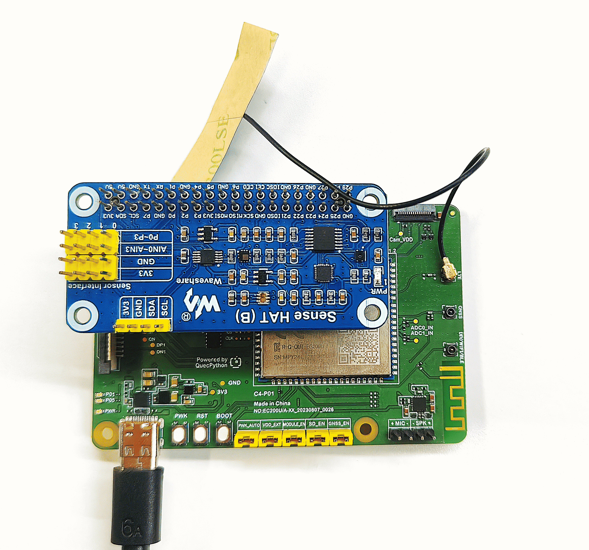

# SensorHub solution

This solution is based on the EC200U-EU QuecPython standard development board and has the following features:

- Provide accurate temperature and humidity detection function and high-precision GNSS positioning
- Support Quectel cloud and remote data viewing through the app
- Using Python language for easy secondary development

------

- [Development resource](./dev_resources.md)
- [Quick start](quick_start.md)
- [Software design](./software_design.md)
