# Quick start

## Hardware preparation

- A Windows computer, recommended for the 'Win10' system
- One set [EC200U-EU Quecpython standard EVB](https://developer.quectel.com/doc/quecpython/Dev_board_guide/en/ec200x-evb.html)
- One SIM card

## Environment construction

- Download and install driver：[QuecPython_USB_Driver_Win10_ASR](https://developer.quectel.com/wp-content/uploads/2024/09/Quectel_Windows_USB_DriverA_Customer_V1.1.13.zip)

- Download and install [VSCode](https://code.visualstudio.com/)
- Download [QPYCom](https://developer.quectel.com/wp-content/uploads/2024/09/QPYcom_V4.1.0.zip) 
- Download [Firmware](../../solutions/SensorHub/EC200UEUAAR05A01M08_TEST0222.zip  )
- Download [Source Code](https://github.com/QuecPython/solution-Sensorhub) 

## Hardware connection

Connect the hardware according to the following diagram:

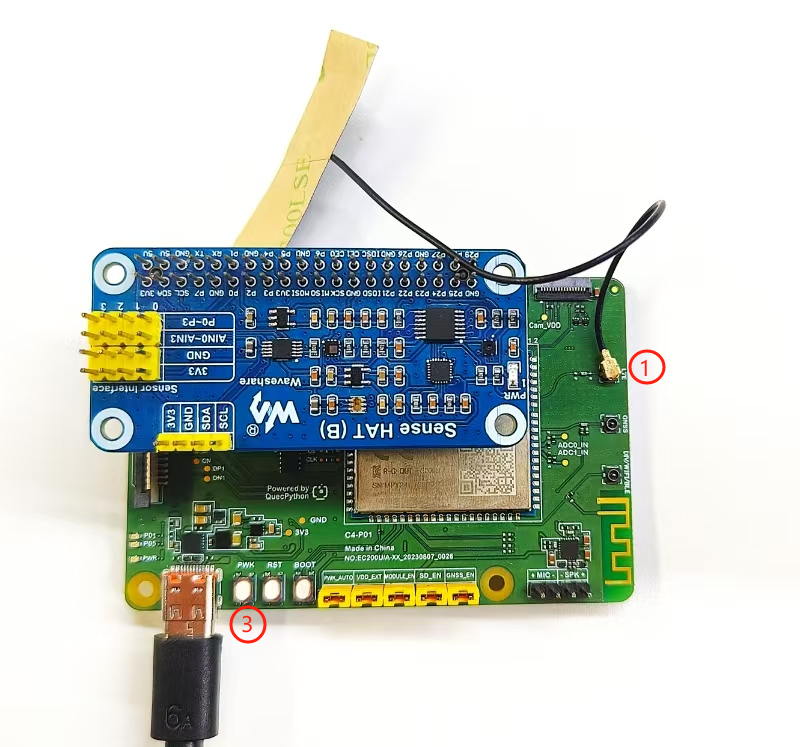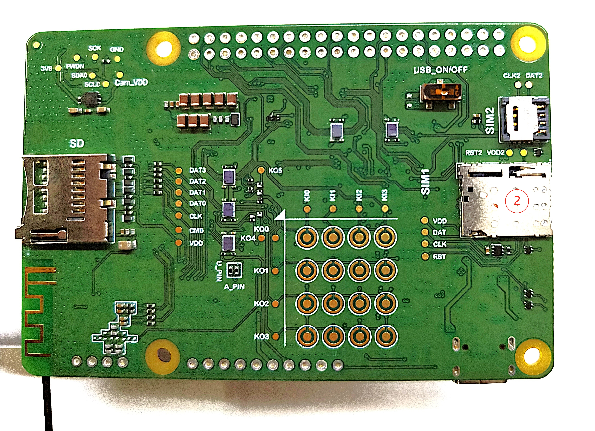

1. Connect the antenna to the antenna connector marked with the word 'LTE'.

2. Insert an available Nano SIM card into the SIM1 slot as shown in the diagram.

3. Connect the development board and computer using a Type-C data cable.

## Equipment development

- ### Power on

After completing the hardware connection work, when PWR, SCK1 light up or a COM port containing the words Quectel USB appears in the port list of the computer device manager, it indicates a successful boot up.

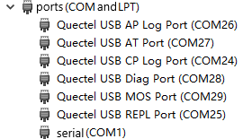

- ### Download firmware

Refer to [this chapter](https://developer.quectel.com/doc/quecpython/Application_guide/en/dev-tools/QPYcom/qpycom-dw.html) Download the firmware and burn the firmware to the development board.

- ### Script import and execution

1.Refer to [this chapter](https://developer.quectel.com/doc/quecpython/Getting_started/en/4G/first_python.html#Transfer-Files-Between-PC-and-Module)to transfer files between modules, import all files from the code folder in the source code directory into the module file system according to the original directory structure, as shown in the following figure

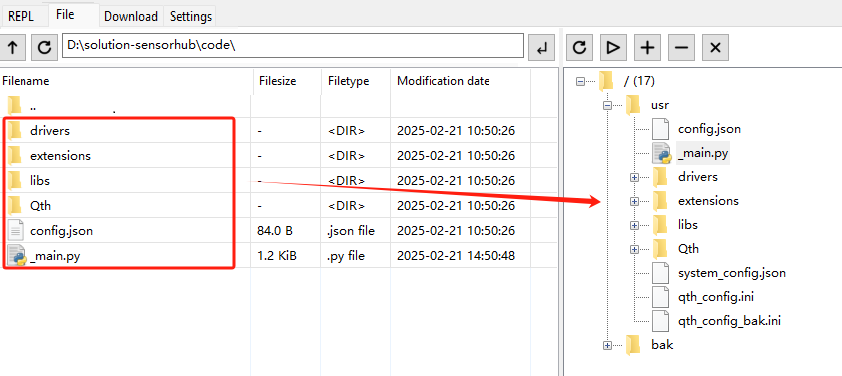

2.Refer to [this chapter](https://developer.quectel.com/doc/quecpython/Getting_started/en/4G/first_python.html#Run-Script), execute the main program file `_main.py`

3.Refer to [this chapter](https://developer.quectel.com/doc/quecpython/Getting_started/en/4G/first_python.html#Stop-a-Running-Program), stop program running

## Debugging

### Program startup

After executing the `_main.py` script, the program starts running and prints dialing information, including dialing status, IP address, DNS server address, device number, etc

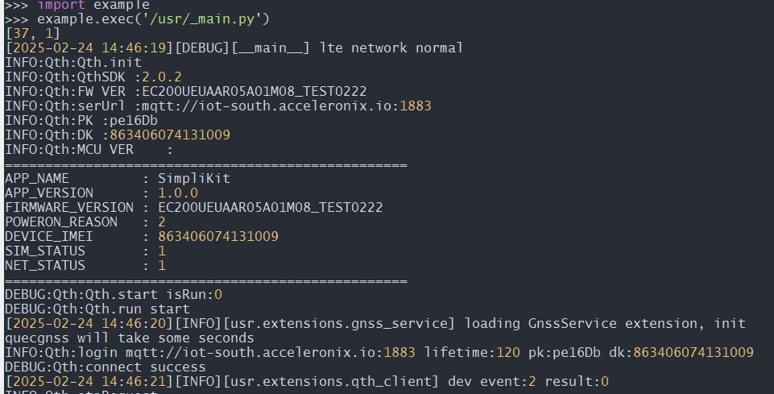

### 🚩 **Warning**

When the SIM card is not inserted, the SCK1 light will not light up and device information cannot be printed. After inserting the SIM card and restarting the device, it can run normally.

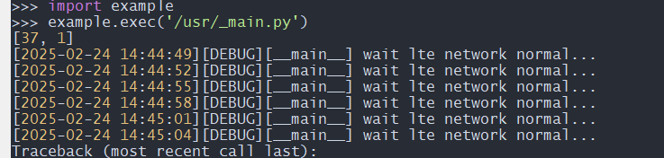

### Data detection

After starting to run, the detected data of temperature 1, humidity, air pressure, temperature 2, and the three primary colors of color will be printed every 1 second

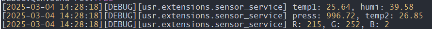

### Data update

When any of the above four types of data produces a change greater than 1 or the original color produces a change greater than 150, it will attempt to upload the updated data to the cloud. When the upload is successful, it will return "send ret: True" and prompt which data has changed. The APP will read the latest data from the cloud for data update.

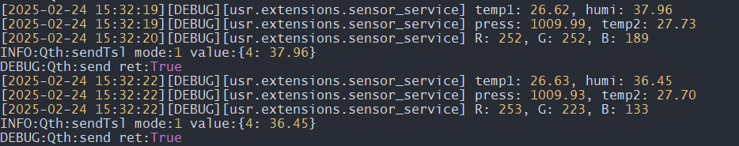

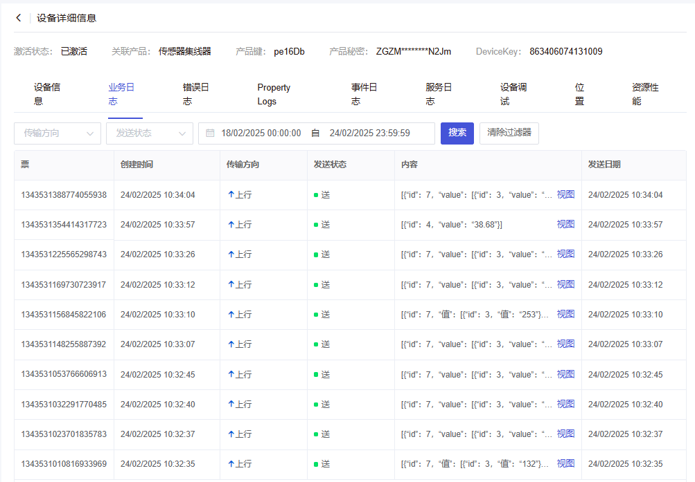

If there is no change greater than 1 in the data, only the currently detected data will be printed in pqcom and will not be uploaded to the cloud.

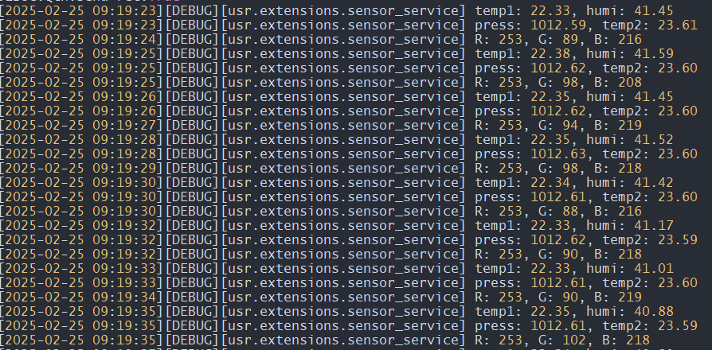

Location update: When the module displacement exceeds 50 meters, the cloud will refresh the location information, and the app will read the latest location information.

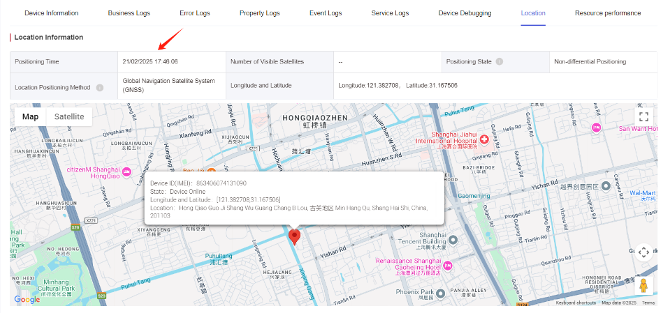

Proactively refresh APP data. By clicking the refresh button in the upper right corner of the APP, the APP will initiate a command to the server to actively read data for updating panel data

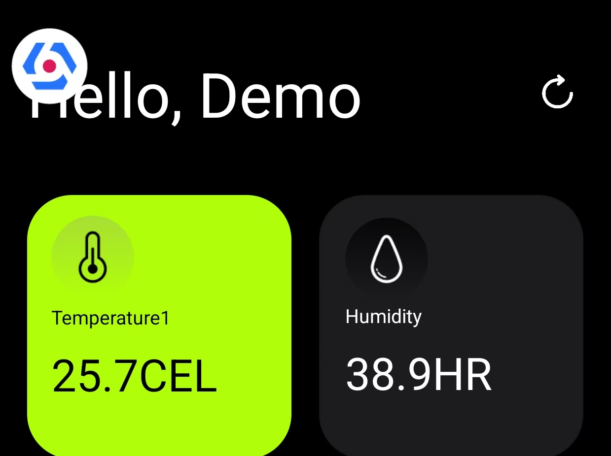

Temperature, humidity, air pressure, color, and Lbs data have been successfully obtained

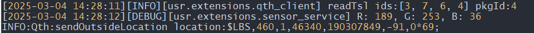