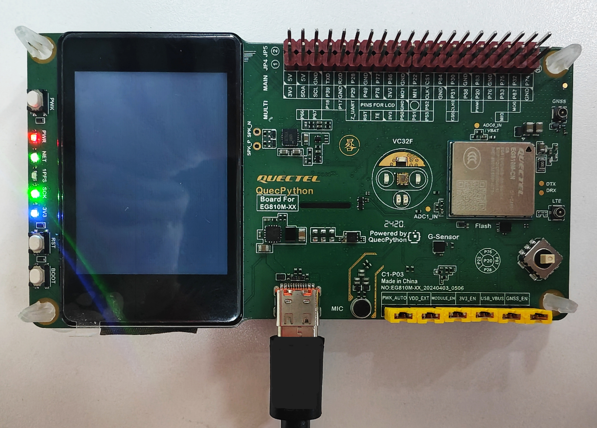
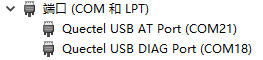
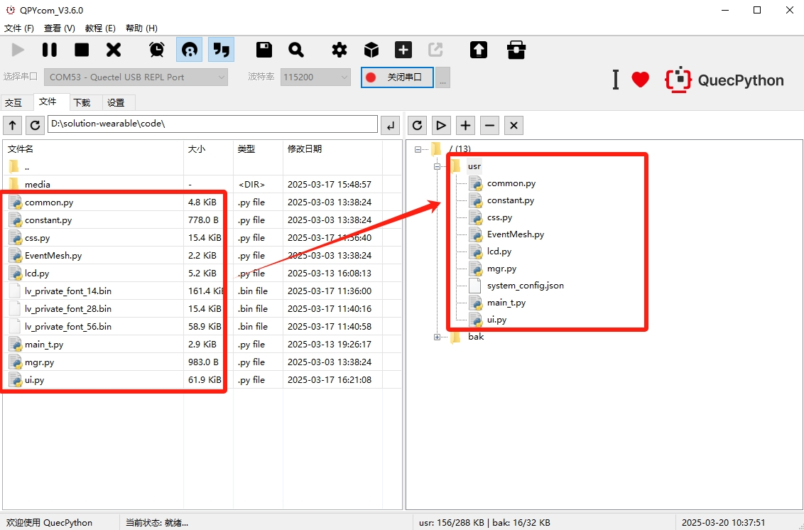
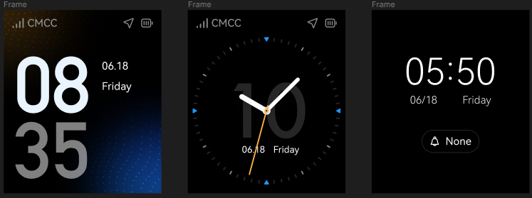
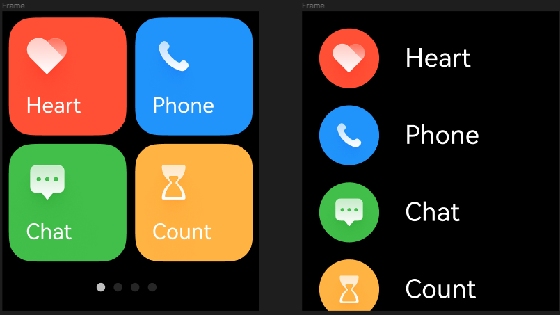
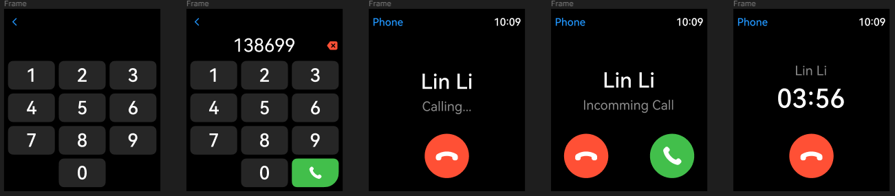
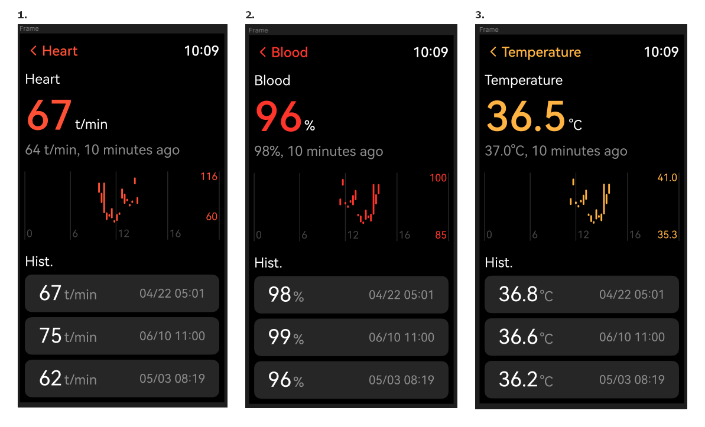

# Quick start

## Hardware preparation

- A Windows computer, recommended for the 'Win10' system
- A TypeC data cable
- A QuecPython EG810X C1-P03 development board

## Environment construction

- Download and install EG810M module driver： [QuecPython_USB_Driver_Win10_ASR](https://developer.quectel.com/wp-content/uploads/2024/09/Quectel_Windows_USB_DriverA_Customer_V1.1.13.zip)
- Download and install [VSCode](https://code.visualstudio.com/)
- Download and install [QPYCom](https://developer.quectel.com/wp-content/uploads/2024/09/QPYcom_V4.1.0.zip) 
- Download [Firmware](https://raw.githubusercontent.com/QuecPython/solution-wearable/refs/heads/master/EG810MCNGAR06A01M08_VOEXT_OCPU_QPY_BETA0222_20250317-1147_20250317-1152.zip)
- Download [Source Code](https://codeload.github.com/QuecPython/solution-wearable/zip/refs/tags/v1.0.1)

## Hardware connection

Connect the hardware according to the following diagram:

	

Connect the development board and computer using a TypeC data cable

## Equipment development

### Power on

After completing the hardware connection work, long press the button labeled 'PWk' on the development board until the network light 'net' flashes or a COM port containing the words' Quectel USB 'appears in the port list of the computer device manager, indicating successful boot.

​	

### Download firmware

Refer to [this chapter](../../../Getting_started/flash_firmware.md), burn firmware package [EG810MCNGAR06A01M08_VOEXT_SCPU_QPYBETA0222. zip](https://raw.githubusercontent.com/QuecPython/solution-wearable/refs/heads/master/EG810MCNGAR06A01M08_VOEXT_OCPU_QPY_BETA0222_20250317-1147_20250317-1152.zip) To the development board.

### Script import and execution

1. Refer to [this chapter](../../../Getting_started/first_python.md#Writing the First Script File)  To transfer files between modules, import all files ending in '. py' from the 'code' folder in the source code directory into the module file system, as shown in the following figure:

   		

2. Refer to [this chapter](../../../Getting_started/first_python.md#Executing the Script File) Execute the script file and execute the main program file `main.py`. (During normal startup, the module will automatically execute the `main.py` file)

3. Refer to [this chapter](../../../Getting_started/first_python.md#Stop-a-Running-Program), stop program running.

## Screen display

The wearing plan provides homepage, dial screen, application screen, standby scren, dial screen, heart rate/blood oxygen/body temperature detection screen.

### watch dial

	

component:

1. **Universal Headboard:**
  - Signal display.
  - The operator displays.
  - Battery level display.
  - Navigation icon display.
2. **Dial content:**
  - Time display: Real time refresh of time.
  - Hour hand/minute hand/second hand: Real time linkage with time.
  - The current time on the background disk is displayed on the clock.
  - Date display: The date is refreshed in real-time.
3. **Interaction Relationship**:
  - Swipe left on the digital dial to enter the screen display interface, and swipe right to enter the schedule dial interface.
  - Swipe left on the pointer dial to enter the digital dial interface, swipe right to enter the application list 1 page
  - The device (entered without any operation within 30 seconds) will display an off screen interface. Right swipe to enter the dial interface

### App screens

	

1. **Heart rate monitoring:**
  - Click to jump to the heart rate detection page.
2. **Phone:**
  - Click to enter the phone dialing interface.
3. **WeChat:**
  - Click to enter the WeChat interface for sending and receiving voice messages.
4. **Countdown interface:**
  - Click to enter the countdown interface.
5. **Interaction Relationship:**
  - Right swipe on the application list interface to enter the application list 2 interface.
  - Swipe left on the application list 2 interface to enter the application list interface, and swipe right to enter the heart rate detection and other interfaces.

### Phone screen

	

Provides modes and displays for making phone calls, going/calling/calling, etc.

### Detection screen

	

The detection interface includes temperature/blood oxygen/heart rate detection, as well as display of detection status and historical detection.
