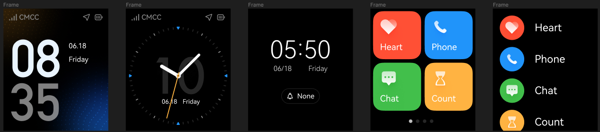

# Wearable solution

The wearable solution is based on the QuecPython EG810M C1-P03 development board and has the following features:

- Including interfaces such as clock display, phone dialing and answering reality, heart rate/temperature/blood oxygen measurement, etc
- Using [LVGL](https://lvgl.io/) Drawing graphical interfaces, it is a lightweight, open-source embedded graphics library.
- Having a basic application framework, users can improve their application development based on this framework
- Using Python language for easy secondary development.

	

------

- [Development resource](./dev_resources.md)
- [Quick start](./quick_start.md)
- [Software design](./software_design.md)

