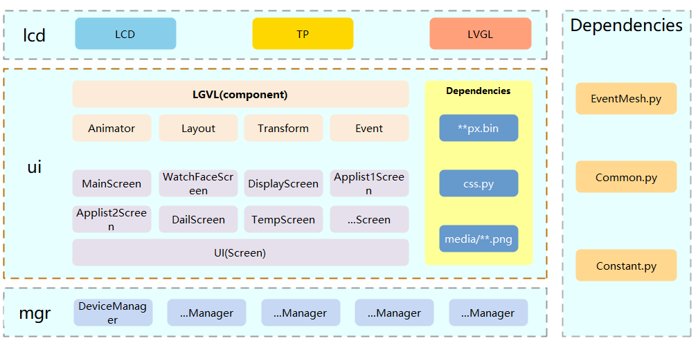
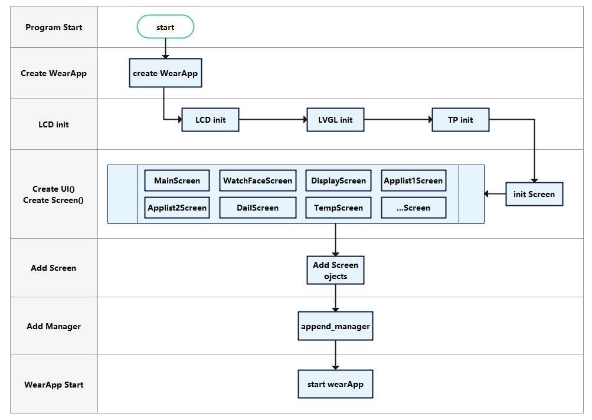
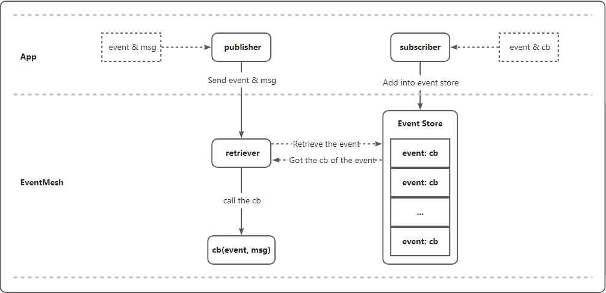
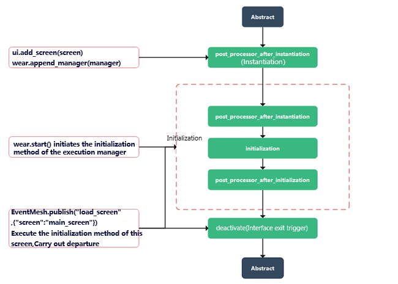

# Software design


## Software framework


### Software design diagram

	


### Business system startup process

	


## Implementation


### Code Catalog

The code for the wearable solution is hosted on [Github](https://github.com/QuecPython/solution-wearable.git)The directory structure of the code is as follows:

```PlainText
.
|-- EventMesh.py
|-- common.py
|-- constant.py
|-- lcd.py
|-- css.py
|-- ui.py
|-- mgr.py
|-- main_t.py
|-- img
|   |-- point.png
|   |-- gps.png
|   |-- bat4.png
|   |-- ...png
```

- `EventMesh.py` is an event manager module that, when an event on a screen control is triggered, users only need to call the relevant interface to send the event,  [EventMesh](https://github.com/QuecPython/EventMesh) It will automatically switch screen content.
- `common.py` mainly provides common abstract base classes and common dependency classes, such as `class Abstract` which provides abstraction of the lifecycle.
- `constant.py` mainly provides constant configuration.
- `lcd.py` mainly providing driver initialization for LCD, The initialization of TP drivers and LVGL will only be displayed on the screen when this file is successfully initialized.
- `css.py` mainly provides CSS functionality, static styles, font styles, etc. for use by screen objects in UI files.
- `ui.py`
  - Provides the base class `class Screen()` for screen objects, providing common methods required for all screen objects, such as creating screens and displaying status bar information (operator name, signal strength, system time, battery level, etc.).
  - `Class **Screen` implements a class that inherits from class Screen(), which is the code implementation corresponding to the image that the screen needs to display. The main content of the interface code is automatically generated by the GUI Guider tool and then modified slightly, mainly by modifying the object initialization method ` __init__() ` and the control event handling callback function (` __xxx_event_cb() `), or modifying it during the lifecycle of the control
- `mgr.py` mainly providing backend functions, allowing the interface to interact with various managers at different lifecycles or event triggers.
- `main_t.py` is an application entry script file.
  - Call `lcd.py` to initialize the screen driver and display.
  - Initialize the `APP` and wear the app.
  - Call the class `UI()` provided by `ui. py` to create a GUI object for the wearing scheme, and call the screen object adder of the GUI object to add the required screen objects. When adding, the instantiation method of the page will be executed.
  - Call `APP` to add a manager and execute the instantiation method of the manager.
  - startup `APP`.
  - Jump to the main screen.


### Screen switching mechanism


#### EventMesh Management Framework

As mentioned earlier, the interface switching is driven by the EventMesh event management framework.

- EventMesh is an application framework based on subscription and publishing mechanisms, where users can subscribe to any topic of interest, which represents an event.
- At the same time as subscribing to the topic, you also need to register a callback function to handle the generated events.
- Users can post the event anywhere it occurs and carry the message content. At this point, the callback function registered by the subscriber will be called and the event will be processed.

EventMesh design framework is shown in the following figure:

	


#### **Principle of screen switching implementation**

	


Sample lifecycle of page templates and redirects

```python
# ui.py

# Any new class **Screen must inherit from Screen. The lv_obj must be predefined.  

class DemoScreen(Screen):
    # NAME is required, it is used to find the screen when switching 
    # For example we use EventMesh.publish("load_screen", {"screen": "demo_screen"}) to find this screen
    NAME = "demo_screen"  
    def __init__(self):
        super().__init__()
    	# meta is the core switching object 
        self.meta = app_list_screen        
    	# prop contains info passed during the jump 
    	# if EventMesh.publish("load_screen", {"screen": "demo_screen", “test”:1}) is called
    	# then prop = {"screen": "demo_screen", “test”:1}
        self.prop = None	

    # Called only once when ui.add_screen(DemoScreen())
    # Users can implement initialization here 
    def post_processor_after_instantiation(self, *args, **kwargs): 
        """Called after instantiation"""
        pass
    
    # These methods will be called in sequence whenever 
    # EventMesh.publish("load_screen", {"screen": "demo_screen"}) switches to this screen
        # post_processor_before_initialization
    	# initialization
    	# post_processor_after_initialization
    # Users can implement functionality here, called every time when switching to this screen
    def post_processor_before_initialization(self, *args, **kwargs):
        """Called before initialization""" 
        pass

    def initialization(self, *args, **kwargs):
        """initialization"""
        pass


    def post_processor_after_initialization(self, *args, **kwargs):
        """Called after initialization"""
        pass
    	
    # Called when leaving this screen, for example below will 
    # first call deactivate() before calling main screen init()
    def deactivate(self, *args, **kwargs):
        """initialize load"""
        pass


# Note: If the screen is in a tileview, the mapping must be added for switching with  
# EventMesh.publish("load_screen", {"screen": "main_screen"}) to work
# See example mapping below in UI class 

class UI(Abstract):
    def __init__(self):
        self.screens = []
        self.current = None
        # display_screen maps to tile at column 0 row 0
        # main_screen maps to tile at column 0 row 1, etc
        self.tileview_map = {  
            "display_screen": [0, 0, lv.ANIM.OFF],
    		"main_screen": [1, 0, lv.ANIM.OFF],
            "watch_face_screen": [2, 0, lv.ANIM.OFF],
            "app_list_1_screen": [3, 0, lv.ANIM.OFF],
    		#...
        }
    	# Reverse mapping of above
        self.tileview_position_map = {
            (0, 0): "display_screen",
            (1, 0): "main_screen",
            (2, 0): "watch_face_screen", 
    		#...
        }
    	
# What is tileview? For example, tile1 is at position column 1 row 0, supports left/right slide  
tile1 = tileview.add_tile(1, 0, lv.DIR.RIGHT | lv.DIR.LEFT) 
# Put main_screen on tile1, swiping left enters tile at (0,0), swiping right enters tile at (2, 0)
main_screen = lv_obj(  
    parent=tile1, 
    #...
)
```

From the above code, it can be seen that the implementation of the callback function for each touch event is similar.

Taking the touch of the application list control as an example, the code is as follows:

```python
class AppList1Screen(Screen):
    NAME = "app_list_1_screen"

    def __init__(self):
        super().__init__()
        self.meta = app_list_screen
        self.container = app_list_cont
        self.profile = [
            ["U:/media/app_heart.png", {"screen": "blood_screen"}],
            ["U:/media/app_phone.png", {"screen": "dail_screen"}],
            ["U:/media/app_chat.png", None],
            ["U:/media/app_time.png", None]
        ]
        self.btn_list = []
        self.bottom = None
        self.bottom_profile = [
            ["U:/media/wpoint.png"],
            ["U:/media/bpoint.png"],
            ["U:/media/bpoint.png"],
            ["U:/media/bpoint.png"]
        ]
        self.bottom_btn_list = []

	def btn_click(self, event, i):
        screen_info = self.profile[i][1]
        if screen_info:
            EventMesh.publish("load_screen", screen_info)

    def post_processor_after_instantiation(self):
        for i, btn_profile in enumerate(self.profile):
            btn = lv_img(
                parent=self.container,
                size=(110, 110),
                src=btn_profile[0],
                flag=lv.obj.FLAG.CLICKABLE,
                style=[
                    (style_cont, lv.PART.MAIN | lv.STATE.DEFAULT),
                    (style_list_scrollbar, lv.PART.SCROLLBAR | lv.STATE.DEFAULT),
                    (style_list_scrollbar, lv.PART.SCROLLBAR | lv.STATE.SCROLLED),
                    (style_gap_default, lv.PART.MAIN | lv.STATE.DEFAULT),
                    (style_pad_default, lv.PART.MAIN | lv.STATE.DEFAULT),
                ]
            )
            btn.add_event_cb(lambda event, cur=i: self.btn_click(event, cur), lv.EVENT.CLICKED, None)
            self.btn_list.append(btn)
        self.bottom = lv_obj(
            parent=app_list_screen,
            pos=(88, 254),
            size=(56, 8),
            flex_flow=lv.FLEX_FLOW.ROW,
            flex_align=(lv.FLEX_ALIGN.SPACE_AROUND, lv.FLEX_ALIGN.START, lv.FLEX_ALIGN.START),
            style=[
                (style_cont, lv.PART.MAIN | lv.STATE.DEFAULT),
                (style_list_scrollbar, lv.PART.SCROLLBAR | lv.STATE.DEFAULT),
                (style_list_scrollbar, lv.PART.SCROLLBAR | lv.STATE.SCROLLED),
                (style_pad_default, lv.PART.SCROLLBAR | lv.STATE.SCROLLED),
                (style_app_list, lv.PART.MAIN | lv.STATE.DEFAULT),
            ]
        )
        for btn_profile in self.bottom_profile:
            btn = lv_img(
                parent=self.bottom,
                size=(8, 8),
                src=btn_profile[0],
                style=[
                    (style_cont, lv.PART.MAIN | lv.STATE.DEFAULT),
                    (style_list_scrollbar, lv.PART.SCROLLBAR | lv.STATE.DEFAULT),
                    (style_list_scrollbar, lv.PART.SCROLLBAR | lv.STATE.SCROLLED),
                    (style_gap_default, lv.PART.MAIN | lv.STATE.DEFAULT),
                    (style_pad_default, lv.PART.MAIN | lv.STATE.DEFAULT),
                ]
            )
            self.bottom_btn_list.append(btn)
```

The core statement of this code is ` EventMesh.publish("load_screen", screen_info)`, which sends an event called ` load_screen`, meaning to load a new screen interface; The carried message is `screen_info`,  `screen_info` is the name of the interface to be redirected to by `{"screen": "blood_streen"}`, indicating that the blood oxygen display interface is being loaded.

#### **UI startup**

The `load_screen`event is subscribed to in the `start()` method of the `class AgriUi(object)` class in the `Agri_ui.py` script file.

code:

```python
class UI(Abstract):

    def __init__(self):
		...

    def lv_load(self, event, msg):
        for screen in self.screens:
            if screen.NAME == msg["screen"]:
                scr = screen
                if self.current != scr:
                    if self.current:
                        self.current.deactivate()
                        scr.last_screen_info = {"screen": self.current.NAME}
                    scr.set_prop(msg)
                    scr.post_processor_before_initialization()
                    scr.initialization()
                    scr.post_processor_after_initialization()
                    self.current = scr
                    if msg["screen"] in self.tileview_map:
                        lv.scr_load(tileview_screen)
                        tileview.set_tile_id(*self.tileview_map[msg['screen']])
                    else:
                        lv.scr_load(self.current.meta)

    def post_processor_after_instantiation(self):
        EventMesh.subscribe("load_screen", self.lv_load)
        EventMesh.subscribe("load_tileview", self.lv_tileview)

    def add_screen(self, screen):
        screen.post_processor_after_instantiation()
        self.screens.append(screen)

    def start(self):
        self.post_processor_after_instantiation()
```

The `start()` method in the above code is used to launch the graphical interface of the wearable solution, and its workflow is as follows:

- Call the `add_streen` method to create metadata for each screen interface.

- Call the `EventMesh.subscribe()` method to subscribe to an event named `load_screen`. When the event occurs, call the `lv_load()` method to process it.

  > The `lv_load()` method matches the corresponding interface object based on the message carried when publishing the event, that is, the name of the screen interface, and calls lvgl's `lv.scr_load()` method to load a new interface.
  >Observant readers will notice that in every class implemented in the screen interface script file, there will be statements similar to `NAME=' main_streen' `under its class. This statement records the name of the screen interface.
  
- `EventMesh.publish("load_screen", {"screen": "main_screen"})` is used to trigger the first interface display, which is the main interface.

At this point, the graphical interface of the wearable solution has been launched, and the subsequent interface switching is controlled by the user's touch.


### Graphic interface design

The following text takes the application of wearable solutions as an example to introduce the design process of graphical interfaces.

#### Layout and background settings

Create a watch plan and choose a suitable layout template and background design. This stage will start with a blank layout design, selecting a blank template and setting the resolution to 240 * 280.


#### Screen drawing

This section mainly draws the dial homepage, explains the page layout, and how to quickly implement it using code.

1. top bar

	

- **component：** obj， img， label。
- **Operator and Signal (Box 1):** is an obj with another img display signal inside, The label displays the operator, which is aligned to the left in the layout, with a 4px gap between the weapon img and the label.
  - The size of obj is the specific length multiplied by 20px.
  - The img size is 20px * 20px.
- **Navigation and battery level (Box 2):** is an obj with another navigation img and battery level img inside, with an 8px interval in between, with a size of.
  - obj size is 48px * 20px。
  - img size is 20px * 20px。
- **top layout:**
  - flex layout， Default spindle horizontal direction.
  - size is 240px * 34px。
  - Layout the container with the main axis aligned left and right in the space between.
  - All sub attributes use flex end alignment, representing bottom alignment along the vertical axis.
  - The layout padding is 0px above, 12px to the right, 4px to the bottom, and 12px to the left.

 Implementation: 

```python
# Styles from css.py  

# Main page
main_screen = lv_obj(  
    size=(240, 280),
    style=[...]
)

# Top bar  
main_top = lv_obj(
    parent=main_screen,
    size=(240, 34),
    flex_flow=lv.FLEX_FLOW.ROW,
    flex_align=(lv.FLEX_ALIGN.SPACE_BETWEEN, lv.FLEX_ALIGN.END, lv.FLEX_ALIGN.END),   
    style=[...]  
)

# Box 1
main_top_cont_1 = lv_obj(
    parent=main_top,
    size=(88, 20),
    flex_flow=lv.FLEX_FLOW.ROW,
    flex_align=(...),
    style=[
    	# gap set to 4px in style  
    	(style_main_top_cont_1, lv.PART.MAIN | lv.STATE.DEFAULT),
    	...]
)

# Signal img parent is Box 1  
main_top_cont_1_img_signal = lv_img(  
    parent=main_top_cont_1,
    size=(20, 20),
    src="U:/media/s4.png", 
    style[...]
)

# Operator label parent is Box 1
main_top_cont_1_label_operator = lv_label(
    parent=main_top_cont_1,
    size=(64, 19), 
    text="Operator",
    style[...]  
)

# Box 2
main_top_cont_2 = lv_obj(  
    parent=main_top,
    size=(48, 20),
    flex_flow=lv.FLEX_FLOW.ROW,
    flex_align=(...), 
    style[...]
)

# Navigation img parent is Box 2  
main_top_cont_2_img_gps = lv_img(
    parent=main_top_cont_2,
    ...)
    
# Battery img parent is Box 2
main_top_cont_2_img_bat = lv_img(
    parent=main_top_cont_2, 
    ...)

```


2. Time Section


- Time Section
  - Size 116px * 200px
  - Position:
    - top: 64px
    - left: 16px
- Hour Hand Section (Box 1)
  - Size 118px * 200px
  - 2 images
    - Each image size 58 * 100px
  - Flex layout, horizontal axis
- Minute Hand Section (Box 2)
  - 2 images
  - Image size 58 * 100px each
  - Flex layout, horizontal axis
- Layout:
  - Flex layout, vertical axis

```python
# ... main_screen 

# Create time section  
main_content_cont_1 = lv_obj(
    parent=main_screen,
    size=(116, 200),
    pos=(19, 64),
    flex_flow=lv.FLEX_FLOW.COLUMN,
    flex_align=(...),
    style[...]  
)

# Create Box 1  
main_content_cont_1_hour = lv_obj(  
    parent=main_content_cont_1,
    size=(116, 100), 
    flex_flow=lv.FLEX_FLOW.ROW,
    flex_align=(...),
    style[...]
)

# Hour hand img 1 in Box 1
main_content_cont_1_hour_0 = lv_img(  
    parent=main_content_cont_1_hour, 
    size=(58, 100),
    src="U:/media/h0.png",
    style[...]
)  

# Hour hand img 2 in Box 1 
main_content_cont_1_hour_1 = lv_img(
    ...)
    
# Create Box 2  
main_content_cont_1_m = lv_obj(
    parent=main_content_cont_1,
    # Inherits vertical flex layout from parent
    flex_flow=lv.FLEX_FLOW.ROW, 
    ...)
    
# Minute hand img 0 in Box 2
main_content_cont_1_m_0 = lv_img(  
    ...)
    
# Minute hand img 1 in Box 2
main_content_cont_1_m_1 = lv_img(
    ...)
```


When placing elements in GUI Guider, ensure components align to grid and layout appropriately for different screen sizes and resolutions. The design should be clean and minimalist, use appropriate color schemes to make key info prominent yet non-intrusive, interactive elements should provide instant feedback e.g. hover/click change appearance. Test on different devices to ensure usability and performance.

If the system will be used under various lighting conditions like direct sunlight, adjust contrast and brightness to enhance visibility. Finally, the design should be intuitive for new users to navigate without extensive training, reflecting good user experience (UX) design principles.

The code generated by GUI tools lacks flexibility and maintainability. It's recommended to refactor as shown above for better encapsulation, simplicity and maintainability.