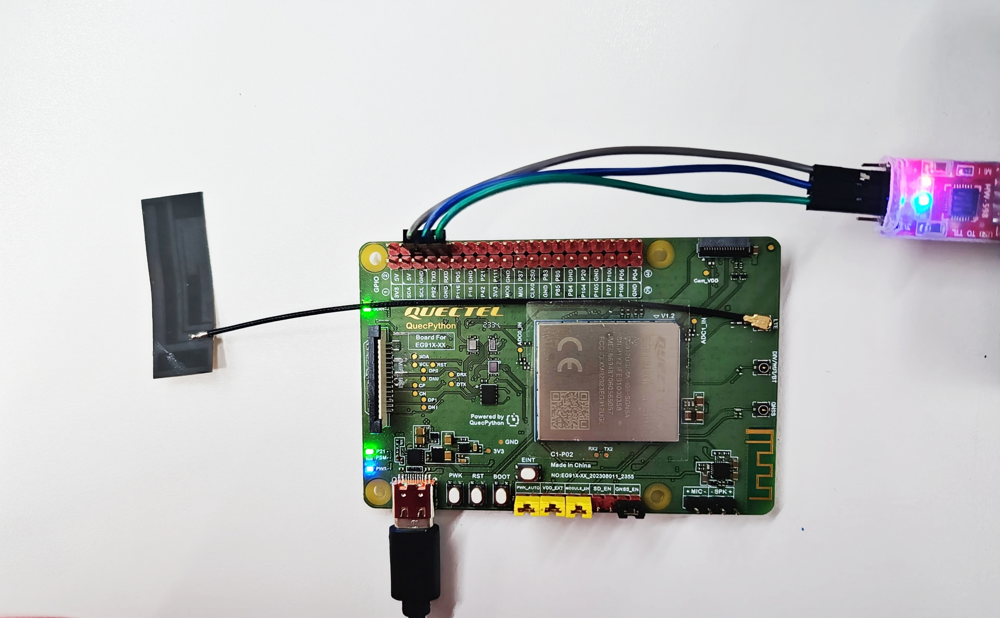

# Electricity-Meter solution

Meter solution based on QuecPython_EG91X C1-P02 EVB, Has the following characteristics: 

- Contains commonly used functional components in the electricity meter industry, such as serial communication module, TCP client, RFC1662 protocol, DLMS protocol (under development), etc.
- Having a basic application framework, users can improve their application development based on this framework.
- Using Python language for easy secondary development.

	

------

- [Development resources](./dev_resources.md)
- [Quick start](./quick_start.md)
- [Software design](./software_design.md)

