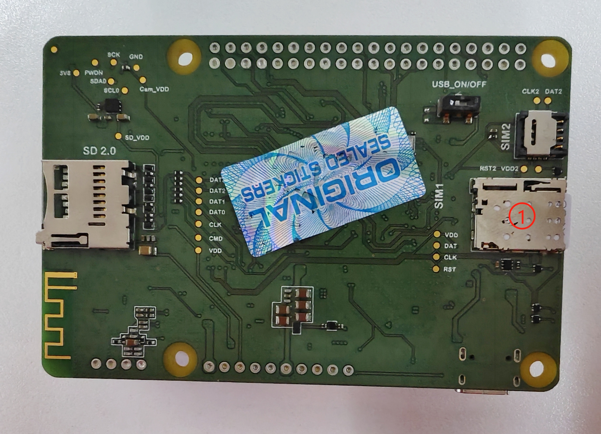
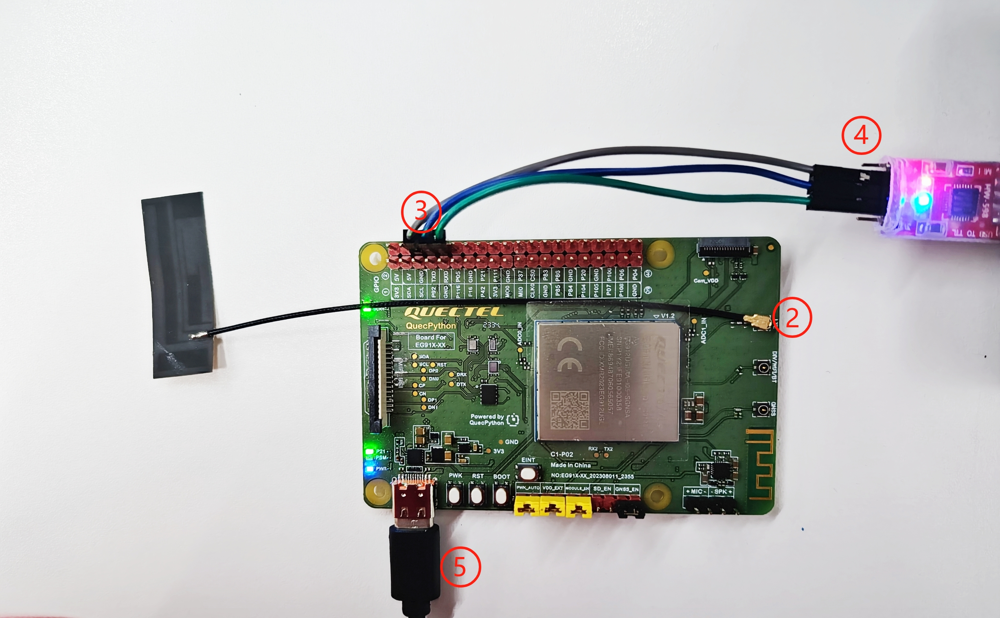
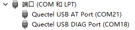
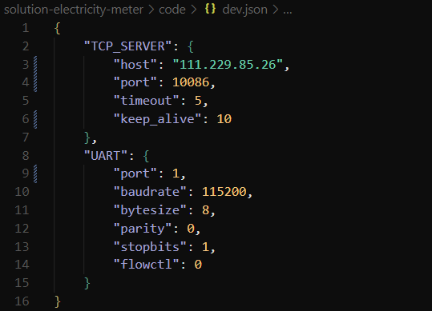
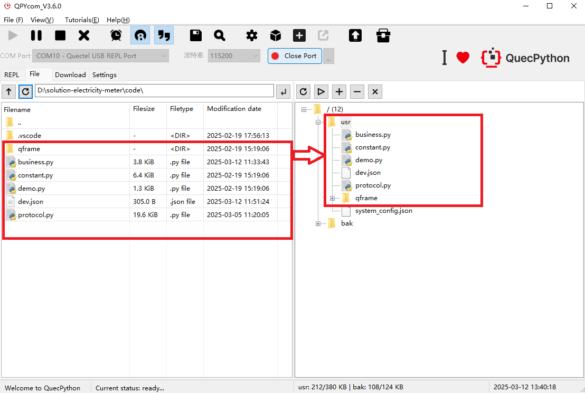
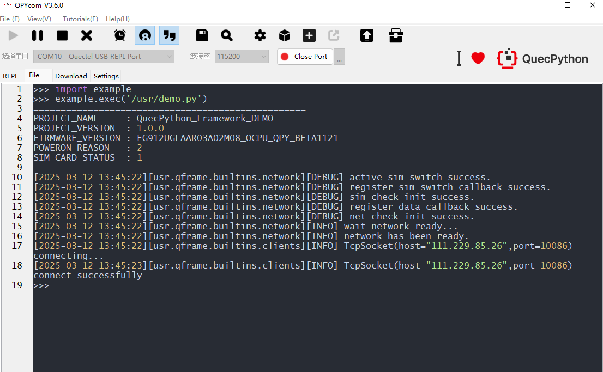
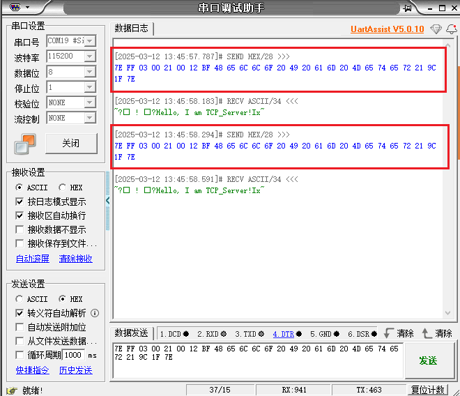
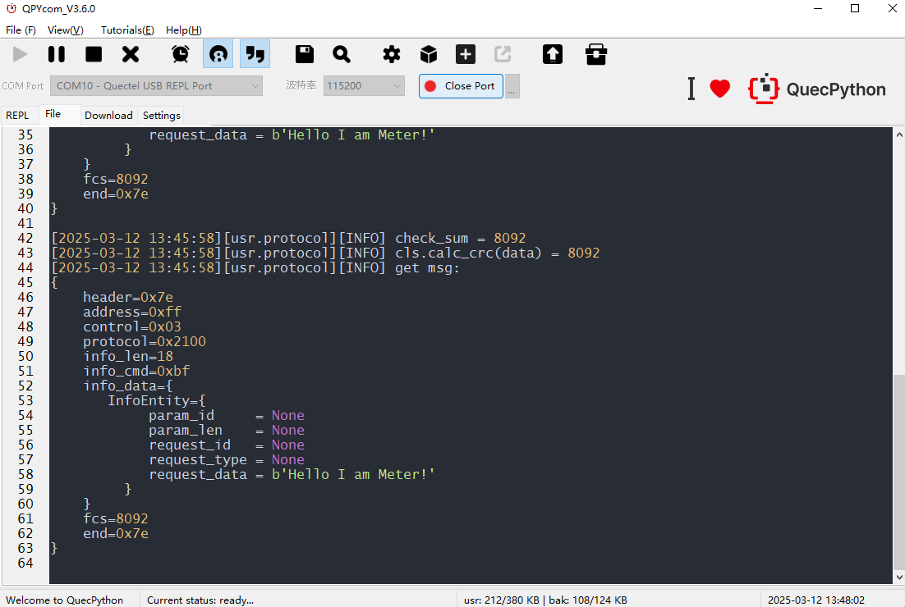
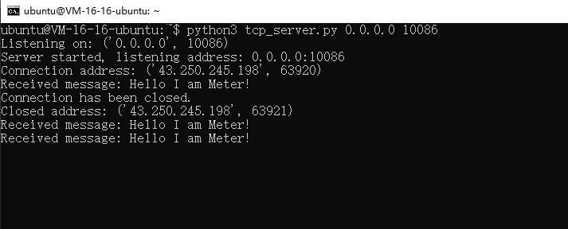
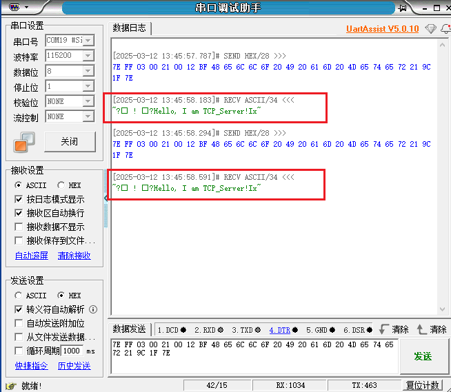

# Quick start

## Hardware preparation

- A Windows computer, recommended for the 'Win10' system
- A TypeC data cable
- A SIM card
- One [EG91X Evaluation Board](https://developer.quectel.com/doc/quecpython/Dev_board_guide/en/eg91x-evb.html)
- A CP2102 module
- One antenna

## Environment construction

- Download and install drivers：[Quectel_Windows_USB_DriverU](https://codeload.github.com/QuecPython/solution-wearable/zip/refs/tags/v1.0.1)
- Download and install [VSCode](https://code.visualstudio.com/)
- Download and install [QPYCom](https://developer.quectel.com/wp-content/uploads/2024/09/QPYcom_V4.1.0.zip) 
- Download [EG912U firmware](https://developer.quectel.com/wp-content/uploads/2024/09/QPY_OCPU_BETA0002_EG912U_GLAA_FW.zip)
- Download [Source code](https://codeload.github.com/QuecPython/solution-electricity-meter/zip/refs/tags/v1.0.0)

## hardware connection

Connect the hardware as shown in the following diagram:

	

1. Insert SIM card
2. Connect the antenna to the antenna connector marked with the word 'LTE'.
3. Connect the serial port of the EG912U development board to the CP2102 module.
4. Connect the CP2102 module to the computer
5. Connect the EG912U development board with a Type-C data cable

## Equipment development

### Power on

After completing the hardware connection work, long press the button labeled as `PWk` on the development board until the network light `net` flashes, or a COM port containing `Quectel USB` appears in the port list of the computer device manager, indicating successful boot-up. (The EG91X series C1-P02 development board automatically boots up upon power-on)

	

### Download firmware

Refer to [this chapter](https://developer.quectel.com/doc/quecpython/Application_guide/en/dev-tools/QPYcom/qpycom-dw.html) Burn firmware package [QPy_OCPU_SETA0002REG912U_GLAA_FW. zip](https://developer.quectel.com/wp-content/uploads/2024/09/QPY_OCPU_BETA0002_EG912U_GLAA_FW.zip) To EG912U module development board.

​	

### Script import and execution

1. Configure the specific parameters of the TCP server and UART used in `dev.json`

	

2. Refer to [this chapter](https://developer.quectel.com/doc/quecpython/Getting_started/en/4G/first_python.html#Transfer-Files-Between-PC-and-Module) To transfer files between modules, import all files from the `code` folder in the source code directory into the module file system, as shown in the following figure:

	

3. Refer to [this chapter](https://developer.quectel.com/doc/quecpython/Getting_started/en/4G/first_python.html#Run-Script), execute the main program file ` demo.py`

4. Refer to [this chapter](https://developer.quectel.com/doc/quecpython/Getting_started/en/4G/first_python.html#Stop-a-Running-Program), stop program running

## Debugging

### Program startup

After executing `demo.py`, the program will start various service modules and connect to the configured TCP server

	

### Upload data from the electricity meter

Here, the serial port assistant is used to send information to simulate electricity meter uploading data. The serial port assistant sends a hexadecimal RFC1662 message with the content "Hello, I am Meter".

> 🚩 **Warning**
> The information sent needs to be in the message format specified in the RFC1662 protocol in the code!
>
> For example, it is necessary to send "Hello I am Meter!", assemble it into a message format, and represent it in hexadecimal as:
>
> 7E FF 03 00 21 00 12 BF 48 65 6C 6C 6F 20 49 20 61 6D 20 4D 65 74 65 72 21 9C 1F 7E 
>
> Then send it to the module in hexadecimal format through the serial assistant

	

After receiving the RFC1662 message from the electricity meter, the module will first parse it and then send it to the TCP server:

	

The TCP server received a message from the electricity meter:

	

### TCP downlink data

The TCP server sends a message "Hello, I am TCP_Server!" to the module. After receiving the message, the module will first perform RFC1662 protocol packaging on the message and then send it to the electricity meter

	

> 🚩 **Warning**
>
> The phenomenon of garbled characters appearing before and after the information in the figure is not actually garbled, but rather because the module sent a complete RFC1662 protocol packet,
>And the serial assistant does not have the ability to unpack, so this is a normal phenomenon

