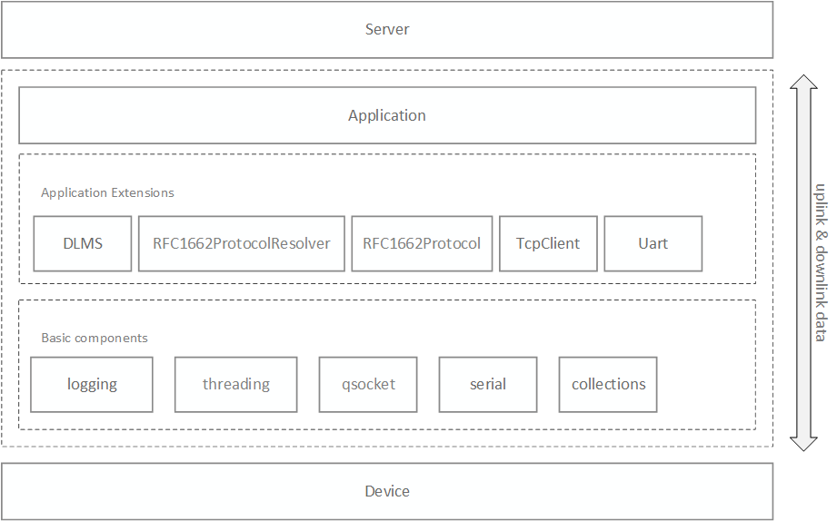
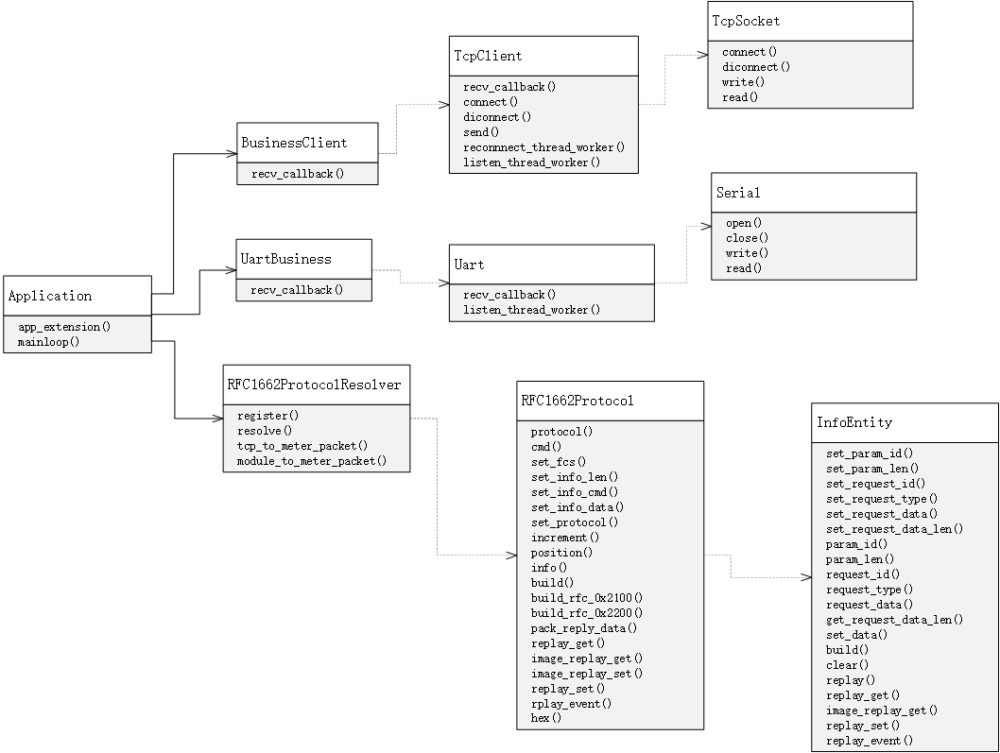
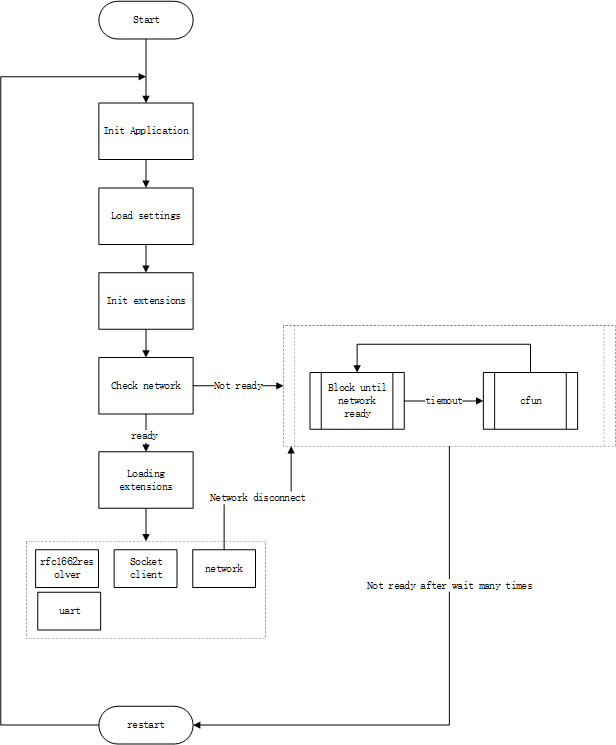
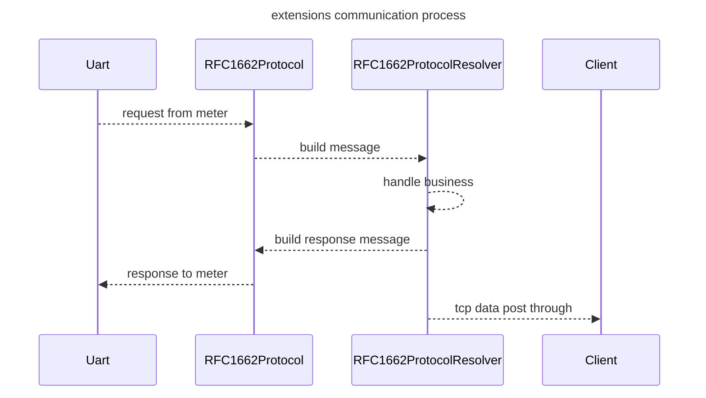
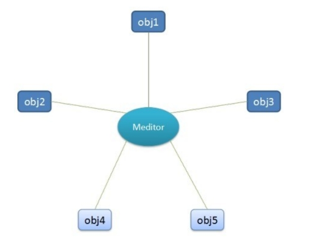

# Software design explanation


## Software framework


### Software Design Diagram

	


### UML

	


### System startup process

	

1. Instantiate application objects
2. Import configuration JSON file
3. Initialize various application extension components (this step will register each application extension into the main application object, facilitating communication between extensions)
4. Check the network (this step will block waiting for the network to be ready. If the wait times out, try switching to cfun to restore the network)
5. Load application extensions and start related services (customizable by users)
6. The system enters normal operation mode (by default, SIM card and network detection are enabled. If there is a network failure, it will attempt to switch to cfun to restore the network)


##  Implement 


### Sequence Diagram




### Code Catalog

The code for the smart meter solution is hosted on [Github](https://github.com/QuecPython/solution-electricity-meter.git) The directory structure of the code is as follows:

```PlainText
.
|-- LICENSE
|-- README.md
|-- code
|   |-- business.py
|   |-- constant.py
|   |-- demo.py
|   |-- dev.json
|   |-- protocol.py
|   `-- qframe
|       |-- __init__.py
|       |-- builtins
|       |   |-- __init__.py
|       |   |-- clients.py
|       |   |-- network.py
|       |   `-- uart.py
|       |-- collections.py
|       |-- core.py
|       |-- datetime.py
|       |-- globals.py
|       |-- led.py
|       |-- logging.py
|       |-- ota.py
|       |-- qsocket.py
|       |-- serial.py
|       `-- threading.py
`-- docs
    `-- media
        |-- UML.png
        |-- init.png
        |-- system.png
        `-- ...
```


### Basic framework

The smart meter solution is developed based on an application framework called QFrame.

> The `QFrame` application framework is a fundamental application framework developed by QuecPython. [Click here to view](https://github.com/QuecPython/QFrame) Design and application guidance for this framework.

An application often relies on multiple business modules, and there may be coupling between them.
In the framework design, the communication between business modules adopts a star shaped structure design, as shown in the following figure:

	

The Mediator in the figure is an intermediary object (usually named 'Application') that communicates between various business modules through the `Application` object. This design is called the **intermediary pattern**.
The business module is embedded in the application program in the form of application extensions, and the interaction between various application extensions is uniformly scheduled through the `Application` object.


### Application objects and extensions

Applications based on the QFrame framework must have a central object for scheduling various business modules, namely the Application object mentioned earlier; The application parameters are also configured through this object.

example:

```python
def create_app(name='DTU', config_path='/usr/dev.json'):
    # init application instance
    _app = Application(name)
    # read settings from json file
    _app.config.from_json(config_path)
	#The code is omitted here
    return _app

app = create_app()
```

`Application` class：

```python
class Application(object):
    """Application Class"""

    def __init__(self, name):
        self.name = name
        self.config = LocalStorage()
        self.business_threads_pool = ThreadPoolExecutor(max_workers=4, enable_priority=True)
        self.submit = self.business_threads_pool.submit
        # init builtins dictionary and init common, we use OrderedDict to keep loading ordering
        self.extensions = OrderedDict()
        self.__append_builtin_extensions()
        # set global context variable
        CurrentApp.set(self)
        G.set(_AppCtxGlobals())
        
    #The code is omitted here
    
    def append_extension(self, extension):
        self.extensions[extension.name] = extension

    def mainloop(self):
        """load builtins"""
        for extension in self.extensions.values():
            if hasattr(extension, 'load'):
                extension.load()
```

#### Definition and initialization of application extension

Application extension refers to the business modules loaded by the `Application` object. Generally speaking, application extensions obtain their own configuration from `app.config` and pass it to the application instance during initialization.
The use of application extension includes two parts: definition and initialization. Application extension provides a base class called `AppExtendeABC`, defined as follows:

```python
class AppExtensionABC(object):
    """Abstract Application Extension Class"""

    def __init__(self, name, app=None):
        self.name = name  # extension name
        if app:
            self.init_app(app)

    def init_app(self, app):
        # register into app, then, you can use `app.{extesion.name}` to get current extension instance
        app.append_extesion(self)
        raise NotImplementedError

    def load(self):
        # loading extension functions, this method will be called in `app.mainloop`
        raise NotImplementedError
```

This base class is inherited by a specific application extension class to constrain the interface definition of the application extension class.

- We need to pass the `Application` application object to the initialization method `__init__`. When creating an application extension object, call `init_app` to complete the initialization action of the extension; It is also possible to create an application extension object directly without passing in the application object, and then explicitly call `init_app` to complete initialization.
- The `load` method is used to be called by the `Application` object to load various application extensions.

#### The use of application expansion

When the application extension inherits the base class `AppExtendeABC` and implements the necessary interface functions, you can refer to the following two different ways of code to load the application extension object.

Method 1:

```python
app = Application(__name__)
ext = ExtensionClass(app)
```

Method 2:

```python
ext = ExtensionClass()
ext.init_app(app)

	rfc1662resolver.init_app(_app)
    uart.init_app(_app)
    client.init_app(_app)
```


### Main Application

As the script file for application entry, `demo.py` provides a factory function `create_app` that passes in the configuration path to initialize the application and load various application extensions. 

 `demo.py` sample code is as follows: 

```python
import checkNet
from usr.qframe import Application
from usr.business import rfc1662resolver, client, uart

PROJECT_NAME = "QuecPython_Framework_DEMO"
PROJECT_VERSION = "1.0.0"

def poweron_print_once():
    checknet = checkNet.CheckNetwork(
        PROJECT_NAME,
        PROJECT_VERSION,
    )
    checknet.poweron_print_once()

def create_app(name='DTU', config_path='/code/dev.json'):
  # initialize Application
  _app = Application(name)
  # read settings from json file
  _app.config.from_json(config_path)

  # init rfc1662resolver extension
  rfc1662resolver.init_app(_app)
  # init uart extension
  uart.init_app(_app)
  # init tcp client extension
  client.init_app(_app)

  return _app

# create app with `create_app` factory function
app = create_app()

if __name__ == '__main__':
  poweron_print_once()
  # loading all extensions
  app.mainloop()
```


### Application Extensions

The main application extension functions include three main categories `rfc1662resolver` (1662 protocol resolution), `client` (tcp client) and `uart` (serial read and write), which are all registered in the application object `Application` for ease of coordination.

- `rfc1662resolver`: responsible for parsing and assembling RFC1662 protocol messages, (`RFC1662ProtocolResolver` instance object).
- `client`: tcp client (`BusinessClient` instance object), responsible for communicating with the tcp server.
- `uart`: serial port client (`UartBusiness` instance object), responsible for serial read and write.

#### Class `RFC1662ProtocolResolver`

This class is an application extension class, an RFC1662 protocol data resolver, used to process RFC1662 protocol data transmitted in the business, and pack and unpack this class data. 

The class provides the following methods: 

- resolve(msg)
  - **Function**: Process an RFC1662 protocol message. The behavior is to find the processing function of the message from the registry by resolving the protocol (which can be understood as the message id of the protocol message), and call the function to process if found, otherwise throw a `ValueError` exception. See the `register` decorator function on how to register the processing function.
  - **Parameters**: `msg` is an `RFC1662Protocol` object, which is an encapsulation class of the RFC1662 protocol, see the introduction below.
  - **Return value**: None
  - **Exceptions**: If the processing function cannot be found in the registry for the incoming `msg`, a `ValueError` exception will be thrown.
- register(protocol)
  - **Function**: It is a decorator function used to register a processing function for a protocol.
  - **Parameters**: `protocol` can be understood as the message id of the RFC1662 protocol.
  - **Return value**: original function
- tcp_to_meter_packet(data)
  - **Function**: Static method, pack the byte data `data` into a transparent RFC1662 data packet (0x2100), that is, the data frame passed to the meter by tcp transparent transmission.
  - **Parameters**: `data`, byte type.
  - **Return value**: 0x2100 protocol packet byte string
  - **Exceptions**: None
- module_to_meter_packet(data)
  - **Function**: Static method, assemble RFC1662 protocol data packet (0x2200), that is, the data frame sent by the module to the meter
  - **Parameters**: data is a list, [get/set, id, data], where:
    - `get/set`: `COSEM.GET/COSEM.SET`, the corresponding values are `0xC0/0xC1` respectively
    - `id`: function command word
    - `data`: byte type
  - **Return value**: 0x2200 protocol packet byte string

 Sample code: 

```python
# we have inited a RFC1662ProtocolResolver object in `business.py` module
# import `rfc1662resolver`
from code.business import rfc1662resolver


# decorate with protocol 0x2100
@rfc1662resolver.register(0x2100)
def handle2100(msg):
  """when get a 0x2100 message，this function will be called"""
  pass
```

#### Class `RFC1662Protocol`

This class is a specific implementation of the RFC1662 protocol, including unpacking and packing. The instance object of this class is an encapsulated form of a complete RFC1662 protocol package. The main methods are:

- `build_rfc_0x2100`: assemble 0x2100 protocol packet, return bytes, equivalent to `RFC1662ProtocolResolver.tcp_to_meter_packet`
- `build_rfc_0x2200`: assemble 0x2200 protocol packet, return bytes, equivalent to `RFC1662ProtocolResolver.module_to_meter_packet`
- `build`: class method, used to resolve a protocol packet frame, return `RFC1662Protocol` object.
- `replay_get`: reply get command, judge success or failure
- `replay_set`: reply set command
- `reply_event`: reply event information

#### TCP Client Component

##### Base Class  `TcpClient`

This class exposes two interfaces to the user:

- `recv_callback` method, users rewrite this method to achieve business processing of TCP server downlink data.
- `send` method, users can call this method to send data to the server.

Code is as follows:

```python
class TcpClient(object):
   	# ...
    def recv_callback(self, data):
        raise NotImplementedError('you must implement this method to handle data received by tcp.')
    
    def send(self, data):
        # TODO: uplink data method
        pass
```

##### Subclass  `BusinessClient`

`BusinessClient` rewrites the `recv_callback` method to encapsulate the downlink data of the server into RFC1662 format messages and forwards the data to the serial port.

Code is as follows:

```python
class BusinessClient(TcpClient):
    
    def recv_callback(self, data):
        # recv tcp data and send to uart
        data = RFC1662Protocol.build_rfc_0x2100(data)
        CurrentApp().uart.write(data)
```

#### Serial Communication Component

##### Base Class `Uart`

This class exposes two interfaces to users:

- `recv_callback` method, users rewrite this method to achieve business processing of received serial data.
- `send` method, users can call this method to send data to the serial port.

Code is as follows:

```python
class Uart(object):
    # ...
    def recv_callback(self, data):
        raise NotImplementedError('you must implement this method to handle data received from device.')
    
    def write(self, data):
        # TODO: write data to uart
        pass
```

##### Subclass `UartBusiness`

 `UartBusiness` rewrites the `recv_callback` method to implement business processing of received serial data. 

```python
class UartBusiness(Uart):

        def recv_callback(self, data):
            # parse 1662 protocol data
            pass
```

> In the subclass `UartBusiness`'s `recv_callback` method, after parsing the RFC1662 protocol message, constructing the message object, distribute the message processing business through the `rfc1662resolver.resolve` method. 


### Writing Business Programs

Define a global `rfc1662resolver` resolver in the script file `business.py` to register message processing functions of specified types.

The following sample code registers the 0x2100 protocol transparent transfer processing function:

```python
# >>>>>>>>>> handle rfc1662 message received from uart <<<<<<<<<<

@rfc1662resolver.register(0x2100)
def handle2100(msg):
  """post data received to cloud"""
  # message body bytes
  data = msg.info().request_data()
  if data:
    # post data to tcp server by `client` extension register in Application
    CurrentApp().client.send(data)
```

