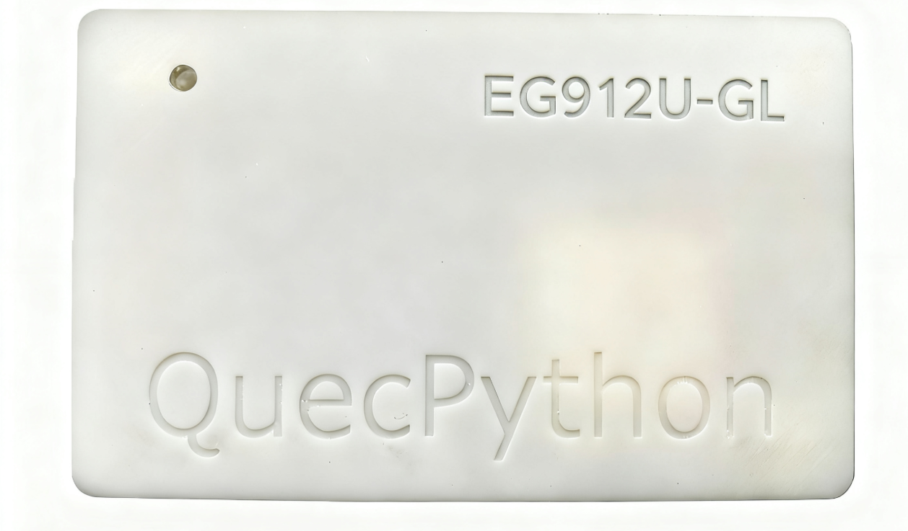

# Smart meter solution based on EG912U

The **meter solution** has the following features:

* Supports Quectel Cloud for remote data viewing

* Uses Python language for easy secondary development.

​	

* [Development Resources](./dev_resources.md)

* [Quick Start](./quick_start.md)

* [Software Design](./software_design.md)
