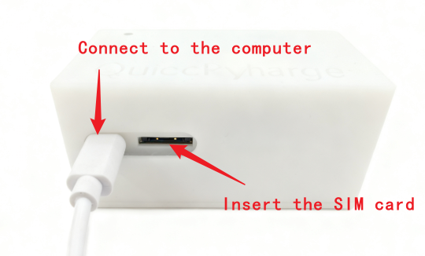
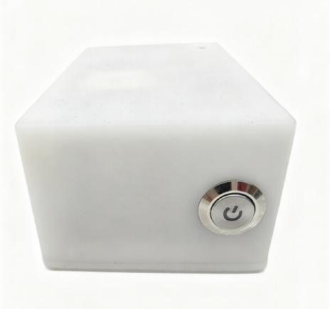
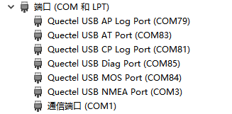
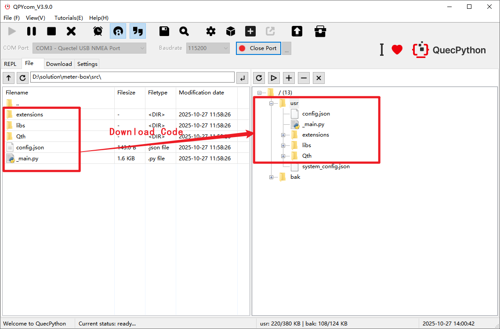
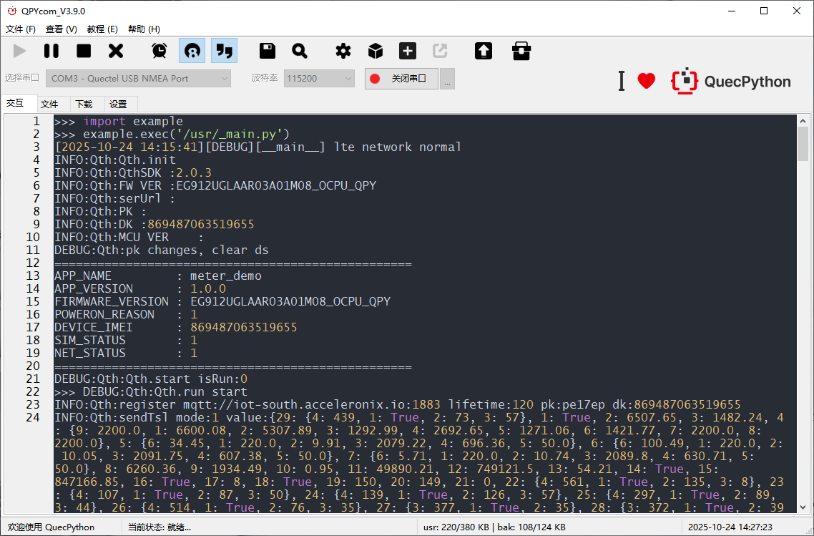
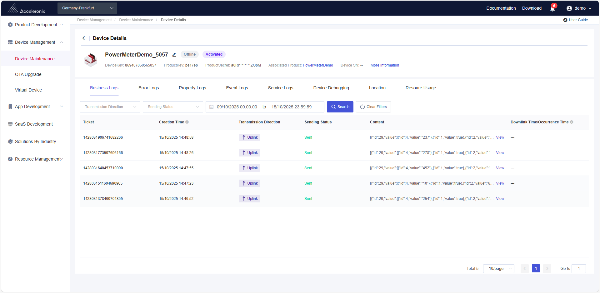
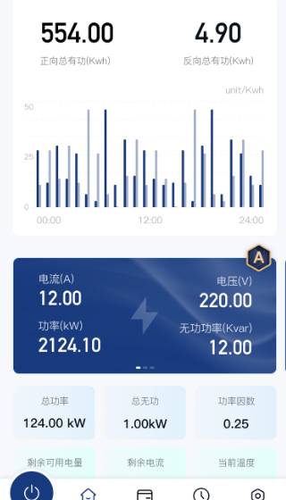

# Quick start

## Hardware preparation

* A Windows computer, preferably with `Win10` system.

* A set of meter-box products.

* A working SIM card.

## Environment setup

* Download and install EG912U series module driver: [QuecPython\_USB\_Driver\_Win10\_U\_G](https://developer.quectel.com/wp-content/uploads/2024/09/Quectel_Windows_USB_DriverU_V1.0.19.zip)

* Download and install [VSCode](https://code.visualstudio.com/).

* Download and extract [QPYCom](https://developer.quectel.com/wp-content/uploads/2024/09/QPYcom_V3.9.0.zip) tool to a suitable location on your computer.

* [Download firmware package](../../media/solutions/meter-box/8915DM_cat1_open_EG912UGLAAR05A01M08_TEST0807.zip).

* Download [experiment source code](https://codeload.github.com/QuecPython/meter-box/zip/refs/heads/main).

## Hardware connection

Follow the diagram below for hardware connection:

1. Insert the SIM card and connect to the computer using a Type-C data cable

   ​	

2. Press the power button to turn on

   ​	

## Device development

### Power On

After completing the hardware connection, if a COM port containing `Quectel USB` appears in the computer's device manager port list, it indicates successful power-on.

​	

### Firmware Package Burning

Refer to [this chapter](../../../Getting_started/flash_firmware.md), burn the corresponding model firmware package to the development board.

### Script Import and Execution

1. Refer to [this chapter](../../../Getting_started/first_python.md#Writing the First Script File) , import all files in the `src` folder under the source code directory into the module file system, as shown in the following figure:&#x20;
2. Refer to [this chapter](../../../Getting_started/first_python.md#Executing the Script File) Execute the script file and execute the main program file `main.py`. (During normal startup, the module will automatically execute the `main.py` file)
3. Refer to [this chapter](../../../Getting_started/first_python.md#Stop-a-Running-Program), stop program running.

## Business debugging

### Program Startup

After executing the `_main.py` script, the program starts running.

### Cloud Platform Receives Uplink Data

click [here](https://core.acceleronix.io/) to Cloud Platform

### Mobile APP Interface Display

​	
