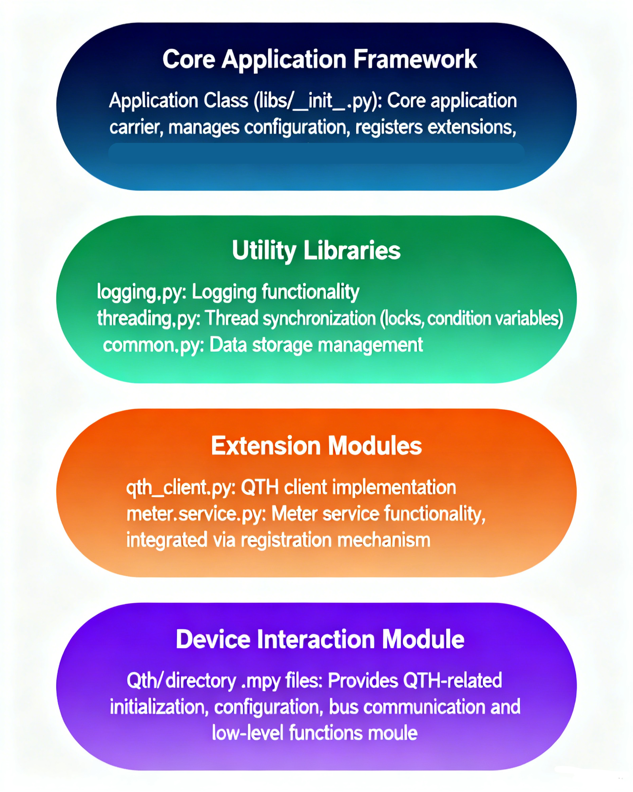
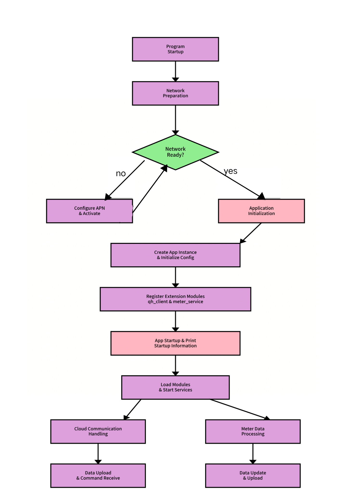

# Software design

## Program architecture

The software adopts a modular architecture design, mainly including four parts: core application framework, tool library, extension modules, and device interaction modules. Each module has clear responsibilities and low coupling, facilitating maintenance and expansion.

​	

## Business flow

​	

## Code details

### Program Entry \_main.py Initialization Flow

`_main.py` is the program entry file responsible for network preparation, application creation, and startup. The specific flow is as follows:

* **Network Waiting and Activation**: Check network status through the `wait_network_ready` function. If not ready, configure APN and activate.

```python
def wait_network_ready():
    wait_cnt = WAIT_NETWORK_READY_S / 5
    is_ready = False
    while wait_cnt:
       lte = dataCall.getInfo(1, 0)
       if lte[2][0] == 1:
           is_ready = True
           break
       utime.sleep(5)
       wait_cnt -= 1
    return is_ready

if __name__ == "__main__":
    while True:
       if wait_network_ready():
           logger.debug('lte network normal')
           break
       logger.debug('wait lte network normal...')
       ret=dataCall.setPDPContext(1, 0, 'BICSAPN', '', '', 0)
       ret2=dataCall.activate(1)
       while not ret and ret2:
           ret=dataCall.setPDPContext(1, 0, 'BICSAPN', '', '', 0)
           ret2=dataCall.activate(1)
           if  ret and ret2:
               print("Net injection failure")
               break
```

* **Application Creation and Initialization**: The `create_app` function initializes the application instance, loads configurations, and registers extension modules.

```python
def create_app(name="meter_demo", version="1.0.0", config_path="/usr/config.json"):
   _app = Application(name, version)
   _app.config.init(config_path)
    
   qth_client.init_app(_app)
   meter_service.init_app(_app)
    
   return _app
```

* **Application Startup**: After creating the application instance, call `app.run()` to start the application, execute system information printing and extension loading.

```python
app = create_app()
app.run()
```

### QTH Client Uploading Data to Cloud

`qth_client.py` implements QTH client functionality, responsible for communicating with the cloud. The data upload process is as follows:

* **Client Initialization**: The `init_app` method of the `QthClient` class initializes QTH-related configurations and registers event callback functions.

```python
def init_app(self, app):
   app.register("qth_client", self)
   qth_init.init()
   qth_config.setProductInfo(app.config["QTH_PRODUCT_KEY"], app.config["QTH_PRODUCT_SECRET"])
   qth_config.setServer(app.config["QTH_SERVER"])
   qth_config.setEventCb(
       {
           "devEvent": self.eventCallback,
           "recvTrans": self.recvTransCallback,
           "recvTsl": self.recvTslCallback,
           "readTsl": self.readTslCallback,
           "readTslServer": self.recvTslServerCallback,
           "ota": {
               "otaPlan":self.otaPlanCallback,
               "fotaResult":self.fotaResultCallback
           }
       }
   )
```

* **Data Sending Interface**: Provides methods such as `sendTsl`, `sendLbs`, `sendGnss` for sending different types of data to the cloud. This solution only uses the `sendTsl` method.

```python
def sendTsl(self, mode, value):
   return qth_bus.sendTsl(mode, value)

def sendLbs(self, lbs_data):
   return qth_bus.sendOutsideLocation(lbs_data)

def sendGnss(self, nmea_data):
   return qth_bus.sendOutsideLocation(nmea_data)
```

* **Data Upload Trigger**: When receiving a command to read data, generate random simulation data in the `readTslCallback` method and upload it through the relevant mechanism.

```python
def readTslCallback(self, ids, pkgId):
   logger.info("readTsl ids:{} pkgId:{}".format(ids, pkgId))
   value=dict()
# Generate various meter data...
# Send generated data through QTH client
```

### Meter Data Update Logic

The meter data update logic is mainly implemented in the `readTslCallback` method of `qth_client.py`. When receiving a command to read data, it generates random meter data as follows:

* **Data Generation**: Generate corresponding meter data according to different `id`, including total electricity, phase voltage, current, power, etc. Some data is generated based on random functions.

```python
def readTslCallback(self, ids, pkgId):
   	logger.info("readTsl ids:{} pkgId:{}".format(ids, pkgId))
   	value=dict()

	# Combine total active energy and other random simulation data generation
   	com_total_active_energy = random_float(int(total_phase_a_energy + total_phase_b_energy + com_total_phase_c_energy), int(total_phase_a_energy + total_phase_b_energy + com_total_phase_c_energy), 2)
   	com_forward_active_energy = random_float(4500, 5500, 2)
   	com_reverse_active_energy = random_float(int(com_total_active_energy - com_forward_active_energy), int(com_total_active_energy - com_forward_active_energy), 2)

# Random simulation data generation for phase voltage, current, etc.
   	voltage_a = 220.0
  	current_a = random_float(9, 10, 2)

	# ... Other phase data generation

	# Map data according to id
   	for id in ids:
       	if 1 == id:
           	value[1]=True
       	elif 2 == id:
           	value[2]=random_float(6000, 6600, 2)
		# ... Mapping of other id corresponding data
```

* **Data Update Trigger**: When the cloud or other modules trigger a command to read data, the `readTslCallback` method is called to generate the latest random data, realizing dynamic update of meter data.
