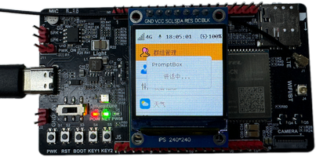

# Poc solution

This public network intercom solution is based on the EC600MCNTE QuecPython standard development board and has the following features:

- Provide half duplex high-definition and secure voice intercom function.
- Support connecting commonly used intercom platforms: Android, Shanli, Bernard and their chip platforms.
- Ultra long standby: Supports ultra-low power consumption mode.
- Using Python language for easy secondary development.

 

---

- [Development resources](./dev_resources.md)
- [Quick start](./quick_start.md)
- [Software design](./software_design.md)

