# Quick start

## Hardware preparation

- A Windows computer, recommended for the `Win10` system.
- Two sets of [EC600MCNTE QuecPython standard development boards](https://developer.quectel.com/en/modules-cat/ec600m-series) (Each set includes an antenna, Type-C data cable, etc.).

  > 💡 **Tips**
  > One set is used for the demonstration of the calling device, and the other set is used for the demonstration of the called device.

- Two functional Nano SIM cards.
- Two LCD screens with a resolution of 240 * 240, model ST7789.
- Two speakers with a power of 2-5W.

## Environment construction

- Download and install EC600M series module driver: [QuecPython_USB_Driver_Win10_ASR](https://developer.quectel.com/wp-content/uploads/2024/09/Quectel_Windows_USB_DriverA_Customer_V1.1.13.zip).
- Download and install [VSCode](https://code.visualstudio.com/ ).
- Download and unzip [QPYCom](https://developer.quectel.com/wp-content/uploads/2024/09/QPYcom_V4.1.0.zip) Tool to the appropriate location on the computer.
- Download [firmware package](https://github.com/QuecPython/solution-POC/releases/download/v2.0.1/EC600MCNLER06A01M08_POC_XBND_OCPU_QPY_BETA0117.zip ).
- Download [Experimental Source Code](https://github.com/QuecPython/solution-POC/archive/refs/tags/v2.0.1.zip).
- Apply for a Bernard **chip platform** testing account.

According to the steps shown in the figure below, obtain the IMEI number and provide it to the sales personnel of Mobile Remote to apply for a walkie talkie testing account.

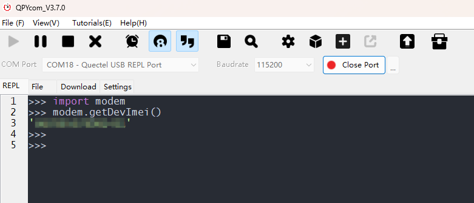 

> 💡 **Tips**
> - Non commercial testing, please contact the sales personnel of Mobile Far East (li.bao@quectel.com ) Apply for a Bernard **chip platform ** testing account.
> - Please follow the business process for commercial applications.

## Hardware connection

Connect the hardware according to the following diagram:

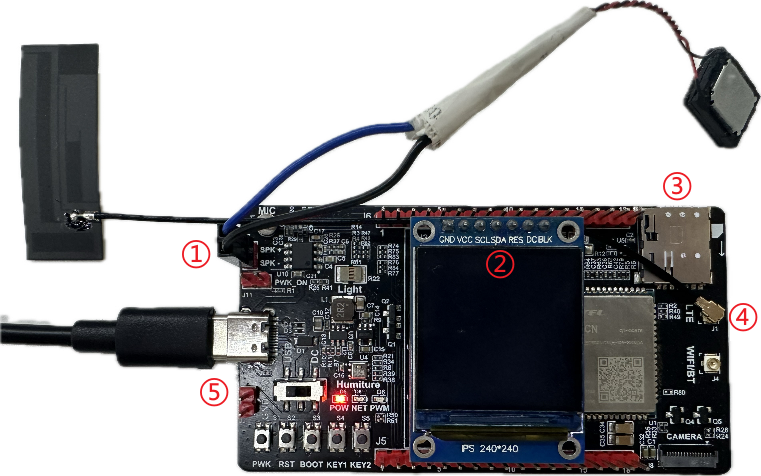 

1. Connect the horn to the pins labeled `SPK+` and `SPK -` in the diagram.
2. Connect the LCD screen to the pin bank labeled with the word `LCD`.
3. Insert an available Nano SIM card into the position shown in the diagram.
4. Connect the antenna to the antenna connector marked with the word `LTE`.
5. Connect the development board and computer using a Type-C data cable.

## Equipment development

### Power on

After completing the hardware connection work, long press the button labeled `PWK` on the development board until the network light flashes or a COM port containing the words `Quectel USB`appears in the port list of the computer device manager, indicating successful boot.

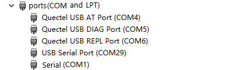 

### Download firmware

Refer to [this chapter](../../../Getting_started/flash_firmware.md) Burn firmware package [EC600MCNLER06A01M08-POC_XBND_SCPU_QPYBETA0117. zip](https://github.com/QuecPython/solution-POC/releases/download/v2.0.1/EC600MCNLER06A01M08_POC_XBND_OCPU_QPY_BETA0117.zip) To the development board.

### Script import and execution

1. Refer to [this chapter](../../../Getting_started/first_python.md#Writing the First Script File)  Import all files from the `code` folder in the source code directory into the module file system, as shown in the following figure:

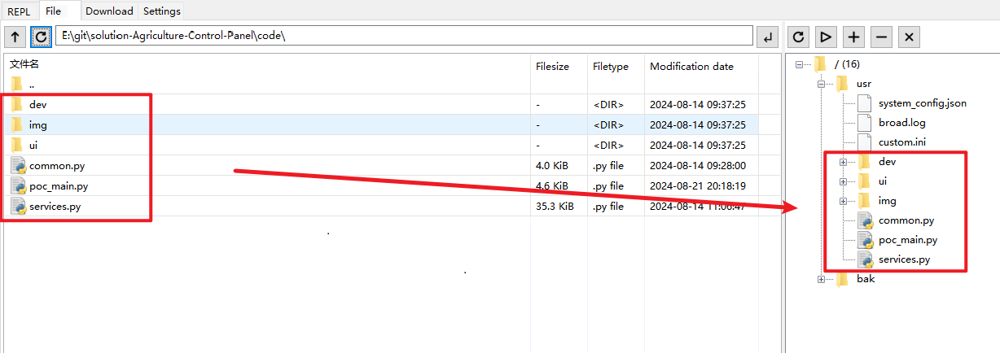

2. Refer to [this chapter](../../../Getting_started/first_python.md#Executing the Script File) Execute the script file and execute the main program file `poc_main.py`. (During normal startup, the module will automatically execute the `main.py` file)
3. Refer to [this chapter](../../../Getting_started/first_python.md#Stop-a-Running-Program), stop program running.

## Debugging

### Program startup

After executing the ` poc_main.py ` script, the program starts running and enters the ` WelcomeScreen ` interface. At the same time, it obtains the SIM card status and current account, and broadcasts the information of the currently logged in user and the group they have joined through TTS voice.

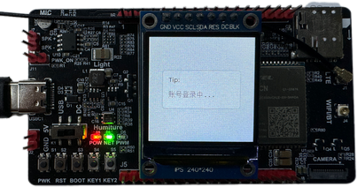 

> 🚩 **Warning**
> When the SIM card is not inserted, it will not enter the main interface. After inserting the SIM card and restarting the device, it can run normally.
> 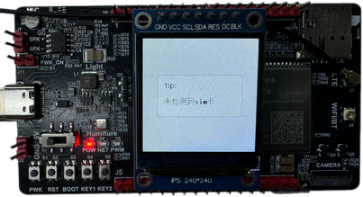

### Main screen

The main interface contains multiple option lists, and each option corresponds to a new interface.

- Click the `key2` key to scroll down the checkbox.
- Double click the `key2` key to enter the selected interface.
- Long press the `key2` key to return to the previous interface.

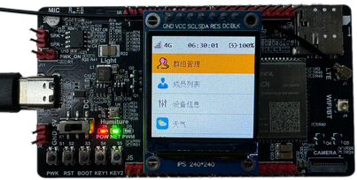 

### Group List

Entering the group management interface can query the list of groups that the current account has joined, and the message prompt box will indicate which group it is currently in, as shown in the following figure:

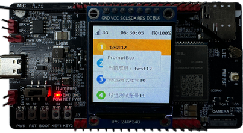 

### Member list

By entering the member list interface, all members of the current group can be queried, as shown in the following figure:

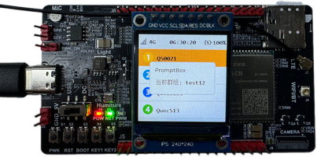 

### Intercom

- Long press the `key1` key to communicate with members in the same group, and the menu bar will display the `microphone` icon.
- After speaking, release the `key1` key to end the intercom function.
- When actively calling or being called by the other party, there will be a message pop-up prompt.
- When the other party is speaking, the menu bar displays the `earpiece` icon.

**Active call icon:**
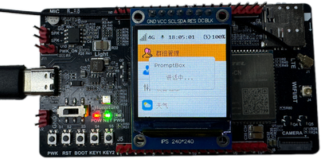 

**Call icon for the other party:**

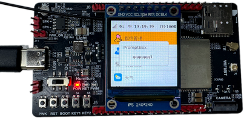 
