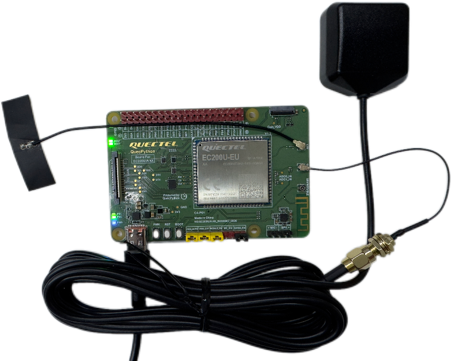

# Tracker solution

This intelligent locator solution is based on the EC200UEUAA QuecPython standard development board and has the following features:

- MQTT protocol communication (current solution supports Alibaba IoT platform/TinsBoard platform)
- Read and write configuration files
- OTA remote upgrade
- LED indicator light
- Device Network Management
- Equipment Information Management
- Battery level and charging management
- Backup information storage
- GNSS positioning/base station positioning/WiFi positioning
- Low power management
- Log storage record

 

------

- [Development resources](./dev_resources.md)
- [Quick start](./quick_start.md)
- [Software design](./software_design.md)