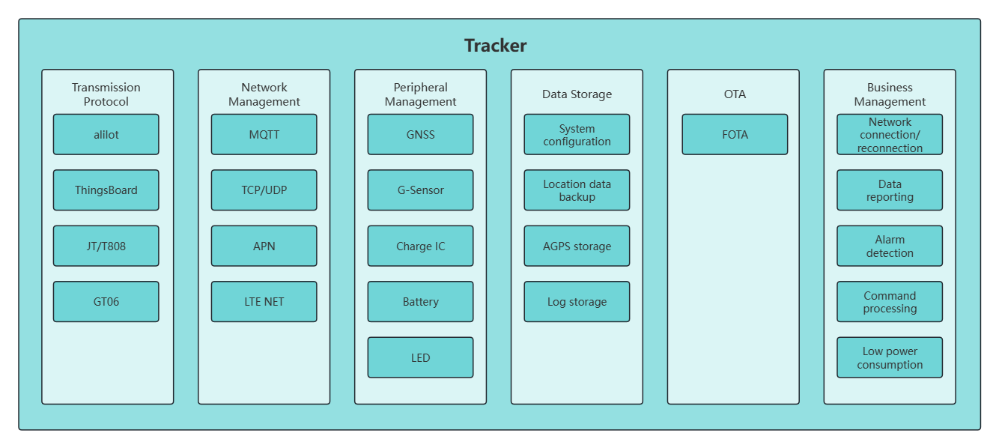
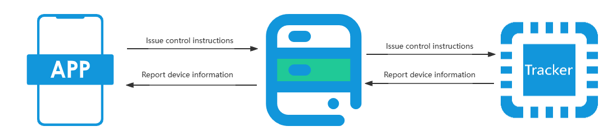
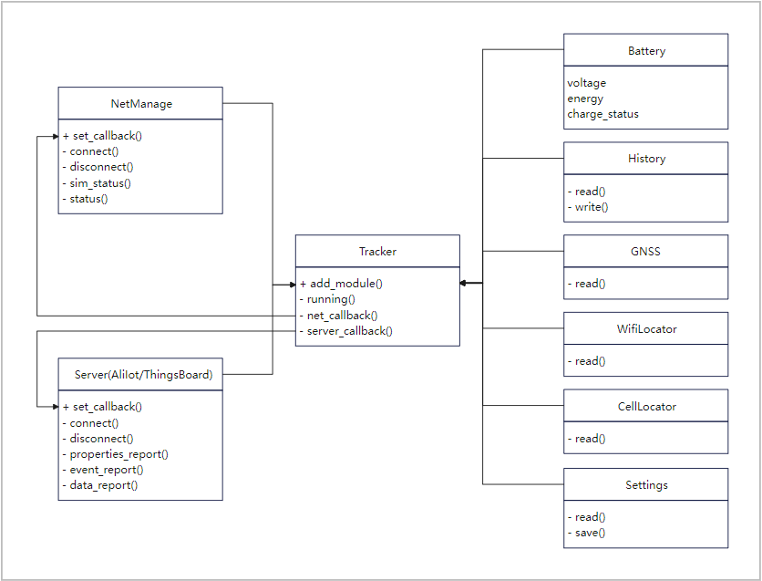
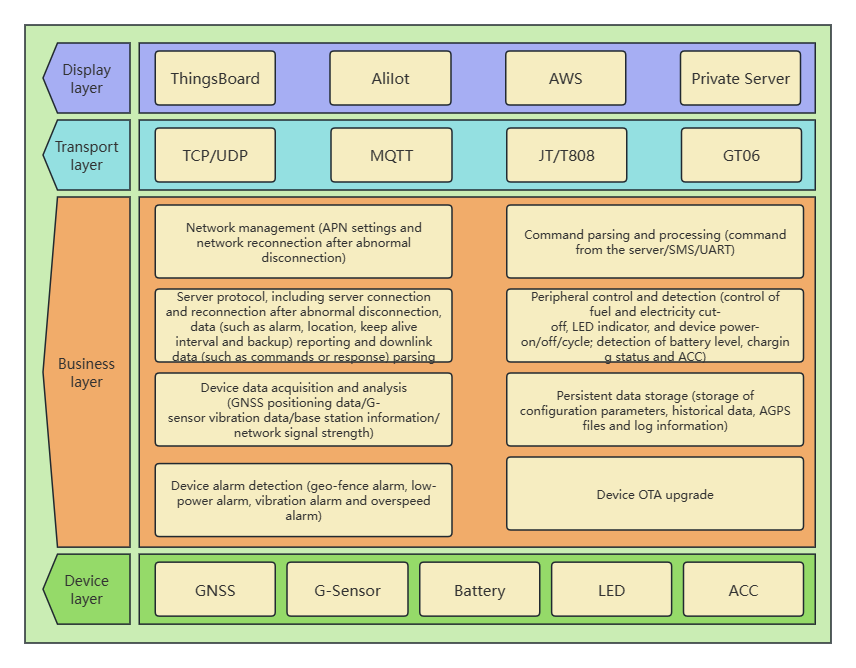
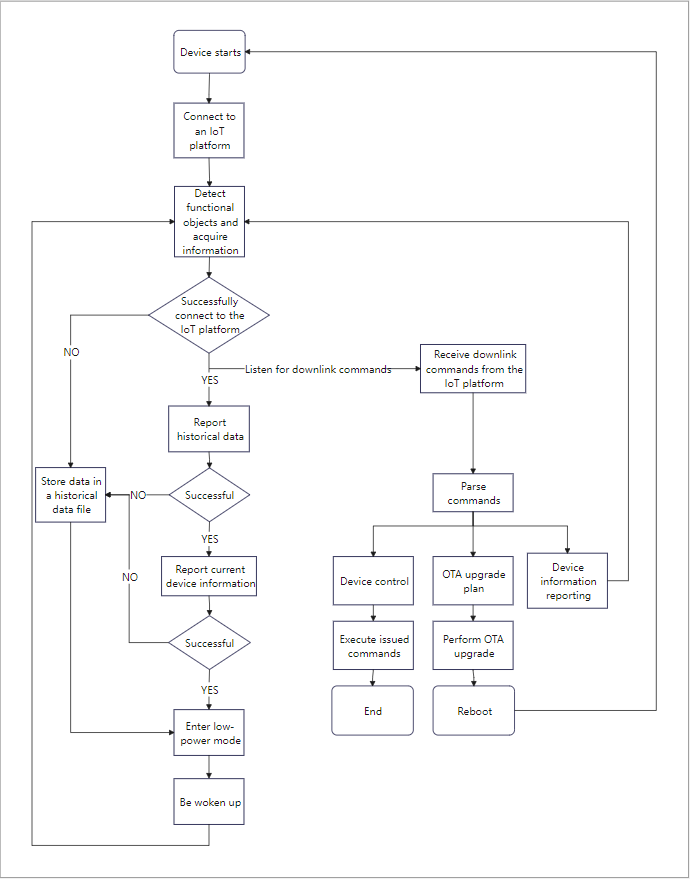
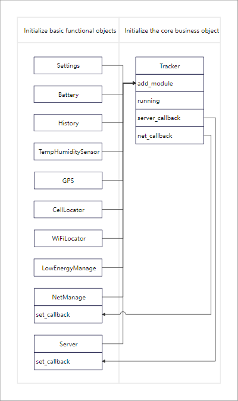

# Software design

## Introduction

This document mainly describes the design framework of the QuecPython locator for mobile communication, including the software and hardware system framework, key component function description, system initialization process and business process introduction, as well as functional examples, to facilitate users to quickly understand the overall architecture and functions of the QuecPython locator.

## Function introduction

The software functions in the intelligent locator solution are introduced as shown in the following figure. The solution is divided into functions based on the actual business of the locator and developed in a modular manner.



- Transmission Protocol Analysis
    + Alibaba IoT Platform Connection and Data Interaction
    + ThingsBoard Platform Connection and Data Interaction
    + GT06 protocol
    + JT/T808 protocol
- network management
    + MQTT protocol
    + TCP/UDP protocol
    + APN setting
    + LTE NET
- External Device Management
    + GNSS positioning data reading, enabling, AGPS injection, etc
    + G-Sensor sensor data reading
    + Charge IC charging management, obtaining device charging status
    + Battery management, reading battery voltage, converting battery capacity
    + LED indicator light
- Data Storage
    + System configuration parameter storage
    + Positioning data supplementary transmission and storage
    + AGPS download storage
    + Log information storage
- Device Upgrade
    + OTA
- Business Function Management
    + Connection and reconnection between network and IoT platform
    + Equipment data collection and reporting
    + Alarm detection and reporting
    + IoT platform downlink instruction processing
    + Low power sleep mode of the device

## Data exchange process

The data exchange process between modules and IoT platforms is described in the following figure:



Process description:
1. The mobile app sends instructions to the IoT platform, and the server sends the instruction data to the module end through TCP/UDP/MQTT protocol for parsing and processing;
2. The module reports data to the IoT platform through TCP/UDP/MQTT protocol, which processes it and synchronously displays it on the mobile phone.

## Software framework

### Design ideas

- This system is designed in listener mode and monitors message transmission events through callback functions;
- The software splits its functions according to the business requirements of the locator, mainly implementing them in modules. Each part is independently developed and implemented to reduce dependence on each other, and can be independently debugged and run to achieve decoupling effect;
- The event interaction between functions is completed through callback functions, and all business function processing is handled in the 'Tracker' class, such as downstream instruction processing, alarm detection, data collection and reporting, device control, etc.



1. All functional modules are controlled by registering them in the `Tracker` class through `Tracker.add_module`;
2. The Server module (IoT platform interaction module) passes the service-oriented downlink data to `Tracker.server_callback` for processing through callbacks;
3. The NetManage module passes the network disconnection event to `Tracker.net_callback` for processing through callbacks.

### Software architecture diagram

The introduction and description of the software system framework are as follows:

- Display layer, integrating with different IoT platforms;
- Transport layer, using different protocols for interaction;
- The business layer is mainly used to collect device data, control device modules, receive and process downstream instructions from the IoT platform, and integrate and report data;
- The device layer mainly includes functions such as obtaining and parsing positioning data, reading sensor data, battery management, and storing historical data. It also collects device data information and sets device functions, such as device version information, IMEI number, APN settings, network dialing, and device low power consumption.



## Introduction to functional components

### Core business module (Tracker)

1. Function description

   Implement core business logic, interact and parse data with the server, control device modules, and transmit all functions in the form of events to the sub threads of the business event message queue for processing.

2. Implementation principle

- By registering functional modules, obtain data from various functional modules, such as positioning information, battery information, sensor information, etc

  ```python
  class Tracker:
      ...
  
      def add_module(self, module):
          if isinstance(module, AliIot):
              self.__server = module
          elif isinstance(module, AliIotOTA):
              self.__server_ota = module
          elif isinstance(module, Battery):
              self.__battery = module
          elif isinstance(module, History):
              self.__history = module
          elif isinstance(module, GNSS):
              self.__gnss = module
          elif isinstance(module, CellLocator):
              self.__cell = module
          elif isinstance(module, WiFiLocator):
              self.__wifi = module
          elif isinstance(module, NMEAParse):
              self.__nmea_parse = module
          elif isinstance(module, CoordinateSystemConvert):
              self.__csc = module
          elif isinstance(module, NetManage):
              self.__net_manage = module
          elif isinstance(module, PowerManage):
              self.__pm = module
          elif isinstance(module, TempHumiditySensor):
              self.__temp_sensor = module
          elif isinstance(module, Settings):
              self.__settings = module
          else:
              return False
          return True
  
      def running(self, args=None):
          if self.__running_tag == 1:
              return
          self.__running_tag = 1
          # Disable device sleep mode
          self.__pm.autosleep(0)
          self.__pm.set_psm(mode=0)
          # Start the listener thread for the business event message queue
          self.__business_start()
          # Send the OTA version refresh instruction to the event queue for execution.
          self.__business_queue.put((0, "ota_refresh"))
          # Send the event for reporting location data (including network connection, data collection of the device, and reporting of device data)
          self.__business_queue.put((0, "loc_report"))
          # Event of sending OTA upgrade query instruction
          self.__business_queue.put((0, "check_ota"))
          # Send device sleep event
          self.__business_queue.put((0, "into_sleep"))
          self.__running_tag = 0
  ```
  
- By calling back and monitoring the command messages issued by the server, perform business processing

  ```python
  class  Tracker:
      ...
  
      def server_callback(self, args):
          # Downstream messages from the server are received and processed in the business event message queue.
          self.__business_queue.put((1, args))
  ```

  ```python
  class Tracker:
      ...
  
      def __business_running(self):
          while True:
              data = self.__business_queue.get()
              with self.__business_lock:
                  self.__business_tag = 1
                  ...
                  # Handling the function of downlink instructions for IoT platforms
                  if data[0] == 1:
                      self.__server_option(*data[1])
                  self.__business_tag = 0
  ```
  
  ```python
  class Tracker:
    ...
  
    def __server_option(self, topic, data):
        if topic.endswith("/property/set"):
            # Downstream message for handling attribute settings
            self.__server_property_set(data)
        elif topic.find("/rrpc/request/") != -1:
            # Downlink messages for handling transparent data transmission
            msg_id = topic.split("/")[-1]
            self.__server_rrpc_response(msg_id, data)
        elif topic.find("/thing/service/") != -1:
            # Downstream messages for processing service data
            service = topic.split("/")[-1]
            self.__server_service_response(service, data)
        elif topic.startswith("/ota/device/upgrade/") or topic.endswith("/ota/firmware/get_reply"):
            # Handle the downlink messages related to OTA upgrade
            user_cfg = self.__settings.read("user")
            if self.__server_ota_flag == 0:
                if user_cfg["sw_ota"] == 1:
                    self.__server_ota_flag = 1
                    if user_cfg["sw_ota_auto_upgrade"] == 1 or user_cfg["user_ota_action"] == 1:
                        # Satisfy the conditions for OTA upgrade and execute the OTA upgrade process.
                        self.__server_ota_process(data)
                    else:
                        self.__server_ota_flag = 0
                        self.__server_ota.set_ota_data(data["data"])
                        ota_info = self.__server_ota.get_ota_info()
                        ota_info["ota_status"] = 1
                        self.__server_ota_state_save(**ota_info)
                else:
                    module = data.get("data", {}).get("module")
                    self.__server.ota_device_progress(-1, "Device is not alowed ota.", module)
  ```

- Wake up the device from sleep and report business data through RTC callback wake-up operation

  ```python
  class Tracker:
      ...
  
      def __into_sleep(self):
          while True:
              if self.__business_queue.size() == 0 and self.__business_tag == 0:
                  break
              utime.sleep_ms(500)
          user_cfg = self.__settings.read("user")
          # Adjust the sleep mode automatically according to the duration of sleep. Autosleep or PSM.
          if user_cfg["work_cycle_period"] < user_cfg["work_mode_timeline"]:
              self.__pm.autosleep(1)
          else:
              self.__pm.set_psm(mode=1, tau=user_cfg["work_cycle_period"], act=5)
          # Activate the RTC for timed wake-up of the device.
          self.__set_rtc(user_cfg["work_cycle_period"], self.running)
  
      def __set_rtc(self, period, callback):
          # Set the RTC wake-up clock and wake up the device.
          self.__business_rtc.enable_alarm(0)
          if callback and callable(callback):
              self.__business_rtc.register_callback(callback)
          atime = utime.localtime(utime.mktime(utime.localtime()) + period)
          alarm_time = (atime[0], atime[1], atime[2], atime[6], atime[3], atime[4], atime[5], 0)
          _res = self.__business_rtc.set_alarm(alarm_time)
          log.debug("alarm_time: %s, set_alarm res %s." % (str(alarm_time), _res))
          return self.__business_rtc.enable_alarm(1) if _res == 0 else -1
  ```

3. Registration function module and callback function configuration

   ```python
   def main():
       # Initialize the network function module
       net_manage = NetManage(PROJECT_NAME, PROJECT_VERSION)
       # Initialization configuration parameter function module
       settings = Settings()
       # Initialize the battery detection function module
       battery = Battery()
       # Initialize the historical data function module
       history = History()
       # Initialize the functional modules of the IoT platform (Alibaba IoT)
       server_cfg = settings.read("server")
       server = AliIot(**server_cfg)
       # Initialize the OTA (Over-The-Air) function module of the IoT platform (Alibaba IoT)
       server_ota = AliIotOTA(PROJECT_NAME, FIRMWARE_NAME)
       server_ota.set_server(server)
       # Initialize the low-power function module
       power_manage = PowerManage()
       # Initialize the function module of the temperature and humidity sensor
       temp_sensor = TempHumiditySensor(i2cn=I2C.I2C1, mode=I2C.FAST_MODE)
       loc_cfg = settings.read("loc")
       # Initialize the GNSS positioning function module
       gnss = GNSS(**loc_cfg["gps_cfg"])
       # Initialize the base station positioning function module
       cell = CellLocator(**loc_cfg["cell_cfg"])
       # Initialize the Wifi positioning function module
       wifi = WiFiLocator(**loc_cfg["wifi_cfg"])
       # Initialize the GNSS positioning data parsing function module
       nmea_parse = NMEAParse()
       # Initialize the function module for coordinate system conversion between WGS84 and GCJ02
       cyc = CoordinateSystemConvert()
   
       # Initialize the Tracker business function module
       tracker = Tracker()
       # Register the basic functional modules into the Tracker class for control.
       tracker.add_module(settings)
       tracker.add_module(battery)
       tracker.add_module(history)
       tracker.add_module(net_manage)
       tracker.add_module(server)
       tracker.add_module(server_ota)
       tracker.add_module(power_manage)
       tracker.add_module(temp_sensor)
       tracker.add_module(gnss)
       tracker.add_module(cell)
       tracker.add_module(wifi)
       tracker.add_module(nmea_parse)
       tracker.add_module(cyc)
       
       # Add the basic event to the event list.
       server.add_event("over_speed_alert")
       server.add_event("sim_abnormal_alert")
       server.add_event("low_power_alert")
       server.add_event("fault_alert")
   
       # Set the callback function of the network module. When the network connection is lost, carry out business processing.
       net_manage.set_callback(tracker.net_callback)
       # Set the callback for the downlink data reception on the server side. When the server issues an instruction, carry out the business processing.
       server.set_callback(tracker.server_callback)
   
       # Initiate the business functions of the Tracker project.
       tracker.running()
   
   if __name__ == "__main__":
       # Main file startup
       main()
   ```

### Location module

1. Function Description

   Obtain current device location information through built-in or external GNSS, base station, and WiFi.

2. Implementation principle

- Built in GNSS enables and reads GNSS data through the `quecgnss` interface

  ```python
  class GNSS:
      ...
  
      def __internal_read(self):
          log.debug("__internal_read start.")
          # Activate GNSS
          self.__internal_open()
  
          # Clear the GNSS historical data cached in the serial port
          while self.__break == 0:
              gnss_data = quecgnss.read(1024)
              if gnss_data[0] == 0:
                  self.__break = 1
          self.__break = 0
  
          self.__gps_nmea_data_clean()
          self.__gps_data_check_timer.start(2000, 1, self.__gps_data_check_callback)
          cycle = 0
          # Read the raw data of GNSS (Global Navigation Satellite System)
          while self.__break == 0:
              gnss_data = quecgnss.read(1024)
              if gnss_data and gnss_data[1]:
                  this_gps_data = gnss_data[1].decode() if len(gnss_data) > 1 and gnss_data[1] else ""
                  self.__reverse_gps_data(this_gps_data)
                  if self.__check_gps_valid():
                      self.__break = 1
              cycle += 1
              if cycle >= self.__retry:
                  if self.__break != 1:
                      self.__break = 1
              if self.__break != 1:
                  utime.sleep(1)
          self.__gps_data_check_timer.stop()
          self.__break = 0
  
          self.__gps_data_check_callback(None)
          # Disable GNSS
          self.__internal_close()
          log.debug("__internal_read %s." % ("success" if self.__get_gps_data() else "failed"))
          return self.__get_gps_data()
  ```

- External GNSS reads GNSS data through UART serial port

  ```python
  class GNSS:
      ...
  
      def __external_read(self):
          # Enable GNSS UART serial port
          self.__external_open()
          log.debug("__external_read start")
  
          # Clear the GNSS historical data cached in the serial port
          while self.__break == 0:
              self.__gps_timer.start(50, 0, self.__gps_timer_callback)
              signal = self.__external_retrieve_queue.get()
              log.debug("[first] signal: %s" % signal)
              if signal:
                  to_read = self.__external_obj.any()
                  log.debug("[first] to_read: %s" % to_read)
                  if to_read > 0:
                      self.__set_gps_data(self.__external_obj.read(to_read).decode())
              self.__gps_timer.stop()
          self.__break = 0
  
          self.__gps_nmea_data_clean()
          self.__gps_data_check_timer.start(2000, 1, self.__gps_data_check_callback)
          cycle = 0
          # Read the raw data of GNSS (Global Navigation Satellite System)
          while self.__break == 0:
              self.__gps_timer.start(1500, 0, self.__gps_timer_callback)
              signal = self.__external_retrieve_queue.get()
              log.debug("[second] signal: %s" % signal)
              if signal:
                  to_read = self.__external_obj.any()
                  log.debug("[second] to_read: %s" % to_read)
                  if to_read > 0:
                      self.__reverse_gps_data(self.__external_obj.read(to_read).decode())
                      if self.__check_gps_valid():
                          self.__break = 1
  
              self.__gps_timer.stop()
              cycle += 1
              if cycle >= self.__retry:
                  self.__break = 1
              if self.__break != 1:
                  utime.sleep(1)
          self.__gps_data_check_timer.stop()
          self.__break = 0
  
          # To check GPS data is usable or not.
          self.__gps_data_check_callback(None)
          # Disable the GNSS serial port
          self.__external_close()
          log.debug("__external_read %s." % ("success" if self.__get_gps_data() else "failed"))
          return self.__get_gps_data()
  ```

- The base station positioning obtains information such as latitude, longitude, and accuracy through the cellLocator base station positioning interface

  ```python
  class CellLocator:
      ...
  
      def __read_thread(self):
          loc_data = ()
          try:
              # Read the base station positioning information
              loc_data = cellLocator.getLocation(
                  self.__serverAddr,
                  self.__port,
                  self.__token,
                  self.__timeout,
                  self.__profileIdx
              )
              loc_data = loc_data if isinstance(loc_data, tuple) and loc_data[0] and loc_data[1] else ()
          except Exception as e:
              sys.print_exception(e)
          self.__queue.put(loc_data)
  ```

- WiFi positioning obtains information such as latitude, longitude, accuracy, and MAC address through the WiFi locator and WiFi Scan interfaces

  ```python
  class WiFiLocator:
  
      def __init__(self, token):
          self.__wifilocator = wifilocator(token) if wifilocator else None
  
      def __read_thread(self):
          loc_data = ()
          try:
              # Read Wifi positioning information
              loc_data = self.__wifilocator_obj.getwifilocator()
              loc_data = loc_data if isinstance(loc_data, tuple) and loc_data[0] and loc_data[1] else ()
          except Exception as e:
              sys.print_exception(e)
          self.__queue.put(loc_data)
  ```

### Battery module

1. Function Description

   Read the battery level and voltage, obtain the charging status of the battery, and notify the user of changes in the battery charging status through callback functions.

2.  Implementation principle

- There are two ways to obtain battery voltage
    + Obtain power supply voltage through the Power module;
    + Obtain voltage through ADC for calculation.
    
    ```python
    class Battery(object):
        ...
    
        def __get_power_vbatt(self):
            """Get vbatt from power"""
            # Obtain the power supply voltage through the Power module
            return int(sum([Power.getVbatt() for i in range(100)]) / 100)
    
        def __get_adc_vbatt(self):
            """Get vbatt from adc"""
            # Calculate by obtaining voltage through ADC
            self.__adc.open()
            utime.sleep_ms(self.__adc_period)
            adc_list = list()
            for i in range(self.__adc_period):
                adc_list.append(self.__adc.read(self.__adc_num))
                utime.sleep_ms(self.__adc_period)
            adc_list.remove(min(adc_list))
            adc_list.remove(max(adc_list))
            adc_value = int(sum(adc_list) / len(adc_list))
            self.__adc.close()
            vbatt_value = adc_value * (self.__factor + 1)
            return vbatt_value
    ```

- At present, only simulation calculation is provided for battery power, and a data relationship table of voltage and temperature corresponding to battery power is entered for fuzzy calculation

  ```python
  BATTERY_OCV_TABLE = {
      "nix_coy_mnzo2": {
          55: {
              4152: 100, 4083: 95, 4023: 90, 3967: 85, 3915: 80, 3864: 75, 3816: 70, 3773: 65, 3737: 60, 3685: 55,
              3656: 50, 3638: 45, 3625: 40, 3612: 35, 3596: 30, 3564: 25, 3534: 20, 3492: 15, 3457: 10, 3410: 5, 3380: 0,
          },
          20: {
              4143: 100, 4079: 95, 4023: 90, 3972: 85, 3923: 80, 3876: 75, 3831: 70, 3790: 65, 3754: 60, 3720: 55,
              3680: 50, 3652: 45, 3634: 40, 3621: 35, 3608: 30, 3595: 25, 3579: 20, 3548: 15, 3511: 10, 3468: 5, 3430: 0,
          },
          0: {
              4147: 100, 4089: 95, 4038: 90, 3990: 85, 3944: 80, 3899: 75, 3853: 70, 3811: 65, 3774: 60, 3741: 55,
              3708: 50, 3675: 45, 3651: 40, 3633: 35, 3620: 30, 3608: 25, 3597: 20, 3585: 15, 3571: 10, 3550: 5, 3500: 0,
          },
      },
  }
  ```

  ```python
  class Battery:
      ...
  
      def __get_soc_from_dict(self, key, volt_arg):
          """Get battery energy from map"""
          if BATTERY_OCV_TABLE[self.__battery_ocv].get(key):
              volts = sorted(BATTERY_OCV_TABLE[self.__battery_ocv][key].keys(), reverse=True)
              pre_volt = 0
              volt_not_under = 0  # Determine whether the voltage is lower than the minimum voltage value of soc.
              for volt in volts:
                  if volt_arg > volt:
                      volt_not_under = 1
                      soc1 = BATTERY_OCV_TABLE[self.__battery_ocv][key].get(volt, 0)
                      soc2 = BATTERY_OCV_TABLE[self.__battery_ocv][key].get(pre_volt, 0)
                      break
                  else:
                      pre_volt = volt
              if pre_volt == 0:  # Input Voltarg > Highest Voltarg
                  return soc1
              elif volt_not_under == 0:
                  return 0
              else:
                  return soc2 - (soc2 - soc1) * (pre_volt - volt_arg) // (pre_volt - volt)
  
      def __get_soc(self, temp, volt_arg):
          """Get battery energy by temperature and voltage"""
          if temp > 30:
              return self.__get_soc_from_dict(55, volt_arg)
          elif temp < 10:
              return self.__get_soc_from_dict(0, volt_arg)
          else:
              return self.__get_soc_from_dict(20, volt_arg)
  ```

- The charging status of the battery is determined by the pin interruption and the voltage level of the acquisition pin to determine the current charging status of the device

  ```python
  class Battery:
      ...
  
      def __update_charge_status(self):
          """Update Charge status by gpio status"""
          if not self.__usb:
              chrg_level = self.__chrg_gpio.read()
              stdby_level = self.__stdby_gpio.read()
              if chrg_level == 1 and stdby_level == 1:
                  # Not charge.
                  self.__charge_status = 0
              elif chrg_level == 0 and stdby_level == 1:
                  # Charging.
                  self.__charge_status = 1
              elif chrg_level == 1 and stdby_level == 0:
                  # Charge over.
                  self.__charge_status = 2
              else:
                  raise TypeError("CHRG and STDBY cannot be 0 at the same time!")
          else:
              self.__usb_charge()
  
      @property
      def charge_status(self):
          """Get charge status
          Returns:
              0 - Not charged
              1 - Charging
              2 - Finished charging
          """
          self.__update_charge_status()
          return self.__charge_status
  ```

### Low power module (power_manage)

1. Function Description

   Periodically wake up the device and perform business processing. After the business processing is completed, the device enters sleep mode.

   The currently supported sleep modes are:

   - autosleep；
   - psm。

2. Implementation principle

   Set the corresponding sleep mode to put the device into sleep mode and wake it up through RTC timer

   ```python
   class PowerManage:
       ...
   
       def autosleep(self, val):
           """Set device autosleep.
   
           Args:
               val (int): 0 - disable, 1 - enable.
   
           Returns:
               bool: True - success. False - failed.
           """
           return True if hasattr(pm, "autosleep") and val in (0, 1) and pm.autosleep(val) == 0 else False
   
       def set_psm(self, mode=1, tau=None, act=None):
           """Set device psm.
   
           Args:
               mode (int): 0 - disable psm, 1 - enable psm.
               tau (int/None): tau seconds. When mode is 0, this value is None. (default: `None`)
               act (int/None): act seconds. When mode is 0, this value is None. (default: `None`)
   
           Returns:
               bool: True - success. False - failed.
           """
           if not hasattr(pm, "set_psm_time") or not hasattr(pm, "get_psm_time"):
               return False
           if mode == 0:
               return pm.set_psm_time(0)
           else:
               self.__init_tau(tau)
               self.__init_act(act)
               res = pm.set_psm_time(self.__tau_unit, self.__tau_time, self.__act_unit, self.__act_time)
               log.info("set_psm_time: %s" % res)
               if res:
                   get_psm_res = pm.get_psm_time()
                   log.debug("get_psm_res: %s" % str(get_psm_res))
                   if get_psm_res[0] == 1 and get_psm_res[1:] == [self.__tau_unit, self.__tau_time, self.__act_unit, self.__act_time]:
                       log.debug("PSM time equal set time.")
               return res
   ```

### AliyunIot

1. Function Description

   Interact with Alibaba IoT IoT module through MQTT protocol.

   - Device connection login platform
   - Send object model data to the server
   - Receive instructions issued by the server
   - OTA upgrade

   > Taking the Alibaba IoT MQTT protocol as an example, the actual application is developed based on the IoT platform and protocol that is actually connected, and the basic logical pattern is consistent.

2. Implementation principle

   Log in and exchange data according to the communication rules of Alibaba IoT IoT module through MQTT protocol.

- Login

  ```python
  class AliIot:
      ...
  
      def connect(self):
          res = -1
          self.__server = "%s.%s" % (self.__product_key, self.__domain)
          log.debug("self.__product_key: %s" % self.__product_key)
          log.debug("self.__product_secret: %s" % self.__product_secret)
          log.debug("self.__device_name: %s" % self.__device_name)
          log.debug("self.__device_secret: %s" % self.__device_secret)
          log.debug("self.__server: %s" % self.__server)
          self.__server = aLiYun(self.__product_key, self.__product_secret, self.__device_name, self.__device_secret, self.__server)
          res = self.__server.setMqtt(self.__device_name)
          if res == 0:
              self.__server.setCallback(self.__subscribe_callback)
              res = self.__subscribe_topics()
              if res == 0:
                  self.__server.start()
          return res
  ```

- data uplink

  ```python
  class AliIot:
      ...
  
      def properties_report(self, data):.
          # Reporting of attributes
          _timestamp = self.__timestamp
          _id = self.__id
          params = {key: {"value": val, "time": _timestamp} for key, val in data.items()}
          properties = {
              "id": _id,
              "version": "1.0",
              "sys": {
                  "ack": 1
              },
              "params": params,
              "method": "thing.event.property.post",
          }
          pub_res = self.__server.publish(self.ica_topic_property_post, ujson.dumps(properties), qos=self.__qos) if self.__server else -1
          return self.__get_post_res(_id) if pub_res is True else False
  
      def event_report(self, event, data):
          # Reporting of the incident
          _timestamp = self.__timestamp
          _id = self.__id
          params = {"value": data, "time": _timestamp}
          properties = {
              "id": _id,
              "version": "1.0",
              "sys": {
                  "ack": 1
              },
              "params": params,
              "method": "thing.event.%s.post" % event,
          }
          pub_res = self.__server.publish(self.ica_topic_event_post.format(event), ujson.dumps(properties), qos=self.__qos) if self.__server else -1
          return self.__get_post_res(_id) if pub_res is True else False
  ```

- data downlink

  ```python
  class AliIot:
      ...
  
      def __subscribe_callback(self, topic, data):
          topic = topic.decode()
          try:
              data = ujson.loads(data)
          except:
              pass
          log.debug("topic: %s, data: %s" % (topic, str(data)))
  
          if topic.endswith("/post_reply"):
              self.__put_post_res(data["id"], True if int(data["code"]) == 200 else False)
              return
          elif topic.endswith("/thing/ota/firmware/get_reply"):
              self.__put_post_res(data["id"], True if int(data["code"]) == 200 else False)
  
          if self.__callback and callable(self.__callback):
              # It will be processed in Tracker.server_callback.
              self.__callback((topic, data))
  ```

- OTA upgrade

  ```python
  class AliIotOTA:
      ...
  
      def start(self):
          # Start OTA upgrade
          if self.__module == self.__project_name:
              self.__start_sota()
          elif self.__module == self.__firmware_name:
              self.__start_fota()
          else:
              return False
          return True
  
      def __start_fota(self):
          log.debug("__start_fota")
          fota_obj = fota()
          url1 = self.__files[0]["url"]
          url2 = self.__files[1]["url"] if len(self.__files) > 1 else ""
          log.debug("start httpDownload")
          if url2:
              res = fota_obj.httpDownload(url1=url1, url2=url2, callback=self.__fota_callback) if fota_obj else -1
          else:
              res = fota_obj.httpDownload(url1=url1, callback=self.__fota_callback) if fota_obj else -1
          log.debug("httpDownload res: %s" % res)
          if res == 0:
              self.__ota_timer.start(600 * 1000, 0, self.__ota_timer_callback)
              fota_res = self.__fota_queue.get()
              self.__ota_timer.stop()
              return fota_res
          else:
              self.__server.ota_device_progress(-2, "Download File Failed.", module=self.__module)
              return False
  ```

### UML

There are dependency and inheritance relationships between various component objects in the project software code. We can use the locator product as the top-level object, which consists of several corresponding functions. This chapter establishes an association between it and the dependent component objects through UML class diagrams, as shown in the following figure.


## Event process description

### operation flow



Business Process Description:

1. Power on and start the device;
2. Network (APN) configuration and (dial-up) connection, IoT platform configuration and connection, retry if failed;
3. Device module startup detection and data collection;
   - GNSS positioning module starts, waiting for positioning data;
   - G-Sensor three-axis acceleration sensor module startup and calibration detection;
   - LED indicator lights (network status/location status/charging status, etc.) start;
   - Battery power collection and charging status detection;
   - Alarm detection (overspeed detection/vibration detection/fence detection/low power detection, etc.).After the IoT platform is successfully connected, check if there is any historical data that needs to be reported;
4. IoT platform connection successful, report current device information (location/alarm);
5. If the IoT platform connection fails, the current device information (location/alarm) will be stored;
6. The device has no task, enters low-power mode, and wakes up the device at a scheduled time for device information detection and reporting;
  After the IoT platform is successfully connected, wait for the IoT platform to issue command information;
7. Interpretation of instruction information.
  - Device control instructions, such as modifying device business parameters, controlling device shutdown and restart, etc;
  - Issue OTA upgrade instructions to perform OTA upgrade;
  - Device information query command, respond to device information.

### System initialization process



1. Initialization of basic functional modules, low-power management, configuration parameters, battery, historical files, positioning, sensors;
2. Initialize the IoT platform client module, Alibaba IoT or ThingsBoard platform or private service platform (GT06, JT/T808, etc.);
3. Initialize the core business module (Tracker), add each functional module to the Tracker object through the `add_module` interface, and then register the `Tracker.server_callback` in the Server object to receive downstream message instructions from the server.