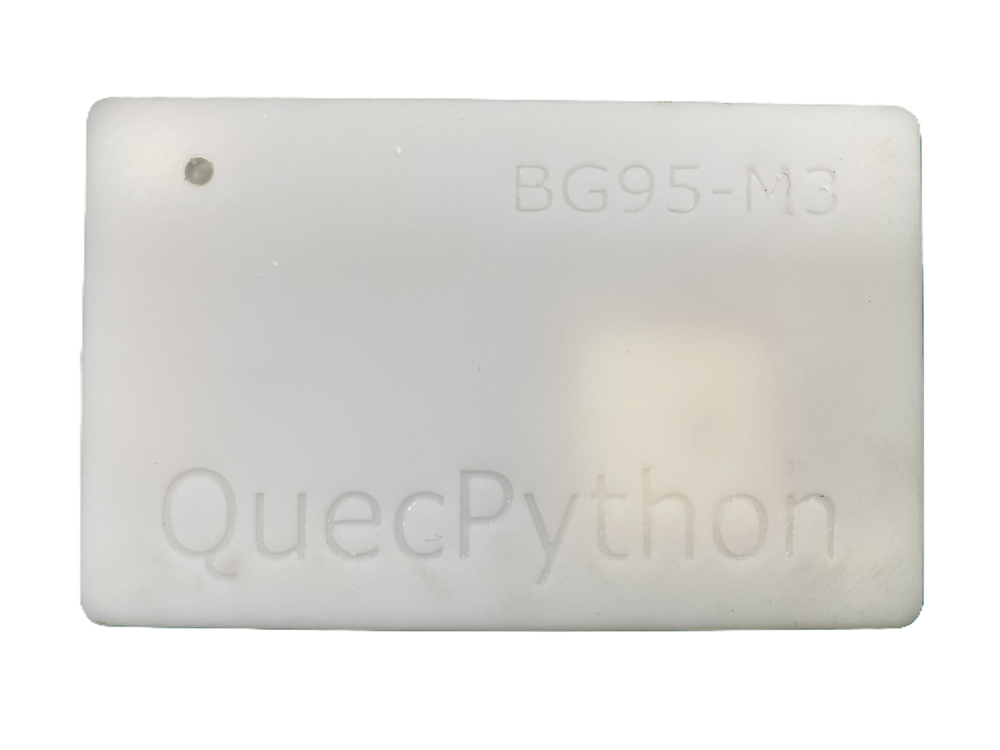

# Smart Tracker Solution Based on BG95M3

The Smart Tracker Solution is implemented based on the QuecPython **BG95-M3** standard development board and has the following features: 

• Provides accurate high-precision GNSS positioning.

 • Powerful and rich interfaces. 

• Uses Python language, facilitating secondary development.

------

- [Summary of Development Resources](./dev_resources.md)
- [Quick Start](quick_start.md)
- [Software Design Explanation](./software_design.md)

