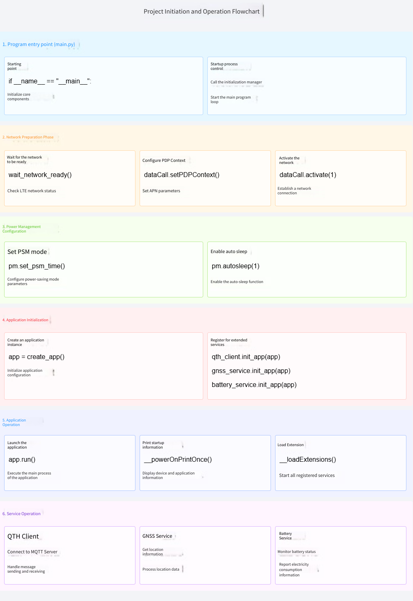

# Software Design

## Introduction

The Smart Tracker by Acceleronix lets you connect effortlessly to the Acceleronix Asset Management SaaS, enabling quick cloud service demos with zero setup hassle. This guide will walk you through using the Smart Tracker to explore platform features seamlessly.

## Software framework

### Software Design Diagram



## Code Explanation

### Wait for the network to be ready

The wait_network_ready class in main.py calculates the maximum number of waiting times (WAIT_NETWORK_READY_S seconds divided by a 5-second interval). It returns True if the network is ready, and False if it times out.

```python
def wait_network_ready():
    wait_cnt = WAIT_NETWORK_READY_S / 5
    is_ready = False

    while wait_cnt:        
        lte = dataCall.getInfo(1, 0)
        if lte[2][0] == 1:
            is_ready = True                        
            break

        utime.sleep(5)
        wait_cnt -= 1    
    
    return is_ready
```

### Create an application instance

The `create_app` function creates an application instance. Its main functions include: creating an Application object, setting the name and version, initializing application configuration, loading configuration files from specified paths, initializing various service modules (such as QTH Client, GNSS Service, Battery Service, etc.), and returning the configured application instance.

```python
def create_app(name="SimpliKit", version="1.0.0", config_path="/usr/config.json"):
    _app = Application(name, version)
    _app.config.init(config_path)

    qth_client.init_app(_app)
    #lbs_service.init_app(_app)
    gnss_service.init_app(_app) 
    battery_service.init_app(_app)
    #sensor_service.init_app(_app)

    return _app
```

### GNSS

This is a Python service module used to process GNSS (Global Navigation Satellite System) positioning data, mainly used for positioning and tracking of IoT devices.

### NMEA Data Parsing Class - NmeaDict

NMEA is the standard data format used by GPS devices: 

• The load() method: Parses raw NMEA data and performs CRC checks. 

• The checksum() method: Verifies the integrity of NMEA sentences.

```python
class NmeaDict(dict):

    @classmethod
    def load(cls, raw):
        items = {}
        for line in raw.split('\r\n'):
            try:
                tail_index = line.rfind('*')
                if tail_index == -1:
                    continue
                head_index = line.rfind('$', 0, tail_index)
                if head_index == -1:
                continue
                crc = int(line[tail_index + 1:tail_index + 3], 16)
                if cls.checksum(line[head_index + 1:tail_index]) != crc:
                    raise ValueError('CRC check failed')
                cmdlist = line[head_index:tail_index].split(',')
                # print(line[head_index:])
                if cmdlist[0] not in items:
                    items[cmdlist[0]] = []
                items[cmdlist[0]].append(line)
            except Exception as e:
                # logger.debug('parse nmea line error: {}; pass it: {}'.format(e, line))
                continue
        return cls(items)

    @staticmethod
    def checksum(data):
        crc = ord(data[0])
        for one in (ord(_) for _ in data[1:]):
            crc ^= one
        return crc
```

### Core Service Class - GnssService

### Initialization and Configuration

• Manage the initialization and state control of GNSS modules 

• Integrate with applications (init_app) 

• Set the positioning update interval (update_interval)

```python
class GnssService(object):

    def __init__(self, app=None):
        self.interval = 300
        self.__gnss = quecgnss

        if app is not None:
            self.init_app(app)

    def __str__(self):
        return '{}'.format(type(self).__name__)
    def init_app(self, app):
        self.event = app.event
        self.gnss_sleep_event = app.gnss_sleep_event
        self.interval = app.config["SLEEP_INTERVAL_SECONDS"]
        app.register('gnss_service', self)
    def load(self):
        logger.info('loading {} extension, init quecgnss will take some seconds'.format(self))
        result = self.init()
        logger.info('{} init gnss res: {}'.format(self, result))
        if result:
            Thread(target=self.start_update).start()

    def init(self):
        if self.__gnss.init() != 0:
            logger.warn('{} gnss init FAILED'.format(self))
            return False
        return True
    def status(self):
        # 0	int	GNSS模块处于关闭状态
        # 1	int	GNSS模块固件升级中
        # 2	int GNSS模块定位中，这种模式下即可开始读取GNSS定位数据，定位数据是否有效需要用户获取到定位数据后，解析对应语句来判断，比如判断GNRMC语句的status是 A 还是 V，A 表示定位有效，V表示定位无效。
        return self.__gnss.get_state()

    def enable(self, flag=True):
        return self.__gnss.gnssEnable(bool(flag)) == 0
    def read(self, size=4096):
        raw = self.__gnss.read(size)
        if raw != -1:
            size, data = raw
            # KHK
            #logger.debug('gnss read raw {} bytes data:\n{}'.format(size, data))
            return NmeaDict.load(data)
    def check_gnss_signal(self, nmea_dict):
        
        snr_threshold = 15        
        min_sats = 3
        has_3d_fix = False
        if "$GNGSA" in nmea_dict:
            for line in nmea_dict["$GNGSA"]:
                parts = line.split(",")
                if len(parts) > 2 and (parts[2] == "3" or parts[2] == "2"):
                    has_3d_fix = True
                    break
        if not has_3d_fix:
            return False

        snrs = []

        def extract_snrs(lines):
            for line in lines:
                parts = line.split(",")
                i = 4
                while i + 3 < len(parts):
                    snr_str = parts[i + 3]
                    if snr_str.isdigit():
                        snrs.append(int(snr_str))
                    i += 4
        if "$GPGSV" in nmea_dict:
            extract_snrs(nmea_dict["$GPGSV"])

        if "$GBGSV" in nmea_dict:
            extract_snrs(nmea_dict["$GBGSV"])

        if "$GAGSV" in nmea_dict:
            extract_snrs(nmea_dict["$GAGSV"])

        # count satelites with SNR > 15
        count = 0
        for snr in snrs:
            if snr > snr_threshold:
                count += 1
                if count >= min_sats:
                    return True
        return False

    def update_interval(self,interval):  
        self.interval = interval
```

### QTH Platform Client

The `QthClient` class is a client class used for communicating with the QTH (Quantum Technology Hub) platform. It is responsible for initializing, starting, and managing the connection to the QTH platform, as well as handling various events and callbacks from the platform.

```python
logger = getLogger(__name__)


class QthClient(object):

    def __init__(self, app=None):
        self.opt_lock = Lock()
        if app:
            self.init_app(app)
 def __enter__(self):
        self.opt_lock.acquire()
        return self

    def __exit__(self, *args, **kwargs):
        self.opt_lock.release()

    def init_app(self, app):
        app.register("qth_client", self)
        Qth.init()               
        Qth.setProductInfo(app.config["QTH_PRODUCT_KEY"], app.config["QTH_PRODUCT_SECRET"])
        Qth.setServer(app.config["QTH_SERVER"])
        Qth.setEventCb(
            {
                "devEvent": self.eventCallback, 
                "recvTrans": self.recvTransCallback, 
                "recvTsl": self.recvTslCallback, 
                "readTsl": self.readTslCallback, 
                "readTslServer": self.recvTslServerCallback,
                "ota": {
                    "otaPlan":self.otaPlanCallback,
                    "fotaResult":self.fotaResultCallback
                }
            }
        )
    
def load(self):
        self.start()

    def start(self):
        Qth.start()
        while not self.isStatusOk():
            utime.sleep(3)
    
    def stop(self):
        Qth.stop()
        
    def sendTsl(self, mode, value):
        return Qth.sendTsl(mode, value)

    def isStatusOk(self):
        return Qth.state()

    def sendLbs(self, lbs_data):
        return Qth.sendOutsideLocation(lbs_data)
    
    def sendGnss(self, nmea_data):
        return Qth.sendOutsideLocation(nmea_data)

    def eventCallback(self, event, result):
        logger.info("dev event:{} result:{}".format(event, result))
        if(2== event and 0 == result):
            Qth.otaRequest()
def recvTransCallback(self, value):
        ret =Qth.sendTrans(1, value)
        logger.info("recvTrans value:{} ret:{}".format(value, ret))

    def recvTslCallback(self, value):
        logger.info("recvTsl:{}".format(value))
        for cmdId, val in value.items():
            logger.info("recvTsl {}:{}".format(cmdId, val))

            if cmdId == 8:
                CurrentApp().gnss_service.update_interval(val)
                CurrentApp().lbs_service.update_interval(val)
                
    def readTslCallback(self, ids, pkgId):
        logger.info("readTsl ids:{} pkgId:{}".format(ids, pkgId))
        value=dict()
         temp1, humi =CurrentApp().sensor_service.get_temp1_and_humi()
        press, temp2 = CurrentApp().sensor_service.get_press_and_temp2()
        r,g,b = CurrentApp().sensor_service.get_rgb888()

        
        for id in ids:
            if 3 == id:
                value[3]=temp1
            elif 4 == id:
                value[4]=humi
            elif 5 == id:
                value[5]=temp2
            elif 6 == id:
                value[6]=press
            elif 7 == id:
                value[7]={1:r, 2:g, 3:b}
        Qth.ackTsl(1, value, pkgId)
       
        
    def recvTslServerCallback(self, serverId, value, pkgId):
        logger.info("recvTslServer serverId:{} value:{} pkgId:{}".format(serverId, value, pkgId))
        Qth.ackTslServer(1, serverId, value, pkgId)
def otaPlanCallback(self, plans):
        logger.info("otaPlan:{}".format(plans))
        Qth.otaAction(1)

    def fotaResultCallback(self, comp_no, result):
        logger.info("fotaResult comp_no:{} result:{}".format(comp_no, result))
        
    def sotaInfoCallback(self, comp_no, version, url, md5, crc):
        logger.info("sotaInfo comp_no:{} version:{} url:{} md5:{} crc:{}".format(comp_no, version, url, md5, crc))
        # 当使用url下载固件完成，且MCU更新完毕后，需要获取MCU最新的版本信息，并通过setMcuVer进行更新
        Qth.setMcuVer("MCU1", "V1.0.0", self.sotaInfoCallback, self.sotaResultCallback)

    def sotaResultCallback(comp_no, result):
        logger.info("sotaResult comp_no:{} result:{}".format(comp_no, result))
```

### Battery Service

battery_service.init_app initializes the battery service module.

```python
logger = getLogger(__name__)

BATTERY_OCV_TABLE = {
    "nix_coy_mnzo2": {
        55: {
            4152: 100, 4083: 95, 4023: 90, 3967: 85, 3915: 80, 3864: 75, 3816: 70, 3773: 65, 3737: 60, 3685: 55,
            3656: 50, 3638: 45, 3625: 40, 3612: 35, 3596: 30, 3564: 25, 3534: 20, 3492: 15, 3457: 10, 3410: 5, 3380: 0,
        },
        20: {
            4143: 100, 4079: 95, 4023: 90, 3972: 85, 3923: 80, 3876: 75, 3831: 70, 3790: 65, 3754: 60, 3720: 55,
            3680: 50, 3652: 45, 3634: 40, 3621: 35, 3608: 30, 3595: 25, 3579: 20, 3548: 15, 3511: 10, 3468: 5, 3430: 0,
        },
        0: {
            4147: 100, 4089: 95, 4038: 90, 3990: 85, 3944: 80, 3899: 75, 3853: 70, 3811: 65, 3774: 60, 3741: 55,
            3708: 50, 3675: 45, 3651: 40, 3633: 35, 3620: 30, 3608: 25, 3597: 20, 3585: 15, 3571: 10, 3550: 5, 3500: 0,
        },
    },
}
class BatteryService(object):
    def __init__(self, app=None):       
        self.interval = 30                
        self.__net = net        
        if app is not None:
            self.init_app(app, battery_ocv="nix_coy_mnzo2")

    def __str__(self):
        return '{}'.format(type(self).__name__)

    def init_app(self, app, battery_ocv="nix_coy_mnzo2"):
        self.gnss_sleep_event = app.gnss_sleep_event
        self.interval = app.config["SLEEP_INTERVAL_SECONDS"]
        self.__energy = 100
        self.__temp = 30
        self.__vbatt_count = 100
        if not BATTERY_OCV_TABLE.get(battery_ocv):
            raise TypeError("Battery OCV %s is not support." % battery_ocv) 
        self.__battery_ocv = battery_ocv
        app.register('battery_service', self)
def load(self):
        logger.info('loading {} extension, init battery will take some seconds'.format(self))
        Thread(target=self.start_update).start()

    def __get_soc_from_dict(self, key, volt_arg):
        """Get battery energy from map"""
        if BATTERY_OCV_TABLE[self.__battery_ocv].get(key):
            volts = sorted(BATTERY_OCV_TABLE[self.__battery_ocv][key].keys(), reverse=True)            
            pre_volt = 0
            volt_not_under = 0  # Determine whether the voltage is lower than the minimum voltage value of soc.
            for volt in volts:
                if volt_arg > volt:
                    volt_not_under = 1
                    soc1 = BATTERY_OCV_TABLE[self.__battery_ocv][key].get(volt, 0)
                    soc2 = BATTERY_OCV_TABLE[self.__battery_ocv][key].get(pre_volt, 0)
                    break
                else:
                pre_volt = volt
            if pre_volt == 0:  # Input Voltarg > Highest Voltarg
                return soc1
            elif volt_not_under == 0:
                return 0
            else:
                return soc2 - (soc2 - soc1) * (pre_volt - volt_arg) // (pre_volt - volt)
def __get_soc(self, temp, volt_arg):
        """Get battery energy by temperature and voltage"""
        if temp > 30:
            return self.__get_soc_from_dict(55, volt_arg)
        elif temp < 10:
            return self.__get_soc_from_dict(0, volt_arg)
        else:
            return self.__get_soc_from_dict(20, volt_arg)            

    def __get_power_vbatt(self):
        """Get vbatt from power"""        
        return int(sum([Power.getVbatt() for i in range(self.__vbatt_count)]) / self.__vbatt_count)
def set_temp(self, temp):
        """Set now temperature."""
        if isinstance(temp, int) or isinstance(temp, float):
            self.__temp = temp
            return True
        return False 
    def start_update(self):
        while True:
            if quecgnss.getPriority():            
                self.__energy = self.__get_soc(self.__temp, self.__get_power_vbatt())            
                data = {4: self.__energy}                
                if data:
                    with CurrentApp().qth_client:
                        for _ in range(3):
                            if CurrentApp().qth_client.sendTsl(1, data):
                                logger.debug("send battery data to qth server success") 
                                break                   
                #self.gnss_sleep_event.set()  # Notify GNSS service to wake up
                utime.sleep(self.interval)
            else:
                utime.sleep(0.1)
```