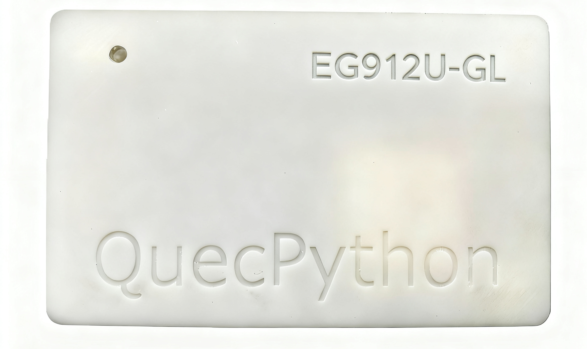

# Smart tracker solution based on EG912U

This Smart Tracker solution is implemented based on the QuecPython EG912U standard development board and features the following characteristics:

- Provide accurate and high-precision GNSS positioning.
- Powerful and rich interfaces.
- Using the python language is convenient for secondary development

- [Development resources](./dev_resources.md)
- [Quick start](./quick_start.md)
- [Software design](./software_design.md)