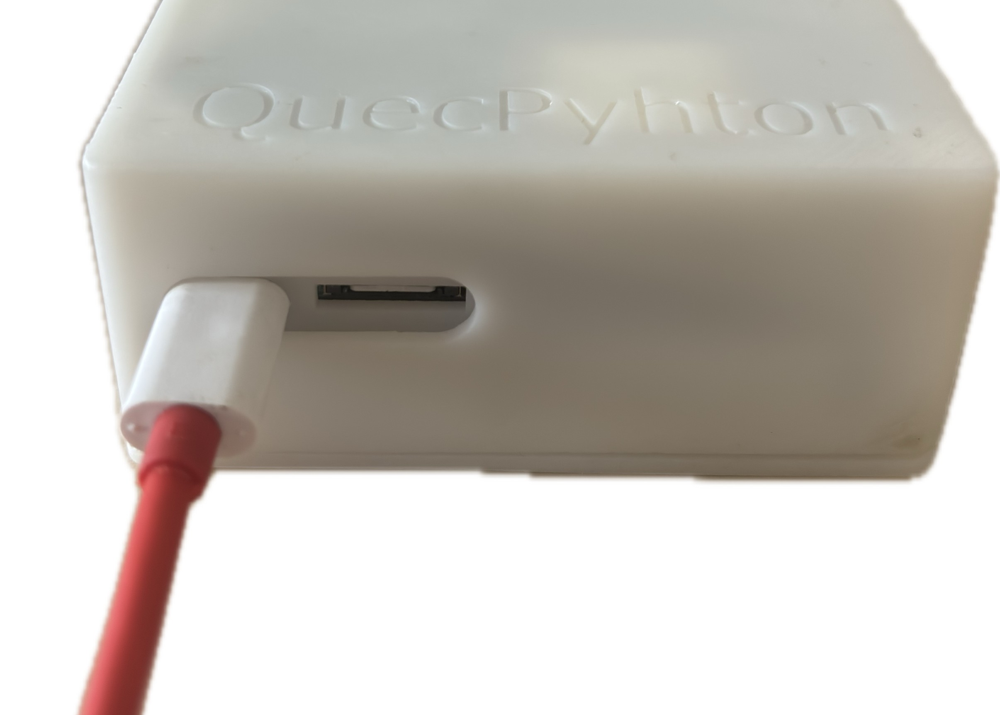
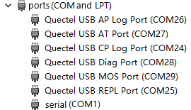
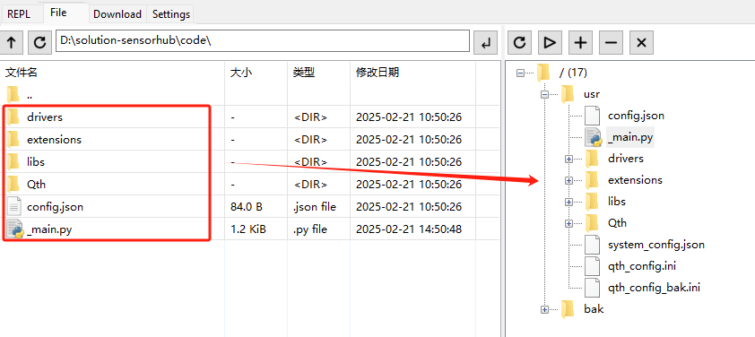
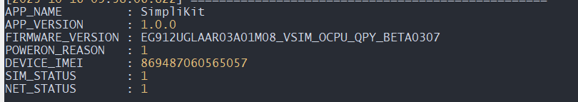
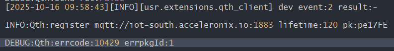
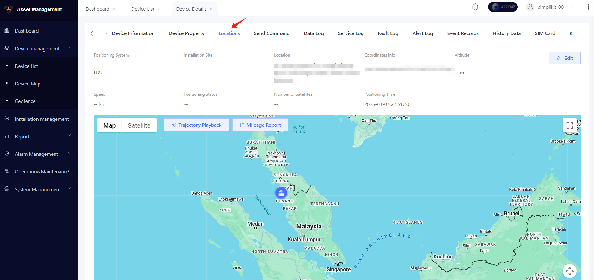
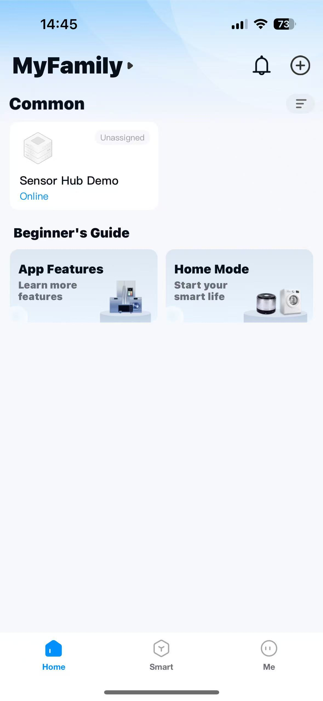
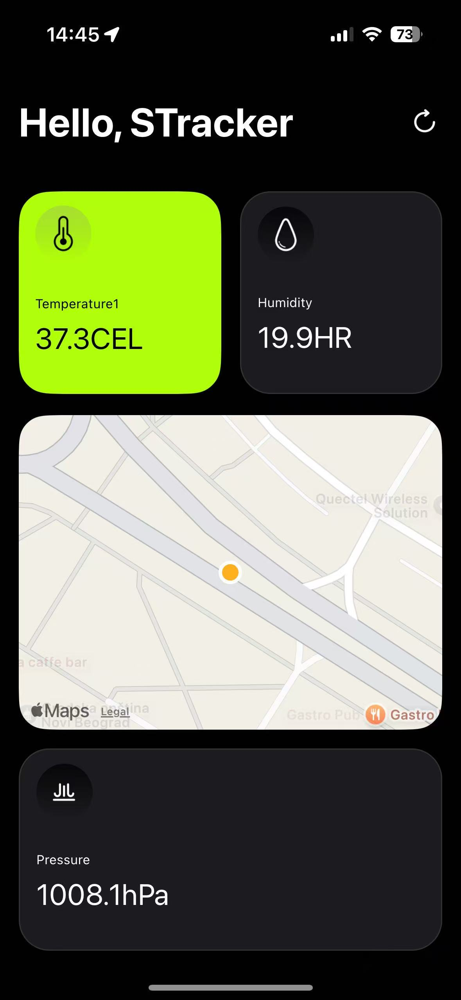

# Quick start

## Hardware preparation

- A Windows computer, recommended for the Win10 system.

- A set of tracker box devices

- Nano SIM card.

## Environment construction

- Download and install the EG912U series module driver：[QuecPython_USB_Driver_Win10_U_G](https://developer.quectel.com/wp-content/uploads/2024/09/Quectel_Windows_USB_DriverU_V1.0.19.zip)

- Download and install [VSCode](https://gitee.com/link?target=https%3A%2F%2Fcode.visualstudio.com%2F)
- Download and unzip [QPYcom](https://developer.quectel.com/wp-content/uploads/2024/09/QPYcom_V3.9.0.zip)
- Download [Firmware](../../media/solutions/tracker_box(EG912U)/fw/8915DM_cat1_open_EG912UGLAAR05A01M08_TEST0807.zip)
- Download [Source code](https://github.com/QuecPython/tracker-box/archive/refs/heads/tracker-box-EG912U.zip) 

## Set up your smart tracker

Follow the steps below to power the smart tracker: 

1. Before powering on, insert the nano SIM card (with data service enabled) into the SIM card slot. If you insert the SIM card after powering on, you need to restart the device.
2. Power on using any of the following methods:

- Method 1: Press the power button on the side of the device.

  

  

- Method 2: Connect the smart tracker to your laptop or power bank using the included USB-C cable, and the device will automatically power on.

3.After startup, the smart tracker will connect to the cellular network and link to the Acceleronix asset management SaaS platform.

## Connect to the asset management SaaS platform

Acceleronix's asset management SaaS platform offers comprehensive solutions for specific industries. It covers the entire business process from the definition of TSL model functions to SaaS platform management and mobile application device control.

This asset management SaaS platform enables users to operate devices and can conduct dynamic analysis of hardware data based on the TSL model. It integrates multiple sensors such as water quality, temperature, humidity, light and carbon dioxide to adapt to different scenarios. The functions include real-time data viewing, historical operation curves, data aggregation, as well as device maps and trajectory playback based on location devices.

## Device development

### Power on

After completing the hardware connection work, if a COM port containing the words "Quectel USB" appears in the port list of the computer device manager, it indicates that the computer has successfully booted up.

###  Firmware Package Burning

Refer to [this chapter](https://developer.quectel.com/doc/quecpython/Application_guide/en/dev-tools/QPYcom/qpycom-dw.html#Download-Firmware) Burn the corresponding firmware package to the development board.

### Script Import and Execution

1. Refer to [this chapter](https://developer.quectel.com/doc/quecpython/Getting_started/en/4G/first_python.html) Import all files from the `code` folder in the source code directory into the module file system, as shown in the following figure:

2. Refer to [this chapter](https://developer.quectel.com/doc/quecpython/Getting_started/en/4G/first_python.html#Executing-the-Script-File) Execute the main program file `_main.py`.
3. Refer to [this chapter](https://developer.quectel.com/doc/quecpython/Getting_started/en/4G/first_python.html#Stop-a-Running-Program) Stop the program from running.

## Business debugging

### Program Startup

After executing the _main.py script, the program starts running and prints the dialing information, including the dialing status, IP address, DNS server address, device number, etc

### Data Detection

After starting to run, startup information will be printed.

### View device location

1. [Click to visit the cloud platform](https://core.acceleronix.io/)，Click **Details** in the device list to open the device details page. 

2. Go to the **Location** tab to view LBS location data.

   

> Note: The location is updated every 30 minutes. If you need to manually refresh, please click the refresh button in the application control panel, then reload the page to view the updated location.

### View and manage sensor data 

1. When the device is online, click on the device in the Wonderfree app to enter the control panel. 
1.  View the real-time sensor data and LBS location data of the smart tracker. 
1. If you need to update sensor data or LBS location, click the refresh button in the upper right corner of the control panel.

