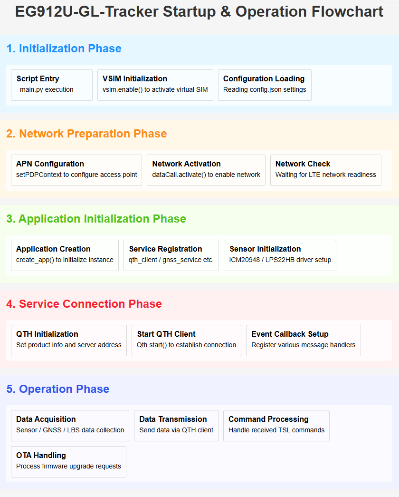

# Software design explanation

## Software framework



## Code explanation

### Wait for the network to be ready

The `wait_network_ready` class in main.py calculates the maximum number of waiting times by dividing the number of seconds in WAIT_NETWORK_READY_S by the 5-second interval. It returns True if the network is ready, and False if it times out.

```python
def wait_network_ready():
    wait_cnt = WAIT_NETWORK_READY_S / 5
    is_ready = False

    while wait_cnt:        
        lte = dataCall.getInfo(1, 0)
        if lte[2][0] == 1:
            is_ready = True                        
            break

        utime.sleep(5)
        wait_cnt -= 1    
    
    return is_ready

```

### Create an application instance

The `create_app` function creates an application instance. Its main functions include: creating an `Application` application object, setting the name and version, initializing the application configuration, loading the configuration file from the specified path, initializing various service modules (such as QTH Client, GNSS Service, Battery Service, etc.), and returning the configured application instance.

```python
def create_app(name="SimpliKit", version="1.0.0", config_path="/usr/config.json"):
    _app = Application(name, version)
    _app.config.init(config_path)

    qth_client.init_app(_app)
    lbs_service.init_app(_app)
    gnss_service.init_app(_app) 
    sensor_service.init_app(_app)

    return _app
```

### LBS Location Service

The `init` method initializes the service and optionally binds to the application instance `app`. 

The `load` method starts a thread to run `start_update`, which is used for periodic updates and sending LBS data. 

The `read` method retrieves base station information via `net.getCellInfo()` and formats it into a specific string (e.g., `$LBS,...`). 

The `start_update` method, when an event is triggered, reads LBS data and attempts to send it to the server; if it fails, it retries or waits. After success, it waits for 300 seconds; otherwise, it retries every 2 seconds. 

The `put_lbs` method implements sending LBS data once and exits the loop upon success.

```python
class LbsService(object):

    def __init__(self, app=None):
        self.__net = net
        if app is not None:
            self.init_app(app)

    def __str__(self):
        return '{}'.format(type(self).__name__)
    def init_app(self, app):
        self.event = app.event
        app.register('lbs_service', self)

    def load(self):
        logger.info('loading {} extension, init lbs will take some seconds'.format(self))
        Thread(target=self.start_update).start()
        
    def read(self):
        cell_info = net.getCellInfo()
        if cell_info != -1 and cell_info[2]:
            first_tuple = cell_info[2]
            mcc_decimal = first_tuple[0][2]  # Retrieve the decimal MCC (e.g., 1120)
            #mcc_hex = "{:x}".format(mcc_decimal).upper()  # Convert to hexadecimal (e.g., '460')

            lbs_data = "$LBS,{},{},{},{},{},0*69;".format(
                mcc_decimal,
                first_tuple[0][3],
                first_tuple[0][5],
                first_tuple[0][1],
                first_tuple[0][7]
            )
            return lbs_data
            
    def read(self):
        cell_info = net.getCellInfo()
        if cell_info != -1 and cell_info[2]:
            first_tuple = cell_info[2]
            mcc_decimal = first_tuple[0][2]  # Retrieve the decimal MCC (e.g., 1120)
            #mcc_hex = "{:x}".format(mcc_decimal).upper()  # Convert to hexadecimal (e.g., '460')

            lbs_data = "$LBS,{},{},{},{},{},0*69;".format(
                mcc_decimal,
                first_tuple[0][3],
                first_tuple[0][5],
                first_tuple[0][1],
                first_tuple[0][7]
            )
            return lbs_data     
            
    def put_lbs(self):
            while True:
                lbs_data = self.read()
                if lbs_data is None:
                    utime.sleep(2)
                    continue

                for _ in range(3):
                    with CurrentApp().qth_client:
                        if CurrentApp().qth_client.sendLbs(lbs_data):
                            break
                else:
                    logger.debug("send lbs data to qth server fail, next report will be after 2 seconds")
                    utime.sleep(2)
                    continue
                
                logger.debug("send LBS data to qth server success")
                break            
```

### GNSS positioning service

Manage the initialization and state control of GNSS modules Integrate with the application (init_app) Set the location update interval (update_interval)

```python
class GnssService(object):

    def __init__(self, app=None):
        self.interval = 300
        self.__gnss = quecgnss

        if app is not None:
            self.init_app(app)

    def __str__(self):
        return '{}'.format(type(self).__name__)
    def init_app(self, app):
        self.event = app.event
        self.gnss_sleep_event = app.gnss_sleep_event
        self.interval = app.config["SLEEP_INTERVAL_SECONDS"]
        app.register('gnss_service', self)
    def load(self):
        logger.info('loading {} extension, init quecgnss will take some seconds'.format(self))
        result = self.init()
        logger.info('{} init gnss res: {}'.format(self, result))
        if result:
            Thread(target=self.start_update).start()

    def init(self):
        if self.__gnss.init() != 0:
            logger.warn('{} gnss init FAILED'.format(self))
            return False
        return True
    def status(self):
        # 0	int	GNSS模块处于关闭状态
        # 1	int	GNSS模块固件升级中
        # 2	int GNSS模块定位中，这种模式下即可开始读取GNSS定位数据，定位数据是否有效需要用户获取到定位数据后，解析对应语句来判断，比如判断GNRMC语句的status是 A 还是 V，A 表示定位有效，V表示定位无效。
        return self.__gnss.get_state()

    def enable(self, flag=True):
        return self.__gnss.gnssEnable(bool(flag)) == 0
    def read(self, size=4096):
        raw = self.__gnss.read(size)
        if raw != -1:
            size, data = raw
            # KHK
            #logger.debug('gnss read raw {} bytes data:\n{}'.format(size, data))
            return NmeaDict.load(data)
    def check_gnss_signal(self, nmea_dict):
        
        snr_threshold = 15        
        min_sats = 3
        has_3d_fix = False
        if "$GNGSA" in nmea_dict:
            for line in nmea_dict["$GNGSA"]:
                parts = line.split(",")
                if len(parts) > 2 and (parts[2] == "3" or parts[2] == "2"):
                    has_3d_fix = True
                    break
        if not has_3d_fix:
            return False

        snrs = []

        def extract_snrs(lines):
            for line in lines:
                parts = line.split(",")
                i = 4
                while i + 3 < len(parts):
                    snr_str = parts[i + 3]
                    if snr_str.isdigit():
                        snrs.append(int(snr_str))
                    i += 4
        if "$GPGSV" in nmea_dict:
            extract_snrs(nmea_dict["$GPGSV"])

        if "$GBGSV" in nmea_dict:
            extract_snrs(nmea_dict["$GBGSV"])

        if "$GAGSV" in nmea_dict:
            extract_snrs(nmea_dict["$GAGSV"])

        # count satelites with SNR > 15
        count = 0
        for snr in snrs:
            if snr > snr_threshold:
                count += 1
                if count >= min_sats:
                    return True
        return False

    def update_interval(self,interval):  
        ...
```

### Sensor Data Acquisition

The `SensorService` class in SensorService.py is a service class for managing sensor data acquisition and update, primarily responsible for initializing the I2C channel and multiple sensors (SHTC3, LPS22HB, and TCS34725), and continuously reading temperature, humidity, air pressure, and RGB color values from these sensors. It is also responsible for sending this data to the specified QTH client.

```python
class SensorService(object):

    def __init__(self, app=None):
        # i2c channel 0 
        self.i2c_channel0 = I2C(I2C.I2C1, I2C.STANDARD_MODE)
        # SHTC3
        self.shtc3 = Shtc3(self.i2c_channel0, SHTC3_SLAVE_ADDR)
        self.shtc3.init()
        # LPS22HB
        self.lps22hb = Lps22hb(self.i2c_channel0, LPS22HB_SLAVE_ADDRESS)
        self.lps22hb.init()
        # TCS34725
        self.tcs34725 = Tcs34725(self.i2c_channel0, TCS34725_SLAVE_ADDR)
        self.tcs34725.init()

        if app is not None:
            self.init_app(app)
            
    def __str__(self):
        return '{}'.format(type(self).__name__)

    def init_app(self, app):
        app.register('sensor_service', self)

    def load(self):
        logger.info('loading {} extension, init sensors will take some seconds'.format(self))
        Thread(target=self.start_update).start()            
    def get_temp1_and_humi(self):
        return self.shtc3.getTempAndHumi()
    
    def get_press_and_temp2(self):
        return self.lps22hb.getTempAndPressure()
    def get_rgb888(self):
            rgb888 = self.tcs34725.getRGBValue()
            logger.debug("R: {}, G: {}, B: {}".format((rgb888 >> 16) & 0xFF, (rgb888 >> 8) & 0xFF, rgb888 & 0xFF))

            r = (rgb888 >> 16) & 0xFF
            g = (rgb888 >> 8) & 0xFF
            b = rgb888 & 0xFF
            return r, g, b   
    def start_update(self):
        prev_temp1 = None
        prev_humi = None
        prev_press = None
        prev_temp2 = None
        prev_rgb888 = None


        while True:
            data = {}
            try:
                temp1, humi = self.shtc3.getTempAndHumi()
                logger.debug("temp1: {:0.2f}, humi: {:0.2f}".format(temp1, humi))

                if prev_temp1 is None or abs(prev_temp1 - temp1) > 1:
                    data.update({3: round(temp1, 2)})
                    prev_temp1 = temp1

                if prev_humi is None or abs(prev_humi - humi) > 1:
                    data.update({4: round(humi, 2)})
                    prev_humi = humi            
            except Exception as e:
                logger.error("getTempAndHumi error:{}".format(e))

            utime.sleep_ms(100)

            try:
                press, temp2 = self.lps22hb.getTempAndPressure()
                logger.debug("press: {:0.2f}, temp2: {:0.2f}".format(press, temp2))

                if prev_temp2 is None or abs(prev_temp2 - temp2) > 1:
                    data.update({5: round(temp2, 2)})
                    prev_temp2 = temp2

                if prev_press is None or abs(prev_press - press) > 1:
                    data.update({6: round(press, 2)})
                    prev_press = press

            except Exception as e:
                logger.error("getTempAndPressure error:{}".format(e))

            utime.sleep(1)            
            
            
```


### QTH Platform Client

The `QthClient class` is a client class used for communicating with the QTH platform. It is responsible for initializing, starting, and managing the connection to the QTH platform, as well as handling various events and callbacks from the platform.

```python
logger = getLogger(__name__)


class QthClient(object):

    def __init__(self, app=None):
        self.opt_lock = Lock()
        if app:
            self.init_app(app)
 def __enter__(self):
        self.opt_lock.acquire()
        return self

    def __exit__(self, *args, **kwargs):
        self.opt_lock.release()

    def init_app(self, app):
        app.register("qth_client", self)
        Qth.init()               
        Qth.setProductInfo(app.config["QTH_PRODUCT_KEY"], app.config["QTH_PRODUCT_SECRET"])
        Qth.setServer(app.config["QTH_SERVER"])
        Qth.setEventCb(
            {
                "devEvent": self.eventCallback, 
                "recvTrans": self.recvTransCallback, 
                "recvTsl": self.recvTslCallback, 
                "readTsl": self.readTslCallback, 
                "readTslServer": self.recvTslServerCallback,
                "ota": {
                    "otaPlan":self.otaPlanCallback,
                    "fotaResult":self.fotaResultCallback
                }
            }
        )
    
def load(self):
        self.start()

    def start(self):
        Qth.start()
        while not self.isStatusOk():
            utime.sleep(3)
    
    def stop(self):
        Qth.stop()
        
    def sendTsl(self, mode, value):
        return Qth.sendTsl(mode, value)

    def isStatusOk(self):
        return Qth.state()

    def sendLbs(self, lbs_data):
        return Qth.sendOutsideLocation(lbs_data)
    
    def sendGnss(self, nmea_data):
        return Qth.sendOutsideLocation(nmea_data)

    def eventCallback(self, event, result):
        logger.info("dev event:{} result:{}".format(event, result))
        if(2== event and 0 == result):
            Qth.otaRequest()
def recvTransCallback(self, value):
        ret =Qth.sendTrans(1, value)
        logger.info("recvTrans value:{} ret:{}".format(value, ret))

    def recvTslCallback(self, value):
        logger.info("recvTsl:{}".format(value))
        for cmdId, val in value.items():
            logger.info("recvTsl {}:{}".format(cmdId, val))

            if cmdId == 8:
                CurrentApp().gnss_service.update_interval(val)
                CurrentApp().lbs_service.update_interval(val)
                
    def readTslCallback(self, ids, pkgId):
        logger.info("readTsl ids:{} pkgId:{}".format(ids, pkgId))
        value=dict()
         temp1, humi =CurrentApp().sensor_service.get_temp1_and_humi()
        press, temp2 = CurrentApp().sensor_service.get_press_and_temp2()
        r,g,b = CurrentApp().sensor_service.get_rgb888()

        
        for id in ids:
            if 3 == id:
                value[3]=temp1
            elif 4 == id:
                value[4]=humi
            elif 5 == id:
                value[5]=temp2
            elif 6 == id:
                value[6]=press
            elif 7 == id:
                value[7]={1:r, 2:g, 3:b}
        Qth.ackTsl(1, value, pkgId)
       
        
    def recvTslServerCallback(self, serverId, value, pkgId):
        logger.info("recvTslServer serverId:{} value:{} pkgId:{}".format(serverId, value, pkgId))
        Qth.ackTslServer(1, serverId, value, pkgId)
def otaPlanCallback(self, plans):
        logger.info("otaPlan:{}".format(plans))
        Qth.otaAction(1)

    def fotaResultCallback(self, comp_no, result):
        logger.info("fotaResult comp_no:{} result:{}".format(comp_no, result))
        
    def sotaInfoCallback(self, comp_no, version, url, md5, crc):
        logger.info("sotaInfo comp_no:{} version:{} url:{} md5:{} crc:{}".format(comp_no, version, url, md5, crc))
        # 当使用url下载固件完成，且MCU更新完毕后，需要获取MCU最新的版本信息，并通过setMcuVer进行更新
        Qth.setMcuVer("MCU1", "V1.0.0", self.sotaInfoCallback, self.sotaResultCallback)

    def sotaResultCallback(comp_no, result):
        logger.info("sotaResult comp_no:{} result:{}".format(comp_no, result))

```

