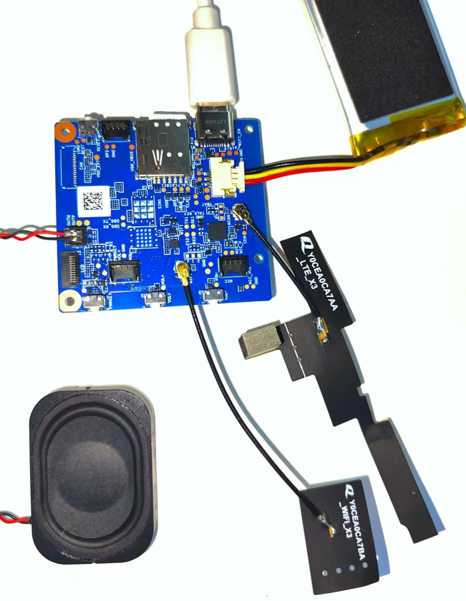

# Xiaozhi AI chatbot based on websocket

The Xiaozhi AI chatbot solution has the following features:
- Support for sound tone switching.
- Support for voice interruption/break.
- Support for voice wake-up.
- Written in Python language, facilitating secondary development.

 

---

- [Development resources](./dev_resources.md)
- [Quick start](./quick_start.md)
- [Software design](./software_design.md)
