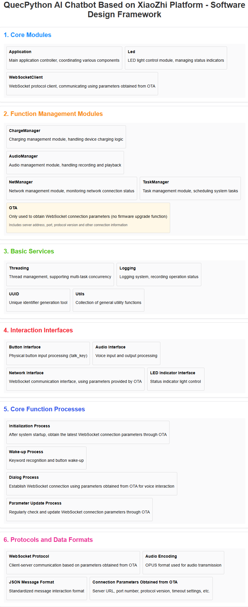
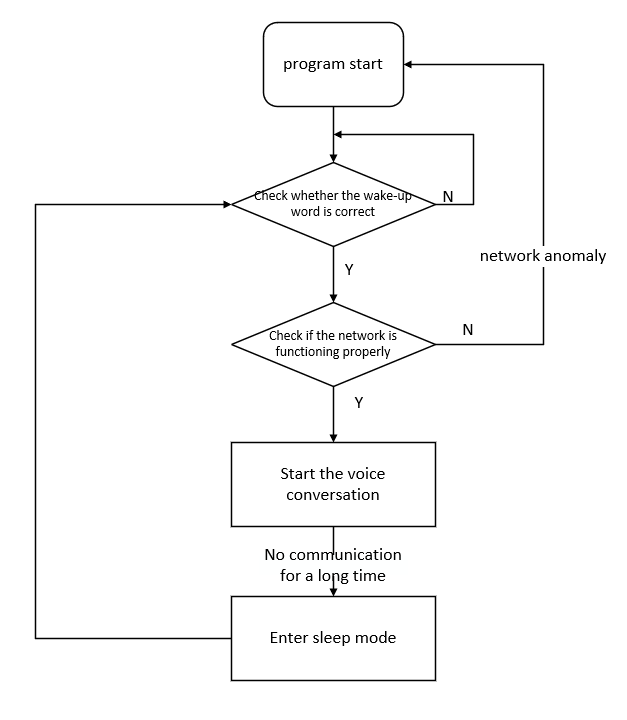

# Software design

## Software framework

### Framework design diagram

 

### Business system startup process



## Code explanation

### AI wake-up & Human voice detection

```python
class Application(object):
    def on_keyword_spotting(self, state):
        logger.info("on_keyword_spotting: {}".format(state))
        if state == 0:
            # Trigger the wake-up word
            if self.__working_thread is not None and self.__working_thread.is_running():
                return
            self.__working_thread = Thread(target=self.__working_thread_handler)
            self.__working_thread.start()
            self.__keyword_spotting_event.clear()
        else:
            self.__keyword_spotting_event.set()

    def on_voice_activity_detection(self, state):
        gc.collect()
        logger.info("on_voice_activity_detection: {}".format(state))
        if state == 1:
            self.__voice_activity_event.set()  # It is claimed that
        else:
            self.__voice_activity_event.clear()  # No One Can Hear You
```

### AI initialization

Initialize AI objects and other hardware drivers.

```python
class Application(object):

    def __init__(self):
        # Initialize the wake-up key
        self.talk_key = ExtInt(ExtInt.GPIO19, ExtInt.IRQ_RISING_FALLING, ExtInt.PULL_PU, self.on_talk_key_click, 50)
        
        # Initialize the led; write(1) extinguished; write(0) is on
        self.wifi_red_led = Led(33)
        self.wifi_green_led = Led(32)
        self.power_red_led = Led(39)
        self.power_green_led = Led(38)
        self.lte_red_led = Led(23)
        self.lte_green_led = Led(24)
        self.led_power_pin = Pin(Pin.GPIO27, Pin.OUT, Pin.PULL_DISABLE, 0)
        
        # Initialize charging management
        self.charge_manager = ChargeManager()

        # Initialize audio management
        self.audio_manager = AudioManager()
        self.audio_manager.set_kws_cb(self.on_keyword_spotting)
        self.audio_manager.set_vad_cb(self.on_voice_activity_detection)

        # Initialize network management
        self.net_manager = NetManager()

        # Initialize the task scheduler
        self.task_manager = TaskManager()

        # Initialization protocol
        self.__protocol = WebSocketClient()
        self.__protocol.set_callback(
            audio_message_handler=self.on_audio_message,
            json_message_handler=self.on_json_message
        )

        self.__working_thread = None
        self.__record_thread = None
        self.__record_thread_stop_event = Event()
        self.__voice_activity_event = Event()
        self.__keyword_spotting_event = Event()
```

### AI dialogue interruption logic

After waking up the AI, start the thread for detecting and uploading the human voice audio. 'self.start_vad()' is used to start the recording function. When there is a human voice, the "Start listening" flag bit 'start' will be sent through websocket. Then execute 'self.__protocol.abort()' to end the current speech and thereby interrupt the AI speaking.

```python
class Application(object):
    def __chat_process(self):
        self.start_vad()
        try:
            with self.__protocol:
                self.power_red_led.on()
                self.__protocol.hello()
                self.__protocol.wakeword_detected("小智")
                is_listen_flag = False
                while True:
                    data = self.audio_manager.opus_read()
                    if self.__voice_activity_event.is_set():
                        # 有人声
                        if not is_listen_flag:
                            self.__protocol.listen("start")
                            is_listen_flag = True
                        self.__protocol.send(data)
                        # logger.debug("send opus data to server")
                    else:
                        if is_listen_flag:
                            self.__protocol.listen("stop")
                            is_listen_flag = False
                    if not self.__protocol.is_state_ok():
                        break
                    # logger.debug("read opus data length: {}".format(len(data)))
        except Exception as e:
            logger.debug("working thread handler got Exception: {}".format(repr(e)))
        finally:
            self.power_red_led.blink(250, 250)
            self.stop_vad()

```

### music organizer

Uniformly manage the audio input and output, encoding and decoding, and voice recognition related functions of the equipment (keyword recognition KWS and voice activity detection VAD), and provide callback interfaces for upper-layer applications to use.

```python
class AudioManager(object):

    def __init__(self, channel=0, volume=11, pa_number=29):
        self.aud = audio.Audio(channel)  # 初始化音频播放通道
        self.aud.set_pa(pa_number)
        self.aud.setVolume(volume)  # 设置音量
        self.aud.setCallback(self.audio_cb)
        self.rec = audio.Record(channel)
        self.__skip = 0

    # ========== 音频文件 ====================

    def audio_cb(self, event):
        if event == 0:
            # logger.info('audio play start.')
            pass
        elif event == 7:
            # logger.info('audio play finish.')
            pass
        else:
            pass

    def play(self, file):
        self.aud.play(0, 1, file)

    # ========= opus ====================

    def open_opus(self):
        self.pcm = audio.Audio.PCM(0, 1, 16000, 2, 1, 15)  # 5 -> 25
        self.opus = Opus(self.pcm, 0, 6000)  # 6000 ~ 128000
    
    def close_opus(self):
        self.opus.close()
        self.pcm.close()
        del self.opus
        del self.pcm
    
    def opus_read(self):
        return self.opus.read(60)

    def opus_write(self, data):
        return self.opus.write(data)

    # ========= vad & kws ====================

    def set_kws_cb(self, cb):
        self.rec.ovkws_set_callback(cb)
            
    def set_vad_cb(self, cb):
        def wrapper(state):
            if self.__skip != 2:
                self.__skip += 1
                return
            return cb(state)
        self.rec.vad_set_callback(wrapper)

    def end_cb(self, para):
        if(para[0] == "stream"):
            if(para[2] == 1):
                pass
            elif (para[2] == 3):
                pass
            else:
                pass
        else:
            pass
    
    def start_kws(self):
        self.rec.ovkws_start("_xiao_zhi_xiao_zhi", 0.7)

    def stop_kws(self):
        self.rec.ovkws_stop()
    
    def start_vad(self):
        self.__skip = 0
        self.rec.vad_start()
    
    def stop_vad(self):
        self.rec.vad_stop()
```

### MCP Management

The message construction and sending function based on the MCP protocol covers scenarios such as initialization, tool list query, tool call response, and device notification. All messages follow the JSON-RPC 2.0 format and are sent uniformly through the 'send_mcp' method, ensuring the modularization and consistency of the code.

```python
class WebSocketClient(object):
    def send_mcp(self, payload, session_id=""):
        """
        发送标准MCP消息,payload为JSON-RPC 2.0格式字典
        """
        with self.__resp_helper:
            self.send(
                JsonMessage(
                    {
                        "session_id": session_id,
                        "type": "mcp",
                        "payload": payload
                    }
                ).to_bytes()        
            )	
    def mcp_initialize(self, capabilities=None, session_id="", req_id=1):
        """
        发送MCP initialize响应
        """
        payload = {
            "jsonrpc": "2.0",
            "id": req_id,
            "result": {
                "protocolVersion": "2025-9-03",
                "capabilities": {
                    "tools":{},
                    "notifications": {}
                },
                "serverInfo": {
                "name": 'xiaozhi-mqtt-client',
                "version": "1.0.0"
            }
        }
        }  
        self.send_mcp(payload, session_id)
    def mcp_tools_list(self, cursor="", session_id="", req_id=2):
        """
        发送MCP tools/list响应请求
        """
        payload = {
            "jsonrpc": "2.0",
            "id": req_id,
            "result": {
                "tools": [
                {
                    "name": "self.setvolume_down()",
                    "description": "只通过调用setvolume_down方法来控制音量变小,接收到回应后会播报当前音量大小",
                    "inputSchema": {}
                },
                {
                    "name": "self.setvolume_up()",
                    "description": "只通过调用setvolume_up方法来控制音量变大,接收到回应后会播报当前音量大小",
                    "inputSchema": {}
                },
                {
                    "name": "self.setvolume_close()",
                    "description": "只通过调用setvolume_close方法来静音,接收到回应后会播报当前音量大小",
                    "inputSchema": {}
                },
                ],
            }
            }
        
        self.send_mcp(payload, session_id)
        
    def mcp_tools_call(self, session_id="", req_id="", error=None, tool_name=""):
        """
        发送MCP tools/call响应
        :param error: 如果为None则返回成功响应,否则返回错误响应(字典,包含code和message)
        """
        if error is None:
            if tool_name == "self.setvolume_down()":
                payload = {
                    "jsonrpc": "2.0",
                    "id": req_id,
                    "result": {
                        "content": [
                            { "type": "text", "text": "音量已调小 "}
                        ],
                        "isError": False
                    }
                }
            elif tool_name == "self.setvolume_up()":
                payload = {
                    "jsonrpc": "2.0",
                    "id": req_id,
                    "result": {
                        "content": [
                            { "type": "text", "text": "音量已调大" }
                        ],
                        "isError": False
                    }
                }
            elif tool_name == "self.setvolume_close()":
                payload = {
                    "jsonrpc": "2.0",
                    "id": req_id,
                    "result": {
                        "content": [
                            { "type": "text", "text": "已静音" }
                        ],
                        "isError": False
                    }
                }      
        else:
            payload = {
                "jsonrpc": "2.0",
                "id": req_id,
                "error": {
                    "code": error.get("code", -32601),
                    "message": error.get("message", "Unknown error")
                }    
        self.send_mcp(payload, session_id)                
                
    def mcp_notify(self, method, params, session_id=""):
        """
        设备主动发送MCP通知  
        """
        payload = {
            "jsonrpc": "2.0",
            "method":  "notifications/state_changed",
            "params": {
                "newState": "idle",
                "oldState": "connecting"
                    }
        }
        self.send_mcp(payload, session_id)                
```

