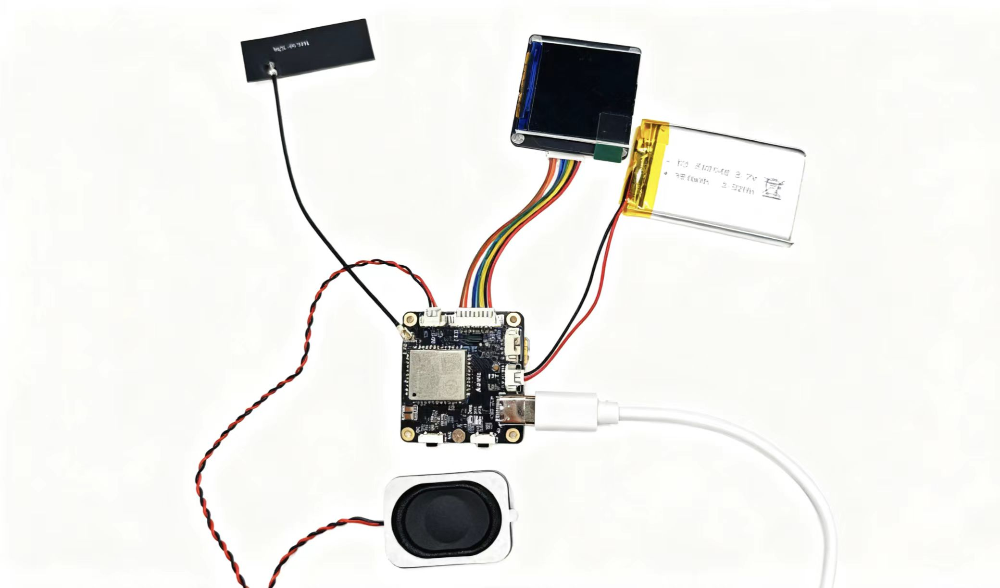

# Xiaozhi AI chatbot based on MQTT + UDP

The Xiaozhi AI chatbot solution has the following features:

- Supports timbre switching.
- Supports voice interruption/interruption.
- Supports voice wake-up.
- Uses Python language, facilitating secondary development.

------

- [Summary of Development Resources](./dev_resources.md)
- [Quick Start](./quick_start.md)
- [Software Design Explanation](./software_design.md)