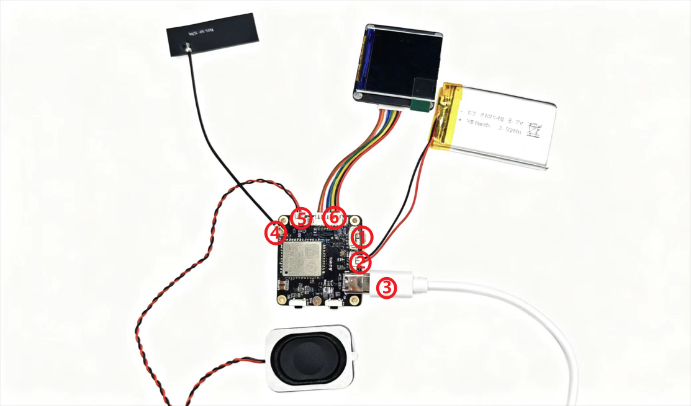
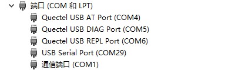
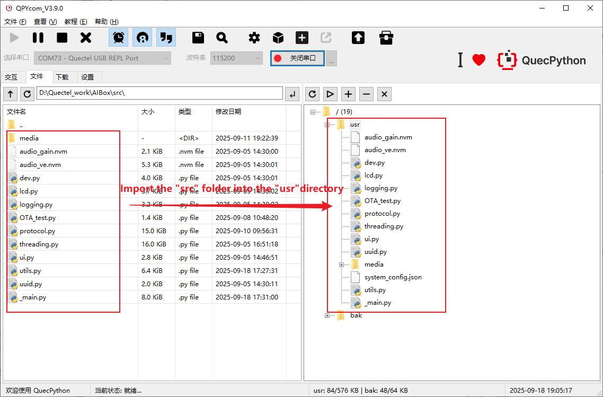
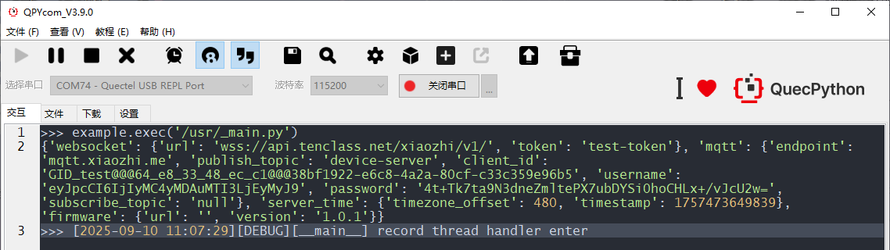
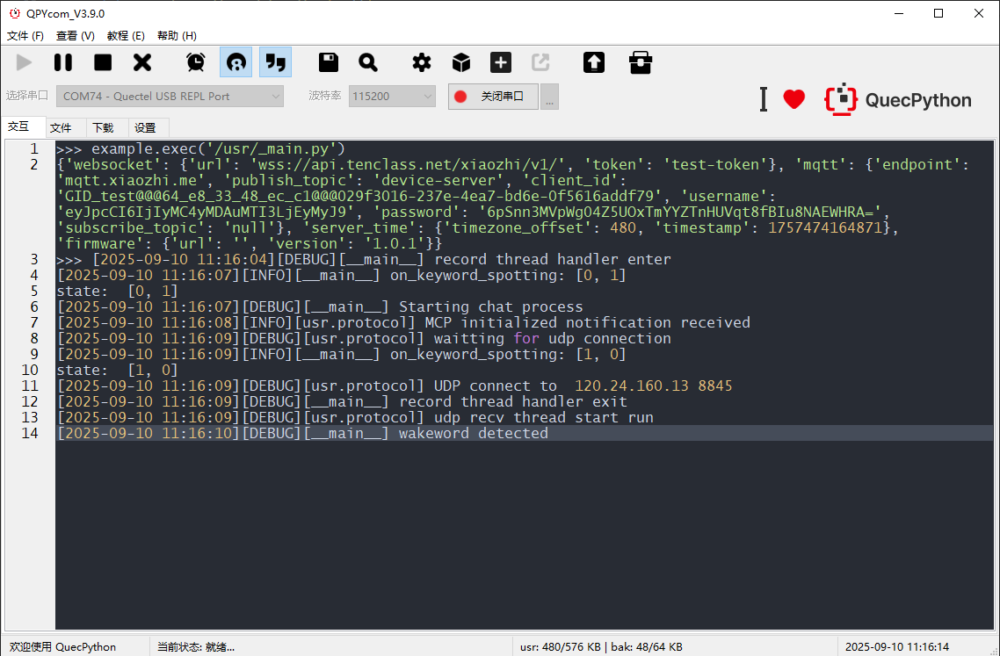
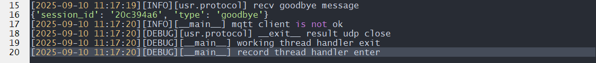

# Quick start

## Hardware preparation

- A Windows computer, preferably with the `Win10` system.
- One set of [EC800MCNLE development board](https://www.quecmall.com/goods-detail/2c90800b97abfe7c0197d347e3860183) (including antenna, Type-C data cable, etc.).
- A properly functioning SIM card.
- A speaker with a power of 2-5W.

## Environment setup

- Download and install the EC800M series module driver: [QuecPython_USB_Driver_Win10_ASR](https://developer.quectel.com/wp-content/uploads/2024/09/Quectel_Windows_USB_DriverA_Customer_V1.1.13.zip).
- Download and install [VSCode](https://code.visualstudio.com/).
- Download and unzip the [QPYCom](https://developer.quectel.com/en/wp-content/uploads/sites/2/2024/11/QPYcom_V4.1.0.zip) tool to a suitable location on your computer.
- [Download the firmware package](../../media/solutions/xiaozhi_AI_mqtt/EC800MCNLER06A01M08_OCPU_QPY_TEST0810.zip).
- Download the [experimental source code](https://codeload.github.com/QuecPython/AIChatbot-Xiaozhi-Mqtt/zip/refs/heads/main).

## Hardware connection

Make hardware connections according to the following diagram:

1. Insert a usable `SIM` card in the position shown in the diagram.
2. Connect the battery in the position shown in the diagram.
3. Use a Type-C data cable to connect the development board to the computer.
4. Connect the antenna to the antenna connector marked `LTE`.
5. Connect the battery in the position shown in the diagram. Connect the speaker to the pin headers marked `SPK+` and `SPK-` in the diagram.
6. Connect the LCD screen.

## Device development

### Power On

After completing the hardware connections, if a COM port containing the words `Quectel USB` appears in the port list of the computer's Device Manager, it indicates a successful power-on.

​	

### Firmware Package Burning

Refer to [this chapter](https://developer.quectel.com/doc/quecpython/Application_guide/en/dev-tools/QPYcom/qpycom-dw.html#Download-Script) to burn the firmware package corresponding to the model into the development board.

### Script Import and Execution

1. Refer to [this chapter](https://developer.quectel.com/doc/quecpython/Getting_started/en/4G/first_python.html) to import all files in the `src` folder under the source code directory into the module file system, as shown in the following figure: 
2. Refer to [this chapter](https://developer.quectel.com/doc/quecpython/Getting_started/en/4G/first_python.html#Run-Script) to execute the main program file `_main.py`.
3. Refer to [this chapter](https://developer.quectel.com/doc/quecpython/Getting_started/en/4G/first_python.html#Stop-a-Running-Program) to stop the program.

## Business debugging

### Program Startup

After executing the `_main.py` script, the program starts running.

### Activate Xiaozhi

The state shown in the following figure is the waiting-for-wake-up state. The development board will have a red light flashing, and you need to use the voice "Xiaozhi, Xiaozhi" to wake up Xiaozhi AI for voice conversation.

After waking up, data related to connecting to the UDP server or a connection failure prompt will appear. If a connection failure occurs, please check if the network is normal.

When there is no conversation for a long time, a goodbye message will be received, both mqtt and udp will be actively closed, and the program will automatically enter the waiting-for-wake-up state, waiting for the next wake-up using the wake-up word to re-establish the connection.

