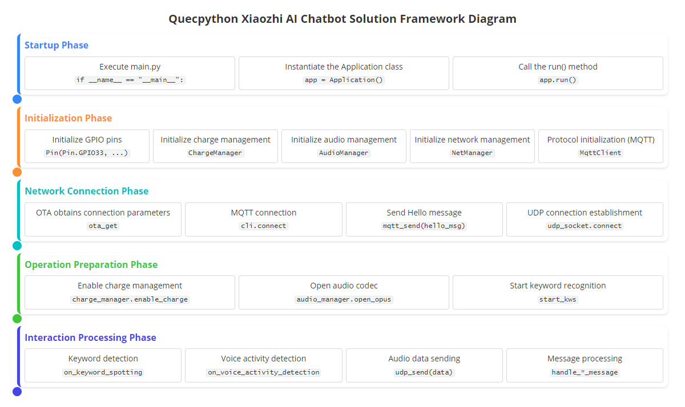
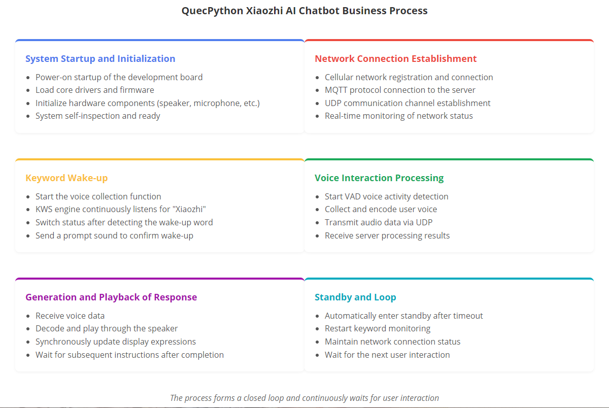
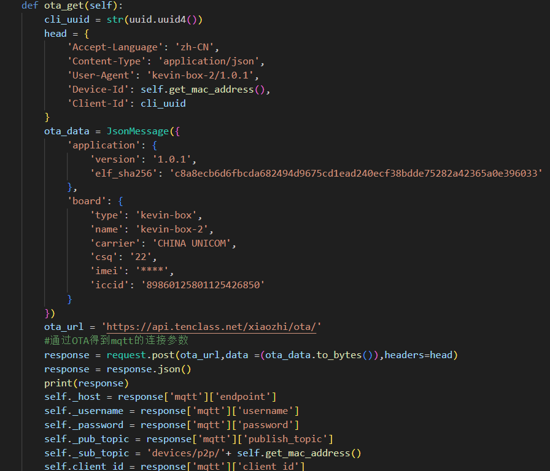
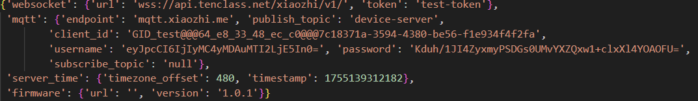
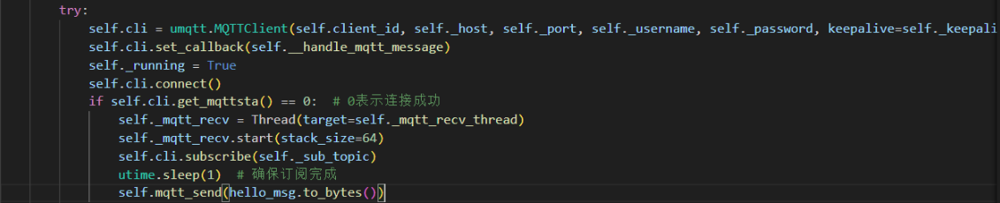
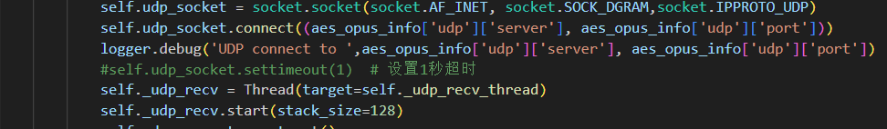
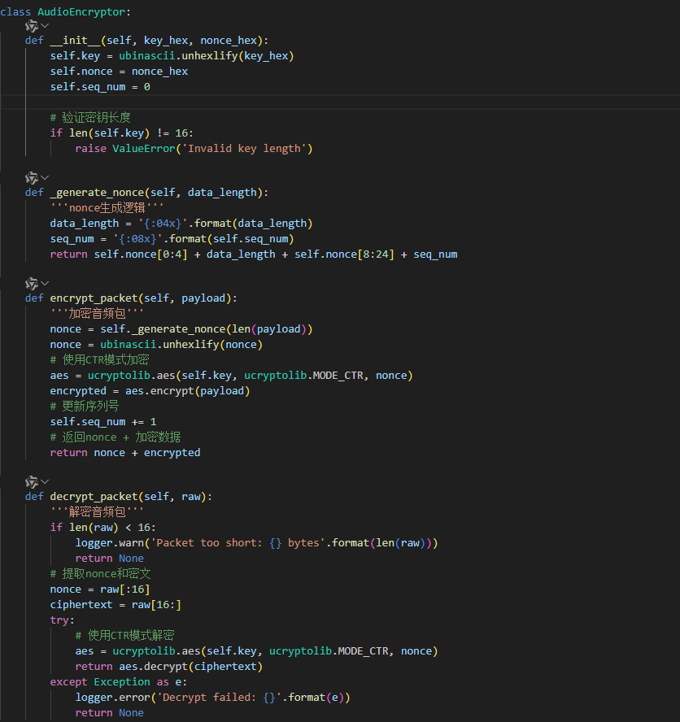
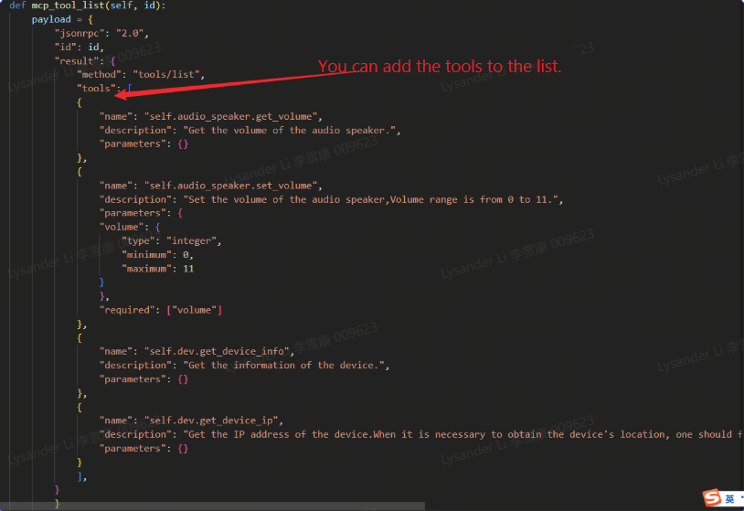
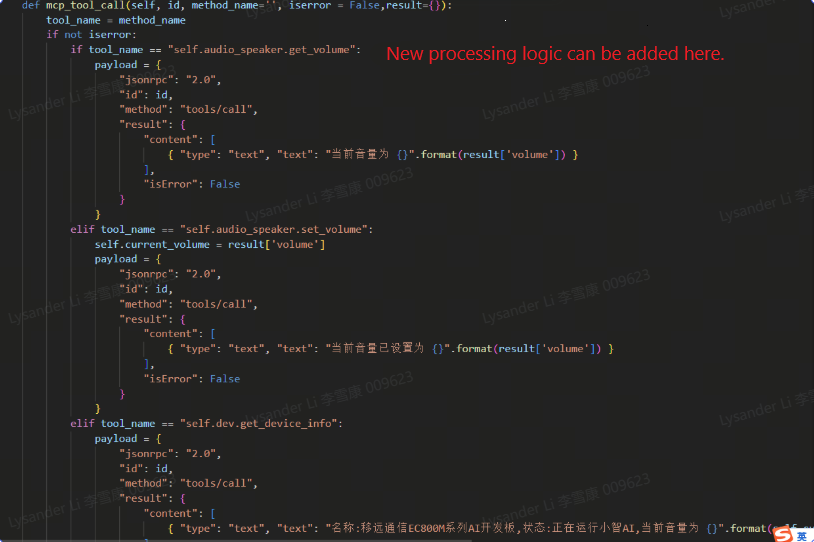

# Software design explanation

## Software framework

### Scheme Framework



### Business Process



## Code explanation

### Application Class Initialization

Initialize AI objects and other hardware drivers.

```python
class Application(object):
    def __init__(self):
        
		Pin(Pin.GPIO33, Pin.OUT, Pin.PULL_PD, 1)
        self.prev_emoj = None        
        
        # Initialize charge management
        self.charge_manager = ChargeManager()

        # Initialize audio management
        self.audio_manager = AudioManager()
        self.audio_manager.set_kws_cb(self.on_keyword_spotting)
        self.audio_manager.set_vad_cb(self.on_voice_activity_detection)

        # Initialize network management
        self.net_manager = NetManager()

        # Initialize task scheduler
        self.task_manager = TaskManager()

        # Initialize protocol
        self.__protocol = MqttClient()
        self.__protocol.set_callback(
            audio_message_handler=self.on_audio_message,
            json_message_handler=self.on_json_message
        )

        self.__working_thread = None
        self.__record_thread = None
        self.__record_thread_stop_event = Event()
        self.__voice_activity_event = Event()
        self.__keyword_spotting_event = Event()
```

### Wake-up & Voice Detection

When the wake-up word is detected, the working thread `self.__working_thread` will be pulled up, and the working thread will enable vad for voice activity detection

```python
class Application(object):
    def on_keyword_spotting(self, state):
        logger.info("on_keyword_spotting: {}".format(state))
        if state == 0:
            # Wake-up word triggered
            if self.__working_thread is not None and self.__working_thread.is_running():
                return
            self.__working_thread = Thread(target=self.__working_thread_handler)
            self.__working_thread.start()
            self.__keyword_spotting_event.clear()
        else:
            self.__keyword_spotting_event.set()

    def on_voice_activity_detection(self, state):
        gc.collect()
        logger.info("on_voice_activity_detection: {}".format(state))
        if state == 1:
            self.__voice_activity_event.set()  # Voice detected
        else:
            self.__voice_activity_event.clear()  # No voice detected
```

### Dialogue Logic

After the working thread is started, it will start a thread to execute `__chat_process`, and send the read audio data when voice is detected

```python
class Application(object):
    def __chat_process(self):
        self.start_vad()
        try:
            with self.__protocol:
                self.power_red_led.on()
                self.__protocol.hello()
                self.__protocol.wakeword_detected("Xiaozhi")
                is_listen_flag = False
                while True:
                    data = self.audio_manager.opus_read()
                    if self.__voice_activity_event.is_set():
                        # Voice detected
                        if not is_listen_flag:
                            self.__protocol.listen("start")
                            is_listen_flag = True
                        self.__protocol.udp_send(data) 
                        # logger.debug("send opus data to server")
                    else:
                        if is_listen_flag:
                            self.__protocol.listen("stop")
                            is_listen_flag = False
                    if not self.__protocol.is_state_ok():
                        break
                    # logger.debug("read opus data length: {}".format(len(data)))
        except Exception as e:
            logger.debug("working thread handler got Exception: {}".format(repr(e)))
        finally:
            self.power_red_led.blink(250, 250)
            self.stop_vad()
```

### Audio Management

Unified management of the device's audio input and output, encoding and decoding, speech recognition-related functions (Keyword Spotting KWS and Voice Activity Detection VAD), and providing callback interfaces for upper-layer applications.

```python
class AudioManager(object):
    def __init__(self, channel=0, volume=11, pa_number=29):
        self.aud = audio.Audio(channel)  # Initialize audio playback channel
        self.aud.set_pa(pa_number)
        self.aud.setVolume(volume)  # Set volume
        self.aud.setCallback(self.audio_cb)
        self.rec = audio.Record(channel)
        self.__skip = 0
    # ========== Audio files ====================
    def audio_cb(self, event):
        if event == 0:
            # logger.info('audio play start.')
            pass
        elif event == 7:
            # logger.info('audio play finish.')
            pass
        else:
            pass
    def play(self, file):
        self.aud.play(0, 1, file)
    # ========= opus ====================
    def open_opus(self):
        self.pcm = audio.Audio.PCM(0, 1, 16000, 2, 1, 15)  # 5 -> 25
        self.opus = Opus(self.pcm, 0, 6000)  # 6000 ~ 128000 
    def close_opus(self):
        self.opus.close()
        self.pcm.close()
        del self.opus
        del self.pcm
    def opus_read(self):
        return self.opus.read(60)
    def opus_write(self, data):
        return self.opus.write(data)
    # ========= vad & kws ====================
    def set_kws_cb(self, cb):
        self.rec.ovkws_set_callback(cb)         
    def set_vad_cb(self, cb):
        def wrapper(state):
            if self.__skip != 2:
                self.__skip += 1
                return
            return cb(state)
        self.rec.vad_set_callback(wrapper)
    def end_cb(self, para):
        if(para[0] == "stream"):
            if(para[2] == 1):
                pass
            elif (para[2] == 3):
                pass
            else:
                pass
        else:
            pass   
    def start_kws(self):
        self.rec.ovkws_start("_xiao_zhi_xiao_zhi", 0.7)
    def stop_kws(self):
        self.rec.ovkws_stop()
    def start_vad(self):
        self.__skip = 0
        self.rec.vad_start() 
    def stop_vad(self):
        self.rec.vad_stop()
```

### MQTT and UDP Connections

#### MQTT Connection

First of all, it should be clear that to successfully connect to Xiaozhi platform's MQTT server, the corresponding MQTT connection parameters are required, and these parameters need to be obtained through Xiaozhi's OTA interface. In this scheme, we directly use Quecpython's request module to send a GET request to obtain the parameters; the specific OTA request method, request header format and request body format are all strictly implemented in accordance with the OTA documentation officially provided by Xiaozhi.

The scheme specially designs a parameter acquisition method `ota_get()`, which is automatically called once during the initialization of the `MqttClient` class to ensure that the necessary connection parameters can be obtained at the initial stage of MQTT client instance creation, laying the foundation for the subsequent MQTT server connection process.





After successfully obtaining the MQTT connection parameters, the scheme will temporarily store these parameters in the global list `aes_opus_info` to realize temporary storage of parameters and convenient subsequent calls.

When the system triggers the wake-up process through the wake-up word, the program will automatically start the MQTT connection operation —— at this time, the MQTT connection parameters obtained through the OTA interface will be extracted from the global list `aes_opus_info`, and the connection configuration with Xiaozhi platform's MQTT server will be completed based on these parameters, ensuring that the MQTT connection process can be smoothly executed with valid and correct parameters.



#### UDP Connection

After the connection with Xiaozhi platform's MQTT server is successfully established, the system will further send a message through the MQTT channel to obtain the parameters required for UDP connection —— specifically, a "hello" type message specified by Xiaozhi platform needs to be sent, and the format of this message should be implemented in accordance with [the relevant specifications officially provided by Xiaozhi](https://github.com/78/xiaozhi-esp32/blob/main/docs/mqtt-udp.md).

After successfully receiving the UDP connection parameters returned by Xiaozhi platform, the program will start the UDP connection process based on these parameters, complete the establishment of the UDP channel with Xiaozhi platform, and prepare for the subsequent transmission of audio stream data.



### Audio Data Encryption

After the UDP channel with Xiaozhi platform is successfully established, the subsequent audio stream data is transmitted using UDP. According to the clear technical specifications of Xiaozhi platform, the audio stream data sent through the UDP protocol must be encrypted to ensure the security and integrity of the data during transmission, and the specified encryption algorithm is the **AES-CTR algorithm**.

In this scheme, we directly rely on Quecpython's encryption module `ucryptolib` to implement the AES-CTR encryption function: before sending the audio stream data, the program will call the corresponding encryption interface in the `ucryptolib` module, pass in preset parameters such as the key, complete the data encryption process; the encrypted audio stream data is then sent to Xiaozhi platform through the established UDP channel, ensuring that the entire audio transmission process conforms to the platform specifications and has reliable security guarantees.



### Internal MCP

When connecting, the mcp channel is opened in the hello message, and the server will send a request message (of type tools/list). At this time, we need to inform the local tools that can be called by Xiaozhi. During our voice interaction, when the server recognizes our intention, it will request to call our local tools. After the device receives the tool call request, it will respond and reply to the server. We can add tool information and processing logic in the response messages of tools/list and tools/call.




