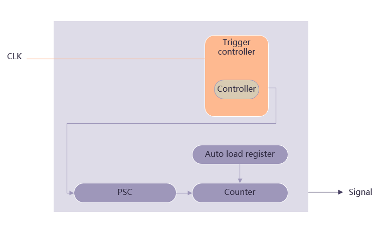
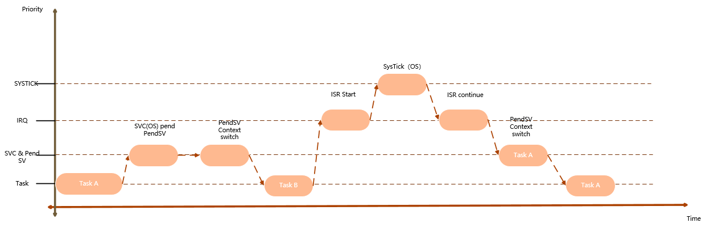
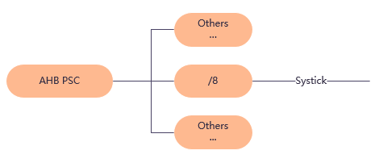
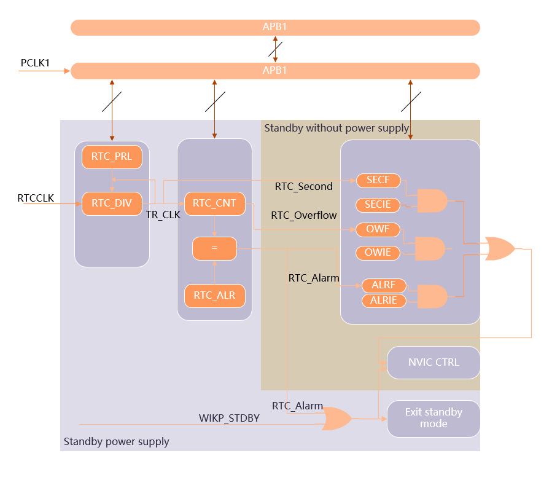
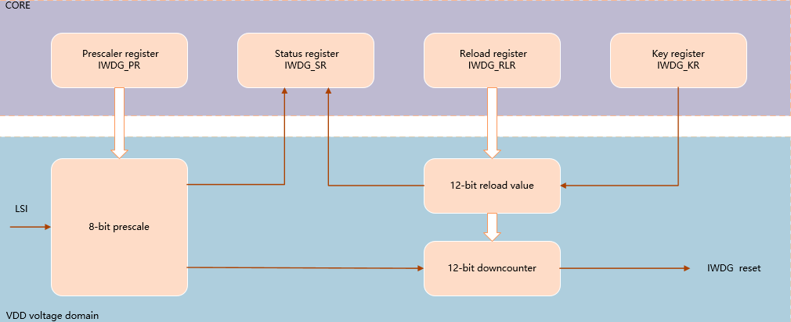
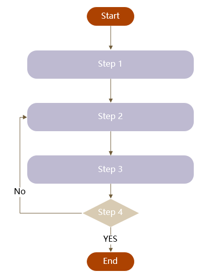

# Timer

## Concept

Timer: generally refers to the internal peripheral devices of SOC or MCU, which can generate periodic interrupts. The system can switch tasks based on this signal, or use this signal for frequency dividing output, and so on.

Hardware timers can be divided into the following categories:

* Systick
  * System tick timer, used to provide a periodic timing function. This timer can generate interrupt signals periodically, serving as the heartbeat clock of the system, which plays a role in task switching or time slicing for task allocation.
* Basic timer
  * No external input/output, mainly used for time base counting and timing.
* General-purpose timer
  * In addition to the basic timer functions, it can provide functions such as input capture, output compare, and connection to other sensor interfaces.
* Advanced timer
  * In addition to the general-purpose timer functions, it can provide functions such as motor control, digital power application, and programmable dead time for complementary output.
* RTC (Real-Time Clock)
  * Mainly used to provide real-time time and date.
* Watchdog
  * Mainly used to monitor whether the system has encountered exceptions.

## Background of Timers

### Introduction

Timers can generate interrupts to notify the CPU that an event has occurred. This allows the CPU to run other functions instead of blocking and waiting for the result of a task. This approach improves efficiency and makes the overall system run more smoothly, conveniently, and responsively, resulting in better user experience and wider application.

### Timer Classification

Timers can be broadly classified into hardware timers and software timers. Hardware timers are the foundation of software timers, and software timers extend the functionality of hardware timers. In theory, there is no limit to the number of software timers. However, software timers are not accurate, and the difference between them becomes larger as the number of software timers increases.

#### Hardware Timers

Hardware timers can be divided into: Systick, basic timer, general-purpose timer, advanced timer, RTC timer, watchdog timer, etc. In the stable operation of a project, each of these timers has its own role.

The working principle of hardware timers are shown in the following diagram:



<center>Figure 2-1</center>

* The CLK clock signal is output to the trigger controller.
* The trigger controller outputs the signal to the prescaler.
* The signal is divided by the prescaler and then output to the counter.
* When the value of the counter reaches the value of the auto-reload register (determined by the timer type), if the interrupt is enabled, the timer generates an overflow interrupt.

The above process is a conceptual overview of the timer principle. The following types of timers are similar.

##### Systick

The system tick timer, also known as the heartbeat timer, generates Systick interrupts to switch system tasks. The system uses this timer to allocate time slices to tasks and switch between tasks. The diagram below illustrates the task switching process:



<center>Figure 2-2</center>

The internal structure diagram is shown below. RCC provides an external clock source by dividing the AHB clock by 8.



<center>Figure 2-3</center>

##### Basic Timer

The basic timer has the following functions:

* Automatic reload and accumulation of the counter.
* Trigger synchronization circuit for DAC.
* Update time to generate interrupt requests.
* Programmable prescaler.

The working principle and conceptual diagram are shown in Figure 2-1. The clock is provided to the prescaler from either internal or external sources. After division, the signal is provided to the counter register. When the counter reaches the value in the auto-reload register, the interrupt condition is met. If the interrupt function is enabled, the interrupt can be triggered to complete the timing task. From the above, it can be seen that timing is achieved by setting the prescaler and auto-reload register.

##### General-Purpose Timer

In addition to the basic timer functions, the general-purpose timer also has the following functions:

* Upward, downward, and up/down automatic reload of the counter.
* Independent channels.
* Control the timer and the Synchronization circuit of interconnecting timers with external signals.
* Support for incremental encoders and Hall sensor circuits for positioning.
* Trigger input as an external clock or current management on a per-cycle basis.

The working principle and conceptual diagram are shown in Figure 2-1. The basic principle of the general-purpose timer is the same as that of the basic timer. The extended functions are only applications of the timer, which will not be repeated here.

##### Advanced Timer

In addition to the general-purpose timer functions, the advanced timer also has the following functions:

* Programmable dead time for complementary output.
* Update the timing counter only after a given number of cycles.
* Interrupt signal input to set the output signal of the timer to a reset state or a known state.
* Set the number of cycles for repeated counting.

The working principle and conceptual diagram are shown in Figure 2-1. The basic principle of the advanced timer is the same as that of the general-purpose timer and the basic timer. It is also an extension of the basic functions. The feature of programmable dead time support makes it convenient for PWM applications.

##### RTC Timer

The Real-Time Clock (RTC) is an independent BCD timer/counter. It can wake up the device from sleep mode to manage the low-power mode of the device. It can provide clock and calendar functions under certain configurations. The RTC time will be reset when the QuecPython module restarts. After successful network registration, the RTC time will be updated. The hardware diagram is shown below:



<center>Figure 2-4</center>

##### Watchdog Timer

The watchdog timer is used to monitor and resolve failures caused by software errors. When the counter counts down to 0 (or increases to the set count value), it triggers a system reset. It has a dedicated low-speed clock driver, which remains effective even if the main clock fails. The watchdog time can be adjusted by configuring the time window. From the above description, it can be understood that the so-called "feeding the dog" refers to resetting the counter (or clearing the counter). The working principle diagram is shown below:



<center>Figure 2-5</center>

#### Software Timers

The implementation of software timers is based on hardware support for setting timer tasks.

The implementation logic is to establish a linked list (or binary tree or other data structure) and record the expiration time of the newly added software timer. Then, add it to the linked list (or binary tree). Each time, select the nearest expiration time of the software timer and set it in the hardware timer. When the hardware timer interrupt is triggered, the expired hardware timer task can be executed, and the software timer task can be processed in the hardware timer task. Next, select the nearest expiration time of the software timer and set it in the hardware timer again. This cycle allows the software timer to work. From the above principle, it can be seen that software timers cannot achieve the accuracy of hardware timers, but they can overcome the number limitation of the hardware timer. The implementation logic block diagram is as follows:



- Step 1
  - Record the expiration time of the currently added software timer and add it to the software timer linked list.
- Step 2
  - Traverse and sort the software timer linked list, select the one with the smallest expiration time, and set its expiration time in the hardware timer.
- Step 3
  - When the hardware timer expires, traverse the software timer linked list, execute the event registered by this timer, and remove the expired node from the software timer linked list.
- Step 4
  - Determine whether the software timer linked list is empty. If it is empty, exit the process.

The above is just a simple way to implement the software timer, not the best way. The implementation of the software timer will vary according to different scenarios and the selection and optimization of data structures. The above is just an introduction to its basic implementation principle.


## Introduction to Timer Interface

QuecPython module timers are divided into two types: software timers and hardware timers. Hardware timers are used on the kernel side, while software timers are open for application layer. In the QuecPython application layer, timers are further divided into system timers and general timers. The following introduces the application of general timers and system timers.

### System Timer

The QuecPython module provides underlying timer interfaces. When a timer times out, it triggers the callback function bound to the timer. It is not recommended to perform blocking or time-consuming operations in the callback function, as it will affect overall performance. It is recommended to only perform message sending operations in the callback function and handle business processing in other tasks. The time precision is as follows (this table only applies to QuecPython interface system timers and general timers):

<center>Table 3-1</center>

<table style="text-align: center">
 	<tr>
            <td  style="background-color: red" rowspan="1">Model</td>
            <td  style="background-color: red" rowspan="1">Precision (ms)</td>
        </tr>
     	<tr >
            <td rowspan="1">Qualcomm</td>
           <td rowspan="1">10</td>
        </tr>
    	<tr >
            <td rowspan="1">ASR</td>
           <td rowspan="1">5</td>
        </tr>
		<tr >
            <td rowspan="1">RDA</td>
           <td rowspan="1">5</td>
        </tr>
    	<tr >
            <td rowspan="1">UNISOC</td>
           <td rowspan="1">5</td>
        </tr>
    	<tr >
            <td rowspan="1">EIGEN</td>
           <td rowspan="1">5</td>
        </tr>
</table>

#### Creating a System Timer

Before enabling a timer, you need to create a timer by calling the following interface.

```python
osTimer()
```

Example

```python
# -*- coding: UTF-8 -*-
# Example
import osTimer

timer = osTimer()

```

#### Starting a System Timer

After creating a timer, when you want to enable the timer, you need to call the following interface to start the timer. The time unit is in milliseconds. The timer can be started in single mode or cyclic mode. In single mode, the timer only executes the callback function once. In cyclic mode, the timer generates timeout events and executes the registered callback function in a loop according to the set period. It is not recommended to perform blocking or time-consuming operations in any callback function (not just the timer callback function) in the QuecPython module, as it will affect the module's performance.

```
osTimer.start(initialTime, cyclialEn, callback)
```

Example

```python
# -*- coding: UTF-8 -*-
# Example
import osTimer

def timer_cb(arg):
    print("osTimer Expired!!")

# Create an os timer
timer = osTimer()

# Start the timer, with parameters in the order of time, whether to loop, and the callback function
time_out = 10
timer.start(time_out * 1000, 1, timer_cb)
```

#### Stopping a System Timer

When the business is completed and the timer is temporarily not needed, you can call the following interface to stop the timer. If you need to reuse the timer to complete the business, simply call the start timer interface again.

```python
osTimer.stop()
```

Example

```python
# -*- coding: UTF-8 -*-
# Example
import osTimer
import utime 

time_out = 1
timer_out_nums = 0

# Create an os timer
timer = osTimer()
timer_is_runing = True

def timer_cb(arg):
    global timer_out_nums
    global timer_is_runing
    global timer
    timer_out_nums = timer_out_nums + 1
    print("osTimer Expired!! {}".format(timer_out_nums))
    if timer_out_nums >= 10:
        timer.stop()
        timer_is_runing = False
        timer_out_nums = 0
        
if __name__ == "__main__":

    # Start the timer in cyclic mode
    timer.start(time_out * 1000, 1, timer_cb)
    while timer_is_runing:
        utime.sleep(1)
        print("waiting timer stop !")
    # After stopping, start the timer again in single mode   
    print("will restart timer  !")    
    timer.start(time_out * 1000, 0, timer_cb)
```

#### Deleting a System Timer

When the timer is no longer needed after completing the business, you can call the following interface to delete the timer. After calling this interface, the timer will be deleted. If you need to reuse the timer, you need to create and start the timer again.

```python
osTimer.delete_timer()
```

Example

```python
# -*- coding: UTF-8 -*-
# Example
import osTimer
import utime 

time_out = 1
timer_out_nums = 0

# Create an os timer
timer = osTimer()
timer_is_runing = True

def timer_cb(arg):
    global timer_out_nums
    global timer_is_running
    global timer
    timer_out_nums = timer_out_nums + 1
    print("osTimer Expired!! {}".format(timer_out_nums))
    if timer_out_nums >= 10:
        timer.stop()
        timer_is_running = False
        timer_out_nums = 0

if __name__ == "__main__":

    # Start the timer in c mode
    timer.start(time_out * 1000, 1, timer_cb)
    while timer_is_running:
        utime.sleep(1)
        print("Waiting for timer to stop!")

    print("Deleting the timer!")
    # Delete the timer
    timer.delete_timer()

    # Recreate the timer
    timer1 = osTimer()

    print(("will start a new timer  !")
    # Start the timer in single mode
    timer1.start(time_out * 1000, 0, timer_cb)
```

#### System Timer Application Example

After the timer expires, send a timer message to the queue and process the business logic in the queue.

```python
# -*- coding: UTF-8 -*-
# Example

import _thread
from queue import Queue
import osTimer
import utime

class QuecPythonTimer():
    
    def __init__(self, timer):
        self.timer_out          = 10*1000
        self.timer_queue        = Queue(100)
        self.timer_out_count    = 0
        self.timer              = timer
        self.cycle              = 0
        self.is_loop            = True

    def timer_set_cycle(self, cycle):
        self.cycle = cycle

    def timer_call(self, args):
        self.timer_out_count = self.timer_out_count + 1
        print("Will put {} to timer_queue".format(self.timer_out_count))
        self.timer_queue.put(self.timer_out_count)

    def timer_set_timeout(self, timer_out=10 * 1000):
        self.timer_out = timer_out

    def timer_start(self):
        self.timer.start(self.timer_out, self.cycle, self.timer_call)

    def timer_wait_message(self):
        while self.is_loop:
            data = self.timer_queue.get()
            print("Get timer_queue data {}".format(data))
   

if __name__ == "__main__":
    timer = osTimer()
    timer = QuecPythonTimer(timer)

    # Set the timer to expire every 5 seconds
    timer.timer_set_timeout(5000)

    # Set the timer to cycle
    timer.timer_set_cycle(1)

    # Start a new task to wait for timer notifications
    _thread.start_new_thread(timer.timer_wait_message, ())

    # Start the timer
    timer.timer_start()
```

### General Timer

QuecPython module provides an application-level timer interface. When the timer expires, the callback function bound to the timer will be triggered. It is not recommended to perform blocking or time-consuming operations in the callback function, as it will affect overall performance. It is recommended to only send messages in the callback function and process the business logic in other tasks. The time precision is shown in Table 3-1. The general timer only supports the creation of up to four timers. It can be used in single mode or cyclic mode.

<center>Table 3-2</center>

<table style="text-align: center">
 	<tr>
            <td  style="background-color: red" rowspan="1">Constant of Timer</td>
            <td  style="background-color: red" rowspan="1">Description</td>
        </tr>
     	<tr >
            <td rowspan="1">Timer.Timer0</td>
           <td rowspan="1">Timer0</td>
        </tr>
    	<tr >
            <td rowspan="1">Timer.Timer1</td>
           <td rowspan="1">Timer1</td>
        </tr>
		<tr >
            <td rowspan="1">Timer.Timer2</td>
           <td rowspan="1">Timer2</td>
        </tr>
    	<tr >
            <td rowspan="1">Timer.Timer3</td>
           <td rowspan="1">Timer3</td>
        </tr>
    	<tr >
            <td rowspan="1">Timer.ONE_SHOT</td>
           <td rowspan="1">In single mode, the timer only executes once</td>
        </tr>
    	<tr >
            <td rowspan="1">Timer.PERIODIC</td>
           <td rowspan="1">In cyclic mode, the timer executes in a loop</td>
        </tr
</table>


As shown in Table 3-2 above, there are four timers available for general timers: Timer0, Timer1, Timer2, and Timer3. Each timer supports both single  mode and cyclic mode.

#### Initialize the General Timer

Before using the timer, you need to initialize it by calling the following interface.

```
class machine.Timer(Timern)
```

Example

```python
# -*- coding: UTF-8 -*-
#Example

from machine import Timer
timer1 = Timer(Timer.Timer1)
```

#### Starting a General Timer

After initializing the timer, you need to start it to generate timer timeout events. Call the following interface to start the timer. The timer start supports setting the single mode and cyclic mode. The single mode generates a timer timeout event only once, while the cyclic mode generates timer timeout events in a loop (with the time interval set as the timer timeout time). In QuecPython module, it is not recommended to block or perform time-consuming operations in any callback function (not only in the timer callback function), as it will affect the performance of the module.

```
Timer.start(period, mode, callback)
```

Example

```python
# -*- coding: UTF-8 -*-
#Example

from machine import Timer

timer1 = Timer(Timer.Timer1)

time_out = 1
timer_out_nums = 0
def timer_out_call(args):
    global timer_out_nums
    timer_out_nums = timer_out_nums + 1
    print("timer will Expired!! {}".format(timer_out_nums))
    
timer1.start(period=time_out*1000, mode=timer1.PERIODIC, callback=timer_out_call)
```


#### Stopping a General Timer

When the business is completed, you need to stop the timer by calling this interface. After calling this interface, if you need to restart the timer to generate timeout events, you can call the start timer interface to restart the timer.

```
Timer.stop()
```

Example

```python
# -*- coding: UTF-8 -*-
# Example

from machine import Timer

timer1 = Timer(Timer.Timer1)

time_out = 1
timer_out_nums = 0
timer_is_runing = True

def timer_out_call(args):
    global timer_out_nums
    global timer_is_runing
    global timer1
    timer_out_nums = timer_out_nums + 1
    print("timer will Expired!! {}".format(timer_out_nums))
    if timer_out_nums >= 10:
        # Stop the timer
        timer1.stop()
        timer_is_runing = False
        timer_out_nums = 0
    
timer1.start(period=time_out*1000, mode=timer1.PERIODIC, callback=timer_out_call)

```

#### Example of Using a General Timer

```python
# -*- coding: UTF-8 -*-
# Example

import _thread
from queue import Queue
from machine import Timer
import utime

class QuecPythonTimer():
    
    def __init__(self,timer):
        self.timer_out          = 10*1000
        self.timer_queue        = Queue(100)
        self.timer_out_count    = 0
        self.timer              = timer
        self.cycle              = 0
        self.is_loop            = True

    def timer_set_cycle(self,cycle):
        self.cycle = cycle

    def timer_call(self,args):
        self.timer_out_count = self.timer_out_count + 1
        print("Will put {} to timer_queue ".format(self.timer_out_count))
        self.timer_queue.put(self.timer_out_count)

    def timer_set_timeout(self,timer_out = 10 * 1000):
        self.timer_out  =   timer_out

    def timer_start(self):
        self.timer.start(period=self.timer_out,mode=self.cycle,callback=self.timer_call)

    def timer_wait_message(self):
        while self.is_loop:
            data = self.timer_queue.get()
            print("Get timer_queue data {}".format(data))

if __name__ == "__main__":
    timer1 = Timer(Timer.Timer1)
    timer = QuecPythonTimer(timer1)

    # Set timer timeout to occur every 5 seconds
    timer.timer_set_timeout(5000)

    # Set the timer to cycle
    timer.timer_set_cycle(timer1.PERIODIC)

    # Start a new task to wait for timer notifications
    _thread.start_new_thread(timer.timer_wait_message, ())

    # Start the timer
    timer.timer_start()
```

## Common Questions about Timers

**Question 1: What are the possible reasons for a timer to fail?**

* Check if the system is under heavy load, which may prevent the timer callback function from executing properly.
* Check if the timer has been deleted or stopped.
* Check if the virtual machine has been restarted without recreating the timer.

**Question 2: Will updating the network time cause the timer timeout to be incorrect?**

* Updating the network time will not cause the timer timeout to be incorrect.

**Question 3: How do timers behave during shutdown and deep sleep?**

* Timers will not work after shutdown and need to be recreated and enabled after a restart.
* Timers will not run during deep sleep and will not work after waking up. They need to be reconfigured.

* During deep sleep, the RTC can wake up the module and resume normal operation.

**Question 4: What is the difference between hardware timers and software timers?**

* The number of hardware timers is limited, while theoretically there is no limit to the number of software timers as long as there are sufficient system resources.
* Software timers are implemented based on hardware timers.

**Question 5: What is the difference between system timers and general timers?**

* `osTimer` can be used directly by importing it, while `Timer` needs to be imported from the `machine` module before it can be used.
* They use different functions.
* Internally, they are implemented in the same way and behave the same.