# Handle Exception

## Kernel Exceptions

### Overview

#### Concept of Exceptions
The processor's normal execution flow generally runs in user mode, with the PC fetching instructions in a sequential manner. Exceptions refer to special events that occur during the normal execution of a program by the processor, such as hardware errors, instruction execution errors, user program requests for services, memory access exceptions, and instruction fetch exceptions. These special events cannot be continued in the normal execution flow and require immediate handling.

#### CPU Operating Modes

|Processor Operating Mode|Privilege Mode|Exception Mode|Description|
|---|---|---|---|
|User Mode|||User program execution mode|
|System Mode|Arbitrary access to system resources||Running privileged-level operating system tasks|
|Interupt ReQuest (IRQ) Mode|Usually switched to this mode by system exception status|Normal interrupt mode||
|Fast Interrupt (FIQ) Mode|Fast interrupt mode|||
|Supervisor Mode|A protective mode used by the operating system, SWI command status|||
|Abort Mode|Virtual memory management and memory data access protection|||
|Undefined Mode|Supports co-processing through software simulation of hardware|||

#### Classification of Exceptions
There are several types of exceptions, which need to be distinguished from operating modes. Exceptions are the reasons for terminating the normal operation of the CPU, while operating modes represent the current working state of the CPU.

**IRQ (Interrupt):**
Triggered by an external interrupt request pin, usually generated by external hardware.

**FIQ (Fast Interrupt):**
Fast interrupt request pin is active, usually generated by external hardware. It has faster speed and higher priority compared to IRQ.

> For the current ARM M3 core, IRQ and FIQ are no longer distinguished. Taking the M3 core as an example, the NVIC interrupt management system is used instead, and each IRQ has programmable priority. The role of FIQ is replaced by the highest priority IRQ.

**SWI (Software Interrupt):**
A software instruction that simulates a hardware interrupt, allowing the CPU to enter an interrupt environment and jump to a specified execution address. For example, software watchdog bites and ASSERT  can be immediately executed and processed by CoreDump in this way.

> For the current ARM M3 core, SVC (System Service Call) is used to describe this exception. Although they have different implementation mechanisms, they have the same functionality.

**RESET:**
Reset instruction that immediately points the CPU's execution address to the reset vector, and the code starts running from the reset vector again. It is generally used for reset. It can be generated by pulling down the hardware RESET pin or by pointing the PC to the reset vector in the code (software reset).

**Prefetch Abort:**
The program memory cannot be accessed normally, usually caused by wild pointers, memory trampling, or accessing unallocated or released memory space when fetching instructions. When this exception occurs, you can choose to perform a coredump.

**Data Abort:**
The data memory cannot be accessed normally, usually caused by wild pointers, memory trampling, or accessing unallocated or released memory space when fetching data. When this exception occurs, you can choose to perform a coredump.

> For the current ARM M3 core, these two exceptions are called bus faults.

**Undefined Instruction (UDEF):**
When the CPU considers the current instruction undefined, an undefined instruction exception interrupt is generated. When this exception occurs, you can perform a coredump.

> For the current ARM M3 core, these two exceptions are called usage faults.

> For the current ARM M3 core, when these exceptions are disabled (e.g. being masked or the CPU is in an operation state that cannot respond to exceptions), an escalation will occur, triggering a higher priority exception called hard fault.

Some of these exceptions can be resolved or recovered through software mechanisms (such as FIQ and IRQ). In this case, the kernel can restore the context before the exception is handled and continue running without affecting the overall operation of the module.

However, software mechanisms cannot resolve or recover all exceptions. When the kernel encounters an unrecoverable exception, we generally apply the following two handling methods in the exception handling program:

1. Reset: When a software unrecoverable exception occurs, jump directly to the RESET interrupt to reset the module and restart normal operation.
2. Enter dump mode, which saves and outputs the context when the kernel encounters an exception.

The reset is generally used for mass production to ensure that the device can restart and resume normal operation even if it encounters an unrecoverable exception. The dump mode is generally used during debugging to capture exception information and analyze and solve the exception.

#### Exception Response Process

When an exception occurs, the CPU stops the current task and jumps to execute the exception handling program. However, before jumping, some preparations need to be made, such as saving the working mode and arithmetic status before the interrupt, and the address of the next instruction after the interrupt position.

**1. Backup CPSR Register Content**
Copy the content of the CPSR register to the corresponding SPSR register in the corresponding exception mode.

During normal operation, the CPU is in user mode. When an exception occurs, the CPU enters the corresponding exception mode. However, the exception mode and user mode share the CPSR register, so the register data in user mode can only be temporarily stored in the SPSR.

**2. Modify the Value of CPSR**
After the user mode data is temporarily stored, the CPSR can be used by the exception mode. The main tasks to be completed are as follows:
Modify the mode bits to the corresponding exception mode.
Modify the interrupt disable bit to disable the corresponding interrupt.
Modify the status bit to enter the ARM state (M3 core always runs in Thumb state, no need to switch).

(1) Modify the mode
After obtaining the CPSR register, the first step is to change the working mode to the corresponding exception mode.

(2) Modify the interrupt disable bit
The purpose of disabling the corresponding interrupt here is that when the CPU is processing the current interrupt, it does not want to be interrupted by other interrupts of the same priority (unless the interrupt priority is higher). Here, IRQ exception (lower priority) and FIQ exception (higher priority) are used as examples:

If an IRQ exception occurs, when other IRQ interrupts occur, the CPU will not respond; when an FIQ interrupt occurs, the current interrupt handling task will be stopped first to handle the FIQ interrupt, and then jump back to handle the IRQ interrupt.

If an FIQ exception occurs, the processing of this exception cannot be interrupted because there is no higher priority interrupt, and the same priority FIQ interrupt has been disabled.

(3) Modify the status bit
If the current processor state is Thumb state, the status bit needs to be modified to ARM state. The M3 core only supports Thumb, so there is no switching process.

**3. Save the Return Address**
After the exception handling is completed, the processor needs to return to the next position of the interrupt to continue running the program. Therefore, it is necessary to save the address of the next instruction after the interrupt position to the LR of the current mode.

Each working mode has its own LR register. If an IRQ exception occurs, it will be saved to the r14_irq register. If an abort occurs, it will be saved to the r14_abt register.

**4. Jump to the Exception Vector Table**
The corresponding exception handling program for the exception mode is generally left for the user to write, and the corresponding handler for different exceptions is also different. When entering an exception, you cannot directly obtain the entry address of the exception handler, so the first step is to jump to the exception vector table.

The exception vector table occupies 32 bytes in memory, with each exception source allocated 4 bytes of storage space. These 4 bytes store the jump instruction, which is used to directly jump to the entry position of the exception handling program.

**5. Execute the Exception Handling Program**
After jumping to the exception handling program, we can run our custom exception handling process. Processes such as dump or reset are configured in the exception handling program.

**6. Return action after exception handling**
(1) Recover the previous status
The SPSR backed up the working mode and operating status before the interruption, so it is necessary to copy the value of SPSR to CPSR to allow the processor to recover the previous status.

(2) Return to the next position of the previous interruption
Before the jump, LR stored the address of the next instruction at the interruption point, so it is necessary to copy the value of LR to PC to allow the program to jump back to the interrupted address and continue execution.

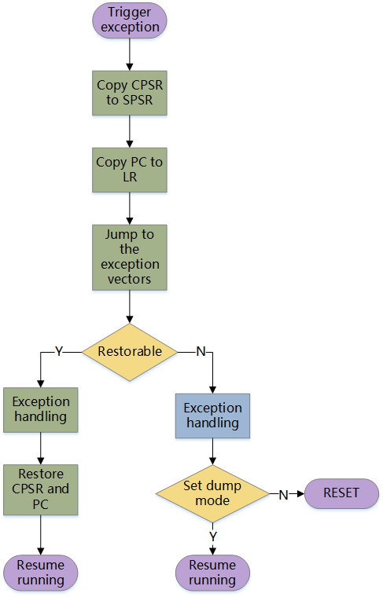

#### Dump and Trigger Mechanism

For Quecpython modules, Dump is a special exception handling program that is usually configured for unrecoverable exceptions. Its function is to save the CPU and memory data of the exception context and output it in a specified way. To enter this mode, two conditions are generally required: first, the module CPU generates an unrecoverable exception; second, the module enables the dump mode.

During the dump process, the following operations are usually performed:
1. Copy the register values of the exception context, including general-purpose registers R0-R12, link register LR pointer, and program counter PC pointer, which can restore most of the context.

2. Establish a channel for saving dump information according to the mode we configured, which generally includes:
   - Output from USB/UART (communication protocols such as Ymodem need to be initialized, and some platforms will re-enumerate the USB port.)
   - Save to storage media (initialize the corresponding storage media and check if the space meets the requirements of the dump file.)
   - Output from JTAG port (initialize the JTAG hardware.)

Considering storage space and ease of use, we generally use USB or UART to output the dump file.

3. Save the dump file
   Send or save the copied register and RAM information according to the address. This action is called "memory dump". After obtaining the RAM information, we can reconstruct the stack structure, stack frames, heap memory, and CPU registers of the exception context, and analyze the problem.

The common triggering mechanisms for unrecoverable exceptions generally include the following:

**Hardware watchdog timeout:** The hardware watchdog is generally connected to the CPU's IO pins, so it can trigger a CPU hardware interrupt. In the case of a timeout, the watchdog triggers a CPU interrupt. In the interrupt ISR, an exception is triggered by actively asserting, etc. If the dump mode is enabled at this time, it will enter the dump mode and output debugging information.

**Memory trampling:** When memory trampling occurs, the valid values in memory will be cleared or tampered with, often causing the CPU to obtain illegal values when fetching instructions or data. In this case, there are two possible exceptions: first, if the CPU fetches an illegal address and attempts to access it, it will cause a program or data memory access failure, triggering a Prefetch Abort or Data Abort; second, sometimes the CPU will jump to the wrong program entry point based on the error address, causing a logical exception and entering an infinite loop, which triggers a watchdog timeout. When the above exceptions occur, if the dump mode is enabled, it will enter the dump mode and output debugging information.

**Null pointer:** Null pointers are invalid for both programs and data. Generally, when using pointers, the code needs to filter out null pointers. If a null pointer is loaded into the CPU and executed, it will trigger a Prefetch Abort or Data Abort.

**Infinite loop:** When entering an infinite loop, the CPU will be occupied by the loop, and other tasks cannot be executed normally. Eventually, a watchdog timeout will trigger an exception.

**Assert:** Assert is a debugging technique that triggers an exception actively when the input is FALSE, such as using abort or while(1), etc. If the dump mode is enabled, it will eventually enter the dump mode and output debugging information.

The above is the triggering mechanism of the dump mode. After entering the dump mode, the module will save the memory and register information at the time of the exception and output it. In the following chapters, we will introduce how to capture dump debugging information and analyze it.

### Capturing Dump Debugging Information

During the debugging process, if a program exception occurs, we can configure the module to enter the dump mode and capture the debugging information.

#### How to Configure the Dump Mode

Generally, the default behavior of the module when a program exception occurs is to reset. We need to configure the module to enter the dump mode when an exception occurs by adjusting the NV parameters. This change needs to be configured by sending AT commands through the AT port (generally supports the main serial port and Quectel USB AT Port). The instructions for each platform are as follows:

ECX00U/ECX00G (this configuration is not saved after power-off):
at+qdbgcfg="dumpcfg",0

ECX00A/ECX00N/ECX00M (this configuration is not saved after power-off):
AT+LOG=19,1
AT+qdumpcfg=0,0
AT+qdumpcfg=2,1

ECX00E (this configuration is saved after power-off):
AT+ECPCFG="faultAction",0

BG95/BG600L (this configuration is saved after power-off):
AT+QCFGEXT="dump",1

After sending the above commands, the module will enter the dump mode instead of restarting directly when a program exception occurs. If you need to clear the above configuration and restore the reset behavior, the instructions for each platform are as follows:

ECX00U/ECX00G (this configuration is not saved after power-off):
at+qdbgcfg="dumpcfg",1

ECX00A/ECX00N/ECX00M (this configuration is not saved after power-off):
AT+qdumpcfg=0,1

ECX00E (this configuration is saved after power-off):
AT+ECPCFG="faultAction",4

BG95/BG600L (this configuration is saved after power-off):
AT+QCFGEXT="dump",0

In addition to the above instructions, the ECX00A/ECX00N/ECX00M platform can restore the reset behavior by clearing the NV parameters:
AT+RSTSET

#### How to Use the Dump Tool and Capture Dump Information

##### ECX00U Series Modules

The dump capture tool used by ECX00U is the same as the log capture tool, which is cooltools. Just like capturing logs, we connect the module to the log tool via the Quectel USB AP Log Port.

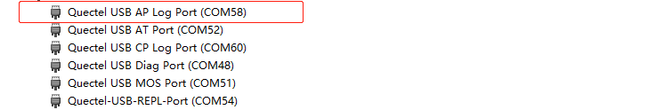
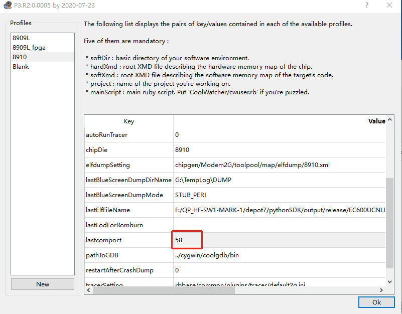
Then, select "**Activate Tracer**" from the Plugins dropdown menu to start the Trace tool plugin, and click the green arrow on the Tracer toolbar. If there is log output, it means that the module has successfully connected to the log tool.

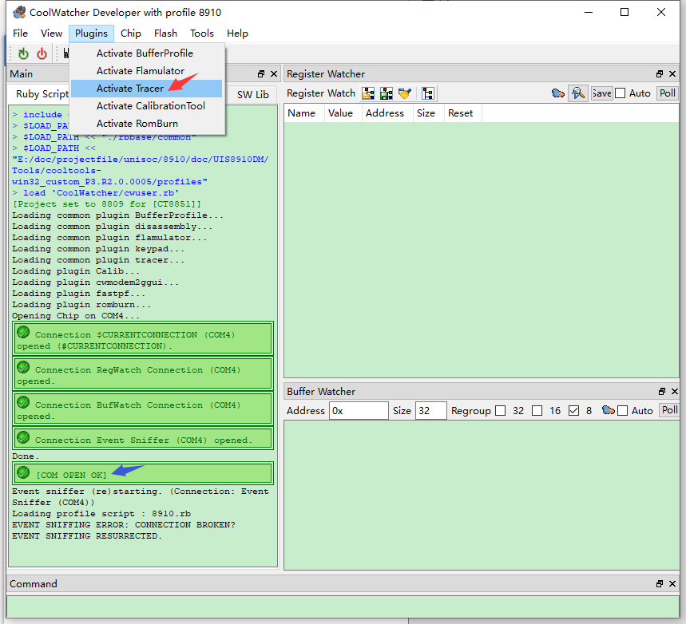
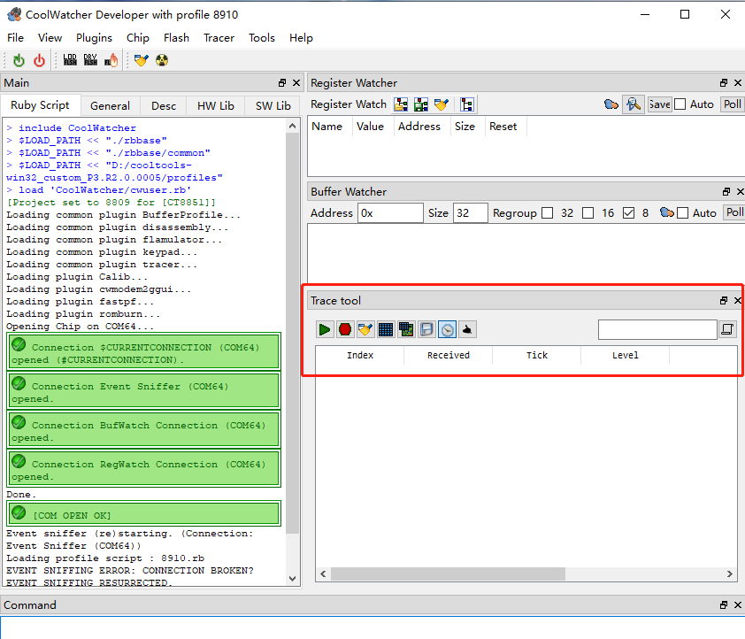
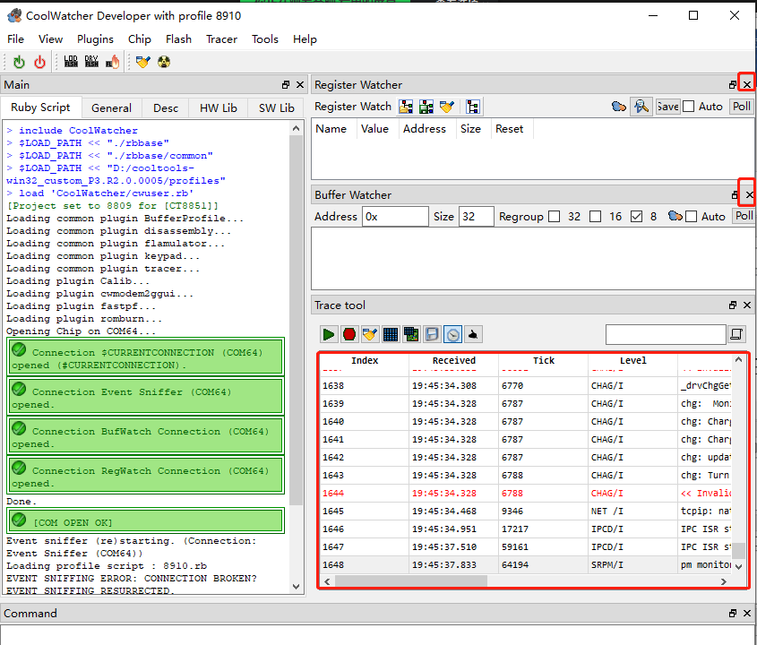

When a dump occurs, the log output interface will print the keyword "CP PANIC!", and then start saving the dump information (at this time, you can see many logs starting with "task").
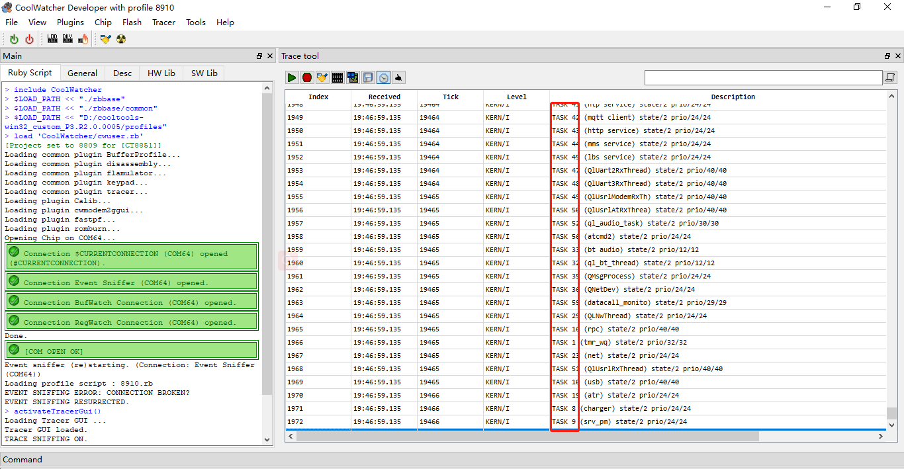

When these logs starting with "Task" stop printing, it means that the dump information is ready. At this time, select "Blue Screen dump" from the Tools dropdown menu, select the corresponding version of the elf file (generally not output with the version, provided by Quectel when there is a debugging requirement), and specify the output path. After selecting, click start.

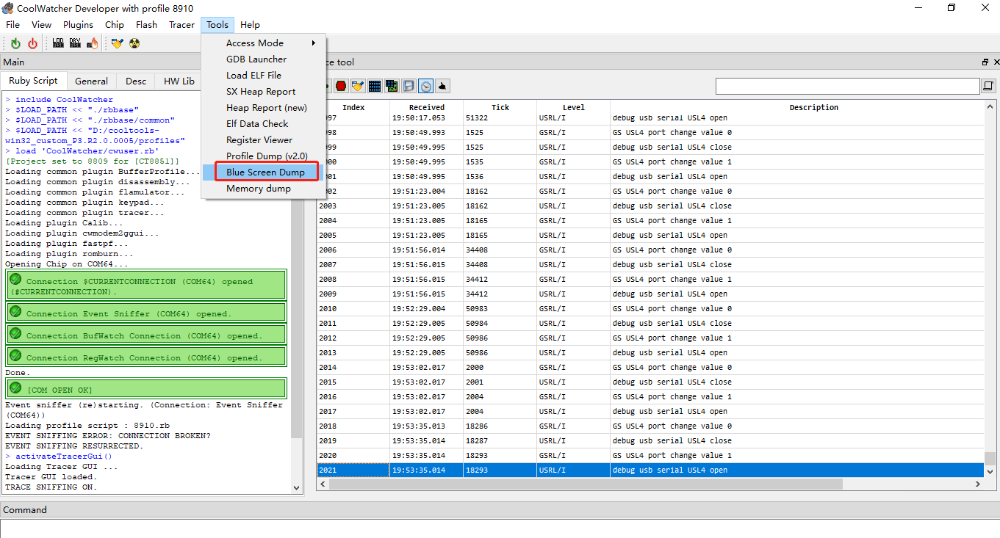
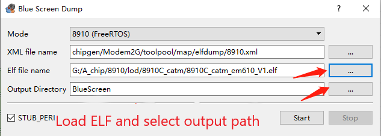
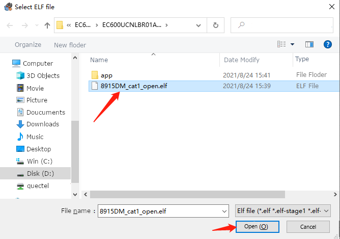

If the following interface appears, it means that the dump has been successfully captured,
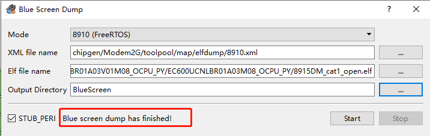

The dump file below should be packaged and sent to Quectel for analysis.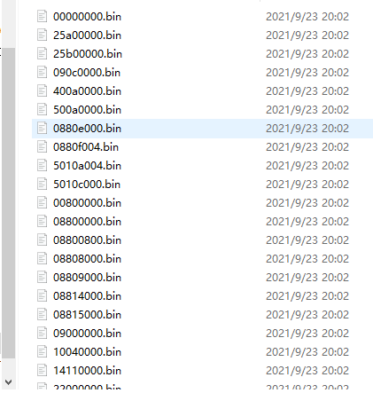

##### ECX00G Series Modules
When ECX00G generates a dump, the log port will also print the CP PANIC related information. At this time, we need to disconnect the log tool and use dtools to capture the dump information.

Click on the icon in the upper left corner of dtools to open the configuration menu, select DIAG port, and connect to Quectel USB DIAG Port.
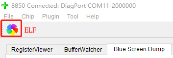
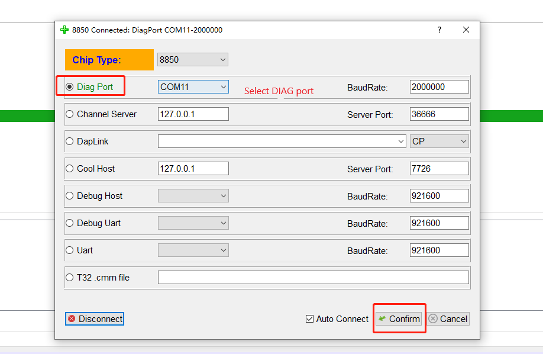

After the port is connected, click on the ELF icon on the right side and select the corresponding version of the elf debugging file (generally not output with the version, provided by Quectel when there is a debugging requirement).


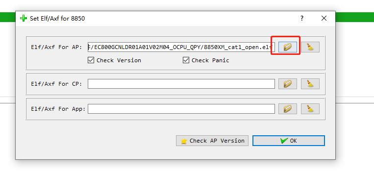
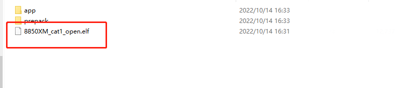
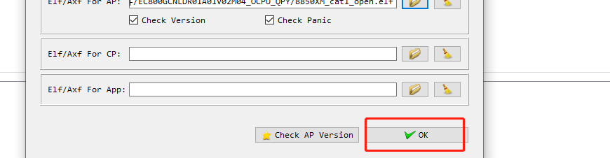

After both the DIAG port and ELF are configured, select Blue screen dump, and the dump Folder here is the output path of the dump file. Click start to start capturing the dump.
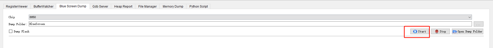

When the capture progress bar reaches 100%, the dump log is successfully captured. Package it and provide it to Quectel for analysis.
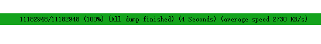

##### ECX00N/ECX00M/ECX00A Series Modules
After the above platforms enter dump mode, the USB port will be re-enumerated as Quectel USB Dump Debug Port, as shown in the figure below:


At this time, we can use the Ymodem tool in Catlog to capture the Dump information. After Catlog is started, select "Offline analysis log" to enter the following interface, select Modules->YmodemDump.
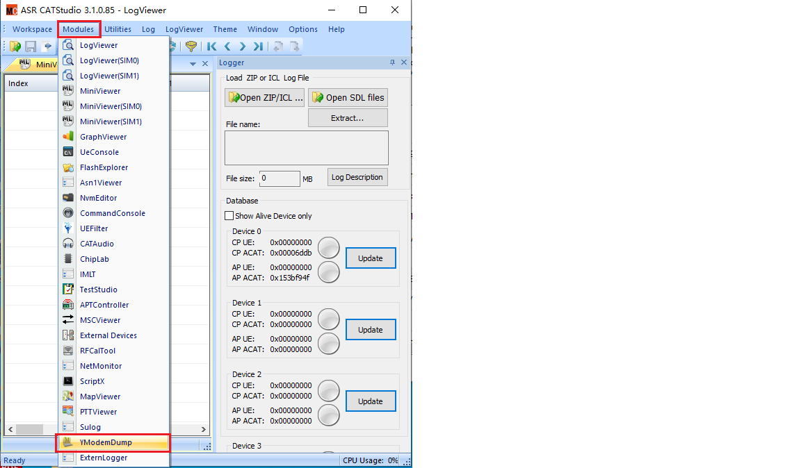

Enter the following interface, select Quectel USB Dump Debug Port for port, baud rate 115200, and click open to connect.
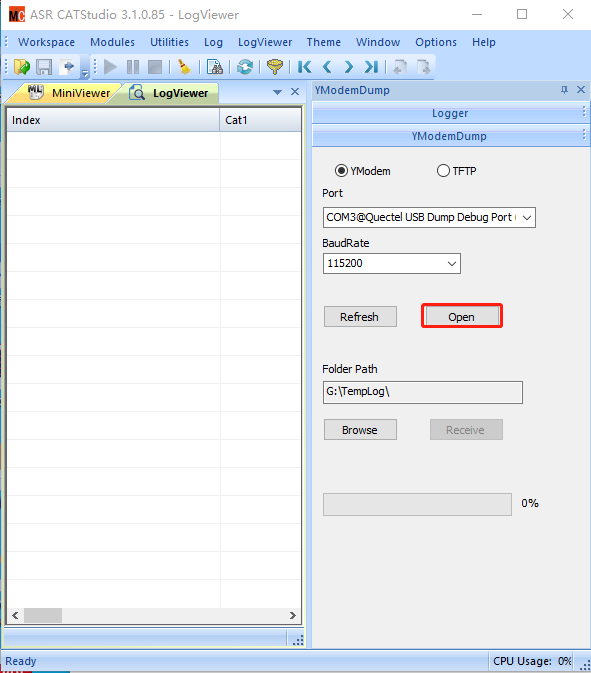

Click Browse below Folder Path to select the dump file output location. Then click Recieve to start capturing the dump information.
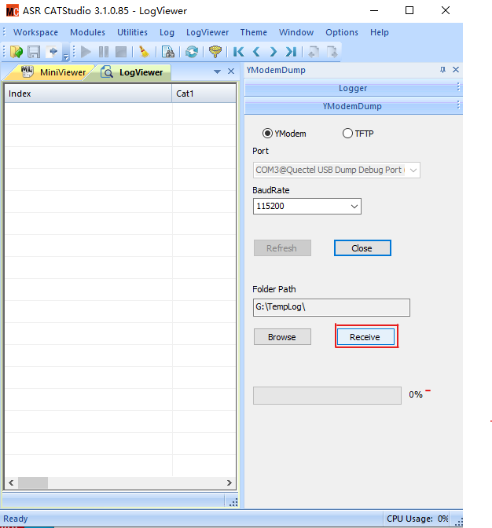

When the following interface appears, the dump information is successfully captured and can be packaged and provided to Quectel for analysis.
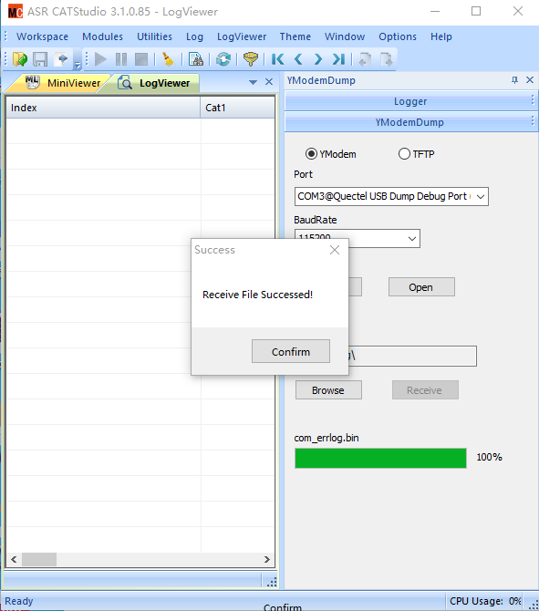
##### ECX00E Series Modules
This series of modules does not require manual execution of dump capture. When the log tool EPAT is connected normally, the log tool will automatically capture the dump when it occurs. Note that the tool needs to match the mdb information (generally not output with the version, provided by Quectel when there is a debugging requirement).
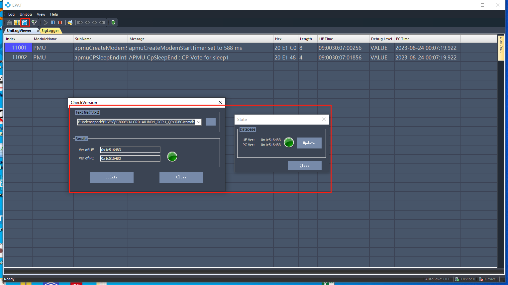
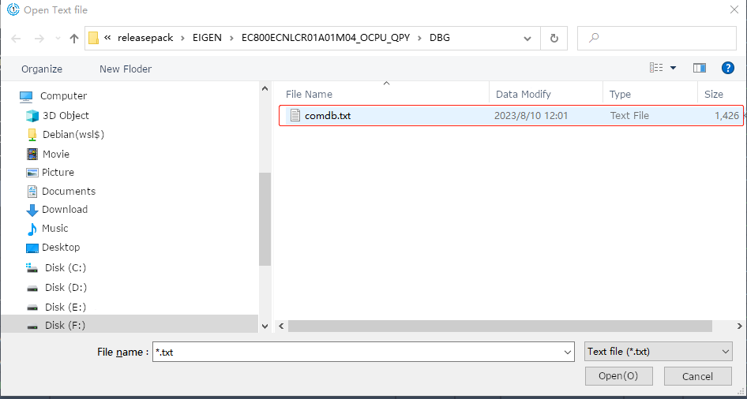

When a dump occurs, the log tool will automatically capture it. When the following interface appears, it means that the dump has been captured.
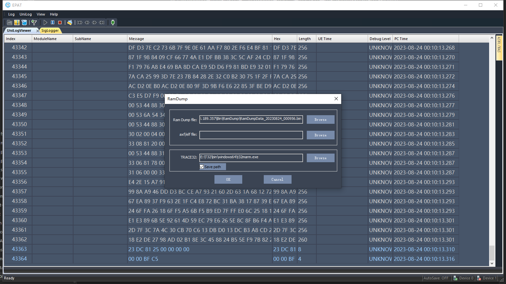

We can directly close the above dialog box. At this time, the dump information has been saved in the Ramdump folder in the root directory of the EPAT tool. There is only one file, named RamDumpData + timestamp. Select the dump file based on the timestamp and provide it to Quectel for analysis.
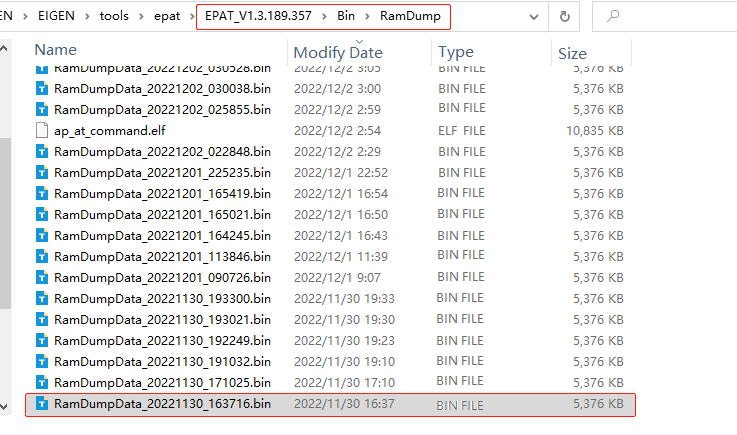

##### BG95/BG600L Series Modules
After this series of modules enters Dump mode, the USB will be re-enumerated, and the enumerated port is Quectel USB DM Port. We use the QPST tool to capture the Dump information.

Open QPST Configuration, click Add New Port, connect to the DM port, and after the connection is successful, the dump information will be automatically captured and saved in the Sahara directory in the QPST root directory.
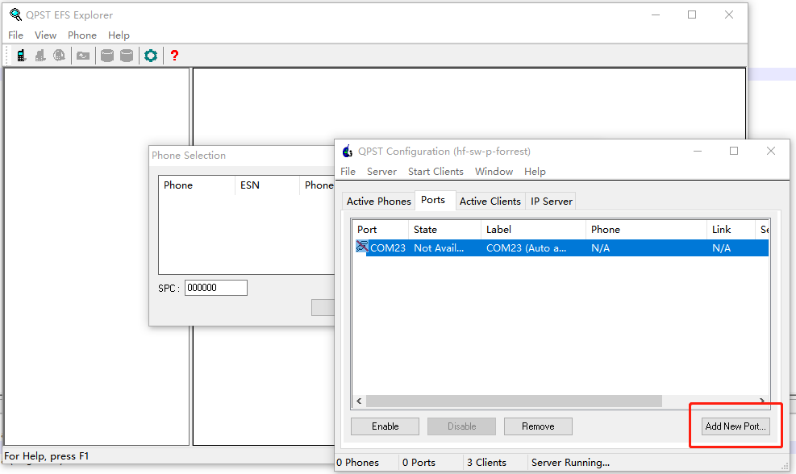
You can jump to the dump information storage location through this method, and send the dump information to Quectel for analysis.
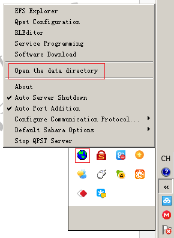
### Log Analysis during Dump

When the Quecpython module enters the dump mode, it will output some information from the log, such as the register address at the time of the dump, the exception type, and the thread being executed at the time of the exception. If the exception is triggered by an assert, it will also output the corresponding debugging information.

The log capture methods for each platform are as follows: 

The analysis of log information can generally start from the following points:
**Program Counter (PC) address:** This address corresponds to the content of the program counter register at the exception scene. It is responsible for storing the address of the instruction currently being executed. By matching the address in this register with the function being executed at the time of the exception in the firmware's map file, it can help locate the position in the code where the exception occurred.

**ASSERT debugging information:** Generally speaking, assert is used for situations that are not expected. It is usually used to check whether the current running situation is within expectations before executing certain logic. The print information of assert usually directly outputs the cause and location of the exception, which helps determine the type and location of the exception.

>**Common assert prints and corresponding information**
>
>**WDT timer expired:** It appears in the log of ECX00E, indicating that the built-in watchdog of the module has timed out.
>
>**Memory allocated failed:** It is adapted in the logs of most models, indicating that memory allocation failed, generally due to insufficient heap or excessive fragmentation.
>
>**stack overflow:** It is adapted in the logs of most models, indicating that a stack overflow has occurred.
>
>**illegal poolRef/pMemBlk/pBufHdr:** It appears in the logs of ECX00N/M, indicating that the memory structure has been corrupted, which implies a memory trampling has occurred.

**Watchdog feeding log:** ECX00U/X00G can determine whether it is a module watchdog-induced exception by calculating the time interval between the last watchdog feeding and entering the dump. Taking ECX00U as an example, when the module is configured in dump mode, this series of modules will output the log information "sys feed wdt" when feeding the built-in watchdog. By comparing the timestamp of the exception scene and the last watchdog feeding, if the time difference exceeds the watchdog bite time of the built-in watchdog (currently set to 30S), the exception cause may be a watchdog timeout.

### Dump Information Analysis

A dump is essentially a copy of the information of an exception scene, which generally includes CPU register information, memory information, etc. By matching this information with the corresponding firmware version's debugging information, the running state at the time of the exception can be parsed, including the running state of the thread at the time of the exception, stack call relationships, memory usage, semaphores, etc. These information can be analyzed to determine the cause of the dump.

The analysis of the dump is generally done by Quectel. When a dump occurs and the cause cannot be analyzed from the logs, users can capture the dump and provide the following information for Quectel to analyze:

**Scenario:** Provide the scenario and stack call relationships to analyze the running logic at the time of the dump.

**Steps:** Provide reproduction steps for reproduction and verification.

**Probability of occurrence:** Evaluate the scope of impact and reproduction conditions.

**Software version:** Confirm the software version where the exception occurred and extract the corresponding version of the ELF debugging file.

**DUMP file:** The captured dump file, which can be parsed into the exception scene with the corresponding ELF.

**LOG file:** If possible, capture the LOG (ECX00N/M/A USB and DEBUG uart will output LOG at the same time) to facilitate analysis by technical personnel.

### Common dump scenarios and solutions

#### Watchdog timeout

Quecpython modules generally have a built-in watchdog to monitor the system's running status. The watchdog feeding action is generally performed by a thread with a relatively low priority. When the CPU is preempted by a high-priority thread for a long time, the watchdog thread may not be scheduled. Once the time for not feeding the watchdog exceeds the trigger time threshold of the built-in watchdog (generally 30 seconds), the watchdog will be triggered, causing the module to enter the dump mode or reset.

In actual business scenarios, there are generally three situations that can cause a watchdog timeout:
First, there is an infinite loop in the business code, and the loop body lacks effective blocking or SLEEP. In this case, the thread in the infinite loop will continuously occupy the CPU and cannot be switched out, causing the watchdog thread to not be scheduled and eventually triggering a watchdog timeout.

Second, a high-priority thread in the business code preempted the CPU and has a long execution time. This situation will also cause the watchdog thread to not be scheduled and eventually trigger a watchdog timeout.

Third, improper use of mutex locks, where a mutex lock is not released at a certain location, resulting in the inability to obtain the mutex lock in subsequent logic, leading to a deadlock.

Phenomenon: In the module's log information, there are watchdog timeout-related information. Or the time from the last feeding of the watchdog to the exception scene in the log has exceeded the watchdog threshold (ECX00U and X00M currently need to calculate in this way, the threshold is 30 seconds).

Solution:
1. Try to eliminate possible infinite loop logic in the business code.
2. Set reasonable blocking or sleep in the business code to ensure that low-priority tasks can be scheduled normally.
3. For necessary loops, add safety measures. For example, add a loop counter in the loop body so that even if an infinite loop occurs, it can exit when the loop reaches a certain number of times.
4. Check the mutex lock to ensure that its usage is paired. Deleting a thread that takes a lock does not release the mutex lock it already holds. This operation will prevent the thread that is mutually exclusive from running. Be sure to release the mutex lock held by the thread before deleting it.

Here is an example to illustrate. First, let's look at a counterexample:

```python
import utime

def Business_code_example():
	while(1):
		print("It will running to dump")
		#Business code here
		
if __name__ == "__main__":
	Business_code_example()
```

In this example, the loop that contains the business function will run indefinitely without any blocking. Running this example on the module will result in a dump after a period of time.

The example is modified as follows:

```python
import utime

def Business_code_example():
	while(1):
		print("It will running to dump")
		utime.sleep(1)
		#Business code here
		
if __name__ == "__main__":
	Business_code_example()
```

Running this example will no longer produce a dump. Because when the business code sleeps, other tasks can be scheduled, ensuring that the watchdog can be fed normally.

#### Stack overflow

When creating a sub-thread in Quecpython, the thread stack space is still allocated from the underlying heap memory. If the allocated stack space is too small to store the thread's private data, a stack overflow will occur, which means that the thread's private data is stored outside the stack, which may cause adjacent memory to be corrupted. This phenomenon is called **memory trampling**.

When memory trampling occurs, there are generally two common dump phenomena:

1. Triggering an assert: Some modules are configured to monitor the stack space, and when a stack overflow occurs, an assert will be triggered proactively. At this time, information output by assert could be seen in the log and dump messages, and the stack overflow-triggered assert will generally print information related to **stack overflow**. In this case, the problem can be directly confirmed as a stack overflow and appropriate measures can be taken.

2. No stack space monitoring is configured, or the stack overflow is not detected. The module can continue to run until the CPU accesses the corrupted memory, which will cause a Data Abort or Prefetch Abort exception. This type of exception requires providing dump information for Quectel to analyze and confirm.

Solution:
When creating a sub-thread in the business code, estimate the required stack size (including the size of the thread's parameters, return values, and local variables, which do not need to be too accurate) and allocate an appropriate size. If a stack overflow occurs, you can use the _thread.stack_size interface to configure a larger stack space.

Here is an example:

```python
import _thread
import utime

def th_func1():
    while True:
    	print("Bussiness code running")
    	#bussiness code here
    	utime.sleep(1)

if __name__ == '__main__':
	stack_size_old = _thread.stack_size()#Get the current stack size
	print(stack_size_old)
	_thread.stack_size(stack_size_old + 1024)#If there is a stack overflow under the current stack size, you can increase the stack size appropriately using this method as a reference
    thread_id = _thread.start_new_thread(th_func1, ())
```

#### Long interrupt processing time

Interrupt service routines (ISRs) have higher priority than all threads and can interrupt thread execution. If the CPU is occupied by an ISR for a long time (the ISR code runs for a long time or a large number of interrupts are triggered in a short period of time, causing frequent entry into the ISR environment), the RTOS may run abnormally or even trigger the watchdog.

There are two common manifestations of long interrupt processing time:
First, there are a large number of interrupt-related prints in the log, which eventually leads to a watchdog timeout.
Second, the protocol stack cannot process data, resulting in overflow and triggering an assert.

Solution:
Hardware design: Properly configure the interrupt-related circuit, handle debouncing properly, and avoid scenarios where hardware interrupts are triggered multiple times in a short period of time.
Software design: Avoid using blocking and time-consuming operations in the interrupt ((A typical pattern is to send signals to a certain thread in ISR, and let the thread execute actual business. The current Python side interrupt callback mechanism has been configured to handle similar processing and does not need to be concerned).

#### Invalid pointer/null pointer

Due to Quecpython's GC recycling mechanism, local variables can be recycled when they are no longer referenced. If these local variables are referenced again after being recycled, there is a risk of introducing invalid pointers or null pointers. If their data has been erased or overwritten, a Data Abort or Prefetch Abort exception will occur.

The phenomenon of this problem is relatively fixed, that is, after using GC for recycling (whether manual or automatic), Data Abort or Prefetch Abort occurs. Dump information needs to be provided to Quectel for analysis to confirm this exception.

Solution:
Local variables have the risk of being recycled at any time outside their lifecycle. Therefore, objects that are not always referenced but are expected to be persistently stored should be configured as global variables.

### Common Issues

#### How to determine if it is an abnormal restart
The power on/off reason can be obtained, for example:

```python
from misc import Power

Power.powerOnReason()# When the return value is 9, it means an abnormal restart occurred
```

#### Program freezes without setting dump mode / Program freezes after setting dump mode but does not enter dump state

If the module is not configured in dump mode but the program freezes, or if the program freezes after configuring dump mode but does not enter dump state, most of the time there is an exception in the business logic.
Debugging methods:

1. Add print information in the business logic to confirm the execution logic.
2. Trigger a dump actively and analyze the running context when the program is blocked based on the dump information.

#### How to trigger a dump actively

Send the following command via the main serial port or Quectel USB AT Port:

>AT+QDBGCFG="system/abort"

For ECX00MLC, LF, and CC, if the above command is not adapted, you can send the following command to achieve the same effect:

>AT+LOG = 14,0

#### How to analyze if setting dump mode still causes restart

1. If setting dump mode still causes a restart and the power on reason points to Dump restart: Generally, the dump mode is not configured correctly, so reconfigure it and try again.

2. If setting dump mode still causes a restart and the power on reason points to RESET restart: Generally, there are two situations. First, a soft restart is triggered, so check if there is a soft restart in the business logic. Second, the reset pin is triggered, so check the waveform of the RESET pin to see if an external factor triggers a hardware reset.

3. If setting dump mode still causes a restart and the power on reason points to powerkey startup: This only occurs on devices that are configured to power on automatically. Generally, after triggering a shutdown, the module is powered on again by the powerkey. In this case, the following three points need to be checked: First, check if the shutdown interface is called. Second, check the VBAT voltage waveform to see if the voltage drop causes the module to shut down. Third, check the powerkey pin to see if its level fluctuates and forms a falling edge to trigger a shutdown.

#### Error occurs during dump capture process

Generally, there are two reasons:
1. The ELF imported by the dump tool does not match the firmware version in the module. Please confirm the version and replace the ELF.
2. Severe stack corruption leads to abnormal saving of dump information. In this case, contact Quectel for assistance.