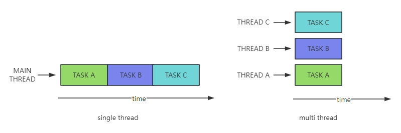
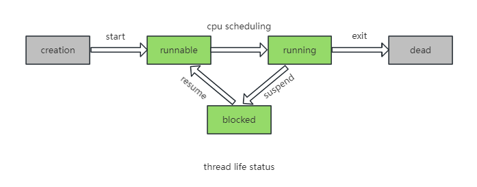
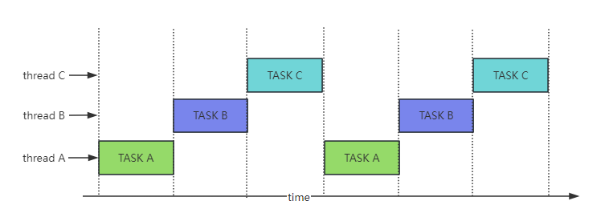
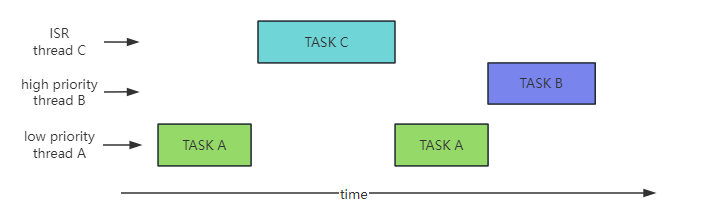
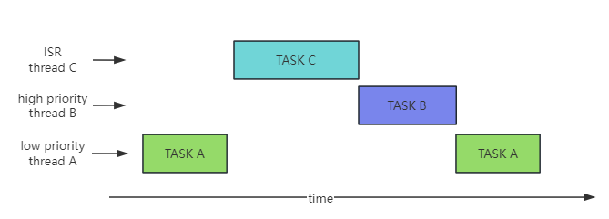
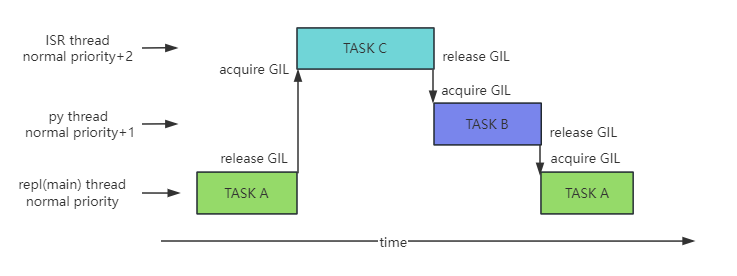

# Multithreading

## Overview

Multithreading is a technique that allows multiple threads to execute concurrently in software or hardware. In a program, multiple threads can execute simultaneously, each performing independent tasks. This allows the program to continue executing other tasks while one thread is blocked (e.g.,  I/O operations), improving the efficiency of the program.



The QuecPython `_thread` module provides functions for creating and deleting threads, as well as interfaces for mutexes, semaphores, and other related operations. QuecPython also provides component modules such as queue, sys_bus, and EventMesh to facilitate multithreaded business processing.

## Implementation of Multithreading

QuecPython does not create thread resources itself. In QuecPython, one thread corresponds to one thread in the underlying RTOS system and relies on the underlying thread scheduling. So how does the underlying system schedule and execute multiple tasks?

### Thread Creation

Python provides a convenient way to create threads, which ignores the configuration of underlying parameters such as stack size and priority, simplifying usage as much as possible. When creating a thread in Python, a task control block (TCB) is generated in the underlying RTOS system for task scheduling and thread resource control.

The default stack size for the protocol stack is 8k. QuecPython also provides the ability to configure the stack size, which can be queried and configured using the `_thread.stack_size()` interface.

```python
import _thread
import utime

# Thread function entry, print every second.
def thread_func_entry(id, name):
    while True:
        print('thread {} name is {}.'.format(id, name))
        utime.sleep(1)

# Create a thread
_thread.start_new_thread(thread_func_entry, (1, 'QuecPython'))

```

### Thread States

A thread has its own lifecycle, from creation to termination, and is always in one of the following five states: creation, runnable, running, blocked, and dead.



- Creation: The thread is created and initialized to the runnable state.
- Runnable: The thread is in the runnable pool, waiting for CPU usage.
- Running: The thread is running when it obtains CPU execution resources from the runnable state.
- Blocked: The running thread gives up CPU usage for some reason and enters the blocked state. The thread is suspended and does not execute until it enters the runnable state again. This blocking state can be caused by various reasons, such as sleep, semaphore, lock, etc.
- Dead: The thread enters the dead state when it completes execution or terminates abnormally.

### Thread Scheduling Mechanism

The simultaneous execution of multiple threads is a false proposition. In reality, not all threads can run continuously and exclusively occupy the CPU, no matter how powerful the hardware resources are. For thousands of threads, a certain scheduling algorithm is needed to implement multithreading. So how is the scheduling mechanism of multithreading implemented?

In an RTOS system, common scheduling mechanisms include time-slice round-robin scheduling, priority-based cooperative scheduling, and preemptive scheduling. Generally, multiple scheduling algorithms are used in an RTOS system.

#### Time-Slice Round-Robin Scheduling

The round-robin scheduling strategy in RTOS allows multiple tasks to be assigned the same priority. The scheduler monitors task time based on the CPU clock. Tasks with the same priority are executed in the order they are assigned. When the time is up, even if the current task is not completed, the CPU time is passed to the next task. In the next allocated time slot, the task continues to execute from where it stopped.

As shown in the following figure, time is divided into time slices based on the CPU tick. After each time slice, the scheduler switches to the next task in the runnable state, and then executes tasks A, B, and C in order.



#### Priority-Based Cooperative Scheduling

Priority-based cooperative scheduling in RTOS is a non-preemptive scheduling method based on priorities. Tasks are sorted by priority and are event-driven. Once a running task completes or voluntarily gives up CPU usage, the highest priority task in the runnable state can obtain CPU usage.

As shown in the following figure, according to the priority task scheduling method, when executing task A, an interrupt event task occurs and the high-priority interrupt event task is executed immediately. After the high-priority interrupt completes or gives up the CPU, the scheduler switches to the higher priority task A. After the task A completes or gives up the CPU, the scheduler switches to the task B.



#### Preemptive Scheduling

RTOS ensures real-time performance through preemptive scheduling. In order to ensure task responsiveness, in preemptive scheduling, as long as a higher priority task becomes runnable, the currently running lower priority task will be switched out. Through preemption, the currently running task is forced to give up the CPU, even if the task is not completed.

As shown in the following figure, according to the preemptive scheduling method, when executing task A, a higher priority task C appears and immediately switches to task C. After the higher priority task C completes or gives up the CPU, the scheduler switches to the higher priority task B based on the current runnable state. After task B completes or gives up the CPU, task A is executed again.



### Thread Context Switching

In actual multithreaded execution, multiple threads are kept running by constantly switching between them. So how does the thread scheduling and switching process work? How is the execution state restored after switching?

When the operating system needs to run other tasks, it first saves the contents of the registers related to the current task to the stack of the current task. Then, it retrieves the previously saved contents of all registers from the stack of the task to be loaded and loads them into the corresponding registers, so that the execution of the loaded task can continue. This process is called thread context switching.

Thread context switching incurs additional overhead, including the overhead of saving and restoring thread context information, the CPU time overhead for thread scheduling, and the CPU cache invalidation overhead.

### Thread Cleanup

A thread is the smallest scheduling unit of the system, and the creation and release of system threads require corresponding resource creation and cleanup.

To simplify the usage for customers, QuecPython automatically releases thread resources after the thread finishes running, so customers do not need to worry about thread resource cleanup. If you need to control the closure of a thread by another thread, you can use the `_thread.stop_thread(thread_id)` interface to control the specified thread based on the thread ID.
> By using `_thread.stop_thread(thread_id)` to forcefully close a thread and release thread resources, you need to pay attention to whether the corresponding thread has locks, memory allocations, and other related operations that need to be released by the user to prevent deadlocks or memory leaks.

```python
import _thread
import utime

# Thread function entry, print every second.
def thread_func_entry(id, name):
    while True:
        print('thread {} name is {}.'.format(id, name))
        utime.sleep(1)

# Create a thread
thread_id = _thread.start_new_thread(thread_func_entry, (1, 'QuecPython'))

# Delete the print thread every second after 10 seconds delay.
utime.sleep(10)
_thread.stop_thread(thread_id)
```

### QuecPython Multithreading

QuecPython multithreading relies on the underlying system's scheduling method and adds GIL lock to implement multithreading.

Python is an interpreted language, and for multithreading processing, it needs to be executed in order to ensure that only one thread is executing at the same time in the process. Therefore, the concept of GIL global lock is introduced to prevent shared resource exceptions caused by multithreading conditions.

QuecPython threads define the main thread, Python sub-threads, and interrupt/callback threads on the basis of the system and fix their priorities. The priority of the main thread (repl interactive thread) is lower than that of Python sub-threads, and the priority of Python sub-threads is lower than that of interrupt/callback threads.

The QuecPython multithreading switching process is shown in the figure below, when executing task A, after releasing the GIL lock of task A, switch to the higher priority interrupt task C. After the high-priority task C releases the GIL lock, execute the higher-priority task B and acquire the GIL lock. After the task B releases the GIL lock, continue to execute task A. QuecPython avoids the GIL lock causing high-priority tasks to be unable to execute and has flexibility in multithreading scheduling. It will automatically release the GIL lock after a certain number of executions and be scheduled by the system.



## Inter-thread Communication & Resource Sharing

Inter-thread communication refers to the techniques or methods used to transmit data or signals between at least two processes or threads. In multithreading, inter-thread communication is essential for controlling thread execution, resource sharing control, message passing, etc., to achieve program diversification.

| Inter-thread Communication | Applicable Scenarios | Resource Consumption |
| ---- | ---- | ---- |
| Mutex Lock | Used for signal transmission, not for data transmission. It is often used to protect shared resources in multithreading and control program execution. | Less resource consumption. |
| Semaphore | Used for signal transmission, not for data transmission. It is often used to protect shared resources in multithreading and control program execution. It is more flexible than mutex locks. | Less resource consumption. |
| Shared Variable | Data transmission, often used in conjunction with mutex locks and semaphores. | Less resource consumption. |
| Message Queue | Used for signal transmission and data transmission, suitable for producer-consumer model. | Moderate resource consumption. |
| sys_bus | Data transmission, one-to-one communication or one-to-many communication, data protocol based on the publish/subscribe paradigm. | Large resource consumption for asynchronous data publishing. |
| EventMesh | Data transmission, one-to-one communication, data protocol based on the publish/subscribe paradigm. | Large resource consumption for asynchronous data publishing. |

### Mutex Lock

A mutex lock is a mechanism used in multithreading programming to prevent two threads from simultaneously reading and writing to the same shared resource (such as a global variable). The purpose of a mutex lock is to slice the code into critical regions one by one, so as to protect the critical regions and enable multiple threads to access them in order.

```python
# In this example, thread B controls the execution of thread A through a mutex lock under certain conditions, achieving inter-thread communication.
import _thread
import utime

lock = _thread.allocate_lock()
count = 1

# Thread B function entry, prevent simultaneous operations on the global variable count through the lock.
def thread_entry_B(id):
    global count
    while True:
        with lock:
            print('thread {} count {}.'.format(id, count))
            count += 1
            utime.sleep(1)

# Thread A function entry, prevent simultaneous operations on the global variable count through the lock.
def thread_entry_A(id):
    global count
    while True:
        with lock:
            print('thread {} count {}.'.format(id, count))
            count += 1

# Create threads
_thread.start_new_thread(thread_entry_A, ('A',))
_thread.start_new_thread(thread_entry_B, ('B',))
```

### Semaphore

A semaphore is a synchronization object that maintains a count between 0 and a specified maximum value. When a thread completes a wait operation on the semaphore object, the count is decremented by one. When a thread completes a release operation on the semaphore object, the count is incremented by one.

By controlling the semaphore, the control of multithreading can be achieved, such as the order or causality of resource operations by multiple threads. It can be controlled by a semaphore.

```python
# In this example, thread B controls the execution of thread A through a semaphore, achieving inter-thread communication.
import _thread
import utime

semaphore = _thread.allocate_semaphore(1)

# Thread B function entry, controls the execution of thread A through the semaphore.
def thread_entry_B(id):
    while True:
        print('this is thread {}.'.format(id))
        utime.sleep(1)
        semaphore.release()

# Thread A function entry, waits for the semaphore to run.
def thread_entry_A(id):
    while True:
        semaphore.acquire()
        print('this is thread {}.'.format(id))

# Create threads
_thread.start_new_thread(thread_entry_A, ('A',))
_thread.start_new_thread(thread_entry_B, ('B',))
```

### Shared Variable

A shared variable refers to a variable that is read and written by multiple threads at the same time, and these operations can affect other threads.

When doing multithreading programming with shared variables, it is necessary to manage and control the shared variables properly to avoid the occurrence of multithreading race conditions.

```python
# In this example, one thread modifies the shared variable, and another thread reads it. When multiple threads write, it is necessary to consider variable safety to prevent unexpected situations.
import _thread
import utime

lock = _thread.allocate_lock()
count = 1

# Thread B function entry, incrementing the shared variable count.
def thread_entry_B(id):
    global count
    while True:
        count += 1
        utime.sleep(1)

# Thread A function entry, reading and printing the shared variable count.
def thread_entry_A(id):
    global count
    while True:
        print('thread {} current count is {}.'.format(id, count))
        utime.sleep(5)

# Create threads
_thread.start_new_thread(thread_entry_A, ('A',))
_thread.start_new_thread(thread_entry_B, ('B',))
```

### Message Queue

The message queue implements a multi-producer, multi-consumer queue. It uses a first-in, first-out data structure, which is particularly suitable for thread programming where messages need to be exchanged safely between multiple threads. It is commonly used for asynchronous message processing, such as receiving data in one thread to prevent blocking and storing the data in the message queue, while another thread handles the messages in the message queue.

```python
# In this example, Thread B pushes messages onto the queue, and Thread A specifically reads and processes the messages in the message queue.
import _thread
import utime
from queue import Queue

q = Queue()

# Thread B function entry, incrementing the shared variable count.
def thread_entry_B(id):
    data = 'Hello QuecPython!'
    while True:
        q.put(data)
        print('thread {} send {}.'.format(id, data))
        utime.sleep(3)

# Thread A function entry, reading and printing the shared variable count.
def thread_entry_A(id):
    while True:
        data = q.get()
        print('thread {} recv {}.'.format(id, data))

# Create threads A and B.
_thread.start_new_thread(thread_entry_A, ('A',))
_thread.start_new_thread(thread_entry_B, ('B',))
```

### sys_bus

The sys_bus component is used for message subscription and publication. It can be used in multithreaded programming to decouple multiple threads and messages by defining different types of topics for different transactions. Any thread can handle the messages by publishing them at any time.
> This component supports one-to-many or many-to-many communication, meaning multiple subscribers can subscribe to the same topic and all subscribers can process messages published to that topic.

```python
# In this example, threads subscribe to topics and A&B threads respectively send subscription messages to the subscribed topics.
import _thread
import utime
import sys_bus

def callback_A(topic, msg):
    print("topic = {} msg = {}".format(topic, msg))

def callback_B(topic, msg):
    print("topic = {} msg = {}".format(topic, msg))

# Thread B function entry, subscribes to the sysbus/thread_B topic and sends messages to the sysbus/thread_A topic every 3 seconds.
def thread_entry_B(id):
    sys_bus.subscribe("sysbus/thread_B", callback_B)
    while True:
        sys_bus.publish_sync("sysbus/thread_A", "this is thread B msg")
        utime.sleep(3)

# Thread A function entry, subscribes to the sysbus/thread_A topic and sends messages to the sysbus/thread_B topic every 3 seconds.
def thread_entry_A(id):
    sys_bus.subscribe("sysbus/thread_A", callback_A)
    while True:
        sys_bus.publish_sync("sysbus/thread_B", "this is thread A msg")
        utime.sleep(3)

# Create threads A and B.
_thread.start_new_thread(thread_entry_A, ('A',))
_thread.start_new_thread(thread_entry_B, ('B',))
```

```python
# In this example, threads A and B subscribe to the same topic, enabling one-to-many communication. When Other threads publish messages to this topic, both threads A and B receive the message.
import _thread
import utime
import sys_bus

def callback_A(topic, msg):
    print("callback_A topic = {} msg = {}".format(topic, msg))

def callback_B(topic, msg):
    print("callback_B topic = {} msg = {}".format(topic, msg))

# Thread B function entry, subscribes to the sysbus/multithread topic.
def thread_entry_B(id):
    sys_bus.subscribe("sysbus/multithread", callback_B)
    while True:
        utime.sleep(10)

# Thread A function entry, subscribes to the sysbus/multithread topic.
def thread_entry_A(id):
    sys_bus.subscribe("sysbus/multithread", callback_A)
    while True:
        utime.sleep(10)

# Create threads A and B.
_thread.start_new_thread(thread_entry_A, ('A',))
_thread.start_new_thread(thread_entry_B, ('B',))

# The main thread publishes a message to the sysbus/multithread topic every 3 seconds.
while True:
    sys_bus.publish_sync("sysbus/multithread", "sysbus broadcast conntent!")
    utime.sleep(3)
```

### EventMesh

The EventMesh component is used for message subscription and publication. It can be used in multi-threading to decouple multiple threads and handle multiple messages by defining different types of topics for different transactions. Any thread can process the message by publishing it at any time.
> This component can only communicate one-to-one or many-to-one, that is, a topic can only have one subscriber at a time, and the last subscriber will replace other subscribers.

> [Click here to download the EventMesh component code on GitHub.](https://github.com/QuecPython/EventMesh)

```python
# This example thread subscribes to the topic. Threads A and B send subscription messages to the subscribed topic for processing.
import _thread
import utime
from usr import EventMesh

def callback_A(topic, msg):
    print("topic = {} msg = {}".format(topic, msg))

def callback_B(topic, msg):
    print("topic = {} msg = {}".format(topic, msg))

# Thread B function entry, subscribe to EventMesh/thread_B topic and send messages to EventMesh/thread_A topic every 3 seconds.
def thread_entry_B(id):
    EventMesh.subscribe("EventMesh/thread_B", callback_B)
    while True:
        EventMesh.publish_sync("EventMesh/thread_A", "this is thread B msg")
        utime.sleep(3)

# Thread A function entry, subscribe to EventMesh/thread_A topic and send messages to EventMesh/thread_B topic every 3 seconds.
def thread_entry_A(id):
    EventMesh.subscribe("EventMesh/thread_A", callback_A)
    while True:
        EventMesh.publish_sync("EventMesh/thread_B", "this is thread A msg")
        utime.sleep(3)

# Create threads A and B.
_thread.start_new_thread(thread_entry_A, ('A',))
_thread.start_new_thread(thread_entry_B, ('B',))
```

```python
# This example thread A and B subscribe to the same topic. EventMesh can only have one subscriber for a topic. B is the last subscriber and will directly replace A's subscription. Only thread B can receive messages from this topic.
import _thread
import utime
from usr import EventMesh

def callback_A(topic, msg):
    print("callback_A topic = {} msg = {}".format(topic, msg))

def callback_B(topic, msg):
    print("callback_B topic = {} msg = {}".format(topic, msg))

# Thread B function entry, subscribe to EventMesh/multithread topic.
def thread_entry_B(id):
    EventMesh.subscribe("EventMesh/multithread", callback_B)
    while True:
        utime.sleep(10)

# Thread A function entry, subscribe to EventMesh/multithread topic.
def thread_entry_A(id):
    EventMesh.subscribe("sysbus/multithread", callback_A)
    while True:
        utime.sleep(10)

# Create threads A and B.
_thread.start_new_thread(thread_entry_A, ('A',))
_thread.start_new_thread(thread_entry_B, ('B',))

# The main thread publishes a message to the EventMesh/multithread topic every 3 seconds.
while True:
    EventMesh.publish_sync("EventMesh/multithread", "EventMesh broadcast conntent!")
    utime.sleep(3)
```

## Multi-threaded Application Example

### Simple Multi-threading Example

A simple multi-threading example is shown below, creating threads A and B, each doing its own independent task. Therefore, when a task needs to run for a long time and will block subsequent task execution, it can be executed in multiple threads.

```python
import _thread
import utime

# Thread B function entry, print every 3 seconds.
def thread_entry_B(id):
    while True:
        print('thread {} is running.'.format(id))
        utime.sleep(3)

# Thread A function entry, print every 3 seconds.
def thread_entry_A(id):
    while True:
        print('thread {} is running.'.format(id))
        utime.sleep(3)

# Create threads
_thread.start_new_thread(thread_entry_A, ('A',))
_thread.start_new_thread(thread_entry_B, ('B',))
```

### Atomic Operation in Multi-threading

An atomic operation is an operation that is not interrupted by the thread scheduling mechanism. Once started, it runs until it finishes without switching to other threads in the middle.

Atomic operations in multi-threading mean that when multiple threads access the same shared resource, it ensures that all other threads do not access the same resource at the same time. Therefore, when multiple threads access the same resource, but the resource cannot be accessed at the same time, this method can be used to implement it.

In the following example, threads A and B simultaneously operate on a shared resource. Locking is used to protect the shared resource, ensuring that only one thread can access the shared resource at the same time.
```python
import _thread
import utime

lock = _thread.allocate_lock()
count = 1

def shared_res(id):
    global count
    with lock:
        print('thread {} count {}.'.format(id, count))
        count += 1

# Thread B entry function, performs accumulation operation on shared resource count.
def thread_entry_B(id):
    while True:
        shared_res(id)
        utime.sleep(1)

# Thread A entry function, performs accumulation operation on shared resource count.
def thread_entry_A(id):
    global count
    while True:
        shared_res(id)
        utime.sleep(1)

# Create threads
_thread.start_new_thread(thread_entry_A, ('A',))
_thread.start_new_thread(thread_entry_B, ('B',))
```

### Sequential Execution of Multiple Threads

Sequential execution of multiple threads can be achieved by controlling with semaphores, which is commonly used when there are dependencies between multiple threads. This method allows for controlled execution in a specific order.

In the following example, there are three threads: A, B, and C. By using semaphores to control their execution, they are printed in the order of A, B, and C.
```python
import _thread
import utime

semaphore_A = _thread.allocate_semaphore(1)
semaphore_B = _thread.allocate_semaphore(1)
semaphore_C = _thread.allocate_semaphore(1)

# Thread C entry function, controls the execution of Thread A with a semaphore.
def thread_entry_C(id):
    count = 0
    while count < 30:
        semaphore_B.acquire()
        print('this is thread {}.'.format(id))
        utime.sleep_ms(100)
        semaphore_C.release()
        count += 1

# Thread B entry function, controls the execution of Thread C with a semaphore.
def thread_entry_B(id):
    count = 0
    while count < 30:
        semaphore_A.acquire()
        print('this is thread {}.'.format(id))
        utime.sleep_ms(100)
        semaphore_B.release()
        count += 1

# Thread A entry function, waits for the semaphore to run.
def thread_entry_A(id):
    count = 0
    while count < 30:
        semaphore_C.acquire()
        print('this is thread {}.'.format(id))
        utime.sleep_ms(100)
        semaphore_A.release()
        count += 1

# Clear semaphores A and B to ensure that only Thread A runs first and avoid interference from extra semaphores.
semaphore_A.acquire()
semaphore_B.acquire()

# Create threads A, B, and C.
_thread.start_new_thread(thread_entry_A, ('A',))
_thread.start_new_thread(thread_entry_B, ('B',))
_thread.start_new_thread(thread_entry_C, ('C',))
```

### Producer-Consumer Pattern

The producer-consumer pattern is commonly used to decouple the production and consumption of data. 

In multi-threaded development, if the producer produces data at a fast rate while the consumer consumes data at a slow rate, the producer must wait for the consumer to finish consuming the data before it can continue producing data. To achieve a balance between the producer and consumer, a buffer is needed to store the data produced by the producer, which is why the producer-consumer pattern is introduced.

In the following example, the producer thread sends a message to the consumer every 3 seconds, and the consumer thread waits for the producer's message to print and process it.
```python
# In this example, Thread B pushes messages onto the stack, and Thread A reads the contents of the message queue for processing.
import _thread
import utime
from queue import Queue

q = Queue()

# Thread producer entry function, provides messages to the consumer.
def thread_producer(id):
    data = 'Hello QuecPython!'
    while True:
        q.put(data)
        print('thread {} send: {}.'.format(id, data))
        utime.sleep(3)

# Thread consumer entry function, processes messages from the producer.
def thread_consumer(id):
    while True:
        data = q.get()
        print('thread {} recv: {}.'.format(id, data))

# Create producer and consumer threads.
_thread.start_new_thread(thread_producer, ('producer',))
_thread.start_new_thread(thread_consumer, ('consumer',))
```

### Interrupt Handling Process

In multi-threaded processing, the interrupt/callback interface provided is operated by other threads. When using it, be careful not to perform delayed tasks in the interrupt/callback. Delayed tasks will cause subsequent interrupts/callbacks to be blocked, resulting in exceptions in the interrupt/callback trigger interface. For time-consuming operations that need to be performed during the interrupt/callback processing, they are generally handed over to other independent threads for task processing through inter-thread communication methods.

In the following example, a serial data interrupt is triggered, and a message queue is used to control another interface for data reading and processing to prevent blocking or packet loss in the interrupt/callback interface.
```python
# In this example, a serial interrupt/callback is triggered to prevent delay in reading the serial port and processing the serial data. A message queue is used to control a dedicated thread for reading and processing the serial data.
import _thread
from machine import UART
from queue import Queue

# Serial data reading thread function entry, triggered by message queue.
def thread_entry():
    while True:
        len = uart_msg_q.get()
        data = UART2.read(len)
        print('uart read len {}, recv: {}.'.format(len, data))

def callback(para):
        print("uart call para:{}".format(para))
        if(0 == para[0]):
            uart_msg_q.put(para[2])

uart_msg_q = Queue()
UART2 = UART(UART.UART2, 115200, 8, 0, 1, 0)
UART2.set_callback(callback)

# Create thread
_thread.start_new_thread(thread_entry, ())
```

## API Description

### Setting and Querying Thread Stack Size

Setting and querying thread stack size allows for dynamic adjustment of stack size based on business needs.

```python
import _thread
import utime

# Thread function entry, prints every second.
def thread_func_entry(name):
    while True:
        print( 'thread {} id is {}.'.format(name, thread_id))
        utime.sleep(1)

# Query current thread stack size
thread_size_old = _thread.stack_size()
print('current thread_size_old {}'.format(thread_size_old))

# Set thread stack size to 10k
_thread.stack_size(10*1024)

# Create thread
thread_id = _thread.start_new_thread(thread_func_entry, ('QuecPython',))

# Restore thread stack size
_thread.stack_size(thread_size_old)
```

### Creating and Deleting Threads

Creating and deleting threads allows for the establishment of parallel tasks or interrupting the execution of a task. Deleting a task refers to interrupting the execution of a normally running task. For tasks that are automatically completed, simply exit.

> Using _thread.stop_thread(thread_id) to forcefully close a thread and release thread resources. Pay attention to whether the corresponding thread has locks, memory allocation, and other operations that need to be released by the user to prevent deadlocks or memory leaks.

```python
import _thread
import utime

# Thread function entry, prints every second.
def thread_func_entry(name):
    while True:
        print( 'thread {} id is {}.'.format(name, thread_id))
        utime.sleep(1)

# Create thread
thread_id = _thread.start_new_thread(thread_func_entry, ('QuecPython',))

utime.sleep(10)
# Delete thread
_thread.thread_stop(thread_id)
```

### Mutex Lock

A mutex lock is a method used to solve conflicts that arise when multiple threads access shared resources in multithreading.

The following example demonstrates the process of creating, locking, unlocking, and deleting a mutex lock.

```python
# In this example, thread B controls thread A's execution under certain conditions using a mutex lock to achieve inter-thread communication.
import _thread
import utime

# Create thread lock
lock = _thread.allocate_lock()
count = 1

# Thread B function entry, controls the global variable count by locking to prevent simultaneous operations.
def thread_entry_B(id):
    global count
    while True:
        # Acquire thread lock, lock.
        lock.acquire()
        print( 'thread {} count {}.'.format(id, count))
        count += 1
        utime.sleep(1)
        # Release thread lock, unlock.
        lock.release()

# Thread A function entry, controls the global variable count by locking to prevent simultaneous operations.
def thread_entry_A(id):
    global count
    while True:
        # Acquire thread lock, lock.
        lock.acquire()
        print('thread {} count {}.'.format(id, count))
        count += 1
        # Release thread lock, unlock.
        lock.release()

# Create thread
thread_id_A = _thread.start_new_thread(thread_entry_A, ('A',))
thread_id_B = _thread.start_new_thread(thread_entry_B, ('B',))

utime.sleep(10)

# Delete lock
_thread.thread_stop(thread_id_A)
_thread.thread_stop(thread_id_B)
_thread.delete_lock(lock)
```

### Semaphore

A semaphore is a method used by an operating system to solve mutual exclusion and synchronization problems in concurrency. It is an evolved version of a mutex lock.

The following example demonstrates the process of creating, releasing a semaphore, consuming a semaphore, and deleting a semaphore.

```python
# In this example, thread B controls thread A's execution under certain conditions using a semaphore to achieve inter-thread communication.
import _thread
import utime

semaphore = _thread.allocate_semaphore(1)

# Thread B function entry, controls thread A's execution using a semaphore.
def thread_entry_B(id):
    while True:
        print('this is thread {}.'.format(id))
        utime.sleep(1)
        # Release semaphore
        semaphore.release()

# Thread A function entry, waits for semaphore to run.
def thread_entry_A(id):
    while True:
        # Consume semaphore
        semaphore.acquire()
        print('this is thread {}.'.format(id))
        
# Creating Threads
_thread.start_new_thread(thread_entry_A, ('A',))
_thread.start_new_thread(thread_entry_B, ('B',))

# Deleting Semaphores
_thread.thread_stop(thread_id_A)
_thread.thread_stop(thread_id_B)
_thread.delete_semphore(semphore)
```

## Common Issues

1. Thread Creation Failure

   In most cases, thread creation fails due to insufficient memory. You can use `_thread.get_heap_size()` to check the current memory size and adjust the thread stack space to minimize memory consumption. However, the stack space should still meet the usage requirements to avoid crashes.

2. How to Release Thread Resources to Prevent Memory Leaks

   Threads can be terminated in two ways. You can use the `_thread.thread_stop(thread_id)` interface to interrupt the program externally. Alternatively, threads can automatically exit when they finish running, and the system will reclaim the thread resources.

3. Thread Deadlock Issues

   Deadlock occurs when multiple threads are waiting for each other to release system resources, resulting in a deadlock when neither side exits first. 

   To prevent deadlocks, make sure that thread locks are used in pairs and avoid situations where locks are nested. Use `_thread.thread_stop(thread_id)` with caution to prevent deadlocks caused by program termination during the locking process.

4. How to Wake Up Blocked Threads

   For threads that need to be blocked, you can use inter-thread communication to wake them up. Avoid using sleep or other methods that cannot be interrupted.

5. Thread Priority

   QuecPython has fixed priorities: the main thread (REPL interactive thread) has the lowest priority, followed by Python sub-threads, and then interrupts/callback threads. User-created Python sub-threads have the same priority.

6. How to Keep Threads Alive

   QuecPython currently does not provide daemon threads or thread status query interfaces. If you need to keep a thread alive, you can implement a custom mechanism. For example, you can count the usage of the thread that needs to be kept alive and ensure that the thread performs a certain action within a certain period of time. If the action is not completed, the thread is cleared and recreated.

7. Thread Infinite Loop

   QuecPython is compatible with multiple platforms, and an infinite loop in a thread may prevent the program from running or cause a system watchdog timeout and crash.

8. Thread Stack Exhaustion

   QuecPython has different default thread stack sizes on different platforms, typically 2KB or 8KB. When the thread workload is large, stack overflow may occur, leading to unpredictable crashes. Therefore, consider whether the default stack size meets the requirements and use the `_thread.thread_size()` interface to check and set the stack size.

9. Thread Safety

   Thread safety is a concept in computer program code for multithreading. In a program with multiple threads that share data, thread-safe code ensures that each thread can execute correctly and accurately through synchronization mechanisms, without data corruption or other unexpected issues. We support mutex locks, semaphores, and other methods for data protection. When sharing data in multiple threads, users can use these methods as needed.

10. Comparison of Interrupts, Callbacks, Python Sub-threads, and the Main Thread (REPL Interactive Thread) Priority

    Interrupts/callbacks depend on their triggering threads, and different interrupts/callbacks have different trigger objects, so their priorities cannot be determined.

    Main thread (REPL interactive thread) priority < Python sub-thread priority < Interrupt/callback thread priority.

11. Whether The Time Slice Round-Robin Scheduling is Supported for Threads with the Same Priority.

    Time slice round-robin scheduling is supported, but it is limited. Due to the Python Global Interpreter Lock (GIL) mechanism, after a thread is scheduled, it acquires the GIL lock. Only when the GIL lock is available can the thread execute successfully. Other threads can only be executed when the Python thread finishes or releases the GIL lock.

12. Whether The Thread Priority Configuration is Support.

    Thread priority configuration is not supported.