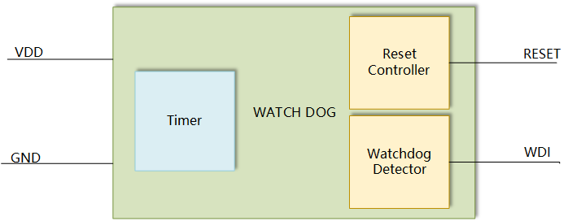
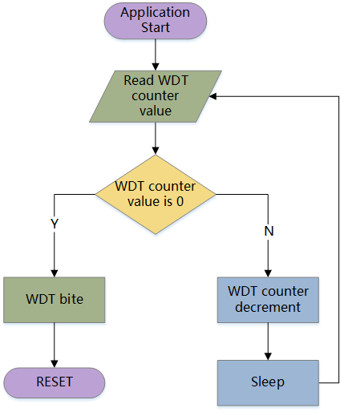
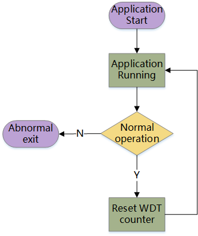
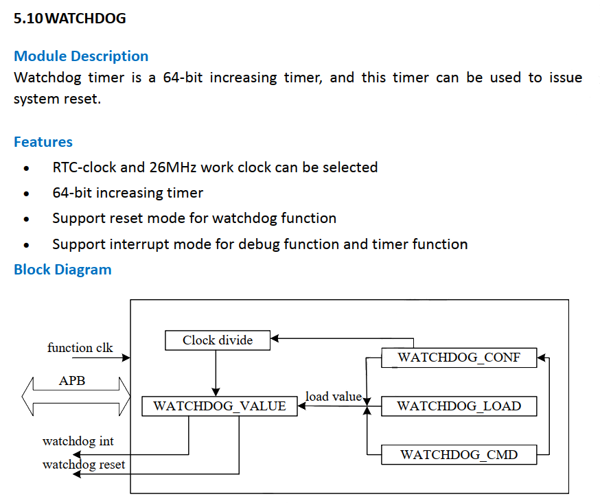
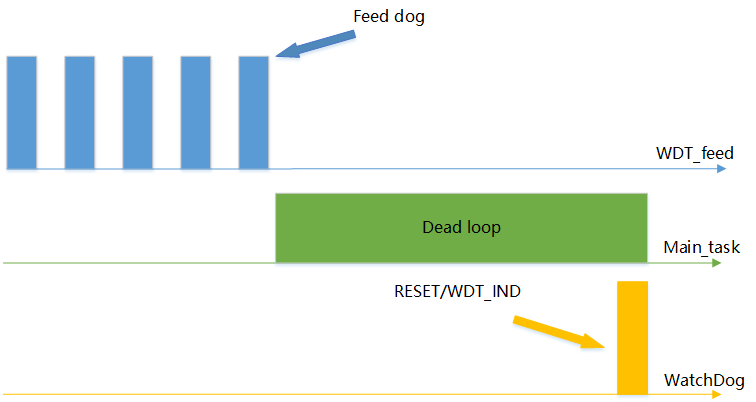
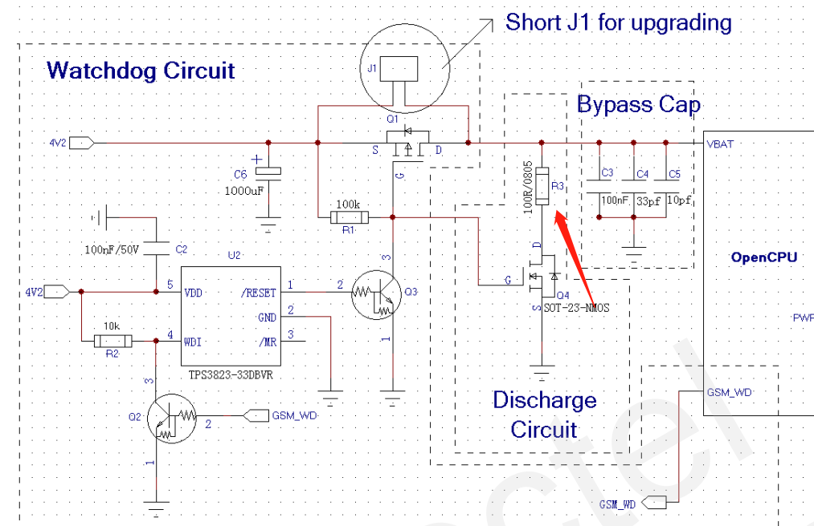
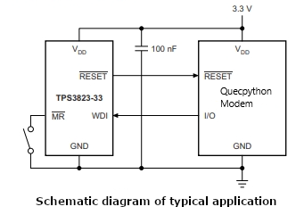
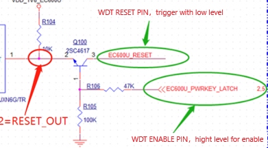

# Watchdog

## Overview

For cellular communication modules, The watchdog is a hardware or software monitoring mechanism used to monitor the module's operating status. When the module gets stuck in a deadlock due to external interference or program errors, the watchdog automatically triggers a module restart to restore the module's operating status.

The following terms are generally used to describe the triggering and resetting behavior of a watchdog:

**Bite:** Refers to the action of the watchdog triggering a module restart.

**Feed:** Refers to the action of resetting the watchdog status of the module (to notify the watchdog that it is still running normally).

#### Hardware Watchdog

**Principle of hardware watchdog:** A typical hardware watchdog mainly consists of a hardware timer, input, and output. Its input is connected to the module's IO, and the output is connected to the module's RESET pin. The hardware timer of the watchdog keeps increasing, and when it exceeds the threshold time, it triggers a module reset through the output pin (this is called "bite").

A normally running module should periodically output a signal to the watchdog through IO, which resets the watchdog timer before it reaches the threshold (i.e., "feeding the dog"). Therefore, when the module is running normally, the timer should not reach the threshold.

When the module is running abnormally and fails to reset the watchdog timer within the specified time, the module RESET pin is triggered, causing a reset.

Quecpython communication modules generally have a built-in watchdog, and software watchdogs can also be implemented in the application. Why do we need an external watchdog? This is because whether it is a built-in watchdog or a software watchdog, they both need to go through the initialization process when the module starts up. If these two watchdogs have not finished initializing and there are exceptions or blocking situations, only an external watchdog can play a role.

**Typical hardware watchdog diagram:**



As shown in the diagram, the basic structure of a hardware watchdog is like this. WDI is the input, and RESET is the output. When WDI detects a level change, it is considered as feeding the dog and clears the timer's count. If the dog is not fed within a certain period of time, the timer will time out and trigger a module restart through the RESET pin.

#### Software Watchdog

**Principle of software watchdog:** Similar to a hardware watchdog, a software watchdog is implemented using a software timer. It is generally used to monitor the running of specific threads, and the monitored threads need to reset the timer regularly.

In some cases, some business threads become blocked or exit abnormally, but the whole system remains normal and cannot trigger the protection mechanism of a hardware watchdog. A software watchdog can monitor one or several specific threads and trigger a reset when these threads encounter exceptions.

**Typical software watchdog diagram:**



As shown in the diagram, a software watchdog generally runs in a daemon thread. Its basic logic is shown in the diagram. The watchdog thread runs with the business and functions like a timed heartbeat. Most of the time, it is in sleep mode and performs the counter check action during the heartbeat. When the counter reaches zero, a reset is triggered.



The watchdog monitors a specific business thread, which means that this specific business thread needs to perform the feeding action, i.e., resetting the watchdog timer regularly. If this thread exits abnormally or becomes blocked, it cannot reset the watchdog timer. When the watchdog thread's counter decreases to 0, a reset is triggered.

As a daemon thread, it is important to note that if the feeding thread exits actively, the watchdog thread must also be stopped to prevent false triggering of a reset.

## Built-in Watchdog in the Module
Cellular modules generally have a built-in hardware watchdog, which mainly monitors the running of the RTOS. When the watchdog bites, it may trigger a reset or a watchdog interrupt. The feeding mechanism is usually implemented by the task with the lowest priority, and system crashes, long-term CPU usage by threads or interrupts can all trigger the watchdog bite.

Compared to a general hardware watchdog, the built-in watchdog usually starts with the module's CPU and needs to obtain the clock source from the module (a hardware watchdog usually has its own clock source). In addition to triggering a RESET, the action of the watchdog bite can also choose to trigger a watchdog interrupt.(used for outputting debug information or entering dump mode).



**Timing Diagram of Watchdog Biting due to an Infinite Loop:**

During normal operation, the low-priority feeding thread runs periodically, with most of the time being idle. When a business thread enters an infinite loop, the feeding thread cannot preempt the CPU and cannot perform the feeding action. When the watchdog times out, a reset or a watchdog interrupt is triggered.



**Underlying Runaway:**
Due to memory trampling, electromagnetic interference, and other factors, the data in memory becomes corrupted, causing the CPU to fetch an incorrect program address and run into abnormal logic, resulting in a deadlock or infinite loop, which leads to a watchdog timeout.

**Precautions for Application Programming:**

Since the built-in watchdog is designed for the RTOS, we cannot control the feeding action at the application layer. Therefore, we need to avoid situations where the business occupies the CPU for a long time, mainly to avoid deadlocks and infinite loops, including the following points:
1. Try to eliminate possible infinite loop logic in the business.
2. Set reasonable blocking or sleep in the business to ensure that low-priority tasks can be scheduled normally.
3. For necessary loops, add safety measures. For example, add a loop counter in the loop body, so even if an infinite loop occurs, it can be exited after a certain number of iterations.
4. Check mutexes to ensure that their usage is paired. Deleting a thread that holds a lock without releasing the mutex it holds will cause the threads that are mutual exclusive with it unable to run. Be sure to release the mutex held by the thread before deleting it.

**Cases not covered by the built-in watchdog:**
The built-in watchdog initializes during startup, so it actually cannot protect against exceptions or blocking in the startup process. This defect should be noted in scenarios where multiple power cycles are required, and an external watchdog is needed to solve this problem.

## External Watchdog Solution

**Schematic of an External Watchdog**





**Recommended Watchdog Chip:**
TPS3823-33DBVR

Working voltage: DC 1.1V~5V
Maximum feeding time: 1.6S
Reset pin: Low level effective
Current consumption: 15uA

**Feeding the External Watchdog under Special Circumstances:**

1. During the boot-up process: If the boot process time will be significantly longer than the threshold value that triggers the watchdog to bite, it is necessary to trigger a WDI level change in the boot or delay the effective time of the watchdog.
2. During the FOTA process: Use the callback of the FOTA progress to operate the WDI interface level change. When FOTA has not adapted the callback and cannot operate IO, you need to find a way to stop the operation of the watchdog.
3. You can choose a watchdog with a longer maximum feeding time, so that its feeding time is longer than the boot-up and FOTA time. This method is applicable to both situations above, but the disadvantage is that it takes a long time to reset when an exception occurs.

**Typical Circuit Design for Whether the Watchdog Is Effective:**
Use a transistor, when the gate is connected to a high level, the watchdog and the RESET pin of the module are conductive.




**External Watchdog Feeding Routine:**

```python
import _thread
import usys as sys
import utime as time
from machine import Pin

class WatchDog:
    def __init__(self, gpio_n):
        self.__pin = Pin(gpio_n, Pin.OUT, Pin.PULL_PD, 0)
        self.__tid = None
  

    def __feed(self):
        while True:
            self.__pin.write(1)
            time.sleep_ms(200)
            self.__pin.write(0)
            time.sleep(1)

    def start(self):
        if not self.__tid or (self.__tid and not _thread.threadIsRunning(self.__tid)):
            try:
                _thread.stack_size(0x1000)
                self.__tid = _thread.start_new_thread(self.__feed, ())

            except Exception as e:
                sys.print_exception(e)
  

    def stop(self):
        if self.__tid:
            try:
                _thread.stop_thread(self.__tid)
            except:
                pass

        self.__tid = None
```

## Software Watchdog Solution

The software watchdog is generally run in a daemon thread, which can cover scenarios where the business thread is abnormally blocked or exits (but the system remains running normally).

**Software Watchdog Example & In-business Feeding Example:**

```python
import _thread
import usys as sys
import utime as time
from machine import Pin
from misc import Power

class WatchDog:
    def __init__(self, max_count):
        self.__max_count = max_count # maximum count for the watchdog
        self.__count = self.__max_count # initialize the watchdog counter
        self.__tid = None

    def __bark(self):
        Power.powerRestart()

    def feed(self):
        self.__count = self.__max_count # feed the watchdog, reset the counter

    def __check(self):
        while True: # continuously check the counter
            if self.__count == 0:
                self.bark() # trigger restart when the counter reaches zero
            else:
                self.__count = (self.__count - 1) # #Otherwise the counter decreases by one
                
            utime.sleep(10)

    def start(self):
        if not self.__tid or (self.__tid and not _thread.threadIsRunning(self.__tid)):
            try:
                _thread.stack_size(0x1000)
                self.__tid = _thread.start_new_thread(self.__check, ())
                
            except Exception as e:
                sys.print_exception(e)

                
    def stop(self):
        if self.__tid:
            try:
                _thread.stop_thread(self.__tid)
            except:
                pass
        self.__tid = None
        

wdt = WatchDog(5) # initialize the software watchdog

def th_func1():
    wdt.start() # start the watchdog
    while True:
        print("Bussiness code running")
        if(wdt != None):
            wdt.feed() # feed the watchdog within the business thread
        # bussiness code here
        utime.sleep(1)

if __name__ == '__main__':
    
    thread_id = _thread.start_new_thread(th_func1, ())
```

## Frequently Asked Questions

### How to determine the feeding interval for the software watchdog?

There are three principles to consider:
1. The feeding interval must be longer than the single execution time of the business code. Otherwise, even if the watchdog is fed within the business thread, a restart will be triggered before the next feeding.

2. The feeding interval is also the heartbeat interval of the daemon thread. It is recommended to be an integer multiple of the heartbeat interval of the business thread. This allows the module to handle both the business and watchdog heartbeats when it wakes up, reducing the number of wake-ups and reducing power consumption.

3. The feeding interval needs to match the business requirements. A too long feeding interval will result in a long waiting time for recovery when an exception occurs.

### How to feed the watchdog during startup?

If the selected watchdog feeding interval is smaller than the startup time, it is necessary to avoid triggering the watchdog biting during startup:
1. Add the feeding operation in the boot stage. please contact Quectel Technical Support.

2. Delay enabling the watchdog during startup until it is possible to operate the feeding IO. For example, control the connection between the watchdog output pin and the RESET pin using a transistor. Only enable the connection between these two pins after the startup is completed. The circuit design can refer to the "[External Watchdog Solution](#External Watchdog Solution)" section.

### How to feed the watchdog during FOTA?

1. Control the feeding IO through the FOTA progress callback.

2. For modules without FOTA progress callbacks, temporarily disable the watchdog. The circuit design can refer to the  "[External Watchdog Solution](#External Watchdog Solution)" section.

### How to determine if an external watchdog is needed?

1. An external watchdog is needed when the product requires high reliability.

2. For products that frequently power on and off the module, there is a higher possibility of triggering the failure of the internal watchdog. In this case, an external watchdog is needed.