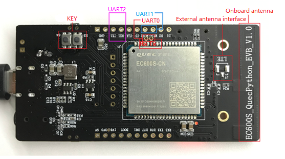

# FAQ on EVB 

This article mainly introduces issues that users may encounter when starting to learn QuecPython and building a development environment based on the official development board or a self-designed circuit board. Issues involving the development of specific software and hardware functions are not covered in this article. Please refer to other chapters.

### **EC600S EVB and module serial port correspondence diagram**

The serial port location of the EC600S EVB (EC600S\_QuecPython\_EVB\_V1.x) is as follows:

### **The serial port connected to the board cannot communicate**

Pay attention to whether the interface is 1.8V or 3.3V, and the level must be matched for normal communication.

### **Why doesn’t the light bring up when the USB cable is connected**

Check the module voltage to ensure that the module's 3.8V is stable and use battery power if necessary.

### **What are the precautions when testing the TTS function of the EC600SV1.1 QuecPython development board?**&#x20;

The peripheral is a connected to the speaker, while the "microphone" is configured in TTS.

Since a power amplifier is added in V1.1, you need to pull up (hardware pull-up) pin58 of the socket in module (the enable pin of the power amplifier), or enable it via command "audio\_EN = Pin(Pin.GPIO11, Pin. OUT, Pin.PULL\_PD, 1)”.

The power of external speakers is limited, which shall be less than 8R 2W.
