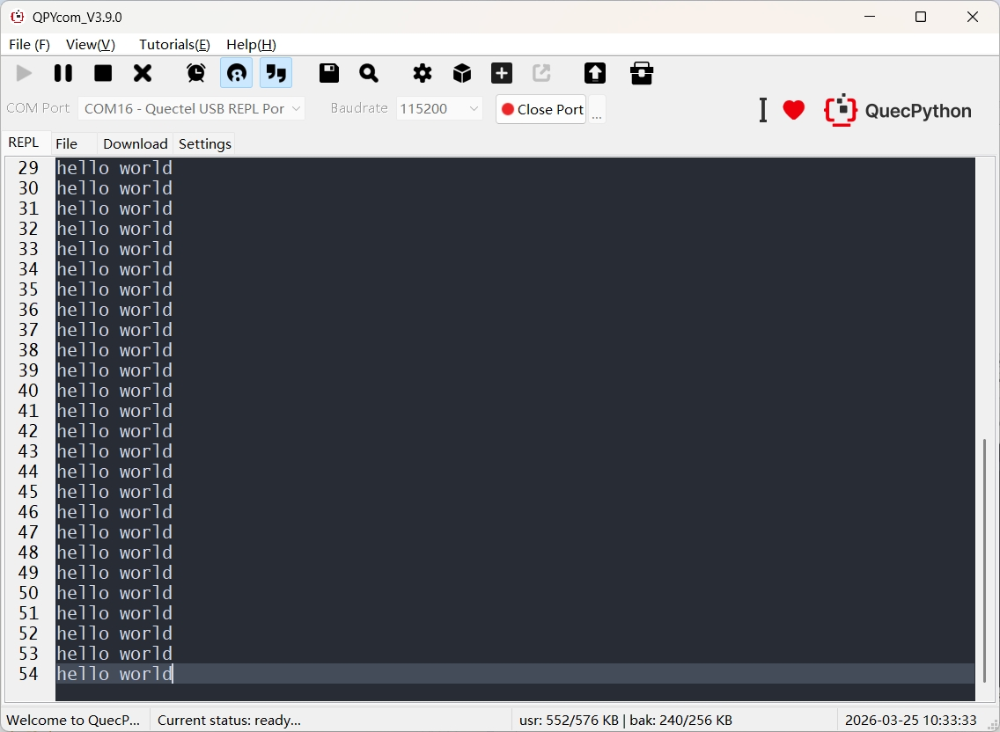

# Implement Script Auto-Start with main.py

After QuecPython runs, it will automatically launch the script named `main.py` in the `usr` directory. Before the device enters mass production, the entry script of the program **must** be named `main.py`.

Write a minimal version of the auto-start script `main.py` to implement cyclic printing of `hello world` after startup, which is used to verify the auto-start function.

### Example Code

```python
# Import the built-in system delay module of QuecPython
import utime
# Program main entry
if __name__ == '__main__':
    # Infinite loop to achieve continuous printing and ensure stable capture of logs by the serial port
    while True:
        print("hello world")
        # 1-second delay to control printing frequency and avoid excessive CPU resource occupation
        utime.sleep(1)
```

### Test the Auto-Run Effect (Restart the Module to Verify Execution Results)

After the module is fully started, the `hello world` log is continuously output every second. This proves that the program is automatically executed upon module startup, and the verification of the auto-start function is completed.



> Note: If only the one-time execution code `print("hello world")` is written in `main.py` (without loop-based continuous running logic), the one-time print output will be generated before the REPL port is opened. As a result, QPYcom cannot capture the one-time print output.

## Common Issues and Precautions

### The Script Fails to Auto-Start

- **Path Error**: `main.py` must be stored in the root directory of `/usr` (not in subfolders such as `/usr/project/`);
- **File Name Error**: Use all lowercase `main.py` strictly (avoid `Main.py`, `main.py.txt`, etc.);
- **Encryption Restriction**: `main.py` cannot be encrypted. The firmware only supports parsing plaintext auto-start entry files;
- **Syntax/Runtime Exceptions**: Syntax errors or top-level code exceptions in the script will directly terminate the auto-start process (it is recommended to manually execute and verify the script in REPL first).