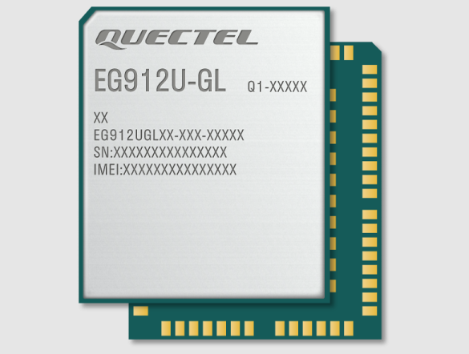
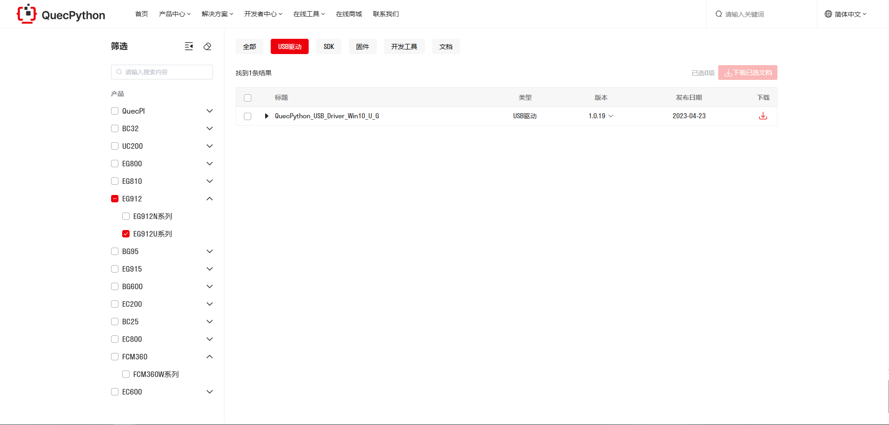
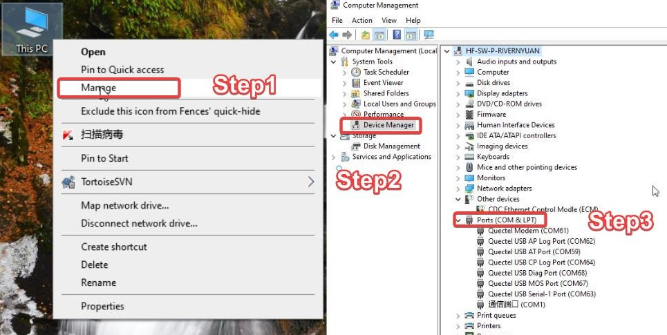

# Driver Preparation

## **Download Driver**

The "device driver" is a special program that allows the PC to communicate with and the device. Only through this interface can the OS control the hardware device.

- Open the [QuecPython official website driver download link](https://developer.quectel.com/en/resource-download).

- Start by selecting the "Driver" section, and then within the "Driver" section, choose the driver that matches your module model and computer system. Different module platforms require different driver programs, so you need to download the corresponding driver package based on your module model.

- You can obtain the module model from the laser engraving on the module itself or by using AT commands. The laser engraving is illustrated in the image below, with the model "EG912U" shown on the engraving.

- In the search box, type "EG912U" to find the appropriate driver for EG912U, and then click the download button to download the driver: [QuecPython_USB Driver Win10_U_G](https://developer.quectel.com/en/wp-content/uploads/sites/2/2024/11/Quectel_Windows_USB_DriverU_V1.0.19.zip).

| Module Model                                                 | Host Platform  | Driver Name                                       |
| ------------------------------------------------------------ | ----------------------------------------------------- | ------------------------------------------------------------ |
| [BG95](https://developer.quectel.com/modules-cat/bg95-series) &nbsp;&nbsp;&nbsp;&nbsp; [BG600L](https://developer.quectel.com/modules-cat/bg600l-series)	| &nbsp;&nbsp;&nbsp;&nbsp;Win10&nbsp;&nbsp;&nbsp;&nbsp; | &nbsp;&nbsp;&nbsp;&nbsp;&nbsp;&nbsp;&nbsp;&nbsp;[**QuecPython_USB_Driver_Win10_BG**](https://developer.quectel.com/en/wp-content/uploads/sites/2/2024/11/Quectel_Windows_USB_DriverQ_NDIS_V2.7.14.zip) |
| [EC800E](https://developer.quectel.com/modules-cat/ec800e-series) &nbsp;&nbsp;&nbsp;&nbsp;[EC600E](https://developer.quectel.com/modules-cat/ec600e-series) &nbsp;&nbsp;&nbsp;&nbsp; [EC800Z](https://developer.quectel.com/modules-cat/ec800z-series) | &nbsp;&nbsp;&nbsp;&nbsp;Win10&nbsp;&nbsp;&nbsp;&nbsp; | &nbsp;&nbsp;&nbsp;&nbsp;&nbsp;&nbsp;&nbsp;&nbsp;[**QuecPython_USB_Driver_Win10_E**](https://developer.quectel.com/wp-content/uploads/2024/09/Quectel_Windows_USB_DriverY_V1.0.2.zip) |
| [EG912N](https://developer.quectel.com/en/modules-cat/eg912n-series)&nbsp;&nbsp;&nbsp;&nbsp;[EG915N](https://developer.quectel.com/en/modules-cat/eg915n-series) &nbsp;&nbsp;&nbsp;&nbsp;[UC200A](https://developer.quectel.com/modules-cat/uc200a-series) [EC600K](https://developer.quectel.com/modules-cat/ec600k-series) &nbsp;&nbsp;&nbsp;&nbsp;[EG810M](https://developer.quectel.com/modules-cat/eg810m-series) &nbsp;&nbsp;&nbsp;&nbsp;[EC800K](https://developer.quectel.com/modules-cat/ec800k-series) &nbsp;&nbsp;&nbsp;&nbsp;[EG800K](https://developer.quectel.com/modules-cat/eg800k-series) &nbsp;&nbsp;&nbsp;&nbsp; [EC200N](https://developer.quectel.com/modules-cat/ec200n-series) &nbsp;&nbsp;&nbsp;&nbsp;[EC800M](https://developer.quectel.com/modules-cat/ec800m-series) &nbsp;&nbsp;&nbsp;&nbsp;[EC600N](https://developer.quectel.com/modules-cat/ec600n-series) &nbsp;&nbsp;&nbsp;&nbsp;[EC600M](https://developer.quectel.com/modules-cat/ec600m-series) &nbsp;&nbsp;&nbsp;&nbsp;[EC200A](https://developer.quectel.com/modules-cat/ec200a-series) | &nbsp;&nbsp;&nbsp;&nbsp;Win10&nbsp;&nbsp;&nbsp;&nbsp; | &nbsp;&nbsp;&nbsp;&nbsp;&nbsp;&nbsp;&nbsp;&nbsp;[**QuecPython_USB_Driver_Win10_ASR**](https://developer.quectel.com/en/wp-content/uploads/sites/2/2024/11/Quectel_Windows_USB_DriverA_Customer_V1.1.13.zip) |
| [EG915U](https://developer.quectel.com/en/modules-cat/eg915u-series)&nbsp;&nbsp;&nbsp;&nbsp;[EC200U](https://developer.quectel.com/modules-cat/ec200u-series)&nbsp;&nbsp;&nbsp;&nbsp;[EC800G](https://developer.quectel.com/modules-cat/ec800g-series) [EC600U](https://developer.quectel.com/modules-cat/ec600u-series) &nbsp;&nbsp;&nbsp;&nbsp;[EC600G](https://developer.quectel.com/modules-cat/ec600g-series) &nbsp;&nbsp;&nbsp;&nbsp;[EC800G](https://developer.quectel.com/modules-cat/ec800g-series) | &nbsp;&nbsp;&nbsp;&nbsp;Win10&nbsp;&nbsp;&nbsp;&nbsp; | &nbsp;&nbsp;&nbsp;&nbsp;&nbsp;&nbsp;&nbsp;&nbsp;[**QuecPython_USB_Driver_Win10_U_G**](https://developer.quectel.com/en/wp-content/uploads/sites/2/2024/11/Quectel_Windows_USB_DriverU_V1.0.19.zip) |

## **Install the Driver**

Before installation, please check if the device is powered on. If there are no new ports in the device manager, it indicates that the device is not powered on. You can try to power on the device by long-pressing the PWRKEY button.

After downloading, unzip the driver package, find **"setup.exe"** or **"setup.bat"** and double-click to run it. After installation, open the "Device Manager" and you can see that the yellow exclamation mark in the port has disappeared, indicating that the installation is successful and your PC can communicate with the device normally.

*It is normal for devices such as Mobile ECM Network Adapter or CDC Ethernet Control Model (ECM) to not be recognized, which does not affect firmware download and subsequent development and can be ignored.*

Right-click to open **"My Computer"** — select **"Computer Management"** — select **"Device Manager"**, and then select **"Ports"** in the "Device Manager".

After opening the page by following the steps above, you can refresh the page and see whether there are ports starting with **Quectel USB**". If the ports starting with "**Quectel USB**" exist, the USB driver installation is successful.

**After the driver is installed**

