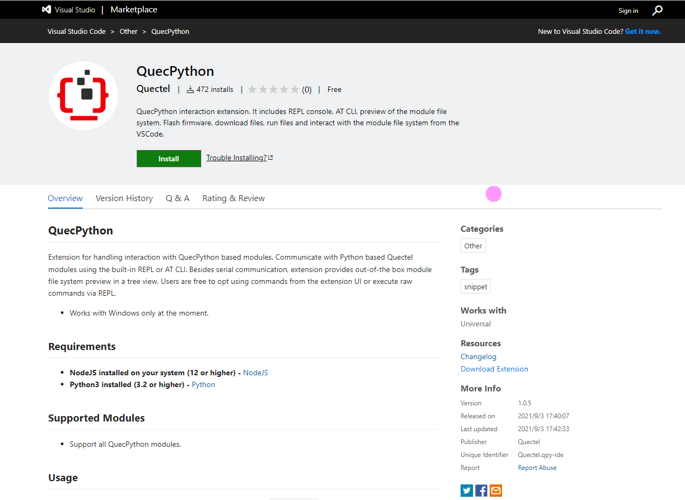

## Tools Preparation

### Get QPYcom

To develop with QuecPython, you need a specialized development and debugging tool — **QPYcom**. This tool is used for debugging code, analyzing logs, transferring files, downloading firmware, merging firmware, and more.

[QPYcom](https://developer.quectel.com/en/wp-content/uploads/sites/2/2024/11/QPYcom_V4.1.0.zip) is a one-stop debugging tool for QuecPython development.

*Note: This tool does not need to be installed. Just unzip and use it.*

### Install VSCode Extension

When editing Python codes, you will use an IDE that is either dedicated to Python or compatible with multiple languages, which can significantly improve development efficiency. Here, we recommend VSCode.

For VScode, QuecPython has launched a dedicated extension to serial port debugging and other features. The installation method is shown below.

- In VSCode, click the extension marketplace in the sidebar. In the extension marketplace, search for "QuecPython" and download the extension based on the search result.

- You can also search for "QuecPython" in the [VSCode Extension Marketplace](https://marketplace.visualstudio.com/vscode). After downloading the extension based on the search result, VSCode will automatically be opened and installed.

