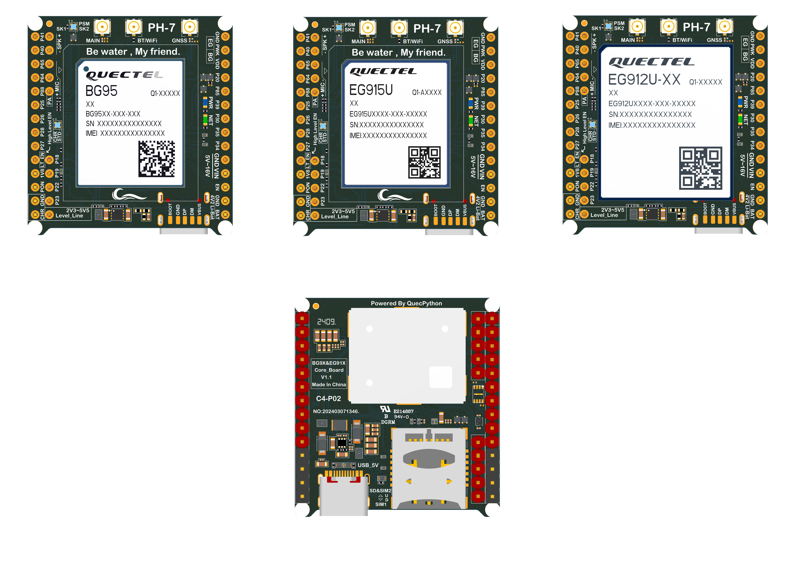
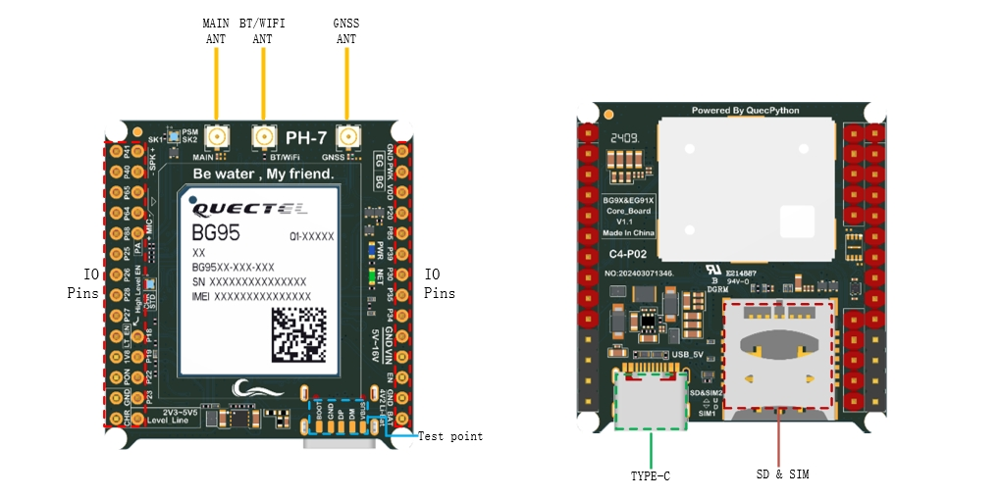
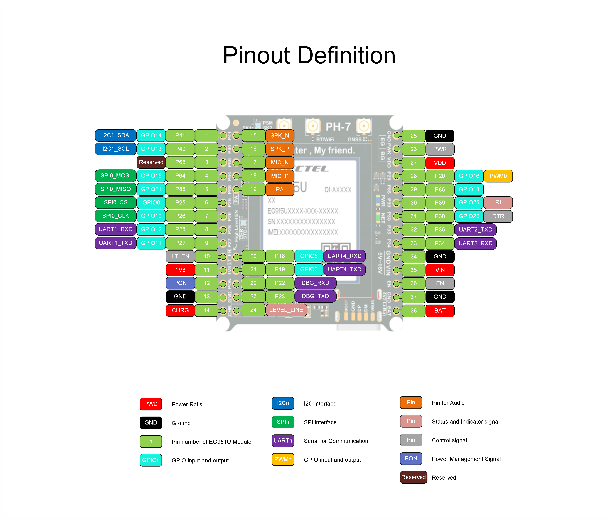
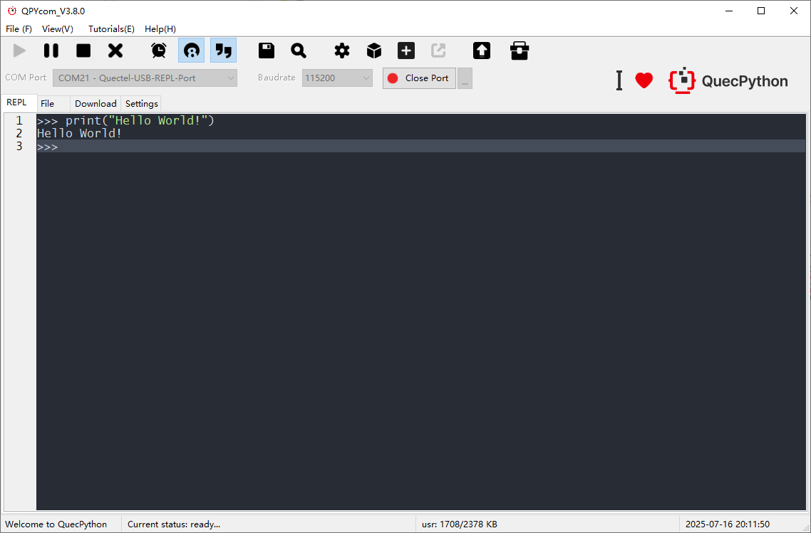
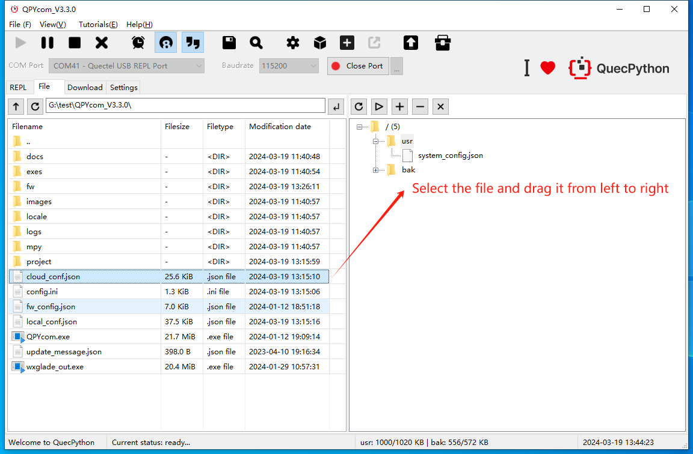

# QuecPython BG&EG Core EVB Introduction

## Quick Start

Supported Module List

- [BG95-M1](https://www.quectel.com.cn/product/bg95-bg95x-eg9x-compatible-design)
- [BG95-M3](https://www.quectel.com.cn/product/bg95-bg95x-eg9x-compatible-design)
- [BG95-M8](https://www.quectel.com.cn/product/bg95-bg95x-eg9x-compatible-design)
- [EG915U-LA](https://www.quectel.com.cn/product/bg95-bg95x-eg9x-compatible-design)
- [EG915U-EU](https://www.quectel.com.cn/product/bg95-bg95x-eg9x-compatible-design)
- [EG912U-GL](https://www.quectel.com.cn/product/bg95-bg95x-eg9x-compatible-design)

## Feature List

### Overview

The QuecPython BG&EG series core board (PH-7 (C4-P02)) is a core development board specifically designed for QuecPython with minimal functionality. The core board is designed with a 2.54mm pin arrangement, providing 38 PIN pins, including functional pins and enable control pins. Mainly providing support and convenience for customer development, debugging, and mass production equipment. The core board of the series is applicable to the entire BG95 series, EG915UEUAB, EG915ULAAB, EG912UGLAA and other EG series, including but not limited to the above module models.

## Core EVB View



 The main components and interface layout of the development board are shown in the following figure.



- Charging and USB: When inserting the Type-C interface to connect to USB, the charging function is enabled by default and cannot be turned off. If the charging function is not used, there is no need to pay attention.
- GNSS: The GNSS function depends on the module model. Taking BG95 as an example, the core board defaults to using active antennas and has already enabled power supply to the active antennas by default.
- SD & SIM Card Slot.
- 38 Pin.
- Antenna Interface。

## **Documents Download**

- [QuecPython-PH-7C4-P02_Core_Board_Specification_and_User_Guide_V1.0.0](https://developer.quectel.com/en/wp-content/uploads/sites/2/2024/11/PH-7C4-P02_Core_Board_Specification_and_User_Guide_V1.0.0.pdf)
- [QuecPython-PH-7C4-P02_Core_Board_SCH](https://developer.quectel.com/en/wp-content/uploads/sites/2/2024/11/PH-7C4-P02_Schematic_Diagram.pdf)
- [QuecPython-PH-7C4-P02_Core_Board_Silkscreen](https://www.quectel.com.cn/wp-content/uploads/2026/03/Quectel_QuecPython_PH_7C4_P02_%E6%A0%B8%E5%BF%83%E6%9D%BF%E4%B8%9D%E5%8D%B0%E5%9B%BE.pdf)

## EVB Resources

The main pin layout of the development board is shown in the following figure.

## Quick Start Guide

### Hardware Preparation

- <font color='red'>**Step 1: Required Items**</font>

  - Development board
  - USB-C cable (A-to-C)
  - Windows 10 PC
  - Nano-SIM card
  - 4G antenna

- <font color='red'>**Step 2: Antenna & SIM Installation**</font>

  - Attach the provided antenna to the MAIN antenna port.
  - Insert the SIM card into the Nano-SIM slot.

- <font color='red'>**Step 3: Connect the Board**</font>

  - Power the board via USB-C.

- <font color='red'>**Step 4: Power On**</font>

  - Press and hold PWK until the power indicator light on the mainboard  (labeled as POW) lights up. 
  - If you short-circuited PWK_ON, there's no need to press PWK; the board will power on  automatically.

  > <font color='red'>**If the PWR indicator is constantly on, the EVB is successfully turned on.**</font>

### Driver Installation

1. Download the **QuecPython USB Driver** from [QuecPython Official Drivers](https://www.quectel.com.cn/download-zone).
2. Extract and run `setup.exe` or `setup.bat`.
3. Verify installation in **Device Manager** (look for "Quectel USB" ports). Ignore unrelated devices like "Mobile ECM Network Adapter."

### Tool Installation

1. **QPYcom**: Download from [QuecPython Tools](https://www.quectel.com.cn/download-zone). Extract and use directly.
2. **VSCode Plugin**: Search for "QuecPython" in the Visual Studio Code marketplace.

### Firmware Burning

1. **Firmware Download**: Get the latest QuecPython firmware  from QuecPython Firmware Page.

2. **Burning Steps**:

   - Open QPYcom, select the USB REPL port, and create a new project.

   - Choose the `.bin` firmware file
   - Set mode to "Download FW" and click **Download**.


### REPL Debugging

1. Connect via QPYcom and open the REPL interface.
2. Test with `print("Hello World!")`.



## First Script Development

### Writing a Script

Create `helloworld.py`:

```python
print("Hello World!")
```

### File Transfer

- **Method 1**: Drag-and-drop files via QPYcom’s GUI.



- **Method 2**: Use the "Download Script" feature in QPYcom.


### Running Scripts

Execute via REPL:

```python
import example
example.exec("/usr/helloworld.py")
```

### Stopping Program Execution

How to stop a running program. The following methods are provided according to the type of the running script file:

| Is the program name main.py? | Does the program contain a dead loop? | Does the program use multiple threads? | Stopping Steps                                               |
| :--------------------------: | :-----------------------------------: | :------------------------------------: | :----------------------------------------------------------- |
|              ✓               |                   ✓                   |                   ✓                    | (1) Press Ctrl + A to enter RAW mode <br />(2) Press Ctrl + D to restart the QuePython virtual machine <br />(3) Press Ctrl + B to return to the normal interactive mode<br />(4) If the above methods fail, re-flash the firmware |
|              ✓               |                   ✓                   |                   ✗                    | (1) Press Ctrl + C to interrupt the program execution <br />(2) If the above method fails, re-flash the firmware |
|              ✓               |                   ✗                   |                   ✓                    | (1) Press Ctrl + A to enter RAW mode <br />(2) Press Ctrl + D to restart the QuePython virtual machine <br />(3) Press Ctrl + B to return to the normal interactive mode <br />(4) If the above methods fail, wait for the program to finish running |
|              ✓               |                   ✗                   |                   ✗                    | (1) Press Ctrl + C to interrupt the program execution <br />(2) If the above method fails, re-flash the firmware |
|              ✗               |                   ✓                   |                   ✓                    | (1) Press Ctrl + D to restart the QuePython virtual machine <br />(2) If the above method fails, directly restart the module |
|              ✗               |                   ✓                   |                   ✗                    | (1) Press Ctrl + D to restart the QuePython virtual machine <br />(2) If the above method fails, directly restart the module |
|              ✗               |                   ✗                   |                   ✓                    | (1) Press Ctrl + C to interrupt the program execution <br />(2) If the above method fails, re-flash the firmware or directly restart the module |
|              ✗               |                   ✗                   |                   ✗                    | (1) Press Ctrl + C to interrupt the program execution <br />(2) If the above method fails, re-flash the firmware or directly restart the module |