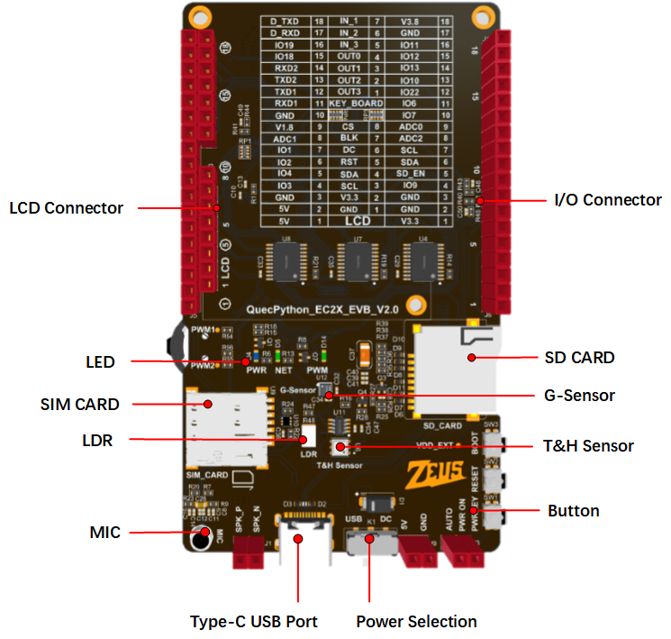
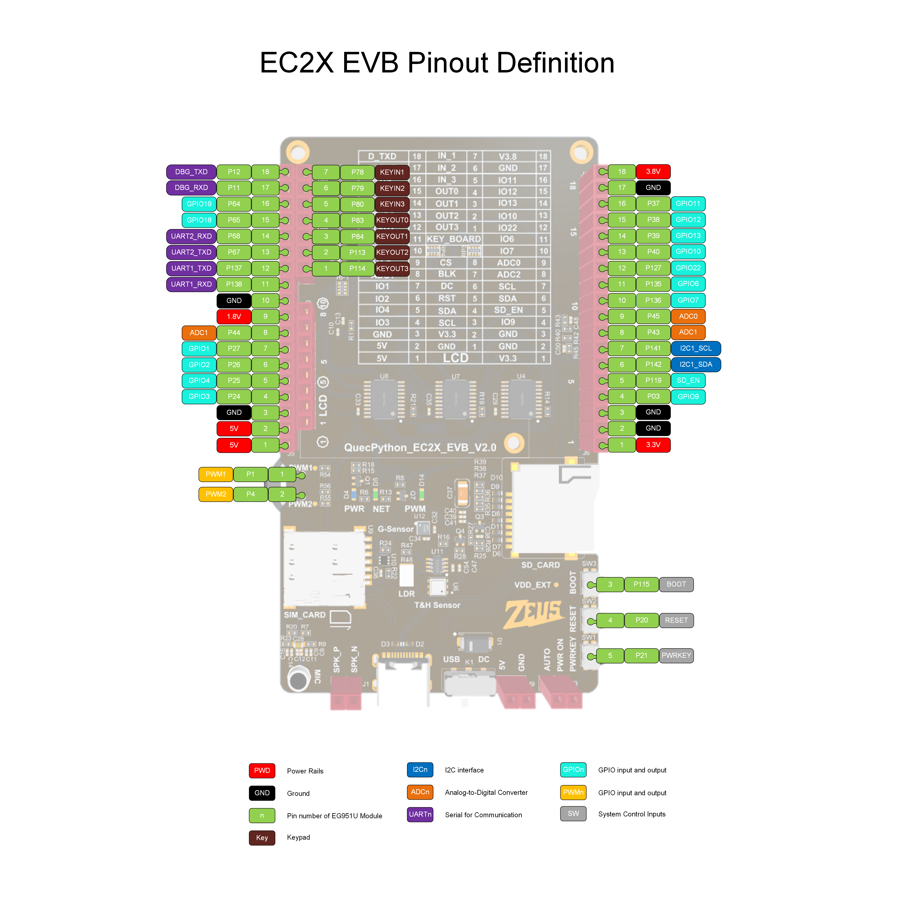

# EC2X EVB Introduction

## Supported Modules

Supported module models

- [EC200A-CN](https://www.quectel.com.cn/product/ec200a-series)
- [EC200U-CN](https://www.quectel.com.cn/product/ec200u-series)
- [EC200A-EU](https://www.quectel.com.cn/product/ec200a-series)
- [EC200A-AU](https://www.quectel.com.cn/product/ec200a-series)

## Feature List

### Basic Overview

The QuecPython_EC2X_EVB is specifically designed for QuecPython. It is a small and portable "pocket-sized" EVB with rich features, such as temperature and humidity sensor, acceleration sensor, SIM card slot, SD card slot, LCD connector, LDR and MIC.

The EVB is equipped with a Type-C interface, so developers only need a USB Type-C cable to easily manipulate the EVB.

The EVB is equipped with the EC200U series module. For details, see [EC200U-EU](https://www.quectel.com.cn/product/ec200u-series).

### Feature Description

The main components and interface layout of the EVB are shown in the figure below.



## Document download

- [EC2X_EVB_SCH2](https://developer.quectel.com/en/wp-content/uploads/sites/2/2024/11/EC200A_zsus-Series-EVB_SCH.pdf)

##  EVB Resources

### EVB Interface

**J5 Pin Assignment**

| Pin Header | Pin No. | Name    | Feature |
| ---------- | ------- | ------- | ------- |
| J5         | -       | VCC_5V  | 5V      |
| J5         | -       | VCC_5V  | 5V      |
| J5         | -       | GND     | Ground  |
| J5         | 24      | IO3     | GPIO3   |
| J5         | 25      | IO4     | GPIO4   |
| J5         | 26      | IO2     | GPIO2   |
| J5         | 27      | IO1     | GPIO1   |
| J5         | 44      | ADC1_IN | ADC1    |
| J5         | -       | VDD_EXT | 1.8 V   |

**J6 Pin Assignment**

| Pin Header | Pin No. | Name    | Feature                |
| ---------- | ------- | ------- | ---------------------- |
| J6         | -       | V3.3    | 3.3 V                  |
| J6         | -       | GND     | Ground                 |
| J6         | -       | GND     | Ground                 |
| J6         | 3       | IO9     | GPIO9                  |
| J6         | 119     | SD_EN   | SD card enable control |
| J6         | 142     | SDA     | I2C1                   |
| J6         | 141     | SCL     | I2C1                   |
| J6         | 43      | ADC2_IN | ADC2                   |
| J6         | 45      | ADC0_IN | ADC0                   |

**J7 Pin Assignment**

| Pin Header | Pin No. | Name | Feature |
| ---------- | ------- | ---- | ------- |
| J7         | -       | GND  | Ground  |
| J7         | 138     | RX1  | UART1   |
| J7         | 137     | TX1  | UART1   |
| J7         | 67      | TX2  | UART2   |
| J7         | 68      | RX2  | UART2   |
| J7         | 65      | IO18 | GPIO18  |
| J7         | 64      | IO19 | GPIO19  |
| J7         | 11      | D_RX | UART    |
| J7         | 12      | D_TX | UART    |

**J10 Pin Assignment**

| Pin Header | Pin No. | Name | Feature |
| ---------- | ------- | ---- | ------- |
| J10        | 136     | IO7  | GPIO7   |
| J10        | 135     | IO6  | GPIO6   |
| J10        | 127     | IO22 | GPIO22  |
| J10        | 40      | IO10 | GPIO10  |
| J10        | 39      | IO13 | GPIO13  |
| J10        | 38      | IO12 | GPIO12  |
| J10        | 37      | IO11 | GPIO11  |
| J10        | -       | GND  | Ground  |
| J10        | -       | V3.8 | 3.8 V   |

The following figure shows the pin assignment.



> **Tips**
> For more information about the EVB, please visit <https://www.quectel.com.cn/download-zone>

### EVB Configuration

The EVB is equipped with various sensors and other peripherals. The pins of peripherals are shown in the table below.

| Pin No.   | Name                                 | Model         | Supported | Interface Type |
| --------- | ------------------------------------ | ------------- | --------- | -------------- |
| 41 and 42 | Temperature and Humidity Sensor      | AHT20         | Yes       | I2C            |
| 45        | LDR                                  | GT36528       | Yes       | ADC            |
| 41 and 42 | G-Sensor                             | QMA7981       | Yes       | I2C            |
| 75 and 77 | Microphone                           | GMI6050P-66DB | Yes       | SPK            |
| 73 and 74 | Power Amplifier Chip                 | NS4160        | Yes       | SPK            |
| 122–125   | LCD (Choose the package with screen) | ST7789        | Yes       | SPI            |
| 28–34     | SD_CARD                              | XKTF-NO2-N    | Yes       | SPI            |

## Quick Start Guide

### Hardware Preparation

- <font color='red'>**Step 1: Required Items**</font>

  - Development board
  - USB-C cable (A-to-C)
  - Windows 10 PC
  - Nano-SIM card
  - 4G antenna

- <font color='red'>**Step 2: Antenna & SIM Installation**</font>

  - Attach the provided antenna to the MAIN antenna port.
  - Insert the SIM card into the Nano-SIM slot.

- <font color='red'>**Step 3: Connect the Board**</font>

  - Power the board via USB-C.

- <font color='red'>**Step 4: Power On**</font>

  - Press and hold PWK until the power indicator light on the mainboard  (labeled as POW) lights up. 
  - If you short-circuited PWK_ON, there's no need to press PWK; the board will power on  automatically.

  > <font color='red'>**If the PWR indicator is constantly on, the EVB is successfully turned on.**</font>

### Driver Installation

1. Download the **QuecPython USB Driver** from [QuecPython Official Drivers](https://www.quectel.com.cn/download-zone).
2. Extract and run `setup.exe` or `setup.bat`.
3. Verify installation in **Device Manager** (look for "Quectel USB" ports). Ignore unrelated devices like "Mobile ECM Network Adapter."

### Tool Installation

1. **QPYcom**: Download from [QuecPython Tools](https://www.quectel.com.cn/download-zone). Extract and use directly.
2. **VSCode Plugin**: Search for "QuecPython" in the Visual Studio Code marketplace.

### Firmware Burning

1. **Firmware Download**: Get the latest QuecPython firmware  from QuecPython Firmware Page.

2. **Burning Steps**:

   - Open QPYcom, select the USB REPL port, and create a new project.

   - Choose the `.bin` firmware file
   - Set mode to "Download FW" and click **Download**.


### REPL Debugging

1. Connect via QPYcom and open the REPL interface.
2. Test with `print("Hello World!")`.


## First Script Development

### Writing a Script

Create `helloworld.py`:

```python
print("Hello World!")
```

### File Transfer

- **Method 1**: Drag-and-drop files via QPYcom’s GUI.


- **Method 2**: Use the "Download Script" feature in QPYcom.


### Running Scripts

Execute via REPL:

```python
import example
example.exec("/usr/helloworld.py")
```

### Stopping Program Execution

How to stop a running program. The following methods are provided according to the type of the running script file:

| Is the program name main.py? | Does the program contain a dead loop? | Does the program use multiple threads? | Stopping Steps                                               |
| :--------------------------: | :-----------------------------------: | :------------------------------------: | :----------------------------------------------------------- |
|              ✓               |                   ✓                   |                   ✓                    | (1) Press Ctrl + A to enter RAW mode <br />(2) Press Ctrl + D to restart the QuePython virtual machine <br />(3) Press Ctrl + B to return to the normal interactive mode<br />(4) If the above methods fail, re-flash the firmware |
|              ✓               |                   ✓                   |                   ✗                    | (1) Press Ctrl + C to interrupt the program execution <br />(2) If the above method fails, re-flash the firmware |
|              ✓               |                   ✗                   |                   ✓                    | (1) Press Ctrl + A to enter RAW mode <br />(2) Press Ctrl + D to restart the QuePython virtual machine <br />(3) Press Ctrl + B to return to the normal interactive mode <br />(4) If the above methods fail, wait for the program to finish running |
|              ✓               |                   ✗                   |                   ✗                    | (1) Press Ctrl + C to interrupt the program execution <br />(2) If the above method fails, re-flash the firmware |
|              ✗               |                   ✓                   |                   ✓                    | (1) Press Ctrl + D to restart the QuePython virtual machine <br />(2) If the above method fails, directly restart the module |
|              ✗               |                   ✓                   |                   ✗                    | (1) Press Ctrl + D to restart the QuePython virtual machine <br />(2) If the above method fails, directly restart the module |
|              ✗               |                   ✗                   |                   ✓                    | (1) Press Ctrl + C to interrupt the program execution <br />(2) If the above method fails, re-flash the firmware or directly restart the module |
|              ✗               |                   ✗                   |                   ✗                    | (1) Press Ctrl + C to interrupt the program execution <br />(2) If the above method fails, re-flash the firmware or directly restart the module |
