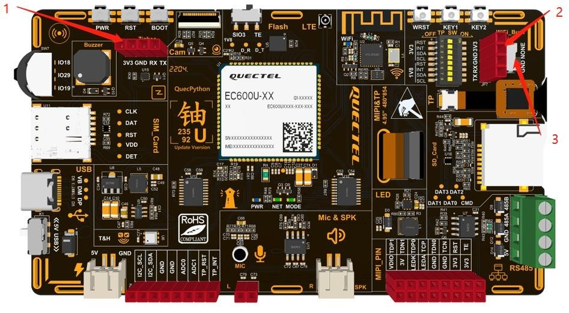
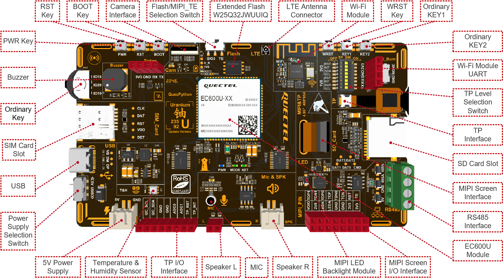

# EC600U U-235 EVB Introduction

## Feature List

### Basic Overview

QuecPython U-235 large screen evb integrates almost all the functions of the existing modules, including a wealth of peripherals, including external Flash, WiFi, screen and so on.

The evaluation board has a USB Type-C interface, making it convenient for development. Developers only need a USB Type-C cable to easily use the evaluation board.

### Function Description

This section provides instructions for some functions of the U-235 EVB.




1. **SD Card: **

Pull up Pin 53 (QuecPython GPIO27) of the EC600U module.

2. **Wi-Fi Module: **

Pull the switch marked with "3" in the figure above to the "**GND**" side to download the firmware of the Wi-Fi module through the UART of the Wi-Fi module (marked with "2" in the figure above). After the download is complete, pull the switch marked with "3" to the "**NONE**" side, and reboot the Wi-Fi module. To enable the communication between the Wi-Fi module and the EC600U module, pull up Pin 3 of the EC600U module to switch the pin from UART 1 to Wi-Fi UART and pull up Pin 121 to power the Wi-Fi module.

3. **Zigbee: **

When Pin 3 of the EC600U module is at a low level, the serial port marked with "1" in the figure above functions as UART 1. When this pin is at a high level, the serial port marked with "1" functions as Zigbee.

4. **MIC & SPK: **

Both the left channel and the right channel of the microphone and the speaker interfaces are available.

5. **External Power Supply:**

Pull the Power Supply Selection Switch to the “**5V**” side, and connect the external power supply through the 5V Power Supply Interface. The maximum input voltage is 6.5 V.

6. **Buzzer:**

Pull up or down Pin 119 of the EC600U module to control the buzzer sound.

7. **RS-485:**

The RS-485 interface is connected to a physical serial port by default and communicates through UART 2.

8. **MIPI:**

Pull up Pin 118 (QuecPython GPIO 8) of the EC600U module.

9. **Audio:**

To enable PA, pull up Pin 4 (QuecPython GPIO 11) of the EC600U module.

10. **Screen**:

ST7701, 5 inch,  MIPI interface, 480x854 Resolution, Capacitive touch screen, Touch chip GT911


> In the QuecPython solution, for details about the correspondence between GPIOs and pins of EC600U series, please refer to QuecPython Documentation > Wiki > Peripherals > machine – Hardware > class Pin – Control I/O Pins. [**Control  I/O Pins**](https://developer.quectel.com/doc/quecpython/API_reference/en/peripherals/machine.Pin.html)

## Resource Download

- [EC600U_U-235_EVB_SCH](https://developer.quectel.com/en/wp-content/uploads/sites/2/2024/12/EC600U_U-235_EVB_SCH.pdf)
- [Quectel_QuecPython_U 235_EVB](https://developer.quectel.com/en/wp-content/uploads/sites/2/2024/12/EC600U_U-235_EVB_Specification_and_User_Guide.pdf)

## Evaluation Board Resources

The abundant onboard resources of U-235 EVB are illustrated by the figure below:



Starting from the "EC600U Module" indicator box in the figure above, the EVB resources are introduced as follows in a clockwise direction.

- EC600U Module: The CPU with a Flash of 8 MB and a RAM of 16 MB.
- MIPI Screen I/O Interface
- MIPI LED Backlight Module
- Speaker R: The right channel speaker
- MIC: The microphone interface
- Speaker L: The left channel speaker
- TP I/O Interface
- Temperature & Humidity Sensor
- 5V Power Supply: The interface for 5V power supply
- Power Supply Selection Switch: The switch to select USB power supply or external power supply
- USB: The USB interface for downloading program codes and debugging scripts
- SIM Card Slot
- Ordinary Key: Three ordinary keys (no default function)
- Buzzer
- PWR Key: The power key for turning on/off the EC600U module
- RST Key: The reset key for reseting the EC600U module
- BOOT Key: The USB boot key for force-downloading firmware
- Camera Interface: The camera interface supporting taking photos and scanning
- Flash/MIPI_TE Selection Switch: If you need to use an external Flash, you must switch to the SIO3 side because the SIO3 of the Flash conflicts with the MIPI_TE pin. And most MIPI screens do not use MIPI_TE, so this switch is usually switched to the SIO3 side.
- Extended SPI Flash: The memory of the Flash W25Q32JWUUIQ is 4 MB.
- LTE Antenna Connector
- Wi-Fi Module
- WRST Key: The reset key for resetting the Wi-Fi module
- Ordinary KEY1 (no default function)
- Ordinary KEY2 (no default function)
- Wi-Fi Module UART
- TP Level Selection Switch: The switch to select the voltage level (1.8 V or 3.3 V) of the touch panel
- TP Interface
- SD Card Slot
- MIPI Screen Interface
- RS-485 Interface: SP3485EIM/TR is used

> The MIPI interface and the TP interface are available synchronously to improve the reusability of U-235 EVB.

## Quick Start Guide

### Hardware Preparation

- <font color='red'>**Step 1: Required Items**</font>

  - Development board
  - USB-C cable (A-to-C)
  - Windows 10 PC
  - Nano-SIM card
  - 4G antenna

- <font color='red'>**Step 2: Antenna & SIM Installation**</font>

  - Attach the provided antenna to the MAIN antenna port.
  - Insert the SIM card into the Nano-SIM slot.

- <font color='red'>**Step 3: Connect the Board**</font>

  - Power the board via USB-C.

- <font color='red'>**Step 4: Power On**</font>

  - Press and hold PWK until the power indicator light on the mainboard  (labeled as POW) lights up. 
  - If you short-circuited PWK_ON, there's no need to press PWK; the board will power on  automatically.

  > <font color='red'>**If the PWR indicator is constantly on, the EVB is successfully turned on.**</font>

### Driver Installation

1. Download the **QuecPython USB Driver** from [QuecPython Official Drivers](https://developer.quectel.com/en/resource-download?cid=2).
2. Extract and run `setup.exe` or `setup.bat`.
3. Verify installation in **Device Manager** (look for "Quectel USB" ports). Ignore unrelated devices like "Mobile ECM Network Adapter."

### Tool Installation

1. **QPYcom**: Download from [QuecPython Tools](https://developer.quectel.com/en/resource-download?cid=2). Extract and use directly.
2. **VSCode Plugin**: Search for "QuecPython" in the Visual Studio Code marketplace.

### Firmware Burning

1. **Firmware Download**: Get the latest QuecPython firmware for EC600U from [QuecPython Firmware](https://developer.quectel.com/en/resource-download?cid=2) Page.

2. **Burning Steps**:

   - Open QPYcom, select the USB REPL port, and create a new project.

   - Choose the `.bin` firmware file
   - Set mode to "Download FW" and click **Download**.


### REPL Debugging

1. Connect via QPYcom and open the REPL interface.
2. Test with `print("Hello World!")`.


## First Script Development

### Writing a Script

Create `helloworld.py`:

```python
print("Hello World!")
```

### File Transfer

- **Method 1**: Drag-and-drop files via QPYcom’s GUI.


- **Method 2**: Use the "Download Script" feature in QPYcom.


### Running Scripts

Execute via REPL:

```python
import example
example.exec("/usr/helloworld.py")
```

### Stopping Program Execution

How to stop a running program. The following methods are provided according to the type of the running script file:

| Is the program name main.py? | Does the program contain a dead loop? | Does the program use multiple threads? | Stopping Steps                                               |
| :--------------------------: | :-----------------------------------: | :------------------------------------: | :----------------------------------------------------------- |
|              ✓               |                   ✓                   |                   ✓                    | (1) Press Ctrl + A to enter RAW mode <br />(2) Press Ctrl + D to restart the QuePython virtual machine <br />(3) Press Ctrl + B to return to the normal interactive mode<br />(4) If the above methods fail, re-flash the firmware |
|              ✓               |                   ✓                   |                   ✗                    | (1) Press Ctrl + C to interrupt the program execution <br />(2) If the above method fails, re-flash the firmware |
|              ✓               |                   ✗                   |                   ✓                    | (1) Press Ctrl + A to enter RAW mode <br />(2) Press Ctrl + D to restart the QuePython virtual machine <br />(3) Press Ctrl + B to return to the normal interactive mode <br />(4) If the above methods fail, wait for the program to finish running |
|              ✓               |                   ✗                   |                   ✗                    | (1) Press Ctrl + C to interrupt the program execution <br />(2) If the above method fails, re-flash the firmware |
|              ✗               |                   ✓                   |                   ✓                    | (1) Press Ctrl + D to restart the QuePython virtual machine <br />(2) If the above method fails, directly restart the module |
|              ✗               |                   ✓                   |                   ✗                    | (1) Press Ctrl + D to restart the QuePython virtual machine <br />(2) If the above method fails, directly restart the module |
|              ✗               |                   ✗                   |                   ✓                    | (1) Press Ctrl + C to interrupt the program execution <br />(2) If the above method fails, re-flash the firmware or directly restart the module |
|              ✗               |                   ✗                   |                   ✗                    | (1) Press Ctrl + C to interrupt the program execution <br />(2) If the above method fails, re-flash the firmware or directly restart the module |
